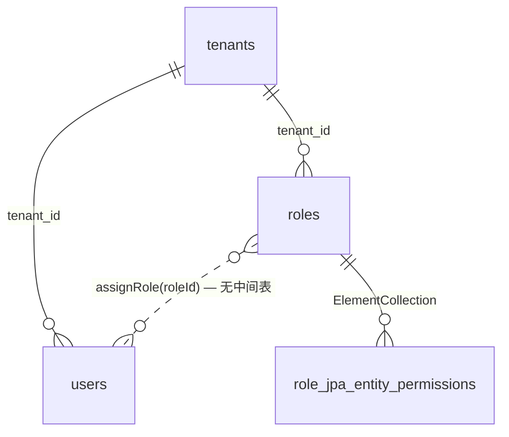
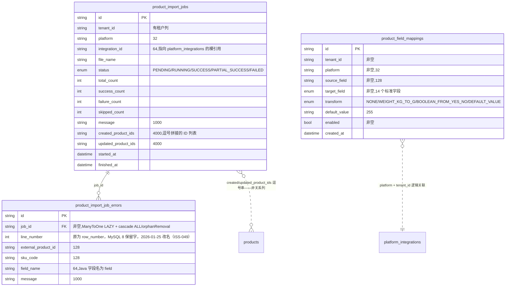
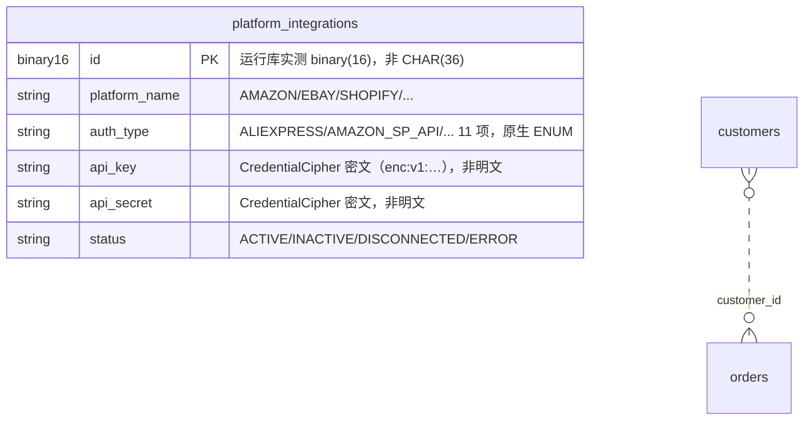
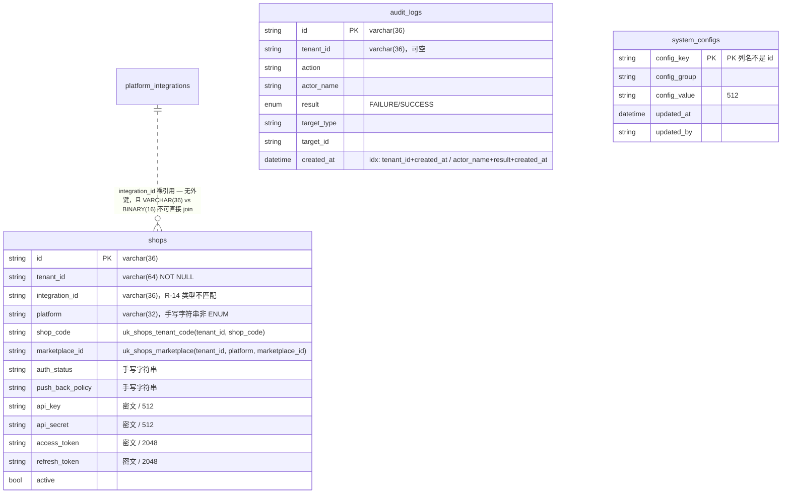

# 实体关系图（ER）

> 来源：`backend/src/main/java/.../infrastructure/persistence/jpa/entity/` 下 ~~**24 个 `@Entity`**（口径 2026-01-25；早期记录为 21，差的是商品导入新增的 3 张表，已补进 §5.1）~~ → 🔄 **2026-10-21 实测：43 个 `@Entity` / 43 个 `@Table`**（另有 2 张 `@ElementCollection` 集合表，合计 45 张运行时表）。旧口径 24 只覆盖了当时的实体子集，`shops`、`audit_logs`、`system_configs` 以及多套导入表都未计入；本次补登见 §7.1。
> 与 [schema.sql](./schema.sql) 一一对应；关系仅包含**代码里真实声明了 JPA 关联**的连线，
> 裸字符串引用（有语义无关联）用虚线标出，这类连线在数据库层面**不产生外键**。

图例：`||--o{` 一对多（JPA 关联，有外键）；`||--o|` 一对一；`..>` 逻辑引用（裸字符串列，无外键）。

## 1. 多租户 / 认证



- `users.tenant_id` / `roles.tenant_id` 为普通列，**未声明 @ManyToOne**，即无物理外键。
- ~~用户与角色的绑定通过 `POST /api/users/{id}/roles` 完成，但**数据库层没有 user_roles 关联表**（角色归属由领域对象持有）——这是当前 schema 的结构性缺口。~~ → 🔄 **2026-10-21 更正：该结论已过期**。`UserJpaEntity` 的 `@CollectionTable(name = "user_roles")` 把角色集合落成真实表（`user_roles`，复合主键 `user_id + role`），运行时库实测存在；`roles` 的权限集合同理落为 `role_jpa_entity_permissions`。下方 §8 原有更正条目保留，两处口径现已一致。

## 2. 订单上下文

```mermaid
erDiagram
    shipping_addresses ||--o| orders : "shipping_address_id"
    payment_infos      ||--o| orders : "payment_info_id"
    orders             ||--o{ order_items : "order_id (cascade ALL, orphanRemoval)"
    customers          ..> orders : "customer_id 裸引用"
    skus               ..> order_items : "sku_code 裸引用"
```

- 地址与支付是**值对象独立建表**，由 `orders` 单向 @OneToOne 持有（cascade=ALL + orphanRemoval），删订单即删地址行。
- `order_items` 是弱实体，生命周期完全依附 `orders`。

## 3. 物流上下文

```mermaid
erDiagram
    logistics_channels ||--o{ logistics_orders : "logistics_channel_id (nullable=false)"
    logistics_labels   ||--o| logistics_orders : "logistics_label_id (@OneToOne)"
    logistics_fees     ||--o| logistics_orders : "logistics_fee_id (@OneToOne)"
    orders             ..> logistics_orders : "order_id 裸引用"
```

## 4. 仓储上下文

```mermaid
erDiagram
    warehouses ||--o{ locations         : "warehouse_id (cascade ALL)"
    warehouses ||--o{ inventory_records : "warehouse_id (cascade ALL)"
    locations  ||--o{ inventory_records : "location_id"
    skus       ..> inventory_records : "sku_code 裸引用"
```

## 5. 产品上下文

```mermaid
erDiagram
    products ||--o{ skus : "product_id (cascade ALL, orphanRemoval)"
    categories ..|| products : "category_id / category_name — categories 表不存在"
```

- 分类只有 `category_id` + `category_name` 两个冗余列，**没有 categories 表**，`ProductCategory` 仅存在于领域层。

### 5.1 商品导入（product 上下文新增三表）



三处值得评审时盯住的设计选择（不是缺陷清单，是**建模决定**）：

- `product_import_job_errors` **无 `tenant_id`**，靠 `job_id`（`@ManyToOne` LAZY + `cascade=ALL`、`orphanRemoval=true`）间接归属。⚠️ 2026-01-25 更正：「全库唯一一张父表有租户列、子表没有」的说法不成立——6 张 `*_import_job_errors` 全是这个形状，`order_items`（父 `orders`）、`skus`（父 `products`）、`inventory_records`/`locations`（父 `warehouses`）、`purchase_order_items`（父 `purchase_orders`）同样由实体侧的 `@JoinColumn` 挂父；`payment_infos`/`shipping_addresses` 更弱，反向引用列在 `orders` 上（`OrderJpaEntity:55-61` 的 `@OneToOne`），子表既无租户列也无回指列。实测 ~~42 张表里 23 张有 `tenant_id`、19 张没有~~ → **2026-10-21：45 张表里 25 张有 `tenant_id`、20 张没有**。错误明细只落了 `line_number/external_product_id/sku_code/field_name/message` 五个定位字段，**没有保存原始行内容** → 失败行无法复盘到「平台到底返回了什么」。M3 租户列迁移时要显式决定补列还是记为例外，见 [migration-plan.md §7](./migration-plan.md)。
- `created_product_ids` / `updated_product_ids` 把「一次导入产出了哪些商品」存成 **4000 字符的逗号串**，而不是 `sync_job_items` 那样的明细表 → 无法按商品反查来源导入，且 4000 上限会截断。这是当前最可能变成返工点的一列。
- `product_field_mappings` 用 `(tenant_id, platform)` 组合唯一键 `uk_field_mappings_ref`，映射配置按租户+平台整体覆盖保存；`integration_id` 未落在映射表上，所以同一租户同一平台的多个店铺集成会共享一套映射。

## 6. 采购与财务

```mermaid
erDiagram
    purchase_orders ||--o{ purchase_order_items : "purchase_order_id (cascade ALL)"
    suppliers       ..|| purchase_orders : "supplier_id/supplier_name — suppliers 表不存在"
    warehouses      ..> purchase_orders : "warehouse_id 裸引用"
    skus            ..> purchase_order_items : "sku_code 裸引用"
    financial_transactions }o..o{ orders : "reference_id + reference_type 多态引用"
```

- `financial_transactions.reference_id` 是**多态外键**（配合 `reference_type` 指向 order / logistics / purchase），数据库层无法用外键约束保证完整性。

## 7. 平台集成 / 客户



- 🔄 **2026-10-21 更正**：`api_key` / `api_secret`（以及 `access_token` / `refresh_token`）**不再是明文**。写入经 `PlatformIntegrationRepositoryImpl:80-92` 的 `CredentialCipher` 加密（AES-256-GCM，`enc:v1:` 前缀），API 出参只给掩码与布尔标记。⚠️ 前提是注入 `platform.credential.master-key`（`application.yml:66`）；未注入时 `CredentialCipher:42-44` 只 WARN 后按明文读写，风险原样存在。

## 7.1 店铺 / 审计 / 系统配置（2026-10-21 补登）



- `shops` 与 `platform_integrations` 是 **ADR-0013 的两层拆分**：集成元信息（平台/凭据）与店铺（站点/市场/回写策略）分表；但 `shops.integration_id` 是裸字符串、无外键，且与 `platform_integrations.id` 的 `BINARY(16)` **类型不一致**，跨表按裸值 join 会失败（风险 R-14）。
- `audit_logs` 只增不改：没有 `updated_at`、没有软删除列，`result` 是原生 ENUM；当前实库 8181 行。`tenant_id` 可空，平台级操作无租户。
- `system_configs` 是平台级键值表，**无 `tenant_id`**；主键列名是 `config_key` 而非 `id`（R-11 的三个非 `id` 主键之一，另两个是 `purchase_orders.purchase_order_id`、`financial_transactions.transaction_id`）。当前 12 行。

## 8. 全局结构缺口汇总

| 缺口 | 影响 |
|---|---|
| 业务表无 `tenant_id` | ⚠️ 2026-01-25 实测更正：**42 张表中 23 张有该列、19 张没有**（含租户主体表 `tenants` 自身）。租户列已从 IAM 三表扩散到 orders / customers / products / logistics_orders / warehouses / platform_integrations / financial_transactions / **purchase_orders**（本次新增）及全部 `*_import_jobs`、`*_field_mappings`、`shop_warehouses`。**仍无列的**：`order_items`、`skus`、`inventory_records`、`locations`、`logistics_channels`、`logistics_fees`、`logistics_labels`、`payment_infos`、`shipping_addresses`、`purchase_order_items`、6 张 `*_import_job_errors`，外加 `user_roles`/`role_jpa_entity_permissions` 两张集合表。库层面仍无法对子表按租户约束。详见 [migration-plan.md M3](./migration-plan.md)。<br>🔄 **2026-10-21 复测：45 张表中 25 张有 `tenant_id`、20 张没有**（新增的 `shops`、`audit_logs` 带列，`system_configs` 不带）。仍无列的名单在旧句基础上**加 `system_configs`**；有列的 25 张里 20 张有以 `tenant_id` 打头的索引，缺索引的是 `users`/`roles`/`warehouses`/`platform_integrations`/`financial_transactions`（R-06）。 |
| `suppliers` / `categories` 表缺失 | 供应商、分类无主数据，只有名称快照 |
| ~~`user_roles` 关联表缺失~~ | ⚠️ 2026-01-25 更正：**已持久化**。`UserJpaEntity:65` 用 `@CollectionTable(name = "user_roles")` 把角色集合落成真实表，运行时库里确实存在；`RoleJpaEntity` 的权限集合同理落为 `role_jpa_entity_permissions`。原「不持久化」结论已过期 |
| 裸引用列无索引 | 部分已补：`logistics_orders.order_id`（`idx_logistics_orders_order`）、`orders.customer_id`（`idx_orders_customer`）现已有索引。**仍裸**：`order_items.sku_code`、`inventory_records.sku_code`、`financial_transactions.reference_id` 等，按其查询仍走全表扫描 |
| ~~全库无 `@Index`~~ | ⚠️ 2026-01-25 更正：**已有 27 个 `@Index` 声明**，分布在 18 个实体上（`OrderJpaEntity` 4、`LogisticsOrderJpaEntity`/`ProductJpaEntity` 各 3，其余 1/2 个；全部 `*_import_jobs`、`*_field_mappings` 都带租户索引）。运行时库里非主键索引 66 个（含唯一键隐含索引）。无索引的仍是 order_items/skus/inventory_records/locations/logistics_fees/logistics_labels/payment_infos/shipping_addresses/purchase_orders 等老表。<br>🔄 **2026-10-21 复测：21 个实体 / 34 处 `@Index`**（新增 `PurchaseOrderJpaEntity` 3、`ShopJpaEntity` 2、`AuditLogJpaEntity` 2），另有 12 个实体 / 14 处 `@UniqueConstraint`；运行时库**非主键索引 75 个**（按 `TABLE_NAME:INDEX_NAME` 去重，含唯一键隐含索引）。`purchase_orders` 已有 3 条索引，**应从"无索引"名单移除**；无索引的仍是 order_items/skus/inventory_records/locations/logistics_fees/logistics_labels/payment_infos/shipping_addresses。 |
| 无统一软删除列 | `active`（部分表）/ `status='DELETED'`（仅 customers）/ 物理删除 三种方式并存 |

详见 [data-dictionary.md](./data-dictionary.md) 风险清单 ~~R-01 ~ R-12~~ → **R-01 ~ R-14**（R-13 保留字撞名、R-14 跨表 ID 类型不一致）。
