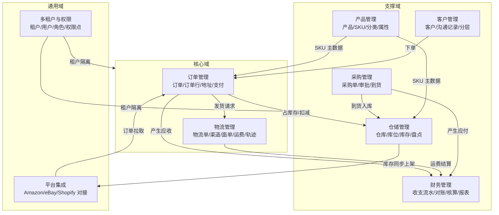

# 03 · 功能全景图与实现状态矩阵

> 本文件是 README「功能清单」的**落地版本**：逐条给出**真实实现状态**与代码证据，用于版本计划、演示范围确认与上线风险评估。
> 状态含义：✅ 已实现（端到端可用）｜🟡 部分实现（骨架在、闭环缺）｜⚪ 未实现（仅规划）
> 核对日期：2026-01-25，代码基线 `main@bfbce09`。

---

## 1. 功能全景图

**数据流转主线**：平台集成 → 订单 → （库存、物流）→ 财务；产品/客户是主数据；采购补库存；租户与权限横切。

---

## 2. 功能清单矩阵

> 「证据」列给出判断依据：🖥 = 前端页面文件，🔌 = 后端 REST 端点，🧩 = 领域层代码。

### 2.1 订单管理（核心域）

| # | 功能点（对齐 README） | 状态 | 证据 | 说明 |
|---|---|---|---|---|
| 1.1 | 订单列表 | 🟡 | ~~🔌 无全量列表端点；仅有 `GET /api/orders/{id}`、`GET /api/orders/customer/{customerId}`~~ → ✅ **列表端点已补**：`GET /api/orders`（`OrderController.java:63-81`，`searchOrders`），参数 `:66-76` = `tenantId`/`orderNumber`(模糊)/`customerId`/`customerName`(模糊)/`status`/`platform`/`keyword`/`startDate`/`endDate`/`page`/`size`，返回 `PageResult`；🖥 `pages/order/OrderList.jsx`（已联网） | ~~后端缺列表+分页+筛选，前端读页面内 mock 数组~~ → 两点都已不成立。 ⚠️ 但列表查询**不带租户过滤**（ISS-050），且 `tenantId` 可省略时回落 `default-tenant`（ISS-051） |
| 1.2 | 订单详情 | 🟡 | 🔌 `GET /api/orders/{id}`；🖥 `pages/order/OrderDetail.jsx` | ~~接口可用，但前端详情页是写死的 `mockOrder`~~ → 2026-01-25 逐页复测（判据：页面里是否有 `*Api.` 调用点）：`OrderDetail.jsx` 已有 4 个 `orderApi.*` 调用点，mock 数组已删；仍受 ISS-050 影响（详情按 ID 取，不校验归属租户） |
| 1.3 | 创建订单 | 🟡 | 🔌 `POST /api/orders`；🧩 `OrderProcessingService.createOrder`；🖥 `CreateOrder.jsx` | 链路通畅且含金额校验，**但创建后列表页查不到**（无列表接口） |
| 1.4 | 订单状态变更 | 🟡 | 🔌 `PUT /api/orders/{id}/status`；🧩 `updateStatus` + 领域事件 | 领域侧有流转约束（发货必须 processing、完成必须 shipped），但接口层无退款/退货等扩展状态。 🔄 **2026-10-07：发货联动库存已打通（BR-04）**——首次迁移到 SHIPPED 时按订单行逐行扣减出库仓库存（取租户下第一个仓库；缺货/无仓库则异常整体回滚），`OrderApplicationServiceTest` 5 例覆盖 |
| 1.5 | 订单取消 | 🟡 | 🧩 `cancelOrder`（禁止取消已发货/已完成）；🔌 通过统一状态接口改 `cancelled` | 无独立取消端点、无取消原因、无库存回滚联动 |
| 1.6 | 订单同步（与电商平台） | 🟡 | ~~🧩 `OrderSyncService.syncOrdersFromPlatform` 为 `System.out.println` 桩；🔌 `POST /api/platform-integrations/{id}/sync-orders` 为空逻辑~~ → **2026-03-08 复测：该类已不存在，链路已真实**🔌 `POST /api/platform-integrations/{id}/sync-orders` → `OrderImportApplicationService.syncFromPlatform` → `PlatformFetcherRegistry` 按**认证协议**分派（`SHOPIFY` 走官方 Admin REST：`X-Shopify-Access-Token` + `Link`/`page_info` 游标 + 429 退避；`CUSTOM_SHOP` 走 `GET {storeUrl}/orders` + `X-API-Key/Secret`；`useSampleData=true` 走示例数据）→ 字段映射 → 落 `orders` + `order_import_jobs`/`_errors`。 ⚠️ **仍缺三件事**：① **无定时任务**（只能人工触发，`R-204`）；② 增量窗口 `updatedFrom`/`updatedTo` 由**调用方每次传入**，`last_orders_synced_at` 只是展示用时间戳、**不是持久化游标**（`PlatformIntegrationApplicationService.java:119-125`）；③ **未经真实平台验证**——无沙箱凭据，全部证据是本地 fixture 契约测试（**ISS-064**，P0）。 ✅ 幂等**已实现**（不是缺口）：`OrderImportApplicationService.java:153-154` 的 `updateExisting`/`enableIdempotency` 默认 `true`，`:348` 按已存在订单去重后跳过或更新 |
| 1.7 | 订单导出/打印 | ⚪ | 无 | 未实现 |

### 2.2 物流管理（核心域）

| # | 功能点 | 状态 | 证据 | 说明 |
|---|---|---|---|---|
| 2.1 | 物流单列表 | 🟡 | 🔌 `GET /api/logistics`；🖥 `pages/logistics/LogisticsList.jsx`~~（mock）~~ | ~~接口是全量返回，无分页/条件筛选~~ → **已改为分页检索**：`LogisticsController.java:73-90+` 返回 `PageResult<LogisticsOrderDto>`，支持 `trackingNumber`/`orderId`/`channelId`(或渠道编码)/`status`/`keyword`/`startDate`/`endDate`/分页；2026-01-25 逐页复测（判据：页面里是否有 `*Api.` 调用点） 该页有 6 个 `*Api.` 调用点 |
| 2.2 | 物流单详情 | 🟡 | 🔌 `GET /api/logistics/{id}`、`GET /api/logistics/order/{orderId}`；🖥 `LogisticsDetail.jsx`~~（mock）~~ | 2026-01-25 逐页复测（判据：页面里是否有 `*Api.` 调用点）：8 个调用点，已联网。⚠️ 状态流转仍只挡终态回退、中间态可乱跳（ISS-005） |
| 2.3 | 创建物流单 | ~~🟡~~ → 🟢 | 🔌 `POST /api/logistics`（`@RequestBody CreateLogisticsRequest`）；🧩 `LogisticsOrderProcessingService`；🖥 `CreateLogistics.jsx` ~~仅弹窗提示~~ | ~~前端页面提交了也不发请求~~ → 🔄 **2026-03-22 复测：已真实发请求**（`:87` `logisticsApi.createLogistics` → `:96` 跳详情），并会先拉渠道（`:47`）与按订单号定位订单（`:64`） |
| 2.4 | 物流状态跟踪 | 🟡 | 🔌 `PUT /api/logistics/{id}/status`；🧩 `LogisticsTrackingService`；8 态枚举齐全 | 只存**当前状态**，~~无轨迹明细~~ → 🔄 **2026-03-22 复测：轨迹明细已经有了**，但形式不是轨迹表——`LogisticsOrder:49` `List<LogisticsTrace> traces` 序列化成 `logistics_orders.tracking_traces` 单列（`LogisticsOrderJpaEntity:90` `length=4000`，`LogisticsOrderMapper:64/94` JSON 往返），聚合内 `:324-330` **满 100 条从头截断**；端点 `POST /{id}/track`（刷新）、`POST /{id}/traces`（追加）、`GET /statuses`（字典）。⚠️ `track` 是**本地追加**而非承运商回传，且超长轨迹会静默丢历史 |
| 2.5 | 物流渠道管理 | ~~⚪~~ → 🟢 | 🧩 `LogisticsChannel` + `LogisticsChannelRepository` + `logistics_channels` 表；🔌 ~~**无 REST 端点**~~ → 🔄 **2026-03-22：`LogisticsChannelController` 6 个端点**（list/detail/create/update/status/delete，`:45,:57,:65,:77,:100,:108`）；🖥 `pages/logistics/LogisticsChannels.jsx` | ~~渠道数据在代码里是"孤儿聚合"，前端无法维护~~ → 🔄 **孤儿状态已解除**；⚠️ 残留：list 是 `Result<List<…>>` **全量无分页**（M-07）、该控制器**无方法级鉴权**（M-06） |
| 2.6 | 物流标签/面单生成 | ~~🟡~~ → 🟡（判据换档） | 🧩 `LogisticsLabel`（含 barcode/trackingNumber）；🔌 ~~无专用端点~~ → 🔄 **`POST /api/logistics/{id}/label`**（`LogisticsController:138`，`LogisticsApplicationService:171-187`）；🖥 `LogisticsDetail.jsx:167`、`LogisticsList.jsx:220` 两个按钮 | ~~生成逻辑是桩，`label_data` 无真实面单内容~~ → 🔄 **端点真实但内容仍是半桩**：`generateLabel` 组装 `trackingNumber` + `buildRecipientInfo(order)` + **空 `PackageInfo`** + `labelFormat("PDF")` 后落库并发 `LogisticsLabelGeneratedEvent`；**没有 PDF 字节流、没有条码渲染、没有渠道回传**，所以"打印"这一步在业务上仍不可交付。⚠️ 该事件因 ISS-062（发布的是 `save()` 副本）实际到不了发布器 |
| 2.7 | 运费自动计算 | ~~🟡~~ → 🟡 | 🧩 `PriceRule` / `LogisticsFee`（基础价 + 重量价）；`logistics_fees` 表；🔌 🔄 **2026-03-22：`GET /api/logistics-channels/{id}/fee?weight=&country=`**（`LogisticsChannelController:115-116`）；🖥 `LogisticsChannels.jsx:131` | ~~规则存在，但未与渠道/分区/国家关联，无法实时试算比价~~ → 🔄 **单渠道实时试算已打通（渠道 + 重量 + 国家三个入参）**；**仍缺的是"比价"**：没有跨渠道批量算价/择优的端点。⚠️ 新缺陷：出参直接返回 `LogisticsFee` **值对象**（ISS-063 契约泄漏，物流域唯一一处） |

### 2.3 仓储管理（支撑域）

| # | 功能点 | 状态 | 证据 | 说明 |
|---|---|---|---|---|
| 3.1 | 仓库列表 | 🟡 | 🔌 `GET /api/warehouses`；🖥 `WarehouseList.jsx`~~（mock）~~ | 无分页、无启用/停用筛选 —— **2026-01-25 逐页复测（判据：页面里是否有 `*Api.` 调用点）：2 个调用点，前端已联网**，但**后端这一条仍然成立**：~~`WarehouseController.java:98-101` 是 `Result<List<Warehouse>>` 全量返回~~ → 🔄 **2026-10-07 已改分页 + 租户过滤**：`GET /api/warehouses` 支持 `tenantId/page/size`，返回 `PageResult<Warehouse>`，tenantId 缺省取 JWT 上下文租户（ISS-050 仓库段修复）；前端 `WarehouseList`/`CreatePurchase`/`ShopWarehouseSync` 已适配。 ⚠️ 并且它**直接把聚合 `Warehouse` 当响应体**（连带 `domainEvents` 字段），即 ISS-063 |
| 3.2 | 仓库详情 | 🟡 | 🔌 `GET /api/warehouses/{id}`；🖥 `WarehouseDetail.jsx`~~（mock）~~ | 2026-01-25 逐页复测（判据：页面里是否有 `*Api.` 调用点）：9 个调用点，已联网。响应体同样是聚合（ISS-063） |
| 3.3 | 创建仓库 | 🟡 | 🔌 `POST /api/warehouses`；🖥 `CreateWarehouse.jsx` 仅提示 | 前端未联网 |
| 3.4 | 库存管理（台账查询） | 🟡 | 🔌 `GET /api/warehouses/{warehouseId}/inventory`；🧩 `InventoryRecord` | 只能按仓库看，无按 SKU 全仓汇总、无可用/锁定库存区分 |
| 3.5 | 入库管理 | ~~⚪~~ → ✅ | 🧩 枚举 + code 都在；🔌 `POST /api/warehouses/{warehouseId}/inventory/in`（`WarehouseController:151-158`）；🖥 `WarehouseDetail.jsx:134-161` 出入库弹窗（`:147` 调 `warehouseApi.inventoryIn`） | 🔄 2026-03-22 复测：前后端都通了，且采购到货会自动入库（`PurchaseApplicationService:288`）。⚠️ 仍无入库单/收货任务实体，`locationId` 恒 null（`WarehouseApplicationService:118`），无变动流水表 |
| 3.6 | 出库（扣减）管理 | ~~⚪~~ → 🟡 | 🔌 `POST /api/warehouses/{warehouseId}/inventory/out`（`:161-168`）＋🖥 同弹窗（`WarehouseDetail.jsx:150`）；数量不足由 `InventoryManagementService:72-73` 抛 `InvalidOperationException` → 400 | 🔄 2026-03-22：**「没有出库能力」已不成立，断点换位到「没人调」**——`outboundInventory` 主源码调用点只有仓储自身（`inventoryOut` + `moveInventory`/`transferInventory`），订单发货/取消 0 命中 ⇒ 仍是核心闭环断点，但要补的是联动而不是接口 → 🔄 **2026-10-07 闭环已打通（BR-04）**：`OrderApplicationService.updateOrderStatus` 首次迁移到 SHIPPED 时逐行调 `inventoryOut` 扣减出库仓库存（同事务，缺货整体回滚）；取消仅允许发货前、无需回滚 |
| 3.7 | 库存调拨/移动 | ~~❌~~ → 🟡 | ~~`WarehouseApplicationService:177` 抛 `UnsupportedOperationException`~~ → 🔄 2026-03-22 复测：全仓 `UnsupportedOperationException` **0 处**；`moveInventory:201-232` 四类分派，`TRANSFER` 走 `transferInventory:237-252`（源仓出 `:249` ＋ 目标仓入 `:250-251`，同一事务）。HTTP 可达性也已证实：`InventoryMovement:39` 有 `@JsonCreator`，`WarehouseControllerTest:182-213` 真实 JSON body 断 200，`docs/qa/smoke-test-checklist.md` 4.5 实测 A=45/B=10 | **接口能用了**，演示不必避开；但**前端没有调拨入口**（`warehouseApi.moveInventory` 在 `api.js:297` 有定义、逐页 grep 0 调用），且双写无服务层测试、无流水留痕 |
| 3.8 | 库位管理 | ~~⚪~~ → 🟡 | 🧩 `Location` + `locations` 表；🔌 `POST /api/warehouses/{id}/locations`（`:135-141`）；🖥 `WarehouseDetail.jsx:117-131` 添加库位弹窗 | 🔄 2026-03-22：「无法维护」已不成立，**新增闭环打通**（聚合内查重 `WarehouseManagementService:98-103`）；仍缺 查/改/删 端点，且库位不参与出入库（库存表 `location_id` 实测全为可空列、写入路径恒 null） |
| 3.9 | 库存盘点 | 🟡 | 🔌 `POST /api/warehouses/{warehouseId}/inventory/count`；🧩 `InventoryCountService` | 无盘点单、无差异表、无审批 |
| 3.10 | 缺货/低库存预警 | 🟡（口径细化） | 🧩 `InventoryStatus.SHORTAGE / OUT_OF_STOCK`；🔄 2026-03-22：**状态是自动算的**（`InventoryRecord.calculateInventoryStatus:47-57`，`<10` 判不足、`>100` 判过剩、`<=0` 判缺货，三个改数量方法都在 `:67/:79/:90` 回写状态），`Warehouse.updateInventory:234-244` 还会据此注册 `InventoryShortageEvent` | 「只有状态值」不再准确——**判定与事件注册都有，缺的是发布与配置**：阈值 10/100 硬编码（无 `safety_stock` 列），且出入库路径不调发布器（`WarehouseApplicationService` 的 `publishDomainEvents` 只在 `:45/:55/:102`）⇒ 无主动通知，两条消费者（`EventHandler:92`、`InventoryShortageEventConsumer`）空转（ISS-062）→ 🔄 **2026-10-07 发布链已通**：出入库/调拨/盘点路径均补 `publishDomainEvents`，事件载荷补 `tenantId`（自动建采购单不再落死默认租户）；仍缺阈值配置化（10/100 硬编码） |

### 2.4 产品管理（支撑域）

| # | 功能点 | 状态 | 证据 | 说明 |
|---|---|---|---|---|
| 4.1 | 产品列表 | ~~⚪~~ → 🟡 | ~~🔌 仅 `GET /api/products/{id}`、`GET /api/products/sku/{skuCode}`；无列表/分页/search~~ → ✅ **列表端点已补**：`GET /api/products`（`ProductController.java:54`），支持 `tenantId`/`keyword`(匹配商品名/描述/SKU 编码)/分页；2026-01-25 逐页复测（判据：页面里是否有 `*Api.` 调用点）：`ProductList.jsx` 6 个调用点、`ProductForm.jsx` 3 个（`CreateProduct.jsx`/`EditProduct.jsx` 是它的薄包装，本身无调用点属正常）|
| 4.2 | 产品详情 | 🟡 | 🔌 `GET /api/products/{id}`；🖥 `ProductDetail.jsx`~~（mock）~~ | 2026-01-25 逐页复测（判据：页面里是否有 `*Api.` 调用点）：5 个调用点，已联网 |
| 4.3 | 创建产品 | 🟡 | 🔌 `POST /api/products`；🧩 `ProductManagementService`；🖥 `CreateProduct.jsx` 仅提示 | — |
| 4.4 | 产品上下架 | 🟡 | 🔌 `PUT /{id}/activate`、`PUT /{id}/deactivate` | 无上架状态的批量操作与时间维度 |
| 4.5 | 产品分类 | ⚪ | 🧩 `ProductCategory` 领域对象存在；**无 `categories` 表、无端点**；`products.category_id` 为 `ProductApplicationService` 现场 UUID | 分类树不可用 |
| 4.6 | SKU 管理 | 🟡 | 🧩 `SKU` + `skus` 表随 `products` 级联；🔌 无独立 SKU 端点 | SKU 只能随创建产品带出 |
| 4.7 | 产品属性管理 | ⚪ | 🧩 `ProductAttribute` 值对象，**未持久化** | 属性/变体维度缺失 |
| 4.8 | 产品图片/多语言文案 | ⚪ | 无 | 跨境场景必需，尚未规划进 schema |

### 2.5 采购管理（支撑域）

| # | 功能点 | 状态 | 证据 | 说明 |
|---|---|---|---|---|
| 5.1 | 采购单列表 | 🟡 | 🔌 `GET /api/purchases`（支持 `?status=`）；🖥 `PurchaseList.jsx`~~（mock）~~ | 无分页。**2026-01-25 逐页复测（判据：页面里是否有 `*Api.` 调用点）**：已去 mock（`PurchaseList.jsx:5` 引 `purchaseApi`、`:78` 调 `getPurchaseOrders(params.status)`），ISS-015/016 收尾。⚠️ 该页目前**只有状态一个筛选**，且创建采购单的接口带 `@RequestParam(defaultValue = "default-tenant")`，非种子租户下会被切面拒（ISS-002 残留 / ISS-051） |
| 5.2 | 采购单详情 | 🟡 | 🔌 `GET /api/purchases/{purchaseOrderId}`；🖥 `PurchaseDetail.jsx`~~（mock）~~ | 2026-01-25 逐页复测（判据：页面里是否有 `*Api.` 调用点）：7 个调用点，approve/reject/in-transit/delivered/cancel 与"加采购项"全部接真接口，并按状态显示按钮（配合 ISS-006 的前置校验）。⚠️ 后端仍**没有 `PurchaseStatus.canTransitionTo` 全量迁移表**，非取消类流转靠零散判断（ISS-006 未完成部分）；`Result<PurchaseOrder>`×8 是聚合外露（ISS-063） |
| 5.3 | 创建采购单 | 🟡 | 🔌 `POST /api/purchases`；🧩 `PurchaseOrderService`；🖥 `CreatePurchase.jsx` 仅提示 | — |
| 5.4 | 采购明细行维护 | 🟡 | 🔌 `POST /api/purchases/{id}/items` | 无修改/删除明细 |
| 5.5 | 采购审批 | ✅ | 🔌 `PUT .../approve`、`PUT .../reject`；🧩 `PurchaseStatus` 六态 + 谓词方法 | **本模块最完整的能力**：状态机与 API 齐备 |
| 5.6 | 采购到货/入库 | ~~🟡~~ → ✅ **2026-03-22** | 🔌 `PUT .../in-transit`、`PUT .../delivered` | ~~支持状态推进，但**到货不联动库存增加**，与仓储无集成~~ → 🔄 状态推进 + **到货同事务联动仓储与财务**（逐明细行 `inventoryIn` 加库存、再写一笔 `EXPENSE`/`reference_type=PURCHASE_ORDER` 采购应付；`PurchaseApplicationService.java:256-262`、`:281-293`、`:299-310`，测试 `PurchaseApplicationServiceTest:74-113`）。⚠️ 剩余边界：没有「待入库任务/收货单」中间层，不能分批收货与质检，库位不参与（`locationId` 传 null） |
| 5.7 | 供应商管理 | ⚪ | 仅有 `supplier_id` / `supplier_name` 快照字段，无供应商主数据 | — |
| 5.8 | 取消采购 | 🟡 | 🔌 `PUT .../cancel` | — |

### 2.6 财务管理（支撑域）

| # | 功能点 | 状态 | 证据 | 说明 |
|---|---|---|---|---|
| 6.1 | 财务流水列表 | 🟡 | 🔌 `GET /api/finance/transactions/by-status`、`/by-type`、`/by-reference`；🖥 `FinanceList.jsx`~~（mock）~~ | ~~**无全量列表/分页/时间区间**~~ → **全量分页列表已补**：`GET /api/finance/transactions`（`FinanceController.java:79`，`page` 默认 0 / `size` 默认 20），2026-01-25 逐页复测（判据：页面里是否有 `*Api.` 调用点） 该页 1 个调用点。仍无"日记账"视图 |
| 6.2 | 财务流水详情 | 🟡 | 🔌 `GET /api/finance/transactions/{transactionId}`；🖥 `FinanceDetail.jsx`~~（mock）~~ | 2026-01-25 逐页复测（判据：页面里是否有 `*Api.` 调用点）：2 个调用点，已联网。⚠️ 该域是**唯一权限点被真正检查**的读域（`finance:read`/`finance:write` 共 9 处 `@PreAuthorize`），而其余 12 个 `:read`/`:write` 点没人检查 |
| 6.3 | 创建流水 | 🟡 | 🔌 `POST /api/finance/transactions?type=`；🖥 `CreateFinance.jsx` 仅提示 | 手工录入，非自动生成 |
| 6.4 | 流水状态流转 | ✅ | 🔌 `PUT .../complete`、`/fail`、`/cancel`；🧩 `TransactionStatus` 四态 | 完整 |
| 6.5 | 订单对账 | ⚪ | 无对账实体/接口 | 仅能靠 `by-reference` 按单据查询流水，**不具备对账能力** |
| 6.6 | 费用核算（自动） | ⚪ | 运费计算规则在物流域；财务无自动核算引擎 | 无法按订单归集成本算毛利 |
| 6.7 | 报表生成 | ⚪ | 无报表/导出 | 无利润表、无应收应付账龄表、无 Excel/CSV 导出 |

### 2.7 客户管理（支撑域）

| # | 功能点 | 状态 | 证据 | 说明 |
|---|---|---|---|---|
| 7.1 | 客户列表 | ⚪ | 🔌 仅 `POST /api/customers`、`GET /{id}`、`DELETE /{id}` → **无列表端点** | 客户模块是全系统最薄弱的一环 |
| 7.2 | 客户详情 | 🟡 | 🔌 `GET /api/customers/{id}`；🖥 `CustomerDetail.jsx`~~（mock）~~ | 2026-01-25 逐页复测（判据：页面里是否有 `*Api.` 调用点）：4 个调用点，已联网；`CustomerList.jsx` 也已接 `GET /api/customers`（`CustomerController.java:51`，带筛选+分页） |
| 7.3 | 创建客户 | 🟡 | 🔌 `POST /api/customers`；🖥 `CreateCustomer.jsx` 仅提示 | — |
| 7.4 | 客户沟通记录 | ⚪ | 无 `Communication` 实体/表/接口 | README 已列需求，未实现 |
| 7.5 | 客户分类/分层 | ⚪ | 无标签/分组实体与接口 | 未实现 |

### 2.8 平台集成（通用域）

| # | 功能点 | 状态 | 证据 | 说明 |
|---|---|---|---|---|
| 8.1 | 平台集成列表 | 🟡 | 🔌 `GET /api/platform-integrations`；🖥 `PlatformIntegration.jsx`~~（mock）~~ | 2026-01-25 逐页复测（判据：页面里是否有 `*Api.` 调用点）：`PlatformIntegration.jsx:50` 调 `platformIntegrationApi.getIntegrations()`，`CreatePlatformIntegration.jsx:21,30` 调 create+activate，已联网 |
| 8.2 | 平台集成详情 | 🟡 | 🔌 `GET /{id}`；🖥 `PlatformIntegrationDetail.jsx`~~（mock）~~ | 2026-01-25 逐页复测（判据：页面里是否有 `*Api.` 调用点）：6 个调用点（`:34` 详情、`:50/:52` 停用/启用、`:64/:79/:94` 手工触发 `syncProducts`/`syncCustomers`/`syncLogistics`），已联网。**会把 `apiSecret` 明文返回给前端**（ISS-011，本轮按边界不修）**仍然成立** |
| 8.3 | 创建/维护集成 | 🟡 | 🔌 `POST`、`PUT`、`DELETE` | — |
| 8.4 | 启用/停用 | 🟡 | 🔌 `POST /{id}/activate`、`/deactivate` | — |
| 8.5 | 与 Amazon / eBay / Shopify 对接 | ⚪ | 🧩 `PlatformName` 枚举（AMAZON/EBAY/SHOPIFY/ALIEXPRESS/WISH/MAGENTO/OTHER） | 仅枚举，无任何 API 客户端、OAuth 授权、限流重试 |
| 8.6 | 订单自动同步 | ⚪ | 🔌 `POST /{id}/sync-orders` → 空逻辑桩 | 无定时调度（无 Quartz/XXL-Job/Spring Scheduler 实现） |
| 8.7 | 商品库存同步至平台 | ⚪ | 🔌 `POST /{id}/sync-products`、`/sync-inventory` → 桩 | — |

### 2.9 多租户与权限（通用域，README 未单列但已实现）

| # | 功能点 | 状态 | 证据 | 说明 |
|---|---|---|---|---|
| 9.1 | 租户管理（CRUD + 停用/启用） | 🟡 | 🔌 `/api/tenants/**` 共 9 个端点；🖥 `pages/tenant/*` 已联网 | 端到端可跑，~~但**租户隔离切面未生效** → 数据实际未隔离~~ → 🟡 **2026-01-25 复测：切面已生效**（写路径入参校验，见 9.5），`/api/tenants/**` 由 `SecurityConfig:66` 的 `hasRole('PLATFORM_ADMIN')` 路径规则保护，`admin` 实测 200（ISS-061 修复前恒 403）。 ❌ "数据实际未隔离"**对读路径仍成立**（ISS-050）；停用/启用租户与其成员登录**仍无联动**（BR-10 ❌） |
| 9.2 | 用户管理 | 🟡 | 🔌 `/api/users/**` 共 11 个端点；🖥 `pages/user/*` 已联网 | ~~同上；`UserList.jsx` 硬编码 `tenantId='current-tenant-id'`~~ → **2026-01-25 已修**：全仓 `current-tenant-id` 字面量 **0 处**，`UserList.jsx:23` 改为 `currentUser?.tenantId \|\| localStorage.getItem('tenantId') \|\| ''`（取自 `AuthContext`）。 ❌ 残留：`UserController:31` 只有类级 `hasRole('PLATFORM_ADMIN') or hasAuthority('user:manage')`，**没有"只能改自己"的自身校验**（任何持 `user:manage` 者可对任意 id 改密，见 [tech/security-design.md §5](../tech/security-design.md)） |
| 9.3 | 角色与权限点 | 🟡 | 🔌 `/api/roles/**` 共 10 个端点；`roles` + `role_jpa_entity_permissions` 表 | 权限点为自由字符串，无字典、无菜单级绑定。 🔎 **2026-01-25 量化**：库里 PLATFORM_ADMIN 有 **22** 个权限点，代码 `hasAuthority()` 只检查其中 **10** 个；`Role.hasPermission()`（`domain/tenant/entity/Role.java:131`）**调用点 0** → **按钮级权限不存在** |
| 9.4 | 登录 / JWT | 🟡 | 🔌 `POST /api/auth/login`；🖥 `Login.jsx` 已联网 | ~~**JWT 校验恒通过**（桩），详见已知缺陷 P0~~ → ✅ **2026-01-25 已修**（ISS-007/ISS-041）：`validateToken` = `parseClaims(token) != null`（真验签 + 过期），令牌写 4 个 claim（username/tenantId/roles/permissions）并由过滤器还原 authorities，`admin` 实测 `GET /api/tenants` **200**。 ❌ 残留：拒绝是 **403 + 空 body、无 401 出口**（ISS-032/058）；`refresh` 未校验旧 refresh token；无 `clockSkew` |
| 9.5 | 租户数据隔离 | 🟡 | ~~`TenantIsolationAspect` 逻辑被注释；仅 2 张表（`users`/`roles`）带 `tenant_id`，其余 19 张无~~ → **2026-01-25 复测**：切面**已生效**（`TenantIsolationAspect:55-86`，不一致抛 `TENANT_ACCESS_DENIED`，`PLATFORM_ADMIN` 放行）；`tenant_id` 扩到运行时 **23/42 张表**（本轮补 `purchase_orders`）| 生产可用性阻断项——**但阻断点换了**：读路径不过滤（**ISS-050**，全仓没有一条查询从 `TenantContext` 取值），租户仍由客户端传参决定 + 10 个 `DEFAULT_TENANT_ID` 常量兜底（**ISS-051**） |

### 2.10 首页与看板

| # | 功能点 | 状态 | 证据 | 说明 |
|---|---|---|---|---|
| 10.1 | 首页统计卡片 | ⚪ | 🖥 `pages/home/Home.jsx:36-38` 写死 1250/150/320 | 无任何后端统计接口 |
| 10.2 | 待办/异常提醒 | ⚪ | 无 | — |
| 10.3 | 管理端平台仪表盘 | ⚪ | 🖥 `admin-web/pages/platform/PlatformDashboard.jsx`（mock） | 数据写死。**2026-01-25 逐页复测（判据：页面里是否有 `*Api.` 调用点） 仍成立**，且这不是孤例：admin-web 5 页里 `platform/PlatformDashboard.jsx`+`platform/SystemConfig.jsx`（有 import、0 个调用点）为假，`Login`/`tenant/TenantList`/`user/UserList` 为真（3 真 2 假）；user-web 45 页里仅 `home/Home.jsx` + `platform/PlatformDashboard.jsx` + `platform/SystemConfig.jsx` 为假 |

---

## 3. 端到端可用性分级

按"角色能否真正用它完成一件工作"重新分级：

| 级别 | 定义 | 涉及的模块/链路 |
|---|---|---|
| **A｜可端到端使用** | 页面 → 真实 API → 数据库，且业务语义正确 | 登录、租户管理、用户管理、角色管理、创建订单（创建动作本身） |
| **B｜可演示不可使用** | UI 完整、数据为假；或接口通但用户看不到结果 | 订单/物流/产品/仓储/客户/财务/采购/平台集成 8 个模块的列表与详情页；采购审批（接口可用但前端未接） |
| **C｜接口存在但会失败** | 调用即异常 | 库存转移 `POST /warehouses/{id}/inventory/move` |
| **D｜完全缺失** | 需新开发 | 列表查询与分页、对账、报表导出、出入库、缺货预警、沟通记录、分类树、平台真实对接 |

> **结论**：当前对外只能宣称 **A 级能力 + B 级演示能力**。任何"库存/财务/物流可行性"的表述都需要谨慎。

---

## 4. 缺口 Top 10（按对"能否用起来"的影响排序）

| 排名 | 缺口 | 影响面 | 关联模块 | 建议版本 |
|---|---|---|---|---|
| ~~1~~ | ~~无列表/分页/条件查询（订单、产品、财务、客户）~~ → 2026-01-25 复测：订单/商品/财务/客户/物流**五个域的分页检索端点都已补齐**，只剩**仓库**（`WarehouseController:98-101` 全量）与**采购**（只有 `?status=`）两个域没有 | ~~8 个模块列表页只能 mock，前端无法去 mock~~ → **已去 mock**：45 个 user-web 页面里 42 个有真实 `*Api.` 调用点 | 全域 | ~~v0.1~~ → 仓库/采购列表分页并入 v0.2 |
| 2 | 鉴权与租户隔离不生效（JWT 恒通过、切面未生效） | 阻断生产可用性 | IAM | v0.1 |
| 3 | 前后端未打通（`services/api.js` 中 8 个业务 API 是空对象） | 演示只能看假数据 | 全域 | v0.1 |
| 4 | 订单↔库存↔物流↔财务 四条联动全部缺失 | 业务流程不闭环 | 核心域 | v0.2 |
| 5 | 出入库/调拨无可用实现 | 仓库无法作业 | 仓储 | v0.2 |
| 6 | 无平台真实对接与定时同步 | 产品核心价值落空 | 平台集成 | v0.2 |
| 7 | 无报表导出（CSV/Excel） | 财务与运营无法离案作业 | 全域 | v0.2 |
| 8 | 物流渠道无维护端点、无轨迹明细 | 物流模块不可运维 | 物流 | v0.2 |
| 9 | 客户无列表、无沟通记录 | 客服场景完全缺失 | 客户 | v0.3 |
| 10 | 分类树 / 产品属性 / 供应商主数据缺失 | 主数据不完整 | 产品、采购 | v0.3 |

---

## 5. 与 README 的差异说明

README 中「已完成的功能」写到"完整的路由配置、所有模块的列表页/详情页/创建页、模拟数据支持"，这一表述**在页面层面成立**，但容易被误读为功能已完成。本文件给出的 🟡/⚪ 判定是对它的精确化：

- 页面存在 ≠ 功能可用（依赖 mock）；
- ~~接口存在 ≠ 业务正确（存在桩与 `UnsupportedOperationException`）；~~ → 🔄 2026-03-22 复测：`UnsupportedOperationException` 全仓 **0 处**（2026-01-25 起，ISS-012），这条教训的载体换成了另外两种形态——**接口存在但没人调**（订单发货不扣库存 BR-04；调拨有 API 无前端入口）与**注册了事件却从不发布**（仓储三个事件，ISS-062 → 🔄 **2026-10-07 已修**：根因是仓储 `save()` 重建聚合副本把 `domainEvents` 清空，应用服务对副本发布 = 发布空列表；修复为 `BaseAggregateRoot.carryOverEvents` 在 save 后把事件搬回副本，订单/物流/仓库/客户/平台集成五个仓储实现统一接入，库存领域服务改为返回仓库聚合供应用服务发布）。原则不变：判断可用性要看调用点与发布点，不能只看端点与 `registerDomainEvent` 在不在；
- 领域模型存在 ≠ 用户可用（物流渠道、库位、产品属性无 REST 入口）。

建议在对外材料统一引用本文件的状态矩阵，避免版本能力被高估。
