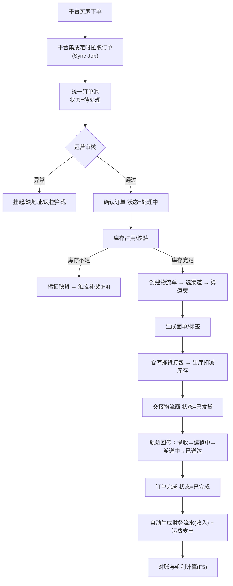
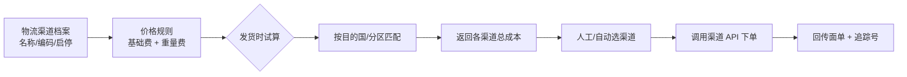
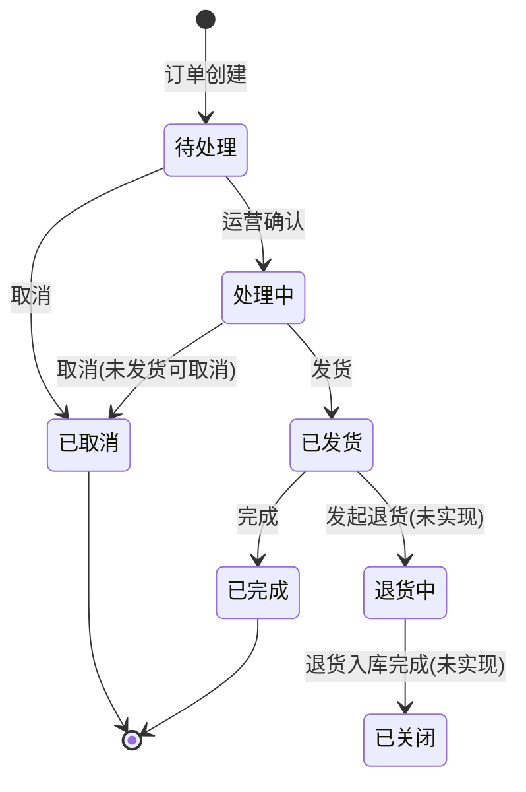
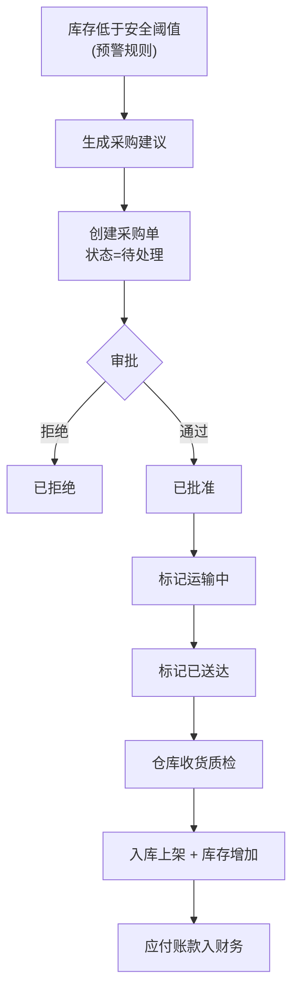
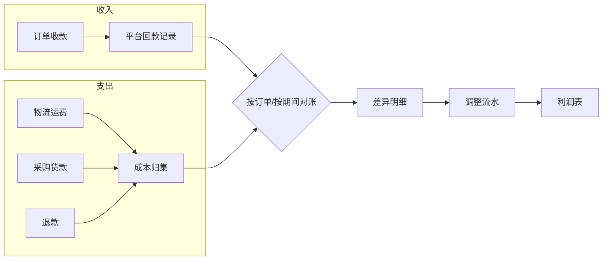
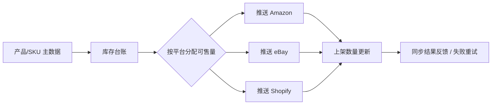
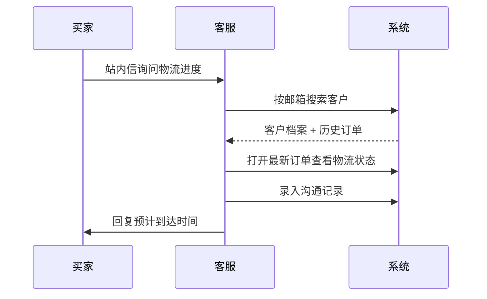

# 05 · 核心业务流程

> 定义"跨境大卖每天如何用它做生意"。每条流程包含：**目标 → 参与角色 → 流程图 → 步骤说明（含当前系统支撑状态） → 业务规则 → 断点与待办**。
> 状态：✅ 已支撑 ｜ 🟡 部分支撑 ｜ ⚪ 未支撑 ｜ ❌ 调用即失败。

---

## F1｜跨境订单履约主流程（P0，系统最核心链路）

**目标**：把买家在第三方平台的付款订单，变成"货已发出、买家可追踪、账已入账"的闭环。

### 目标态流程图

### 步骤与当前支撑状态

| 步骤 | 负责角色 | 当前状态 | 说明 |
|---|---|---|---|
| 1 平台拉取订单 | 系统自动 | 🟡 | ~~`OrderSyncService` 是 `System.out.println` 桩~~（该类已删除）。**2026-03-08 复测**：`POST /api/platform-integrations/{id}/sync-orders` 已走真实链路，按认证协议分派适配器（Shopify 官方 Admin REST / 自建店铺 HTTP / 示例数据），幂等去重已实现（`OrderImportApplicationService:153-154,348`）。 ⚠️ 仍**无定时调度**（只能人工点，`R-204`）；增量窗口由调用方传入、**游标未持久化**；🔴 **未经真实平台验证**（**ISS-064**）。 🔴 **下游仍然断**：同步进来的订单**不会生成任何物流单**——`OrderCreatedEvent` 从未被发布（**ISS-062**，P0） |
| 2 统一订单池 | 运营 | 🟡 | 领域层的订单结构设计正确（含地址、支付、行项），但**没有列表/筛选接口**，前端读 mock |
| 3 运营审核 | 运营 | ⚪ | 无异常标记、无地址校验、无批量操作、无审核意见字段 |
| 4 确认订单（processing） | 运营 | 🟡 | `PUT /api/orders/{id}/status` 可用；流转前置约束写在 `OrderProcessingService` |
| 5 库存占用校验 | 系统自动 | ⚪ | `BusinessProcessOrchestrationService.reserveInventory()` 方法体是空的；订单与库存无联动 |
| 6 缺货触发补货 | 系统自动 | ⚪ | `InventoryStatus.SHORTAGE` 存在但无预警、无自动建单 |
| 7 创建物流单 + 选渠道 | 运营/仓库 | 🟡 | `POST /api/logistics` 可用；但**渠道无维护端点**（见 F2） |
| 8 运费计算 | 系统自动 | 🟡 | `PriceRule`/`LogisticsFee` 有模型，未与渠道/分区/国家绑定 |
| 9 生成面单 | 仓库 | 🟡 | `LogisticsLabel` 有实体，生成逻辑是桩，无 PDF/打印 |
| 10 出库扣减库存 | 仓库 | ⚪ | MovementType.OUTBOUND 枚举存在，**无出库接口** |
| 11 交接物流商 | 仓库 | 🟡 | `PUT /api/logistics/{id}/status` 可用 |
| 12 轨迹回传 | 系统自动 | ⚪ | 只有"当前状态"，**无轨迹明细表** |
| 13 订单完成 | 系统/运营 | 🟡 | `OrderProcessingService.completeOrder`（要求必须已发货） |
| 14 生成财务流水 | 系统自动 | ⚪ | 无自动联动，流水必须手工 `POST /api/finance/transactions` |
| 15 毛利计算 | 财务 | ⚪ | 无核算引擎、无报表 |

**结论：主流程只有第 4、7、11、13 步（状态变更类）可用，占 4/15。**

---

## F2｜物流渠道与面单管理流程

**目标**：维护可用物流渠道与价格规则，发货时自动给出最优渠道建议。

| 步骤 | 状态 | 说明 |
|---|---|---|
| 渠道档案维护 | ⚪ | `LogisticsChannel` 有领域对象与表，**没有 REST 端点**，前端无法维护，只能靠初始化数据 |
| 价格规则维护 | ⚪ | 同上，`PriceRule` 无维护入口 |
| 发货试算与比价 | ⚪ | 无试算接口 |
| 渠道 API 下单 | ⚪ | 无任何外部物流 API 客户端 |
| 面单回传与打印 | ⚪ | `logistics_labels.label_data` 无真实内容，无 PDF 生成 |

---

## F3｜订单取消与退货拦截

**目标**：在货物发出前拦截订单，避免无效物流成本；发出后走退货流程。

**业务规则（已落地）**

| 规则 | 实现位置 | 状态 |
|---|---|---|
| 已发货/已完成订单禁止取消 | `OrderProcessingService.cancelOrder` | ✅ |
| 只能从"处理中"发货 | `OrderProcessingService.shipOrder` | ✅ |
| 只能从"已发货"完成 | `OrderProcessingService.completeOrder` | ✅ |
| 订单金额必须等于支付金额 | `OrderProcessingService.validateOrderInfo` | ✅ |
| 取消后回滚已占用库存 | 无 | ⚪ |
| 取消后关闭物流单 | 无 | ⚪ |
| 退货/退款单据与流程 | 无（无 `REFUND` 状态，`TransactionType.REFUND` 仅有财务类型枚举） | ⚪ |
| 独立取消端点与取消原因 | 无（只能通过通用状态变更改 `cancelled`） | ⚪ |

---

## F4｜库存补货与采购闭环

**目标**：让缺货在成为客户投诉之前被发现，并走完审批到入库。

| 步骤 | 状态 | 说明 |
|---|---|---|
| 缺货/阈值预警 | ⚪ | `InventoryStatus.SHORTAGE / OUT_OF_STOCK` 仅是状态值，无阈值配置、无通知 |
| 采购建议自动生成 | ⚪ | 无需求计算（无销量、无在途、无周转天数） |
| 创建采购单 | 🟡 | `POST /api/purchases` 可用；前端 `CreatePurchase.jsx` 未提交请求 |
| 审批通过/拒绝 | ✅ | `PUT .../approve` / `.../reject`，`PurchaseStatus` 状态机完整（**本系统最完整的能力**） |
| 标记运输中/已送达 | 🟡 | 接口可用，前端未接 |
| 收货入库 + 库存增加 | ⚪ | 采购↔仓储无联动，`BusinessProcessOrchestrationService.processReplenishment()` 为空实现 |
| 应付账款入账 | ⚪ | 财务无自动生成 |

---

## F5｜财务对账与成本核算

**目标**：让每一笔订单都能算出真实毛利。

| 步骤 | 状态 | 说明 |
|---|---|---|
| 按关联单据查流水 | 🟡 | `GET /api/finance/transactions/by-reference` 可用 |
| 收入自动入账 | ⚪ | 订单完成不产生流水 |
| 运费自动入账 | ⚪ | 物流单不产生应付流水 |
| 采购货款入账 | ⚪ | 采购单不产生应付流水 |
| 差异识别与调整 | ⚪ | 无对账引擎、无差异单实体、无调整审批流
| 利润表/报表导出 | ⚪ | 无报表与导出能力 |

---

## F6｜多平台商品与库存同步

**目标**：多平台共享库存，避免超卖。

| 步骤 | 状态 | 说明 |
|---|---|---|
| 平台授权（OAuth / API Key） | ⚪ | 只有 `platform_integrations` 表，**API 密钥明文存储且明文返回给前端** |
| 商品/库存推送 | ⚪ | `POST /{id}/sync-products`、`/sync-inventory` 是空实现 |
| 同步任务日志与重试 | ⚪ | 无 task 表、无重试队列 |
| 可售量分配策略 | ⚪ | 无锁定/可用库存概念 |

> 密钥安全问题登记为 [`../qa/known-issues.md`](../qa/known-issues.md) 中的 P0 条目，上线前必须处理。

---

## F7｜客服查单与沟通留痕

| 步骤 | 状态 | 说明 |
|---|---|---|
| 按邮箱/电话搜客户 | ⚪ | **无客户列表接口**（仅创建/按 ID 查/删除） |
| 查看客户历史订单 | 🟡 | `GET /api/orders/customer/{customerId}` 可用，但依赖已知 customerId |
| 查看物流状态 | 🟡 | 有当前状态，无轨迹时间线 |
| 沟通记录留痕 | ⚪ | 无沟通记录实体 |

---

## F8｜租户开通与权限配置（平台运营视角）

| 步骤 | 状态 | 说明 |
|---|---|---|
| 创建租户 | 🟡 | `POST /api/tenants` + `/tenants/create` 页面已联网 |
| 创建租户管理员 | 🟡 | `POST /api/tenants/{id}/admin` 可用 |
| 角色与权限点 | 🟡 | `/api/roles/**` 齐备；~~但权限点是自由字符串，无字典、未与菜单绑定~~ 后端侧这条**仍然成立**（`permissions` 是 `@ElementCollection` 自由串，无字典表、无写入校验）。 🔎 **2026-01-25 补测**：前端已有一份**硬编码预设**（`user-web/src/pages/role/RoleList.jsx:12-33` 的 `PERMISSION_PRESETS`，**21 项**，用 `Select mode="multiple"` `:266` + `options={PERMISSION_PRESETS}` `:271`），但它与库里的 **22** 个权限点**不等价**：预设**缺 `finance:import`** —— 而 `finance:import` 恰好是被 `@PreAuthorize` 真检查的 10 个点之一 ⇒ 除 `PLATFORM_ADMIN` 外，任何角色都无法通过界面获得财务导入权限。又因为 `mode="multiple"`（不是 `tags`），界面**也无法录入预设外的新权限点**。未与菜单/路由绑定这一点不变（`AuthContext.hasPermission` 调用点 0） 🔄 **2026-10-21 复测：本行主体已过期**——后端已有唯一字典 `domain/tenant/PermissionPoints`（25 租户级 + 1 平台级 = **26 项**），26 项**全部**被 `@PreAuthorize` 的 `hasAuthority(...)` 引用（**0 孤儿**）；`RoleList.jsx` 的 `PERMISSION_PRESETS` 已与后端**逐名对齐 26 = 26**（`finance:import` 已补）。残留只剩「格式合法但不在 catalog 里的字符串仍能经 `PUT /api/roles/{id}/permissions` 写入」 |
| 分配角色 | 🟡 | `POST /api/users/{id}/roles` 可用 |
| **租户数据隔离** | 🟡 | ~~`TenantIsolationAspect` 校验被注释；业务表无 `tenant_id` 列 → **实际不隔离**~~ → **2026-01-25 复测：切面已生效**（`TenantIsolationAspect.java:55-86`，入参租户与登录租户不一致抛 `TENANT_ACCESS_DENIED`，`PLATFORM_ADMIN` 放行），运行时 **23/42 张表有 `tenant_id`**。 ❌ 但"实际不隔离"这个结论**对读路径仍然成立**：仓储层显式不过滤（`:91-97` 只打 trace，注释写明"隔离由服务层参数校验保障"），全仓没有一条查询从 `TenantContext` 取租户去过滤 → **ISS-050**；且租户仍来自客户端传参、缺省回落 `default-tenant`（**ISS-051**） |
| 登录鉴权 | 🟡 | ~~`JwtTokenProvider.validateToken()` 恒返回 `true`，任意 Bearer 串可通过~~ → ✅ **2026-01-25 已修（ISS-007）**：`validateToken` = `parseClaims(token) != null`（`JwtTokenProvider.java:189-191`），`:201-205` 走 `Jwts.parser().verifyWith(signingKey)` 真验签 + 过期判断。 ❌ 残留：认证失败返回的是 **403 + 0 字节 body**，401 通道不可达（`SecurityConfig` 未配 `exceptionHandling()`，**ISS-032/058**）；`refresh` 不轮换 refreshToken（`AuthController.java:128`）；access 与 refresh 同为 24h（`application.yml:80`/`:82`） |

---

## 附录：跨上下文联动现状总表

这是判断"系统是否真的在用"的关键：~~**领域事件的消费者目前基本缺位**~~。

> **2026-01-25 复测更正**：~~结论要分成两半。**9 条联动里有 2 条真的通到了下游写库动作**（`OrderCreatedEvent`→建物流单、`InventoryShortageEvent`→建采购单，且都是**重复执行两次**）；2 条有消费者但**只打日志**；其余 5 条 + 表末补列的 1 条**确实仍然缺位**。所以准确说法是「**消费者零星存在、但动作与期望普遍不一致，且缺少事件→库存/资金的闭环**」，而不是「基本缺位」。~~
>
> **2026-01-25 二次更正（以运行时探针为准，推翻上一块里"2 条通到下游写动作"的部分）**：上一块判断的是"消费者代码写了什么动作"，运行时证明**那些动作一次也没有被触发**——断点在**生产侧**：订单、客户、物流、仓储四个聚合的事件根本没有进 `DomainEventPublisher`（`DomainEventPublisher.java:40` 拿到空的 `domainEvents` 就静默 `return`，连一行日志都不打），所以下表凡"有消费者"的判断都只描述**代码存在性**，当前**不可达**；**这就是 ISS-062**。同一探针会话里 `发布领域事件` 去重后**只有 4 个事件类型真的发出去**：`PurchaseOrderCreatedEvent`、`FinancialTransactionCreatedEvent`、`ProductCreatedEvent`、`SKUCreatedEvent` ⇒ 准确说法是「**消费者零星存在、而多数聚合连"发布"这一步都没走到，跨上下文联动事实上不存在**」。

| 触发事件 | 期望的下游动作 | 当前状态 |
|---|---|---|
| `OrderCreatedEvent` | 占用库存 / 生成应收流水 | ~~⚪ 事件已定义，无消费处理（RocketMQ 仅配置，无实际收发）~~ → **🟡 有消费者，但做的不是这两件事**：进程内 `EventHandler.java:45-56` 与 MQ 侧 `OrderCreatedEventConsumer.java:31-45` 都在建**物流单**（`createLogisticsOrder(...,"DEFAULT_CHANNEL")`），既不占用库存也不生成应收；两条通道同时开启会**重复建单**（**ISS-054**）。 ❌ **二次更正（ISS-062）：上面这些动作当前一次也不会发生**——`OrderProcessingService.java:55`（以及 `:72,:94,:116,:138,:150`）是 `return orderRepository.save(order)`，`OrderRepositoryImpl.java:10` 返回 `orderMapper.toDomainAggregate(...)` 副本，`OrderMapper.java:91` 明确把 `domainEvents` 重置成空列表 ⇒ 实测 `POST /api/orders` 返回 **200**（orderId `efa6720c-89ca-4b4c-a5ff-59ef189cd5a1`，`orders`/`order_items`/`shipping_addresses`/`payment_infos` 都有 INSERT），而整段日志里**没有一行** `发布领域事件` ⇒ 两个消费者一次也没被调用；ISS-054 的"重复建单"因此是**修好 ISS-062 之后才会显形的潜在风险**，不是现状 |
| `OrderShippedEvent` | 扣减库存 / 生成运费应付 | ~~⚪~~ → ⚪ 复测仍无消费方：全仓只有 `Order.java:275` 注册该事件，没有任何 `@EventListener` / `RocketMQListener` 引用它；**生产侧同样断（ISS-062）** |
| `OrderCompletedEvent` | 生成收入流水 | ~~⚪~~ → ⚪ 复测仍无消费方（仅 `Order.java:284` 注册）；**生产侧同样断（ISS-062）** |
| `OrderStatusChangedEvent` | 通知平台 / 通知买家 | ~~⚪~~ → **🟡 有双消费者，但只打日志**：`EventHandler.java:61-71`（`:69` 仅 `log.info`）、`OrderStatusChangedEventConsumer.java:24-32`（`:30` 仅 `log.info`，`:28` 注释写明"仓储侧预留接口尚未实现"）。通知平台/通知买家都没有做。 ❌ 二次更正：**生产侧断**（`Order.java:267` 注册的 `OrderStatusChangedEvent` 走不出"返回映射副本"的调用链，ISS-062）⇒ 两个日志消费者均不可达 |
| `InventoryShortageEvent` | 生成缺货预警 → 采购建议 | ~~⚪~~ → ~~**🟢 唯一真正落到下游写动作的一条，但重复且丢租户**~~ → **🟡 消费者代码真实存在，但当前完全不可达（ISS-062）**：`EventHandler.java:92-105` 与 `InventoryShortageEventConsumer.java:31-43` 都会自动建采购单（同一次缺货**建两张**）；事件载荷没有 `tenantId`，两处把租户硬编码为 `"default-tenant"`（`EventHandler.java:100`、`InventoryShortageEventConsumer.java:37`），供应商固定 `"DEFAULT_SUPPLIER"`。 ❌ **二次更正：上一行写的"重复建两张采购单"实测从未发生**——`InventoryShortageEvent` 在 `Warehouse.java:243` 于聚合内注册，而调用方 `InventoryManagementService.java:49 / :81 / :107` 的 `warehouseRepository.save(warehouse)` **丢弃返回值，且该类从不注入 `DomainEventPublisher`** ⇒ 库存事件全部落在地上。实测：入库 200，再把同一 SKU 出库到 0（必然命中 SHORTAGE/OUT_OF_STOCK 分支）200，日志里**既无 `发布领域事件`，也无 `接收到库存不足事件`，更没有自动生成的采购单** |
| `InventoryMovementEvent` | 更新可用库存/平台可售量 | ~~⚪~~ → ⚪ 复测仍无消费方（注册点实测为 `Warehouse.java:231`，另有盘点事件 `:281`）；平台可售量未联动。**生产侧同样断（ISS-062，见上一行的库存链路实测）** |
| `PurchaseOrderStatusChangedEvent` | 到货后驱动入库 | ~~⚪ 无消费方，而且**入库动作本身还不存在**：`PurchaseApplicationService` 的公开方法最远只到 `markPurchaseOrderAsDelivered:141`，全类没有任何库存/仓储写入调用（该类 grep `warehouse` 仅命中 `createPurchaseOrder` 的入参名）~~ → 🔄 **2026-03-22 复测：入库动作已经存在，但不是靠事件驱动，而是应用服务里的直接编排**——`PurchaseApplicationService.markPurchaseOrderAsDelivered:256-262` 现在是「`publishEventsFrom(purchaseOrder)` → `receiveIntoWarehouse(...)` → `createPurchasePayable(...)` → `return purchaseOrder`」四步：`receiveIntoWarehouse:281-293` 逐明细行调 `warehouseApplicationService.inventoryIn(sku, warehouseId, quantity)`（**BR-08/BR-09，缺行只 `log.warn` 不报错**），`createPurchasePayable:299-311` 调 `financeApplicationService.createFinancialTransaction(EXPENSE, totalAmount, …, referenceType="PURCHASE_ORDER")`（**BR-10；金额 ≤0 时跳过**，且因 `TransactionType` 没有"应付"语义而按资金流出记账）。回归测试是 `PurchaseApplicationServiceTest:74 deliveredShouldStockInEveryLineAndBookPurchasePayable`（并用 `:92`/`:104` 锁住"无明细行不动库存也不挂账""金额为 0 只入库不挂账"两条负分支）与 `:229` 的 `verify(warehouseApplicationService, never()).inventoryIn(...)`。 ⚠️ **"无消费方"这一半仍然成立**：`purchase-events` topic 至今没有任何监听器，所以到货联动的唯一触发方式是**同步调用 `PUT /api/purchases/{id}/delivered`**；若将来改用事件驱动，会与应用层这条直连编排**重复入库/重复挂账**。 🔧 二次更正：**采购是三个"真发得出去"的聚合之一**——`PurchaseOrderRepositoryImpl.save()` 返回 `void`（🔄 现 `:51`），领域服务被迫写成 `save(x); return x;`（~~`:43-44`、`:95-96`、`:109-110`、`:123-124`、`:137-138`、`:151-152`、`:165-166`~~ → 🔄 2026-03-22 复测 9 对：`:74,:120,:139,:155,:172,:189,:204,:219,:234`），事件留在原实例上 ⇒ 实测日志有 `发布领域事件: PurchaseOrderCreatedEvent` + `事件已发布到RocketMQ主题: purchase-events`。但 `purchase-events` **没有任何消费者**（4 个监听器只订阅 `order-events`/`inventory-events`/`logistics-events`），进程内 `EventHandler` 的 4 个 `@EventListener` 也不处理采购事件 ⇒ **发得出去、无人接** |
| `LogisticsStatusChangedEvent` | 写入轨迹明细 / 回推订单状态 | ~~⚪~~ → ⚪ 复测仍无消费方（仅 `LogisticsOrder.java:219` 注册）；轨迹明细未由事件驱动写入。**生产侧同样断（ISS-062）**：注册点实测 4 处（`LogisticsOrder.java:121`、`:219`、`:228`、`:243`），而物流域全部走 `return repository.save(...)` 副本形状 |
| `FinancialTransactionCreatedEvent` | 更新账户余额 | ~~⚪~~ → ⚪ 复测仍无消费方（注册点实测 5 处：`FinancialTransaction.java:117`、`:146`、`:165`、`:184`、`:214`）；余额未联动。 🔧 二次更正：财务与采购、商品同属**真发得出去**的三个聚合（`FinancialTransactionRepositoryImpl.save():48-51` 返回 `void`，`FinancialTransactionServiceImpl:78-79`、`:138-139`、`:152-153`、`:166-167` 都是 `save(x); return x;`）⇒ 实测 `POST /api/finance/transactions`（200，`TXN-244dc9d3`）有 `发布领域事件: FinancialTransactionCreatedEvent` + `事件已发布到RocketMQ主题: finance-events`；但 `finance-events` 同样**没有任何消费者** |
| `LogisticsCompletedEvent`（原表未列） | 生成财务结算记录 | **🟡 有双消费者，但只打日志**：`EventHandler.java:76-87`（`try` 块内只有 `:83` 一行 `log.info`）、`LogisticsCompletedEventConsumer.java:24-29`（`:28` 仅 `log.info`，`:27` 注释"记账规则未定义"）。 ❌ 二次更正：**生产侧断**（物流聚合的 4 处注册在 `LogisticsOrder.java:121`、`:219`、`:228`、`:243`，而 `LogisticsOrderProcessingService.java:38,57,75,98`、`LogisticsTrackingService.java:51` 全是 `return logisticsOrderRepository.save(...)` 副本形状）⇒ 实测 `POST /api/logistics` 返回 200（`aafbefe3-9742-4e79-b2a6-bb5f7b0cc087`）但零发布日志，两个日志消费者不可达 |

> 系统中定义了 22 个领域事件类（2026-01-25 复测：`domain/*/event/` 下 22 个 `*Event` 类，数字无误）并~~借助 `DomainEventPublisher` 双通道发布（进程内 `@EventListener` + RocketMQ）。进程内通道确实在消费~~ **设计上要走双通道，但实测只有 4 个事件类型真的进过发布器**（`PurchaseOrderCreatedEvent` / `FinancialTransactionCreatedEvent` / `ProductCreatedEvent` / `SKUCreatedEvent`）⇒ "通道确实在消费"只对采购、财务、商品三个聚合成立，其余见 **ISS-062**；~~RocketMQ 侧的 4 个监听器代码存在但很可能未注册（非 static 内部类），故跨上下文联动实际不生效。补齐方向不是「补写消费者」，而是修正监听器的类结构~~
>
> **2026-01-25 更正：类结构这一条已经修掉了（ISS-034 ✅）**。4 个监听器现已拆为顶层类，位于 `infrastructure/messaging/consumer/`，每个都是 `@Component` + `@ConditionalOnProperty(prefix = "rocketmq", name = "enabled", havingValue = "true")` + `@RocketMQMessageListener`：
>
> | 监听器 | topic / consumerGroup | 动作 |
> |---|---|---|
> | `OrderCreatedEventConsumer.java:20` | `order-events` / `logistics-group` | 建物流单（真实写库，:40） |
> | `OrderStatusChangedEventConsumer.java:18` | `order-events` / `warehouse-group` | 仅日志（:30） |
> | `InventoryShortageEventConsumer.java:19` | `inventory-events` / `purchase-group` | 建采购单（真实写库，:37） |
> | `LogisticsCompletedEventConsumer.java:18` | `logistics-events` / `finance-group` | 仅日志（:28） |
>
> 而 `application.yml:39-40` 当前是 `rocketmq.enabled: true`，所以**这些监听器确实会被注册**，"未注册"的判断已失效。真正挡住 MQ 通道的是另外三件事：
>
> 1. **反序列化必失败（ISS-052）**：事件类是 `final` 字段 + 私有 builder 构造器、无 `@JsonCreator`、无无参构造（如 `OrderCreatedEvent.java:27`、`:99`）。全仓唯一的 `@JsonCreator` 在 `InventoryMovement.java:39`，事件类一个都没有 ⇒ MQ 侧收不到可用的强类型对象。 🔧 **2026-01-25 二次实测限定**：这一条讲的是**消费侧**；**发送侧已被证明是好的**——采购/财务/商品的事件确实发出去了（`事件已发布到RocketMQ主题: purchase-events` / `finance-events` / `product-events`）。所以 ISS-052 的准确表述是"消息已经躺在 broker 里，消费者按类型反序列化时必然失败"，而它今天之所以没有暴露，只是因为 **ISS-062 让大多数消息根本没有躺进去**。
> 2. **topic 按包名而非事件类型路由**：`DomainEventPublisher.getTopicForEvent(...)`（`:110-130`）用类全名里含 `order.event` / `warehouse.event` 等字符串来选 topic，于是 `order-events` 同时承载 4 个订单事件（`OrderCreated` / `OrderStatusChanged` / `OrderShipped` / `OrderCompleted`），而两个监听器各自声明**单一**载荷类型，且 `@RocketMQMessageListener` **都没有写 `selectorExpression`**（无 tag 过滤）⇒ 类型不匹配是必然，不是偶发。
> 3. **双通道重复副作用（ISS-054）**：`DomainEventPublisher.java:44` 走进程内、`:46` 走 RocketMQ，而两侧动作完全同源（`EventHandler` 的 4 个 `@EventListener` 在 `:45 / :61 / :76 / :92`）⇒ 一次下单会产生**两张物流单**、一次缺货会建**两张采购单**。另有 **ISS-053**：`DomainEventPublisher.handleRollback`（`:135-138`）只打一行日志，没有 outbox，事务回滚与已发出的消息无法对齐。
>
> 因此补齐方向从「修正监听器的类结构」改为：~~修正监听器的类结构~~ **⓪ 先修 ISS-062：把订单、客户、物流、仓储、平台五个聚合"交给 `publishEventsFrom()` 的那个对象"从仓储返回的映射副本换回注册了事件的本地聚合实例——照 `ProductApplicationService.java:124-126` 的既有写法（同一写法还在 `:170`、`:267`、`:283`、`:333`，商品是六个"仓储 save 返回副本"的聚合里唯一做对的），或把对应仓储的 `save()` 改成采购/财务那样的 `void` 返回。这一步不做，①②③④全部修完仍然没有消息可发；** ① 收敛为单一事件通道（保留进程内或 RocketMQ 之一，或引入 outbox 做去重）；② 给事件补 `@JsonCreator`／改为发送扁平消息 DTO；③ 按事件类型拆 topic 或用 tag 过滤；④ 铺出仍然缺位的 ~~6 条联动——占库存、扣库存、应收/收入流水、到货驱动入库、物流轨迹写入、账户余额更新~~ → 🔄 **2026-03-22 复测：6 条里已交付 1 条**——「到货驱动入库」已由 `PurchaseApplicationService.markPurchaseOrderAsDelivered()`（`:256-262`）在同事务里完成（入库 `:281-293` + 采购应付 `:299-310`），**且没有走事件通道**，所以它不依赖 ②③④ 的前置；其余 5 条（占库存、扣库存、应收/收入流水、物流轨迹写入、账户余额更新）仍缺位。见 [`../adr/0006-rocketmq-domain-events.md`](../adr/0006-rocketmq-domain-events.md)。补齐事件消费链路是 v0.2 的核心工作，也是让"业务流程闭环"的关键。
