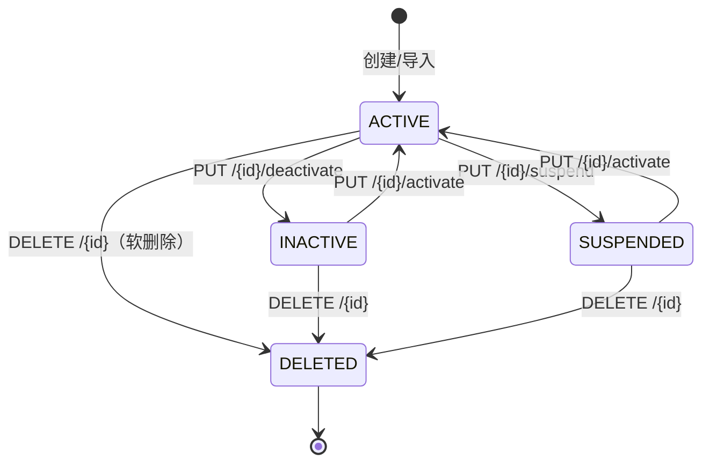

# 功能规格 · 客户管理（支撑域）

| 项 | 内容 |
|---|---|
| 子域 | 支撑域（Customer Bounded Context） |
| 聚合根 | `Customer`、`CustomerImportJob`（导入任务） |
| 值对象 | `CustomerStatus`、`CustomerImportTargetField`、`ImportedCustomerRow` |
| 实体 | `CustomerFieldMapping`（映射模板行）、`CustomerImportError`（行级错误） |
| 领域服务 | `CustomerService`、`CustomerFieldMappingService` |
| 应用服务 | `CustomerApplicationService`、`CustomerImportApplicationService` |
| 数据表 | `customers`（活库 **12 列**、**2 行**）、`customer_import_jobs`（**1 行**）、`customer_import_job_errors`（0 行）、`customer_field_mappings`（**0 行**）——2026-10-21 `information_schema` 实测 |
| 控制器 | `CustomerController`（`/api/customers`，**9** 端点，`interfaces/controller/customer/CustomerController.java:46-52` 定义 `customer:read` / `customer:write` 两个点位串）+ `CustomerImportController`（`/api/customers/import`，**10** 端点，类级 `hasRole('PLATFORM_ADMIN') or hasAuthority('customer:import')`，`:61`） |
| 前端 | `frontend/user-web/src/pages/customer/{CustomerList,CustomerDetail,CreateCustomer,CustomerImport}.jsx`（4 个页面文件均在）；`api.js:395-406` `customerApi` 9 个方法、`:411-433` `customerImportApi` 10 个方法，与后端 19 个端点**一一对应** |
| 测试 | `CustomerControllerTest` 5 + `CustomerImportPipelineTest` 5 + `CustomerApplicationServiceTenantScopeTest` 5 + `CustomerImportApplicationServiceTest` 2 = **17 例**（2026-10-21 surefire 复测，0 failures / 0 errors） |

> 本文件按代码实测更新（2026-01-25）。接口明细见 [api.md §4.5/§4.14](../api/api.md)。
>
> 🔄 **2026-10-21 复测并订正**：模块主体判据仍成立（4 个页面、19 个端点、软删除终态、导入四通道）。本轮改动集中在三处：
> ①**租户边界已经从"列存在"升级为"应用服务级强制"**：`CustomerApplicationService` 的 7 个 by-id 方法**全部**显式过 `TenantAccessGuard.requireOwned`（`:97,110,144,169,183,197,211`），列表过 `scopedTenantId`（`:122`），两条创建路径过 `resolveWriteTenant`（`:55`、`:80`），无租户条件的领域查询过 `withinCurrentTenant`（`:157`，注释原话点名 **ISS-050**）。按全仓实测，这是**覆盖面最完整的一个域**（`requireOwned` 全站共 28 个调用点，本类独占 7 个，其余分给 order 4 / product 4 / finance 4 / warehouse 3 / logistics 3 / shop-warehouse 2 / 平台控制器 1）；见新增 **BR-12**。
> ②库侧唯一约束**比订单/集成两条线都完整**：`uk_customers_email(email)` 与 `uk_customers_external_buyer(tenant_id, source_platform, external_buyer_id)` 都是真唯一键（`SHOW INDEX` 实测），导入幂等因此既有查询兜底也有数据库兜底。
> ③~~"当前 apiKey/apiSecret 明文收发"~~ 这条 §8 缺口已经过期，凭据在平台侧已改为 AES-256-GCM 密文列 + 出参掩码，见 §8 与 [platform-integration.md §2](platform-integration.md)。

---

## 1. 模块定位

跨境业务里，"客户"就是平台上的买家。客户上下文的职责：

1. 沉淀买家档案（含来源平台与平台买家ID），支撑客服查询与二次触达；
2. 从第三方电商平台**批量导入客户**：支持平台买家接口直拉、从平台订单数据萃取买家、文件上传（JSON/CSV/xlsx）三种数据获取方式；
3. 关联客户的历史订单，形成"买家视角的时间线"。

原审计结论"全系统最薄弱模块（仅 3 个接口、前端全 mock）"已不成立：核心 CRUD + 分页搜索 + 状态机 + 软删除 + 完整导入管线均已落地，前后端契约对齐并有单测覆盖（~~`CustomerControllerTest` 5 例、`CustomerImportPipelineTest` 5 例~~ → 🔄 2026-10-21 复测共 **17 例**：上述两个之外还有 `CustomerApplicationServiceTenantScopeTest` 5 例与 `CustomerImportApplicationServiceTest` 2 例，见头部表「测试」行）。

---

## 2. 概念模型

### 2.1 Customer 聚合

| 字段 | 列 | 说明 |
|---|---|---|
| `customerId` | `customers.id` `varchar(64)` NOT NULL，`@Id` 上**无** `@GeneratedValue` | 字符串业务ID：`"CUST-" + UUID.randomUUID().toString().substring(0, 8)`，生成点在**领域服务**（`CustomerServiceImpl.java:156`），不是聚合也不是 JPA。 活库 2 行实测形如 `CUST-2d9e69b6` / `CUST-77674885`；⚠️ 8 位十六进制只有 32 bit 熵且没有唯一约束保护主键以外的重复，靠 `PK` 自身拒重插 |
| `tenantId` | `tenant_id` `varchar(64)` **可空**（活库实测 `IS_NULLABLE=YES`），另有普通索引 `idx_customers_tenant` | 写入时由 `TenantAccessGuard.resolveWriteTenant(tenantId, DEFAULT_TENANT_ID)` 决定（`CustomerApplicationService:55`、`:80`）：有会话就落登录租户，**只有完全没有会话**才落到 `default-tenant` 历史桶（该字面量在 `tenants` 表里没有行，属"不可寻址兜底值"，见 `TenantAccessGuard.java:35-40` 注释与 **ISS-121**） |
| `customerName` | `name` `varchar(255)` NOT NULL（~~旧版记作 `customer_name`，列名实为 `name`~~，`CustomerJpaEntity.java:47`） | 必填 |
| `email` | `email` `varchar(255)` 可空，实体上带 `@Column(unique = true)`（`CustomerJpaEntity.java:53`）；活库实测唯一键 `uk_customers_email(email)`、`Non_unique=0`、单列 | 可选；**小写归一 + 全局唯一**（正则校验在领域服务层）；多个空值归一为 `NULL` 避免唯一约束冲突。 ✅ 2026-10-21 补：唯一性是**数据库级**的，跨租户同邮箱同样被拒——这正是"全局"二字的出处，不是应用层约定 |
| `phone` / `address` / `company` | 同名列 | 可选，`trimToNull`；`company` 贯通导入映射→预览→落库→展示全链路 |
| `sourcePlatform` | `source_platform` | 来源平台名（如 `SHOPIFY`），手动创建为 `NULL` |
| `externalBuyerId` | `external_buyer_id` `varchar(64)` | 平台侧买家ID，与 `(tenantId, sourcePlatform)` 一起构成导入幂等匹配键。 ✅ 2026-10-21 实测该三元组**有真唯一键** `uk_customers_external_buyer(tenant_id, source_platform, external_buyer_id)` ⇒ BR-05 的幂等是"查询合并 + 数据库拒绝"双保险（对比 [platform-integration.md BR-05](platform-integration.md) 的订单线：那里刻意**没有**建唯一索引） |
| `status` | `status` | `@Enumerated(STRING)`，活库里是**真 MySQL `enum('ACTIVE','DELETED','INACTIVE','SUSPENDED')`** 且 NOT NULL（2026-10-21 查 `information_schema`），另有 `idx_customers_status` 普通索引。 ⚠️ 加枚举值要 `ALTER TABLE`（`ddl-auto: update` 能补不能删），这与 `shops.auth_status` 刻意用 `varchar(24)` 的做法相反（[platform-integration.md §9.4](platform-integration.md)） |
| `createdAt` / `updatedAt` | 同名列 | 聚合根内赋值（应用层保证，无 JPA 自动填充） |

### 2.2 导入侧模型

- `CustomerImportJob`：一次批量导入的任务聚合，记录 `totalCount/successCount/failureCount/skippedCount`、创建与更新的客户ID清单、行级错误集合；状态复用 `ImportJobStatus`（`PENDING/RUNNING/SUCCESS/PARTIAL_SUCCESS/FAILED`）。
- `CustomerFieldMapping`：按 `(tenantId, platform)` 保存的「平台原始字段 → 标准目标字段」模板，可整体覆盖。
- `CustomerImportError`：行级失败/跳过明细（行号、买家ID、字段、消息）。

---

## 3. 状态机

- 删除为**软删除**（置 `DELETED`），历史订单关联保留可查。
- 客户是**全仓唯一**采用软删除的业务聚合，因此"`DELETE /api/tenants/{id}` 前置检查"必须把 `DELETED` 墓碑排除在"仍有业务数据"之外（`TenantRepositoryImpl.INVISIBLE_ROW_PREDICATES`，R-31 / ISS-119）：否则"把这个租户的客户删干净"这个动作本身就让该租户永远删不掉，而挡它的那条行用户在列表里根本看不见。代价是删租户后其墓碑成为不可达行，不级联删除是明确接受的取舍。
- `DELETED` 为终态：`changeStatus` 与 `updateProfile` 均 `assertNotDeleted`，再操作抛 `InvalidOperationException`（HTTP 400）。
- 状态未变化时为空操作，不刷新 `updatedAt`、不发事件。
- 尚无「按最近下单时间自动刷新 ACTIVE/INACTIVE」的定时任务（BR-11 仍未实现；全仓 `@Scheduled`/`@EnableScheduling` 实测为 0 处）。

---

## 4. 业务规则

| 编号 | 规则 | 状态 | 说明 |
|---|---|---|---|
| BR-01 | 邮箱格式合法且全局唯一 | ✅ | 领域服务层正则 + `findByEmail` 查重；创建/更新/导入三条路径一致。 ✅ 2026-10-21 补一层证据：应用层查重之外，库里还有 `uk_customers_email` 唯一索引兜并发双插（同 §2.1） |
| BR-02 | 创建/更新时间必须赋值 | ✅ | 聚合 `create/restore` 内赋值，不依赖 JPA 回调 |
| BR-03 | 删除采用软删除 | ✅ | `status=DELETED`，终态不可复活 |
| BR-04 | 分页搜索（ID/名称/邮箱/电话/状态/平台/关键字/注册时间区间） | ✅ | `GET /api/customers` + `CustomerQuery`/Specification |
| BR-05 | 导入幂等：同租户+同平台+同买家ID 视为同一客户 | ✅ | 命中 `mergeImportedProfile`，未命中再按邮箱兜底匹配。 ✅ 该三元组在库里是真唯一键 `uk_customers_external_buyer`（实测），所以并发导入不会双插，代价是撞键时以 `DataIntegrityViolation` 形式记为**行级失败**（`CustomerImportApplicationService:197-198` 的 `catch (Exception)` 接住，BR-07）而不是合并 |
| BR-06 | 导入合并只补空、不覆盖已有值 | ✅ | `mergeImportedProfile` 仅填空白字段；前端文案已对齐（"合并补全缺失字段"） |
| BR-07 | 行级失败不阻断批次 | ✅ | 逐行 try/catch（`CustomerImportApplicationService:196-198` 包住 `processRow(:314)`），失败明细落库可回溯 |
| BR-08 | 一个客户多个收货地址（地址簿） | ⚪ | 未实现，地址为单一字符串列 |
| BR-09 | 沟通记录 | ⚪ | 未实现（见 §8） |
| BR-10 | 客户分层/标签 | ⚪ | 未实现（见 §8） |
| BR-11 | 状态由购买行为自动更新 | ⚪ | 无定时任务（2026-10-21 复测：全仓 `@Scheduled` / `@EnableScheduling` 命中仍为 **0** 处，与 [platform-integration.md BR-06](platform-integration.md) 同一口径） |
| BR-12 | 客户读写必须收敛在登录租户内 | ✅ | 🆕 **2026-10-21 登记**（本表此前没有这一条，而它已经做完全仓最彻底）： **by-id**：`findCustomerById:97`、`findOptionalCustomerById:110`、`updateCustomer:144`、`activateCustomer:169`、`deactivateCustomer:183`、`suspendCustomer:197`、`deleteCustomer:211` —— 7 个方法全部 `TenantAccessGuard.requireOwned("Customer", 行上的 tenantId, id)`；不归属时抛的是 `EntityNotFoundException`（`TenantAccessGuard.java:110-118`）⇒ **回 404 而不是 403**，不用状态码差异确认他租户资源存在性。 **列表**：`searchCustomers:120-122` 用 `scopedTenantId(query.tenantId())` 重写查询对象再交给 Specification（`:50-62`：未传→登录租户，显式传别家→`TENANT_ACCESS_DENIED` 400）。 **无租户条件的领域查询**：`findCustomersByStatus:155-157` 用 `withinCurrentTenant` 在应用层过滤（注释原话"领域服务构造的查询不带租户条件，按登录租户收敛（ISS-050）"）；该方法当前**只有领域侧实现、没有控制器调用点**。 **写归属**：`resolveWriteTenant`（`:55`、`:80`）。 ⚪ 残留：过滤仍发生在应用层内存里，`CustomerRepositoryImpl` 的查询不带租户谓词（对齐 **ISS-050**，全域同病） |

---

## 5. 平台客户导入（核心链路）

### 5.1 数据获取方式

| 通道 | 入口 | 行为 |
|---|---|---|
| 平台买家接口 | `sourceType=CUSTOMERS` | 按 `integrationId` 取集成的 `storeUrl/apiKey/apiSecret`，`GET {storeUrl}/customers`（`X-API-Key`/`X-API-Secret` 头），支持 `keyword` 过滤、`limit/page` 分页。 ⚠️ 2026-10-21 补口径：这条**只覆盖 `CUSTOM_SHOP` 与 `SAMPLE` 两种协议**——`PlatformCustomerFetcher` 端口没有 Shopify/Amazon/eBay 等任一真实平台的适配器（[platform-integration.md §7.1](platform-integration.md)），所以对 Shopify 集成走这条通道会得到 `PLATFORM_ADAPTER_NOT_FOUND`。官方口径是**改走下一行的 `ORDERS` 萃取通道**（买家信息本就在订单里） |
| 平台订单萃取 | `sourceType=ORDERS` | `GET {storeUrl}/orders`（支持 `orderNumber`、增量 `updatedFrom/updatedTo`），再按「买家ID→邮箱→名称」优先级分组去重，每单行合并为买家行 |
| 文件上传 | `/upload` | JSON / CSV / xlsx（`ImportSourceParser` + `ExcelSourceParser`），首行为表头 |
| 示例数据 | `useSampleData=true` | 各平台形状有意的差异样本（AMAZON 无电话地址、SHOPIFY 无买家ID 走邮箱兜底、个别行缺邮箱），用于未联调真实接口时验证全链路 |

未配置 `storeUrl` 且未勾选示例数据 → 直接 400，并提示替代路径。

### 5.2 字段映射规则

- 标准目标字段 9 个：`EXTERNAL_BUYER_ID / CUSTOMER_NAME / CUSTOMER_EMAIL / CUSTOMER_PHONE / COMPANY / COUNTRY / PROVINCE / CITY / ADDRESS`，各带中英文别名表。
- 自动识别：`detectByAlias`（忽略大小写、连字符、下划线精确匹配）→ 未命中再 `detectFuzzy`（包含式兜底）；仍无法识别的列不进映射。
- 已保存模板（`customer_field_mappings`）优先于自动识别；预览请求携带 `mappings` 时以请求为准（支持 UI 手工调整后重预览）。
- 转换规则复用 `FieldTransform`（`NONE/WEIGHT_KG_TO_G/BOOLEAN_FROM_YES_NO/DEFAULT_VALUE`），`DEFAULT_VALUE` 在源值缺失时填默认值。
- 省州/市/国家与详细地址在行模型内拼接为 `fullAddress`（`ImportedCustomerRow.fullAddress()`），落库到 `address` 列。

### 5.3 批量导入流程

1. `POST /preview`：获取→映射→逐行校验，返回预览行 + 逐行 errors + warnings，不写库。
2. `POST /api/customers/import`：带 `rows` 直接导入（rows 为空则服务端重走「获取+映射」）；创建 `CustomerImportJob`（`start`→逐行 `processRow`→`complete`），起止时间、计数、错误明细全程落库。
3. 行处理：行内已有校验错误 → 记失败；名称为空/邮箱非法 → 失败；幂等命中 → 合并（`updateExisting=false` 时改判跳过并记录原因）；未命中 → `createCustomerFromPlatform`。
4. 一键同步：`POST /api/platform-integrations/{id}/sync-customers`（内部固定 `updateExisting=true`、`enableIdempotency=true`）。

### 5.4 异常处理与结果反馈

- 行级 try/catch：单行异常（含领域校验、唯一冲突、数据库异常）只影响该行；错误消息截断 300 字符后随任务持久化。
- 反馈：`CustomerImportJobDto` 含 `status/statusLabel/totalCount/successCount/failureCount/skippedCount/message/startedAt/finishedAt/errors[]/createdCustomerIds[]/updatedCustomerIds[]`；任务列表与详情可事后回溯（`GET /jobs`、`GET /jobs/{jobId}`）。
- 前端 `CustomerImport.jsx`：三个 Tab（平台拉取导入 / 文件上传导入 / 导入任务），导入完成弹窗展示计数与失败行明细（行号/买家ID/字段/原因）。

---

## 6. 功能清单（前后端对照）

| 功能 | 前端 | 后端 | 状态 |
|---|---|---|---|
| 客户列表/搜索/分页 | `CustomerList.jsx`（真实接口） | `GET /api/customers`（`CustomerController:59-60`，`customer:read`） | ✅ |
| 状态下拉选项 | `api.js:399` `getStatusOptions` | `GET /status-options`（`:88-89`，`customer:read`） | ✅（本表此前漏记这一条端点） |
| 创建客户 | `CreateCustomer.jsx` | `POST /api/customers` | ✅ |
| 客户详情 + 历史订单 | `CustomerDetail.jsx`（按客户ID与买家ID双查合并） | `GET /{id}` + `GET /api/orders/customer/{id}` | ✅ |
| 更新资料 | 详情页编辑弹窗 | `PUT /{id}` | ✅ |
| 状态变更 | 激活/置非活跃/暂停按钮 | `PUT /{id}/activate`｜`deactivate`｜`suspend` | ✅ |
| 软删除 | Popconfirm | `DELETE /{id}` | ✅ |
| 平台客户导入（拉取/萃取/上传/映射/预览/任务） | `CustomerImport.jsx` | `/api/customers/import/*` **10 端点**（`:69` target-fields、`:75` transforms、`:81` GET field-mappings、`:90` **PUT field-mappings**、`:96` preview、`:108` upload、`:148` 导入、`:159` jobs、`:169` job 详情、`:175` CSV 模板），类级 `customer:import`（`:61`） | ✅ |
| 平台集成一键同步客户 | 集成列表/详情「同步客户」 | `POST /{id}/sync-customers` | ✅ |
| 沟通记录 | — | — | ⚪ 未实现（README 曾承诺，建议 P1） |
| 客户分类/标签 | — | — | ⚪ 未实现（P1） |
| 收货地址簿 | — | — | ⚪ 未实现（P2） |
| 状态自动刷新 | — | 无定时任务 | ⚪ 未实现（P2） |
| 真实平台 SDK/OAuth | — | 仅通用 HTTP + 别名映射 | 🟡 对外服务需按平台适配 |

---

## 7. 领域事件

| 事件 | 发布点 | 现状 |
|---|---|---|
| `CustomerCreatedEvent` | 创建/导入成功后经 `DomainEventPublisher` 发布（`CustomerApplicationService:58`、`:84`、`:145`） | ✅ 有发布链路；🟡 **无订阅方** |
| `CustomerStatusChangedEvent` | `changeStatus` 且状态确有变化时（`CustomerApplicationService:170`、`:184`、`:198`、`:212`） | ✅ 同上 |

> 🔄 **2026-10-21 把"RocketMQ 通道未接"这句改准确**（原判语容易误读成"发不出去"）：
> **发得出，但没人收**。`DomainEventPublisher.publishEventsFrom:35-54` 对每个事件**双发**——`applicationEventPublisher.publishEvent` + `publishToRocketMQ`（`:85-102`），主题按包名硬路由（`getTopicForEvent:110-133`，9 条：`order/customer/logistics/inventory(由 warehouse.event 映射)/finance/purchase/product/platform/shop-events`）；`customer.event` ⇒ `customer-events`。
> 而全仓 `@RocketMQMessageListener` 只有 **4 个**消费者（`consumer/OrderCreatedEventConsumer` 订 `order-events`、`OrderStatusChangedEventConsumer` 订 `order-events`、`LogisticsCompletedEventConsumer` 订 `logistics-events`、`InventoryShortageEventConsumer` 订 `inventory-events`），`EventHandler` 的 4 个 `@EventListener` 也只覆盖订单/物流/库存——**`customer-events` 有生产者、零消费者**（同样情形的还有 product / finance / purchase / platform / shop 五条）。
> ⚠️ 两条时序口径要一起记下，它们比"有没有订阅方"更容易出事：
> ①**发布发生在事务提交之前**。`publishEventsFrom` 是应用服务方法里的普通调用，而 `@Transactional` 提交在方法返回后；`applicationEventPublisher.publishEvent` 同步派发给 `@EventListener`（非 `AFTER_COMMIT`），所以订阅方**可能读到还没落库的数据**，回滚时消息也已经出去了。
> ②类里唯一的 `@TransactionalEventListener` 是 `handleRollback:137-140`（`AFTER_ROLLBACK`），注释写"清理未发布的事件"，**方法体只有一行 `log.info`**，没有任何清理动作。
> ③发 MQ 失败被 `catch (Exception)` 吞掉（`:99-101`），只打 `log.error` ⇒ 事件丢失不会让业务请求失败。
> 因此本模块的**任何**业务判断都不能建立在"事件一定会被下游看到"上；跨模块联动目前只能靠直接调用（这条口径同样见 [platform-integration.md §8](platform-integration.md)）。

---

## 8. 遗留缺口（按优先级）

| 优先级 | 缺口 | 建议 |
|---|---|---|
| P1 | 沟通记录实体/接口/时间线 | 新增 `customer_communications` + 详情页时间线 |
| P1 | 客户标签/分层 | `customer_tags` + 关系表 |
| P2 | 地址簿多地址 | `customer_addresses`，下单可选 |
| P2 | 状态自动刷新任务 | 定时按最近下单时间切换 ACTIVE/INACTIVE |
| P2 | ~~平台真实凭证对接：OAuth/签名适配层 + 密钥加密存储（当前 apiKey/apiSecret 明文收发）~~ | 🔄 2026-10-21 拆成两半：**加密那半已关闭**（`CredentialCipher` AES-256-GCM 密文列 + 出参只给掩码，门槛是运维注入 `PLATFORM_CREDENTIAL_MASTER_KEY`，见 [platform-integration.md BR-01/BR-02](platform-integration.md)）；**OAuth/签名那半仍在**，且对本模块的具体含义是——`PlatformCustomerFetcher` 端口只有 `CUSTOM_SHOP`/`SAMPLE` 两个实现，所以 `sourceType=CUSTOMERS` 这条路**接不进任何真实公开平台**，买家只能从 `ORDERS` 通道萃取（§5.1）|
| P2 | 导入异步化 | 大样本改后台任务 + 轮询（当前同步执行、请求内完成） |

---

## 9. 验收要点

1. 重复邮箱创建/导入必须拒绝（导入按行记失败，不阻断批次）。
2. 同一 `(tenant, platform, externalBuyerId)` 重复导入不产生新客户，且**已有字段不被空值覆盖**。
3. 软删除客户再更新/变更状态 → 400 `InvalidOperationException`；历史订单仍可查询。
4. `useSampleData` 三平台样本全链路（预览→导入→任务回溯）可跑通，缺邮箱行走邮箱兜底逻辑。
5. 前端列表筛选（状态/时间区间/关键字）与后端 `CustomerQuery` 语义一致；`Result.code` 为字符串 `"200"`。
