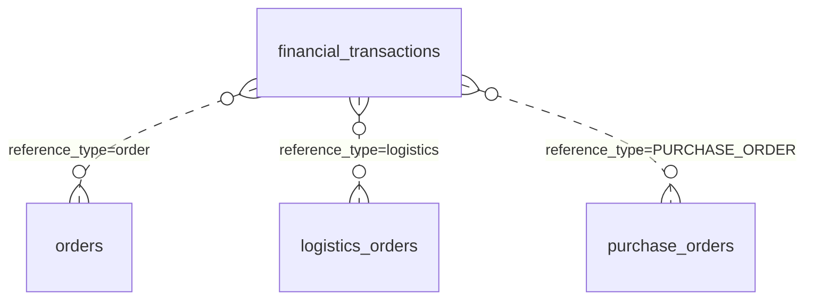
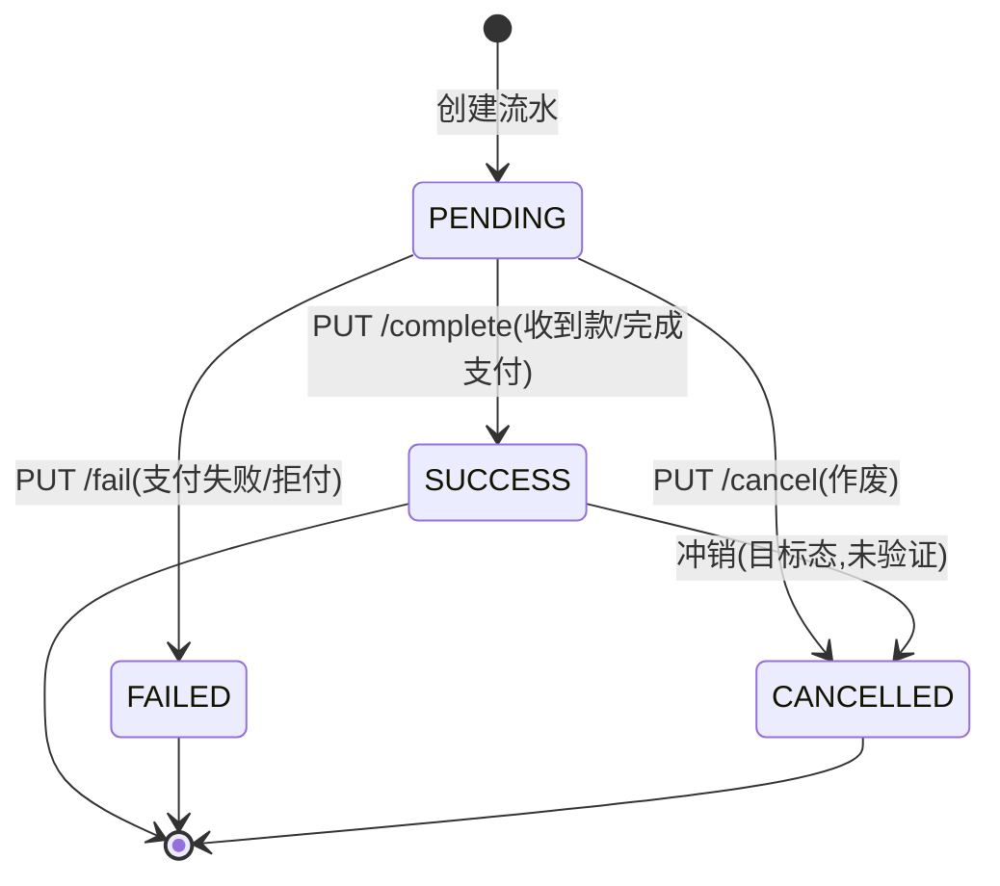

# 功能规格 · 财务管理（支撑域）

| 项 | 内容 |
|---|---|
| 子域 | 支撑域（Finance Bounded Context） |
| 聚合根 | `FinancialTransaction` |
| 值对象 | `TransactionType`、`TransactionStatus` |
| 领域服务 | `FinancialTransactionService` / `FinancialTransactionServiceImpl` |
| 数据表 | `financial_transactions` |
| 前端 | `frontend/user-web/src/pages/finance/{FinanceList,FinanceDetail,CreateFinance}.jsx` |

---

## 1. 模块定位

财务是**结果层**：把订单（收入）、物流（运费支出）、采购（货款支出）、退款（负数）归集到统一的流水上，从而支持对账与毛利核算。

**核心设计**：`FinancialTransaction` 采用**多态引用** `referenceId` + `referenceType`，一张流水表可以挂到任意业务单据上——这是灵活的做法，代价是没有外键约束，且 `referenceType` 的合法取值只存在于调用方代码里（数据字典 R-05/R-08）。

**核心缺口**：流水目前只能手工录入，业务动作不自动产生流水，因此"自动记账"尚未发生。

---

## 2. 概念模型

| 字段 | 说明 | 备注 |
|---|---|---|
| `transaction_id` | 主键 | 由领域层赋值 |
| `type` | 收入/支出/退款/调整 | 存储为**小写 code** |
| `amount` | 金额 | ~~`DECIMAL(19,2)` ✅（本项目少数正确的金额字段）~~ → 🔄 **2026-03-22 按 `information_schema` 实测更正：`decimal(38,2)`**。`FinancialTransactionJpaEntity:33` 的 `@Column(name="amount", nullable=false)` **没写 `precision/scale`**，Hibernate 对未声明精度的 `BigDecimal` 默认给 38；全库唯一显式 `DECIMAL(19,2)` 的金额列是 `payment_infos.amount`。「比 `DOUBLE` 强」这个结论不变（DECIMAL 仍是正确方向），但**精度口径与文档描述不一致**，且 38,2 与 19,2 混用在同库里 ⇒ 见 [../db/data-dictionary.md](../db/data-dictionary.md) R-09 与 [../db/migration-plan.md](../db/migration-plan.md) `V7`。✅ **2026-10-10 已收敛（ISS-023 / R-53，见 [../qa/known-issues.md](../qa/known-issues.md) §20）**：`financial_transactions.amount` 现为 **`DECIMAL(19,2)`**（`V7.2` + `V7.2.1` 影子列流程把 38,2 收窄；本表迁移时与本轮 02:51 复算**都是 0 行**，因此收窄没有数据风险；采购那一侧的对照见 [purchase.md](purchase.md) BR-03 里的**时点值** 350 行 / `1644.00`），`FinancialTransactionJpaEntity:33` 已显式写 `precision = 19, scale = 2` —— 未声明时 Hibernate 按默认宽度 38 建列，这正是 38,2 的成因。全库定点金额列现在**只有两种宽度**（14 × 19,2 + 每克费率 19,4），常驻巡检是 `smoke.sh` §14 的 `14.0b` |
| `currency` | 币种 | `CHAR(3)`，全库唯一显式收紧长度的列 |
| `reference_id` / `reference_type` | 多态指向业务单据 | 无外键、无枚举约束 |
| `status` | 待处理/成功/失败/已取消 | 存储为**小写 code** |
| `description` | 摘要 | — |

---

## 3. 状态机

| 枚举名 | 存储值 | 中文 |
|---|---|---|
| `PENDING` | `pending` | 待处理 |
| `SUCCESS` | `success` | 成功 |
| `FAILED` | `failed` | 失败 |
| `CANCELLED` | `cancelled` | 已取消 |

### 交易类型

| 枚举名 | 存储值 | 中文 | 典型来源 |
|---|---|---|---|
| `INCOME` | `income` | 收入 | 订单完成 ⚪ |
| `EXPENSE` | `expense` | 支出 | 运费、采购货款 —— ~~⚪~~ → 🔄 **2026-03-22：采购货款这一支已自动入账**（到货编排写 `EXPENSE`，`reference_type="PURCHASE_ORDER"`，见 BR-06）；~~**运费仍不自动入账**~~ → ✅ **2026-10-10 运费这一支也已自动入账**（BR-10 / R-58，见 [logistics.md](logistics.md) 与 [../qa/known-issues.md](../qa/known-issues.md) §22）。**入账时点不是建单而是"货已交出"**（`PICKED_UP`/`IN_TRANSIT`/`DELIVERING`/`DELIVERED` 四个发货门），金额直接取 `logistics_fees.total_fee` 的落库值、**不重算**；`LogisticsCompletedEvent` 的处理器仍是空壳（`EventHandler.java:77-88` 只打日志），因为记账走的是**同步编排**而不是事件订阅。⚠️ 上一段说的"运费只有手工/导入"其实是因为**运费金额本身根本没落库**（ISS-137），那一半也已在 R-55~R-57 修好 |
| `REFUND` | `refund` | 退款 | 买家退款 ⚪ |
| `ADJUSTMENT` | `adjustment` | 调整 | 对账差异/汇兑 ⚪ |

---

## 4. 业务规则

| 编号 | 规则 | 状态 | 说明 |
|---|---|---|---|
| BR-01 | 金额必须为正数（方向由 `type` 表达） | 🟡 | 建议在领域层强制校验 |
| BR-02 | 币种使用 ISO 4217 三字符代码 | 🟡 | `CHAR(3)`，但无字典校验 |
| BR-03 | 同一业务单据的同类流水不可重复生成（幂等） | ⚪ **仍不达标（应用侧已成立，DB 侧无防线）** | **2026-10-10 现状**：幂等目前**只有应用侧判据** —— `LogisticsApplicationService.postFreightExpense` 入账前先按 `(reference_id, 'LOGISTICS_ORDER', type=EXPENSE)` 查一次，命中即跳过；实测由 `iss138-freight-posting-probe.sh` 的门 B/C 覆盖（同一门重复推进 ⇒ 分录入数**不变**），`FreightPostingGuardTest.postingIsGuardedByIdempotencyCheck` 静态守卫。**但 DB 侧仍无任何索引可依赖**：`SHOW INDEX FROM financial_transactions` 实测**只有 `PRIMARY(transaction_id)` 一条**（2026-10-10 当场复取），既没有建议的 `UNIQUE(reference_id, reference_type, type)`（R-05），连非唯一索引也没有 ⇒ ①并发/重放同一单据仍会**重复入账**（查-再写不是原子操作，实体也无 `@Version`）；②每次入账判据都是一次全表扫。R-59 的"留痕不删行"语义（`PENDING` 冲销为 `cancelled` 后行仍在）让这个判据更长命，补索引的收益也更明显 |
| BR-04 | 订单完成时自动产生 `income` 流水 | ⚪ | 无联动（核心缺口，`OrderCompletedEvent` 侧只有日志） |
| BR-05 | 物流单创建时自动产生 `expense` 流水 | ⚪ → ✅ **2026-10-10（口径订正：入账时点不是"创建"，是"货已交出"）** | 原表述把时点写错了 —— 建单时运费只是**预估**（R-55 在 `logistics.md` BR-04 定的口径：只有首重续重、没有真实称重），建单即入账等于把预估当实际支出记账。**实现按 R-58 收口为"发货即入账"的四类入口 + 一个例外**：`LogisticsApplicationService` 的 `ship`（手工揽收/PUT 发货，`:256`）/ `shipSingle`（批量发货，`:413`）/ `persistStatusChange`（PUT 状态推进到交出态，`:440`）都调 `postFreightExpense`（`:506`），覆盖 `PICKED_UP`/`IN_TRANSIT`/`DELIVERING`/`DELIVERED`/`DELIVERY_FAILED`；HTTP 建单 `createLogisticsOrder`（`:114`）**只在 `shipImmediately=true`（建单即发货）这一支入账**（`:131-139`，纯建单仍是 `PENDING` ⇒ 不入账）；**编排/事件建单路径恒不入账**（`FreightPostingGuardTest.orchestrationCreatePathStaysUnposted`）。金额读 `logistics_fees.total_fee` 落库值、**从不重算**（`freightPostingNeverRecomputesTheFee`）。⚠️ 三点必须知道的口径：①分录落库为 `pending`，要 `PUT /api/finance/transactions/{id}/complete` 才是 `success`（`success` 才算确认）；②`0.00` 运费不入账（负例实测 `zeroFreightDoesNotPost`）；③**删除源单会先冲销分录**（R-59 / `reverseTransactionsForDocument`，`FinanceApplicationService.java:280`）：已有 `SUCCESS` 分录 ⇒ **挡住删除**并返回 HTTP 400 + 中文原因，`PENDING` ⇒ 置 `cancelled` 且**保留行**（审计留痕）。常驻证据：`iss138-freight-posting-probe.sh` 45 条断言（15:40 复跑 45/0）+ 三层测试 8/13/4 例，详见 [../qa/known-issues.md](../qa/known-issues.md) §22。**仍开放**：平台物流导入链路不入账（`LogisticsImportApplicationService.java:403` 自己 save，不经发货门）。旧口径「`LogisticsCompletedEventConsumer`（`:27-32`，注释 `:30`「记账规则未定义」；该类默认不装配，见 §8）只打日志」⚠️ **已被超越**：记账规则即 R-58，且实现走同步编排，**不依赖该 consumer**（也不依赖 ISS-062 的事件通道） |
| BR-06 | 采购到货入库时自动产生 `expense` 流水 | ~~⚪~~ → ✅ **2026-03-22** | ~~无联动~~ → `PurchaseApplicationService.markPurchaseOrderAsDelivered()`（`purchase/PurchaseApplicationService.java:256-262`）在同事务内先入库再记账：`createPurchasePayable()`（`:299-310`）调本域的 `createFinancialTransaction(TransactionType.EXPENSE, totalAmount, "CNY", purchaseOrderId, "PURCHASE_ORDER", description, tenantId)`（`:307-308` → 本域 `FinanceApplicationService.java:72` 的 7 参重载）。⚠️ 三点口径：①`TransactionType` **没有「应付」值**，用的是 `EXPENSE`，靠 `reference_type="PURCHASE_ORDER"` 识别（常量 `:45`）；②**金额为 0/空时跳过入账**但仍完成入库（`:301-304`）；③`financial_transactions` **无 `(reference_id,reference_type)` 唯一键、实体无 `@Version`** ⇒ 并发重复到货会重复入账（见 [../db/data-dictionary.md](../db/data-dictionary.md)）。测试：`PurchaseApplicationServiceTest:74-113` |
| BR-07 | 退款发生时产生 `refund` 流水并冲抵原收入 | ⚪ | 无退款流程 |
| BR-08 | 流水状态只在 `PENDING` 时可推进 | 🟡 → ✅ **域内校验早已存在（2026-10-10 代码读证），但"业务拒绝"的响应形状仍不达标** | 服务端**不是**没校验：`FinancialTransaction.complete()`（`:138-141`）与 `fail()`（`:157-160`）在非 `PENDING` 时抛异常，`cancel()`（`:176-179`）在 `SUCCESS` 时拒绝 ⇒ 三条推进口都有门（R-59 挡删除正是复用 `SUCCESS` 这一条）。⚠️ **两处必须知道的破口**：①**抛的是 `IllegalArgumentException` 而不是 `BusinessException`**，而 `FinanceController` 的 `complete`/`fail`/`cancel` 各自 `catch (BusinessException) { throw }` + `catch (Exception e) { return Result.error(...) }`（如 `:213-218`）⇒ 违规推进得到的是 **HTTP 200 + `Result.code` 失败**，正是 ISS-136 已经治理过的那个反模式（这一支当时没收，因为只有 `BusinessException` 会走 `GlobalExceptionHandler` 的 400）；②`applyPlatformUpdate()`（`:200-216`）可以**绕过全部三门**直接把 `status` 改成任意值（它只做 `newStatus != this.status` 比较，不校验起点状态）⇒ 平台回传路径是状态机的旁路。**尚未实测**：本轮库里只有 4 条 `pending` 采购分录，做"违规推进"必须新增一条无法删除的流水（财务无 DELETE 端点），为不留脏数据而按代码读证登记，改判 ✅ 留给 §9 第 3 条的常驻断言（见 [../qa/known-issues.md](../qa/known-issues.md) §22 开放缺口） |
| BR-09 | 支持按关联单据追溯（钻取到源单） | 🟡 | `GET /by-reference` 可用，前端未接 |
| BR-10 | 支持按时间区间查询与导出 | ⚪ | 无时间范围查询 |
| BR-11 | 对账差异生成 `adjustment` 流水并留痕 | ⚪ | 无对账引擎 |

---

## 5. 功能清单

| 功能 | 前端 | 后端 | 状态 |
|---|---|---|---|
| 创建流水 | `CreateFinance.jsx`（未提交） | `POST /api/finance/transactions?type=` | 🟡 手工录入 |
| 流水详情 | `FinanceDetail.jsx`~~（mock）~~ | `GET /api/finance/transactions/{transactionId}`（`FinanceController.java:106`） | ~~🟡~~ → 🟡 **2026-01-25 逐页复测**（判据：页面内 `*Api.` 调用点数）：`FinanceDetail.jsx` 有 2 个 `financeApi.*` 调用点，已联网 |
| 按状态查询 | `FinanceList.jsx`~~（mock）~~ | `GET /by-status`（`FinanceController.java:121`）；另有分页全量列表 `GET /api/finance/transactions`（`:79`，`page` 默认 0 / `size` 默认 20） | ~~🟡~~ → 🟡 **2026-01-25 逐页复测**（判据：页面内 `*Api.` 调用点数）：`:53` 调 `financeApi.getTransactions(params)`（`api.js:381`），分页列表已接；`/by-type`（`:138`）、`/by-reference`（`:155`）也已联网 |
| 按类型查询 | — | `GET /by-type` | 🟡 |
| 按关联单据查询 | — | `GET /by-reference` | 🟡 |
| 标记成功 | — | `PUT /{id}/complete` | 🟡 |
| 标记失败 | — | `PUT /{id}/fail` | 🟡 |
| 作废 | — | `PUT /{id}/cancel` | 🟡 |
| **全量列表 / 时间区间 / 分页** | — | **无端点** | ⚪ **P0 缺口** |
| **自动记账（由业务事件驱动）** | — | 无 | ⚪ **P1 缺口** |
| **对账差异处理** | — | 无 | ⚪ |
| **报表与导出** | — | 无 | ⚪ |

---

## 6. 接口对照

| 场景 | 方法 | 路径 |
|---|---|---|
| 创建交易 | POST | `/api/finance/transactions?type=income\|expense\|refund\|adjustment` |
| 详情 | GET | `/api/finance/transactions/{transactionId}` |
| 按状态查 | GET | `/api/finance/transactions/by-status` |
| 按类型查 | GET | `/api/finance/transactions/by-type` |
| 按关联单据查 | GET | `/api/finance/transactions/by-reference` |
| 标记成功 | PUT | `/api/finance/transactions/{transactionId}/complete` |
| 标记失败 | PUT | `/api/finance/transactions/{transactionId}/fail` |
| 作废 | PUT | `/api/finance/transactions/{transactionId}/cancel` |

---

## 7. 领域事件

| 事件 | 期望下游 | 现状 |
|---|---|---|
| `FinancialTransactionCreatedEvent` | 更新资金账户余额 | ⚪ |
| `FinancialTransactionStatusChangedEvent` | 触发对账状态刷新 | ⚪ |

---

## 8. 现状缺口与待办

| 优先级 | 缺口 | 建议 |
|---|---|---|
| ~~**P0**~~ → ✅ 已完成 | ~~无全量列表、无时间区间查询、无分页~~ → **2026-10-10 当场复验**（建议里的端点早已存在，只是这一行一直没改判）：`GET /api/finance/transactions`（`FinanceController.java:92-104`）已支持 `page`/`size`/`type`/`status`/`referenceId`/`referenceType`/`from`/`to`/`tenantId` 九个参数并按创建时间倒序。实测四条：无过滤 `total=4`；`from=2099-01-01T00:00:00` ⇒ `total=0`；`to=2000-01-01T00:00:00` ⇒ `total=0`；`from=2000&to=2099` ⇒ `total=4`（等于全量，说明两侧边界都生效）。响应形状是 `PageResult`，数组字段名为 **`content`**（不是 `records`）。⚠️ 仍未被常驻断言覆盖的一半：`from`/`to` 只有本轮这一组手工实测，`iss138` 探针只用到 `type`/`referenceType` ⇒ 时间区间缺一条回归位（列入 [../qa/smoke-test-checklist.md](../qa/smoke-test-checklist.md)） | 补一条常驻断言：同一批数据在"区间内 / 区间外"两次的 `total` 必须差于全量 |
| ~~**P0**~~ → ✅ 已完成 | ~~前端三个页面全部 mock~~ → **2026-01-25 逐页复测**（判据：页面内 `*Api.` 调用点数）：`FinanceList.jsx`(1)、`FinanceDetail.jsx`(2)、`CreateFinance.jsx`(1) 全部调真实接口，页面内已无 mock 数组 | ~~补齐 `financeApi`~~（`api.js:378-394` 的 `financeApi` 已含分页列表/详情/按状态/按类型/按关联查询与创建） |
| **P1** | ~~业务不自动产生流水~~ ✅ **2026-10-10：三支里两支已闭合，只剩"订单收入"一支** | ~~消费 `OrderCompletedEvent` / `LogisticsOrderCreatedEvent` / `PurchaseOrderStatusChangedEvent` 自动生成对应流水~~ → ①**到货货款**已由**同事务同步编排**写入（BR-06）；②~~物流运费仍未自动入账~~ → **运费也已闭合**（BR-05/BR-10 + R-58/R-59，2026-10-10），且同样走同步编排而非事件订阅，所以**不依赖 ISS-062**；③**订单收入 `income` 仍未闭合**（BR-04，`OrderCompletedEvent` 侧只有日志）——这一支要先定义"收入确认时点"（下单？发货？签收？退款窗口关闭？）再选通道。⚠️ `LogisticsCompletedEvent` 侧的**两处**空壳都还在，且**都不是**运费入账的通道：进程内 `EventHandler.handleLogisticsCompletedEvent()`（`:77-88`，`@EventListener`，默认装配，try 块里只有一条日志）与 MQ 消费端 `LogisticsCompletedEventConsumer.onMessage()`（`:27-32`，注释 `:30` 直说「物流费用到财务结算记录的记账规则未定义」；且该类被 `@ConditionalOnProperty(rocketmq.internal-consumers.enabled=true)` 挡着，**默认根本不装配**，ISS-054）。前者那条注释**已过期**（规则即 R-58）⇒ 要么删掉这段死代码，要么在注释里写明"入账在同步编排里，这里不该再记一遍"，否则后来人很容易在这里加第二次 `postFreightExpense`（幂等判据会挡住重复分录，但语义仍然错） |
| **P1** | 无幂等约束 | 补 `UNIQUE(reference_id, reference_type, type)`。**2026-10-10 复核**：`SHOW INDEX FROM financial_transactions` 只有 `PRIMARY(transaction_id)` 一条 ⇒ 运费入账的幂等目前**纯靠应用侧"先查后插"**（BR-03），并发/重放仍会重复入账，且每次判据是全表扫。R-58 让这张表开始按业务量增长，这条的优先级比登记时更高 |
| **P1** | 无报表与导出 | 至少提供三类：日记账、应收应付账龄、订单毛利；支持 Excel/CSV 导出 |
| **P2** | 币种/汇率缺失 | 新增 `exchange_rates(date, from, to, rate)`，支持结算币种与本位币换算 |
| **P2** | 无账户/资金账户概念 | 新增 `accounts` 表（现金/平台钱包/对公账户），流水绑定账户才有余额语义 |
| **P3** | 无平台账单导入 | 支持导入 Amazon/eBay 结算报告 CSV 做自动对账 |

---

## 9. 验收要点

1. 创建流水时金额为负、币种非法（非 3 位）应被拒绝。**2026-10-10 现状**：零金额已被拒（`FinancialTransaction.applyPlatformUpdate` `:202-204` 抛「金额不能为0，零金额交易无记账意义」），**负数**与**币种长度**两条仍未见门（BR-01/BR-02 的领域校验还没补）⇒ 本条仍属未达成。
2. 同一单据重复创建同类流水应失败（幂等约束生效后）。**2026-10-10 现状**：自动入账路径（运费）已由应用侧幂等守住 —— `iss138-freight-posting-probe.sh` 的"同单再发货 + 再推状态 ⇒ 分录仍 1 条"；**手工 `POST /api/finance/transactions` 无任何判据**，同一单据可手工重复开若干条；DB 侧 `SHOW INDEX FROM financial_transactions` 实测只有 `PRIMARY(transaction_id)` ⇒ R-05 的唯一索引仍未落。本条按"完全达成"看仍是 ⚪。
3. `PENDING` 之外的流水不可再次"标记成功"。**2026-10-10 现状**：门在（`FinancialTransaction.complete()` `:138-141`），但违规时得到的是 HTTP 200 + `Result.code` 失败而不是 4xx（见 BR-08 的破口①），且 `applyPlatformUpdate` 是旁路（破口②）⇒ 需一条常驻断言把"重复 complete"钉死。
4. 通过 `by-reference` 能查到某订单的全部关联流水（含收入、运费、退款）。**2026-10-10 现状**：**运费这一支实测可达** —— `GET /api/finance/transactions/by-reference?referenceId=<物流单id>&referenceType=LOGISTICS_ORDER` 在门 A 返回 `1|13.40`，与库行、`?type=EXPENSE&referenceType=LOGISTICS_ORDER` 列表三处同值（`iss138` 探针常驻断言）；**收入与退款两支还没有生产者**（BR-04/BR-07）。⚠️ 口径：`reference_id` 存的是**源单主键**，运费侧是物流单的 UUID 形状 id，而采购侧存的是单号 `PO-xxxxxxxx`（实测 4 条采购分录的 `reference_id` 全是 `PO-…`）⇒ 两类的钻取键不同形，前端接 `by-reference` 时不能假设同一套 id 规则。
5. 订单完成后应能自动查到一条 `income` 流水（v0.2 验收项）。仍 ⚪（BR-04 未闭合）。
6. 单据被删除时其名下的应付分录必须一起处置，且不得留下指向不存在单据的"活分录"（R-59，**2026-10-10 实测达成**）：门 I 的判据是 `SELECT COUNT(*) FROM financial_transactions t LEFT JOIN logistics_orders l ON l.id=t.reference_id WHERE t.reference_type='LOGISTICS_ORDER' AND l.id IS NULL AND t.status<>'cancelled'` = **0**（探针第 11 节的"全库活孤儿分录"计数）；`PENDING` ⇒ 置 `cancelled` 且保留行，`SUCCESS` ⇒ HTTP 400 + 中文原因挡住删除、单据一张都没删（`@Transactional` 回滚，实测 `logistics_orders` 行仍在、分录仍是 `1|success`）。注意：这条判据把"孤儿"定义为**活分录孤儿**，`cancelled` 留痕行按设计允许长期存在，巡检脚本不能把它们当缺陷。
