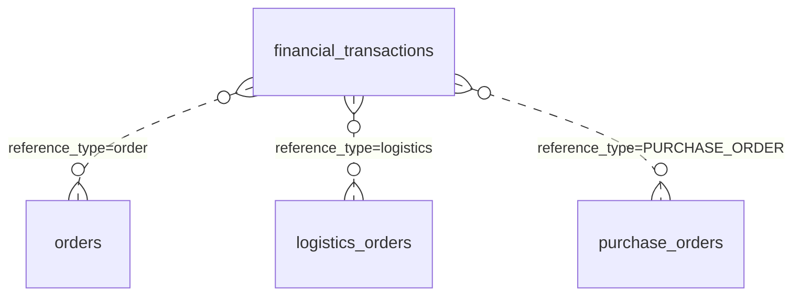
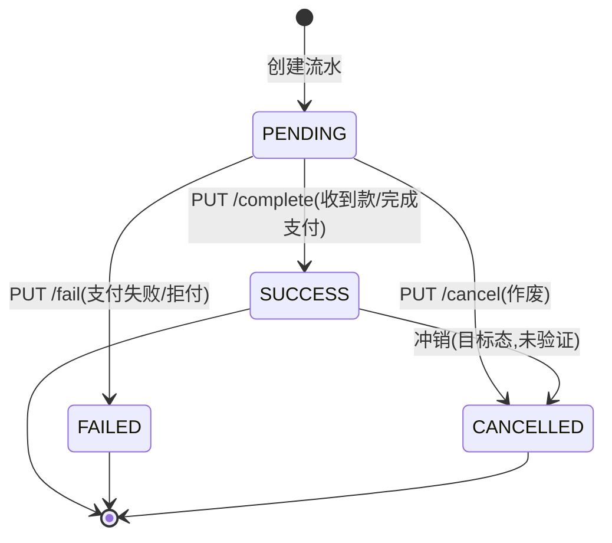

# 功能规格 · 财务管理（支撑域）

| 项 | 内容 |
|---|---|
| 子域 | 支撑域（Finance Bounded Context） |
| 聚合根 | `FinancialTransaction`——🔄 2026-10-21 补：`domain/finance/aggregate/FinancialTransaction.java:19` **继承 `BaseAggregateRoot`**（与 `Warehouse`/`Product` 两个"自带 `domainEvents` 列表、靠反射兜底"的聚合不同，见 [warehouse.md §7](warehouse.md)），所以本域事件的取得走直路、不依赖反射 |
| 值对象 | `TransactionType`、`TransactionStatus` |
| 领域服务 | `FinancialTransactionService` / `FinancialTransactionServiceImpl`（`domain/finance/service/FinancialTransactionServiceImpl.java:21`，`DEFAULT_TENANT_ID` 也在这一层 `:26`） |
| 应用服务 | 🔄 **2026-10-21 补（原表未列）**：`application/service/finance/FinanceApplicationService.java:24`——**本域唯一的应用服务**（没有店铺侧/导入侧的第二份；导入逻辑住在 `FinanceImportApplicationService`，见 §6 末注） |
| 控制器 | 🔄 **2026-10-21 补（原表未列）**：`interfaces/controller/finance/` 实测 **2 个控制器 / 20 个端点 / 20 处守卫**＝`FinanceController` 9 端点 9 方法级 `@PreAuthorize` + `FinanceImportController` 11 端点 1 处**类级** `@PreAuthorize`（`:61`，覆盖整类） |
| 数据表 | `financial_transactions`——🔄 2026-10-21 `information_schema.COLUMNS` 实测 **11 列**（`transaction_id/tenant_id/type/amount/currency/reference_id/reference_type/description/status/created_at/updated_at`），`transaction_id` 是 `varchar(255)` 主键、库里**没有** `id` 列 |
| 前端 | ~~`frontend/user-web/src/pages/finance/{FinanceList,FinanceDetail,CreateFinance}.jsx`~~ → 🔄 **2026-10-21 复测：实测 4 个页面文件**，再加 `FinanceImport.jsx`（11 处 `financeImportApi.*` 调用点：`:106/:107/:108/:125/:146/:185/:216/:230/:251/:284/:300`）；`api.js` 侧对应 `financeApi:437-451`（~~`api.js:378-394`~~ 现行 `:437`）与 `financeImportApi:454` 起 |

---

## 1. 模块定位

财务是**结果层**：把订单（收入）、物流（运费支出）、采购（货款支出）、退款（负数）归集到统一的流水上，从而支持对账与毛利核算。

**核心设计**：`FinancialTransaction` 采用**多态引用** `referenceId` + `referenceType`，一张流水表可以挂到任意业务单据上——这是灵活的做法，代价是没有外键约束，且 `referenceType` 的合法取值只存在于调用方代码里（数据字典 R-05/R-08）。

**核心缺口**：~~流水目前只能手工录入，业务动作不自动产生流水，因此"自动记账"尚未发生~~ → 🔄 **2026-10-21 订正：这一段整体过期，是本文与 §4/§8 冲突的源头**。自动记账**三支里两支已闭合**（采购货款 BR-06、物流运费 BR-05/R-58，都是**同事务同步编排**写入，不走事件订阅），只剩**订单收入 `income`** 一支未闭合（BR-04）；手工 `POST` 与导入仍是有效入口，但已不是唯一入口。上面那句保留是为了说明"这一节曾经怎么错的"——引用 §1 判断自动记账状态时必须改判到 §4 的 BR 表。

---

## 2. 概念模型

| 字段 | 说明 | 备注 |
|---|---|---|
| `transaction_id` | 主键 | 由领域层赋值 |
| `type` | 收入/支出/退款/调整 | 存储为**小写 code** |
| `amount` | 金额 | ~~`DECIMAL(19,2)` ✅（本项目少数正确的金额字段）~~ → 🔄 **2026-03-22 按 `information_schema` 实测更正：`decimal(38,2)`**。`FinancialTransactionJpaEntity:33` 的 `@Column(name="amount", nullable=false)` **没写 `precision/scale`**，Hibernate 对未声明精度的 `BigDecimal` 默认给 38；全库唯一显式 `DECIMAL(19,2)` 的金额列是 `payment_infos.amount`。「比 `DOUBLE` 强」这个结论不变（DECIMAL 仍是正确方向），但**精度口径与文档描述不一致**，且 38,2 与 19,2 混用在同库里 ⇒ 见 [../db/data-dictionary.md](../db/data-dictionary.md) R-09 与 [../db/migration-plan.md](../db/migration-plan.md) `V7`。✅ **2026-10-10 已收敛（ISS-023 / R-53，见 [../qa/known-issues.md](../qa/known-issues.md) §20）**：`financial_transactions.amount` 现为 **`DECIMAL(19,2)`**（`V7.2` + `V7.2.1` 影子列流程把 38,2 收窄；本表迁移时与本轮 02:51 复算**都是 0 行**，因此收窄没有数据风险；采购那一侧的对照见 [purchase.md](purchase.md) BR-03 里的**时点值** 350 行 / `1644.00`），`FinancialTransactionJpaEntity:33` 已显式写 `precision = 19, scale = 2` —— 未声明时 Hibernate 按默认宽度 38 建列，这正是 38,2 的成因。全库定点金额列现在**只有两种宽度**（14 × 19,2 + 每克费率 19,4），常驻巡检是 `smoke.sh` §14 的 `14.0b` |
| `currency` | 币种 | ~~`CHAR(3)`，全库唯一显式收紧长度的列~~ → 🔄 **2026-10-21 复测：形态写错了**——实体是 `@Column(name = "currency", nullable = false, length = 3)`（`FinancialTransactionJpaEntity:36`），`ddl-auto: update` 按 `length` 建出的是 **`varchar(3)`**（`information_schema.COLUMNS` 实测），不是 `CHAR`。结论的另一半仍然成立：**3 位是被 DDL 挡住的**（超长写入直接被拒），但"全库唯一显式收紧长度"这句本轮没有复算，按"币种是唯一被显式限长到 3 的业务列"理解即可；无 ISO 4217 字典校验（BR-02） |
| `reference_id` / `reference_type` | 多态指向业务单据 | 无外键、无枚举约束。🔄 **2026-10-21 实测补两条**：① 两列都是 **`varchar(255)`**（与 `transaction_id`/`tenant_id` 同形），不是编码列；② **实际落库值是 UPPER_SNAKE，不是上面 ER 图里的小写**——库里现存 5 行全部 `reference_type='PURCHASE_ORDER'`、`reference_id='PO-26f97e2a'` 这类**单号**；运费侧写的是常量 `LOGISTICS_ORDER`（`FinanceApplicationService:33`）且 `reference_id` 存物流单的 **UUID 主键**（`iss138` 探针门 A 的实测取值见 §9 第 4 条）。⇒ 上面那张 mermaid 里的 `reference_type=order`／`=logistics` 三种取值**一个都没被真正写过**，手工 `POST` 又能塞任意字符串，所以这个"枚举"事实上只存在于调用方代码里（数据字典 R-08 的口径，本轮按活库值订正） |
| `status` | 待处理/成功/失败/已取消 | 存储为**小写 code** |
| `description` | 摘要 | — |

---

## 3. 状态机

> 🔄 **2026-10-21 按活码把这张图钉一遍**（三处与图不符）：
> 1. **`SUCCESS --> CANCELLED` 这条"冲销"边没有任何实现口**。`cancel()` 的门正是**拒绝**从 `SUCCESS` 出发（`FinancialTransaction:176-177`「交易已成功，无法取消」），R-59 的冲销逻辑也只在 `PENDING` 上调 `cancel`、`SUCCESS` 一律抛业务错误挡住删除（`FinanceApplicationService.reverseTransactionsForDocument:280-297`）⇒ 想冲销一笔已确认的分录，当前**只能走下面第 3 条那个旁路**。
> 2. **`FAILED`／`CANCELLED` 是终态**（没有出边，也没有任何端点能把它们拉回 `PENDING`）——图的这条口径成立，代价是财务**没有 DELETE 端点**，录错只能作废、行永久留痕。
> 3. **唯一的旁路**：`applyPlatformUpdate()`（`:200-216`）不读起点状态，`:210` 只比较 `newStatus != this.status` ⇒ 平台回传/导入映射可以把任意一条流水直接改成任意态，**三门全绕**（BR-08 破口②）。

| 枚举名 | 存储值 | 中文 |
|---|---|---|
| `PENDING` | `pending` | 待处理 |
| `SUCCESS` | `success` | 成功 |
| `FAILED` | `failed` | 失败 |
| `CANCELLED` | `cancelled` | 已取消 |

### 交易类型

| 枚举名 | 存储值 | 中文 | 典型来源 |
|---|---|---|---|
| `INCOME` | `income` | 收入 | 订单完成 ⚪ |
| `EXPENSE` | `expense` | 支出 | 运费、采购货款 —— ~~⚪~~ → 🔄 **2026-03-22：采购货款这一支已自动入账**（到货编排写 `EXPENSE`，`reference_type="PURCHASE_ORDER"`，见 BR-06）；~~**运费仍不自动入账**~~ → ✅ **2026-10-10 运费这一支也已自动入账**（BR-10 / R-58，见 [logistics.md](logistics.md) 与 [../qa/known-issues.md](../qa/known-issues.md) §22）。**入账时点不是建单而是"货已交出"**（`PICKED_UP`/`IN_TRANSIT`/`DELIVERING`/`DELIVERED` 四个发货门），金额直接取 `logistics_fees.total_fee` 的落库值、**不重算**；`LogisticsCompletedEvent` 的处理器仍是空壳（`EventHandler.java:77-88` 只打日志），因为记账走的是**同步编排**而不是事件订阅。⚠️ 上一段说的"运费只有手工/导入"其实是因为**运费金额本身根本没落库**（ISS-137），那一半也已在 R-55~R-57 修好 |
| `REFUND` | `refund` | 退款 | 买家退款 ⚪ |
| `ADJUSTMENT` | `adjustment` | 调整 | 对账差异/汇兑 ⚪ |

---

## 4. 业务规则

| 编号 | 规则 | 状态 | 说明 |
|---|---|---|---|
| BR-01 | 金额必须为正数（方向由 `type` 表达） | ~~🟡 建议在领域层强制校验~~ → 🟡 **2026-10-21 复测：三门已有其二，"正数"这一门仍缺** | 领域层构造校验（`FinancialTransaction.create:70-128`，入参校验块 `:88-99`）实测挡住了**空值**（`:93`「金额(amount)不能为空」）与**零值**（`:96`「金额(amount)不能为0，零金额交易无记账意义」，`applyPlatformUpdate:203` 另有一份同文案），但**没有任何一条负数判据** ⇒ `POST /api/finance/transactions` 送 `amount = -100` 会正常建出一行 `income` 负数流水（活库 11 列里 `amount` 是 `decimal(19,2)`、无 CHECK 约束）。币种同理：`create:98-99` 只挡 null/blank |
| BR-02 | 币种使用 ISO 4217 三字符代码 | 🟡 **2026-10-21 复测：长度被 DDL 挡住，成员没有字典** | ~~`CHAR(3)`，但无字典校验~~ → 现行 `varchar(3)`（实体 `length = 3`，`FinancialTransactionJpaEntity:36`）⇒ **超长被拒、但 `xyz`／`zzz` 这类合法长度非法币照样入库**；全仓无 `Currency` 枚举与校验点（`grep` 领域层无币种字典）。现存 5 行实测全为 `CNY`，是写入方约定不是校验结果 |
| BR-03 | 同一业务单据的同类流水不可重复生成（幂等） | ⚪ **仍不达标（应用侧已成立，DB 侧无防线）** | **2026-10-10 现状**：幂等目前**只有应用侧判据** —— `LogisticsApplicationService.postFreightExpense` 入账前先按 `(reference_id, 'LOGISTICS_ORDER', type=EXPENSE)` 查一次，命中即跳过；实测由 `iss138-freight-posting-probe.sh` 的门 B/C 覆盖（同一门重复推进 ⇒ 分录入数**不变**），`FreightPostingGuardTest.postingIsGuardedByIdempotencyCheck` 静态守卫。**但 DB 侧仍无任何索引可依赖**：`SHOW INDEX FROM financial_transactions` 实测**只有 `PRIMARY(transaction_id)` 一条**（2026-10-10 当场复取），既没有建议的 `UNIQUE(reference_id, reference_type, type)`（R-05），连非唯一索引也没有 ⇒ ①并发/重放同一单据仍会**重复入账**（查-再写不是原子操作，实体也无 `@Version`）；②每次入账判据都是一次全表扫。R-59 的"留痕不删行"语义（`PENDING` 冲销为 `cancelled` 后行仍在）让这个判据更长命，补索引的收益也更明显。 🔄 **2026-10-21 当场复取**：`SHOW INDEX FROM financial_transactions` 仍只回 **`PRIMARY(transaction_id)`** 一条；表 11 列、5 行数据（全 `PURCHASE_ORDER` / `expense` / `pending` / `6.00` / `CNY`，`reference_id` 是 5 个互不相同的 `PO-…`）⇒ 现有数据里**没有重复 `(reference_id, reference_type, type)` 组合**，补唯一索引不需要先去重（成本窗口与 §8 P1「无幂等约束」同一口径） |
| BR-04 | 订单完成时自动产生 `income` 流水 | ⚪ | 无联动（核心缺口，`OrderCompletedEvent` 侧只有日志） |
| BR-05 | 物流单创建时自动产生 `expense` 流水 | ⚪ → ✅ **2026-10-10（口径订正：入账时点不是"创建"，是"货已交出"）** | 原表述把时点写错了 —— 建单时运费只是**预估**（R-55 在 `logistics.md` BR-04 定的口径：只有首重续重、没有真实称重），建单即入账等于把预估当实际支出记账。**实现按 R-58 收口为"发货即入账"的四类入口 + 一个例外**：`LogisticsApplicationService` 的 `ship`（手工揽收/PUT 发货，`:256`）/ `shipSingle`（批量发货，`:413`）/ `persistStatusChange`（PUT 状态推进到交出态，`:440`）都调 `postFreightExpense`（`:506`），覆盖 `PICKED_UP`/`IN_TRANSIT`/`DELIVERING`/`DELIVERED`/`DELIVERY_FAILED`；HTTP 建单 `createLogisticsOrder`（`:114`）**只在 `shipImmediately=true`（建单即发货）这一支入账**（`:131-139`，纯建单仍是 `PENDING` ⇒ 不入账）；**编排/事件建单路径恒不入账**（`FreightPostingGuardTest.orchestrationCreatePathStaysUnposted`）。金额读 `logistics_fees.total_fee` 落库值、**从不重算**（`freightPostingNeverRecomputesTheFee`）。⚠️ 三点必须知道的口径：①分录落库为 `pending`，要 `PUT /api/finance/transactions/{id}/complete` 才是 `success`（`success` 才算确认）；②`0.00` 运费不入账（负例实测 `zeroFreightDoesNotPost`）；③**删除源单会先冲销分录**（R-59 / `reverseTransactionsForDocument`，`FinanceApplicationService.java:280`）：已有 `SUCCESS` 分录 ⇒ **挡住删除**并返回 HTTP 400 + 中文原因，`PENDING` ⇒ 置 `cancelled` 且**保留行**（审计留痕）。常驻证据：`iss138-freight-posting-probe.sh` 45 条断言（15:40 复跑 45/0）+ 三层测试 8/13/4 例，详见 [../qa/known-issues.md](../qa/known-issues.md) §22。**仍开放**：平台物流导入链路不入账（`LogisticsImportApplicationService.java:403` 自己 save，不经发货门）。旧口径「`LogisticsCompletedEventConsumer`（`:27-32`，注释 `:30`「记账规则未定义」；该类默认不装配，见 §8）只打日志」⚠️ **已被超越**：记账规则即 R-58，且实现走同步编排，**不依赖该 consumer**（也不依赖 ISS-062 的事件通道） |
| BR-06 | 采购到货入库时自动产生 `expense` 流水 | ~~⚪~~ → ✅ **2026-03-22** | ~~无联动~~ → `PurchaseApplicationService.markPurchaseOrderAsDelivered()`（`purchase/PurchaseApplicationService.java:256-262`）在同事务内先入库再记账：`createPurchasePayable()`（`:299-310`）调本域的 `createFinancialTransaction(TransactionType.EXPENSE, totalAmount, "CNY", purchaseOrderId, "PURCHASE_ORDER", description, tenantId)`（`:307-308` → 本域 `FinanceApplicationService.java:72` 的 7 参重载）。⚠️ 三点口径：①`TransactionType` **没有「应付」值**，用的是 `EXPENSE`，靠 `reference_type="PURCHASE_ORDER"` 识别（常量 `:45`）；②**金额为 0/空时跳过入账**但仍完成入库（`:301-304`）；③`financial_transactions` **无 `(reference_id,reference_type)` 唯一键、实体无 `@Version`** ⇒ 并发重复到货会重复入账（见 [../db/data-dictionary.md](../db/data-dictionary.md)）。测试：`PurchaseApplicationServiceTest:74-113` |
| BR-07 | 退款发生时产生 `refund` 流水并冲抵原收入 | ⚪ | 无退款流程 |
| BR-08 | 流水状态只在 `PENDING` 时可推进 | 🟡 **域内有门（2026-10-21 逐行复读），但"业务拒绝"的响应形状仍不达标** | 服务端**不是**没校验：`FinancialTransaction.complete()`（门 `:138-139`）与 `fail()`（`:158-159`）在非 `PENDING` 时抛异常，`cancel()`（`:176-177`）在 `SUCCESS` 时拒绝 ⇒ 三条推进口都有门（R-59 挡删除正是复用 `SUCCESS` 这一条）。⚠️ **两处必须知道的破口**：①**抛的是 `IllegalArgumentException` 而不是 `BusinessException`**，而 `FinanceController` 的 `complete`/`fail`/`cancel` 各自 `catch (BusinessException) { throw e; }` + `catch (Exception e) { return Result.error(...) }`（如 `:215-218`）⇒ 违规推进得到的是 **HTTP 200 + `Result.code` 失败**，正是 ISS-136 已经治理过的那个反模式（这一支当时没收，因为只有 `BusinessException` 会走 `GlobalExceptionHandler` 的 400）；②`applyPlatformUpdate()`（`:200-216`）可以**绕过全部三门**直接把 `status` 改成任意值（`:210` 只做 `newStatus != null && newStatus != this.status` 比较，不校验起点状态）⇒ 平台回传路径是状态机的旁路。**尚未实测**：~~本轮库里只有 4 条 `pending` 采购分录~~ → 🔄 2026-10-21 复测 **5 条**，仍全是 `pending`、仍没有一条能安全地拿去撞门（财务无 DELETE 端点，推进错了删不掉），为不留脏数据而按代码读证登记，改判留给 §9 第 3 条的常驻断言（见 [../qa/known-issues.md](../qa/known-issues.md) §22 开放缺口） |
| BR-09 | 支持按关联单据追溯（钻取到源单） | ~~🟡 `GET /by-reference` 可用，前端未接~~ → 🟡 **2026-10-21 复测：前端已接，缺的是"钻到源单"这一步** | `GET /by-reference`（`FinanceController:188`）已由 `api.js:449-450` → `FinanceDetail.jsx:54` 接上，但页面展示的是**流水列表**，没有任何一处从 `referenceId` 反查并跳到物流单/采购单详情 ⇒ "追溯"停在数据层。⚠️ 更要紧的是**钻取键不同形**（见 §9 第 4 条）：运费侧存物流单 UUID，采购侧存单号 `PO-xxxxxxxx`，前端要接跳转必须先按 `referenceType` 分派 |
| BR-10 | 支持按时间区间查询与导出 | ~~⚪ 无时间范围查询~~ → 🟡 **2026-10-21 复测：区间已到位，导出没有** | `GET /api/finance/transactions` 的 `from`/`to`（`:100-103`，`@DateTimeFormat(iso = DATE_TIME)`）+ `FinancialTransactionSpecification.withQuery(...)` 已生效（实测边界见 §8 第一条）；**导出仍 ⚪** —— `/api/finance/import/template` 是导入模板不是报表导出 |
| BR-11 | 对账差异生成 `adjustment` 流水并留痕 | ⚪ | 无对账引擎 |

---

## 5. 功能清单

| 功能 | 前端 | 后端 | 状态 |
|---|---|---|---|
| 创建流水 | `CreateFinance.jsx:25`（~~未提交~~ → 🔄 **2026-10-21 复测：这一行与 §8 自相矛盾，§8 是对的**——页面唯一的调用点 `financeApi.createTransaction`，`api.js:443`） | `POST /api/finance/transactions`（映射 `:63`，守卫 `:60` `finance:write`，留痕 `:61`） | 🟡 手工录入。**⚠️ 契约已换形**：~~`?type=income\|expense\|…` query 参数~~ → 现行是 `@RequestBody CreateFinancialTransactionRequest`（`:64`，字段 `type/amount/currency/referenceId/referenceType/description/tenantId`，`@Schema(example = "default-tenant")` 在 DTO `:36`）；租户经 `resolveTenant(request.getTenantId())` 三级回落（调用 `:75`、定义 `:117-125`，注释点名 ISS-118）。`catch (BusinessException e) { throw e; }` 在 `:77-81`（ISS-136 留下的穿透口），但兜底 `catch (Exception)` 仍把其它异常压成 **HTTP 200 + `code "500"`**（`:82-83`）⇒ 负数金额这类"领域层 `IllegalArgumentException`"永远拿不到 4xx（见 §8 新增行） |
| 流水详情 | `FinanceDetail.jsx:29`（`getTransactionById`） | `GET /api/finance/transactions/{transactionId}`（~~`FinanceController.java:106`~~ 现行 `:133`，守卫 `:132`） | ~~🟡~~ → 🟡 **2026-01-25 逐页复测**（判据：页面内 `*Api.` 调用点数）：`FinanceDetail.jsx` 有 2 个 `financeApi.*` 调用点，已联网。 🔄 2026-10-21 补：主键不存在时领域服务抛 **`IllegalArgumentException`**（`FinancialTransactionServiceImpl:90-91`「财务交易不存在: …」）而**不是** `EntityNotFoundException` ⇒ 全仓那一条 404 `ENTITY_NOT_FOUND` 映射（`GlobalExceptionHandler:64`）在本域**永远不会命中**；再叠加控制器 `:140-141` 的 `catch (Exception)` 兜底 ⇒ 实测形状是 **HTTP 200 + `code "500"` + 原始 message**。同域三个读端点与三个状态推进端点同形（M-08 形态①在本域是 8/9 个端点，只有分页列表 `:92` 不套 try/catch） |
| 按状态查询 | **无前端调用者**（`financeApi` 里根本没有对应方法，`api.js:437-451` 七个方法逐个对过） | `GET /by-status`（~~`FinanceController.java:121`~~ 现行 `:150`，守卫 `:149`）；另有分页全量列表 `GET /api/finance/transactions`（~~`:79`~~ 现行 `:92`，`page` 默认 0 `:94` / `size` 默认 20 `:95`） | ~~🟡~~ → 🟡 **2026-01-25 逐页复测**（判据：页面内 `*Api.` 调用点数）：`:53`~~调 `financeApi.getTransactions(params)`（`api.js:381`）~~ 现行 `FinanceList.jsx:54` + `api.js:440`，分页列表已接；~~`/by-type`（`:138`）、`/by-reference`（`:155`）也已联网~~ → 🔄 **2026-10-21 复测：这句对 `/by-reference` 成立、对 `/by-type` 与 `/by-status` 不成立**——`financeApi` 只有 `getTransactionsByReference`（`api.js:449-450`，被 `FinanceDetail.jsx:54` 调用），**没有任何方法打 `/by-type` 或 `/by-status`**，前端全仓 grep `by-status`／`by-type` **0 命中** ⇒ 这两条只能靠 HTTP 直接调 |
| 按类型查询 | **无前端调用者** | `GET /by-type`（~~`:138`~~ 现行 `:169`，守卫 `:168`） | 🟡 出参 `Result<List<…>>` **无分页无 limit**（M-07 口径，本轮按活码重数见 §8）；服务侧走"查后过滤"：`findByType` 的 SQL 没有租户条件（`FinancialTransactionJpaRepository:35`），租户是在应用层内存里筛掉的（`FinanceApplicationService:137` → `withinCurrentTenant:249-257`） |
| 按关联单据查询 | `FinanceDetail.jsx:54`（`getTransactionsByReference`，`api.js:449`） | `GET /by-reference`（~~`:155`~~ 现行 `:188`，守卫 `:187`） | 🟡 同样"查后过滤"（`findByReferenceIdAndReferenceType` `:44` 无租户谓词 + `FinanceApplicationService:148`）；⚠️ `referenceId` 与 `referenceType` 都是**必填** query 参数（`:190` 与 `:191`，裸 `@RequestParam`），缺省即 400 `VALIDATION_ERROR`（`MissingServletRequestParameterException` → `GlobalExceptionHandler` 请求绑定分支 `:287-305`） |
| 标记成功 | **无前端调用者**（`api.js:445` 有 `completeTransaction`，但**没有任何页面调它**） | `PUT /{transactionId}/complete`（`:210`，守卫 `:208`、留痕 `:209`） | 🟡 门在（`FinancialTransaction.complete():138-141`），但违规抛 `IllegalArgumentException` → 被 `:217` 的兜底 catch 压成 HTTP 200（BR-08 破口①，本轮复测仍在） |
| 标记失败 | 同上（`api.js:446` 无人调用） | `PUT /{transactionId}/fail`（`:228`，守卫 `:226`、留痕 `:227`） | 🟡 同 `complete`（`fail():157-160`） |
| 作废 | 同上（`api.js:447` 无人调用） | `PUT /{transactionId}/cancel`（`:246`，守卫 `:244`、留痕 `:245`） | 🟡 同 `complete`（`cancel():176-179`，只挡 `SUCCESS`）；🔄 本条现在**有真实业务用途**——R-59 的"删源单先冲销"就是调它这一语义（`FinanceApplicationService.reverseTransactionsForDocument:280`） |
| 平台财务流水导入 | `FinanceImport.jsx`（11 个 `financeImportApi.*` 调用点 `:106/:107/:108/:125/:146/:185/:216/:230/:251/:284/:300`） | `FinanceImportController`（前缀 `/api/finance/import`）11 个端点，**类级** `@PreAuthorize` `:61`（`finance:import`） | 🟡 **2026-10-21 补（本表此前完全没有这一行）**：目标字段 `GET /target-fields :69`、转换算子 `GET /transforms :75`、**交易类型 `GET /transaction-types :81`**（这是财务侧比其它导入域多出来的一条，把 `TransactionType` 枚举当可映射目标暴露）、字段映射 `GET /field-mappings :87` 与 `PUT :96`、预演 `POST /preview :102`、上传 `POST /upload :114`（multipart）、建任务 `POST :151`、任务列表 `GET /jobs :162`、任务详情 `GET /jobs/{jobId} :172`、模板 `GET /template :178`（`text/csv`）。⚠️ 页面把租户写死在 `DEFAULT_TENANT_ID`（`FinanceImport.jsx:32` 导入、`:126`/`:146` 使用），而该常量是 **模块加载时**读一次 `localStorage.getItem('tenantId')`（`constants/order.js:7`）⇒ 换租户登录而不刷新页面时，映射与任务列表仍指向上一个租户 |
| ~~**全量列表 / 时间区间 / 分页**~~ | — | ~~**无端点**~~ | ~~⚪ **P0 缺口**~~ → ✅ **2026-10-21 复测：本行与 §8 第一条自相矛盾，本行的旧口径作废**——`GET /api/finance/transactions`（`:92`）九个参数齐（`page :94`/`size :95`/`type :96`/`status :97`/`referenceId :98`/`referenceType :99`/`from :100-101`/`to :102-103`/`tenantId :104`，`from`/`to` 用 `@DateTimeFormat(iso = DATE_TIME)`），SQL 侧由 `FinancialTransactionSpecification.withQuery(...)` 拼、`sort by createdAt DESC`、`size` 夹在 `[1,100]`（`FinancialTransactionRepositoryImpl:126-129`） |
| **自动记账（由业务事件驱动）** | — | 无 | ⚪ **P1 缺口**（三支里只剩"订单收入"，见 BR-04/§8） |
| **对账差异处理** | — | 无 | ⚪ |
| **报表与导出** | — | 无（⚠️ **2026-10-21 订正**：`/api/finance/import/template` 那个 `text/csv` 端点是**导入模板**，不是导出报表，别把它当这一条的交付） | ⚪ |

---

## 6. 接口对照

| 场景 | 方法 | 路径 |
|---|---|---|
| 创建交易 | POST | `/api/finance/transactions`（~~`?type=income\|expense\|refund\|adjustment`~~ → 🔄 2026-10-21：映射 `:63`，**入参是 JSON body**（`CreateFinancialTransactionRequest`，`type` 是 body 字段不是 query）） |
| 详情 | GET | `/api/finance/transactions/{transactionId}`（`:133`） |
| 分页条件列表 | GET | `/api/finance/transactions`（`:92`，九参数，见 §5） |
| 按状态查 | GET | `/api/finance/transactions/by-status?status=`（`:150`） |
| 按类型查 | GET | `/api/finance/transactions/by-type?type=`（`:169`） |
| 按关联单据查 | GET | `/api/finance/transactions/by-reference?referenceId=&referenceType=`（`:188`） |
| 标记成功 | PUT | `/api/finance/transactions/{transactionId}/complete`（`:210`） |
| 标记失败 | PUT | `/api/finance/transactions/{transactionId}/fail`（`:228`） |
| 作废 | PUT | `/api/finance/transactions/{transactionId}/cancel`（`:246`） |

> 🔄 **2026-10-21 补：本域对外是 20 个端点，上表此前只列了 8 个（连分页列表都没有），且完全没有导入侧**。鉴权与留痕口径：
>
> | 控制器 | 端点 | `@PreAuthorize` | `@Auditable` |
> |---|---|---|---|
> | `FinanceController` | 9 | **9/9 方法级**——读 5 条用 `finance:read`（`:132/:149/:168/:187` + 分页 `:91`），写 4 条用 `finance:write`（`:60/:208/:226/:244`），全为 `hasRole('PLATFORM_ADMIN') or hasAuthority('…')` 的**或**关系 | **4 处**：创建 `:61`、完成 `:209`、失败 `:227`、取消 `:245` ⇒ 恰好覆盖 4 个写端点，读端点不留痕 |
> | `FinanceImportController` | 11 | **1 处类级**（`:61`，`finance:import`）覆盖全类 11 端点（写法与 `WarehouseImportController` 的 10 处方法级不同） | **3 处**，恰好是这一类的 3 个写端点：字段映射 `PUT :95`、文件上传 `POST :113`、执行导入 `POST :150`（`FINANCE_IMPORT_EXECUTE`）⇒ 8 个读端点不留痕 |
>
> 权限点侧：`finance:read`／`finance:write`／`finance:import` 三点都在 catalog（`domain/tenant/PermissionPoints.java`，全表 25 租户级 + 1 平台级 = 26），且都被真正检查——财务是 M-06 那轮"种了没人查"清零时的第一批反例。计量口径见 [../security-findings.md M-06 复测第 3 条](../security-findings.md)。

---

## 7. 领域事件

| 事件 | 期望下游 | 现状 |
|---|---|---|
| `FinancialTransactionCreatedEvent` | 更新资金账户余额 | ~~⚪~~ → 🟡 **2026-10-21 复测：注册与发布都有，缺的是订阅者**。注册 1 处（`domain/finance/aggregate/FinancialTransaction.java:117`，在 `create:70` 的工厂末尾）；发布随聚合走 **`FinanceApplicationService:103`**（`createFinancialTransaction` 的 `publishEventsFrom`，6 参重载 `:61-68` 直接委托 7 参 `:84`，两者共用这一条出口；委托时传 `tenantId = null`，于是落到 `resolveWriteTenant(null, DEFAULT_TENANT_ID)` `:101`）与导入侧 `:371`；topic 已由包名命中 `finance-events`（`DomainEventPublisher.getTopicForEvent:110-129`）。⚠️ 但**没有任何订阅者**：进程内 4 个 `@EventListener`（`EventHandler:45/:61/:76/:92`）与 4 个 `*EventConsumer` 类里都没有它，且它是 24 个事件类中**没有 `@JsonCreator` 的 20 个之一** ⇒ 就算将来补一个 MQ 消费者，反序列化还得再补构造器。**"更新资金账户余额"这一支连表都没有**（§8 P2「无账户概念」），所以这条的 ⚪ 判定不在事件层，在模型层 |
| `FinancialTransactionStatusChangedEvent` | 触发对账状态刷新 | ~~⚪~~ → 🟡 **2026-10-21 复测：这是本域发得最多的事件（4 个注册点），下游同样是零**。注册：`complete():146`、`fail():165`、`cancel():184`、`applyPlatformUpdate():214`（`FinancialTransaction.java`）；发布：**6 处**——应用服务 `FinanceApplicationService:103,210,226,242` + 导入侧 `FinanceImportApplicationService:354,371`（`:352`/`:368` 两处 `applyPlatformUpdate` 之后各跟一次发布）。⚠️ 消费端 0（同上），所以"对账状态刷新"没有任何载体；而 R-59 的删除冲销（`reverseTransactionsForDocument:280`）走的也是**同步调用 `cancel()`**，事件照样发、照样没人接。 🔄 本表两行与 [warehouse.md §7](warehouse.md) 同形，说明这不是仓储一域的偶发遗漏：**全仓 24 个事件类里只有 4 个有订阅**（那 4 个恰好就是带 `@JsonCreator` 的 4 个），判定某条联动是否存在要**两步都查**——先看有没有发布点，再看 `EventHandler` 的 4 个 `@EventListener`／4 个消费者类里有没有它 |

---

## 8. 现状缺口与待办

| 优先级 | 缺口 | 建议 |
|---|---|---|
| ~~**P0**~~ → ✅ 已完成 | ~~无全量列表、无时间区间查询、无分页~~ → **2026-10-10 当场复验**（建议里的端点早已存在，只是这一行一直没改判）：`GET /api/finance/transactions`（`FinanceController.java:92-104`）已支持 `page`/`size`/`type`/`status`/`referenceId`/`referenceType`/`from`/`to`/`tenantId` 九个参数并按创建时间倒序。实测四条：无过滤 `total=4`；`from=2099-01-01T00:00:00` ⇒ `total=0`；`to=2000-01-01T00:00:00` ⇒ `total=0`；`from=2000&to=2099` ⇒ `total=4`（等于全量，说明两侧边界都生效）。响应形状是 `PageResult`，数组字段名为 **`content`**（不是 `records`）。⚠️ 仍未被常驻断言覆盖的一半：`from`/`to` 只有本轮这一组手工实测，`iss138` 探针只用到 `type`/`referenceType` ⇒ 时间区间缺一条回归位（列入 [../qa/smoke-test-checklist.md](../qa/smoke-test-checklist.md)） | 补一条常驻断言：同一批数据在"区间内 / 区间外"两次的 `total` 必须差于全量 |
| ~~**P0**~~ → ✅ 已完成 | ~~前端三个页面全部 mock~~ → **2026-01-25 逐页复测**（判据：页面内 `*Api.` 调用点数）：`FinanceList.jsx`(1)、`FinanceDetail.jsx`(2)、`CreateFinance.jsx`(1) 全部调真实接口，页面内已无 mock 数组 | ~~补齐 `financeApi`~~（`api.js:378-394` 的 `financeApi` 已含分页列表/详情/按状态/按类型/按关联查询与创建） |
| **P1** | ~~业务不自动产生流水~~ ✅ **2026-10-10：三支里两支已闭合，只剩"订单收入"一支** | ~~消费 `OrderCompletedEvent` / `LogisticsOrderCreatedEvent` / `PurchaseOrderStatusChangedEvent` 自动生成对应流水~~ → ①**到货货款**已由**同事务同步编排**写入（BR-06）；②~~物流运费仍未自动入账~~ → **运费也已闭合**（BR-05/BR-10 + R-58/R-59，2026-10-10），且同样走同步编排而非事件订阅，所以**不依赖 ISS-062**；③**订单收入 `income` 仍未闭合**（BR-04，`OrderCompletedEvent` 侧只有日志）——这一支要先定义"收入确认时点"（下单？发货？签收？退款窗口关闭？）再选通道。⚠️ `LogisticsCompletedEvent` 侧的**两处**空壳都还在，且**都不是**运费入账的通道：进程内 `EventHandler.handleLogisticsCompletedEvent()`（`:77-88`，`@EventListener`，默认装配，try 块里只有一条日志）与 MQ 消费端 `LogisticsCompletedEventConsumer.onMessage()`（`:27-32`，注释 `:30` 直说「物流费用到财务结算记录的记账规则未定义」；且该类被 `@ConditionalOnProperty(rocketmq.internal-consumers.enabled=true)` 挡着，**默认根本不装配**，ISS-054）。前者那条注释**已过期**（规则即 R-58）⇒ 要么删掉这段死代码，要么在注释里写明"入账在同步编排里，这里不该再记一遍"，否则后来人很容易在这里加第二次 `postFreightExpense`（幂等判据会挡住重复分录，但语义仍然错） |
| **P1** | 无幂等约束 | 补 `UNIQUE(reference_id, reference_type, type)`。**2026-10-10 复核**：~~`SHOW INDEX FROM financial_transactions` 只有 `PRIMARY(transaction_id)` 一条~~ → 🔄 **2026-10-21 当场复取，结论不变**：`SHOW INDEX` 仍然只回 `PRIMARY(transaction_id)`（unique=1，一条）⇒ 运费入账的幂等目前**纯靠应用侧"先查后插"**（BR-03），并发/重放仍会重复入账，且每次判据是全表扫。R-58 让这张表开始按业务量增长，这条的优先级比登记时更高。 🔄 **本轮成本窗口更新**：活库现存 **5 行**（10-10 记的是 4 行），逐行实测为 `tenant_id=d0861d6f-…`、`type=expense`、`reference_type=PURCHASE_ORDER`、`reference_id=PO-xxxxxxxx`（5 个不同单号）、`status=pending`、`amount=6.00`、`currency=CNY` ⇒ **没有任何一行 `LOGISTICS_ORDER` 分录**（`iss138` 探针跑完就清场），也没有重复 `(reference_id, reference_type, type)` 组合。也就是说**现在补这条唯一索引不需要先去重**，与 [warehouse.md §9 第 5 条](warehouse.md) 里 `inventory_records` 的窗口同一性质——窗口会不会一直开着不由文档决定 |
| **P1** | 无报表与导出 | 至少提供三类：日记账、应收应付账龄、订单毛利；支持 Excel/CSV 导出 |
| 🔴 **P1（本轮新增）** | **本域拿不到 4xx：错误语义整体退化成 HTTP 200 + `code "500"`** | `FinanceController` 9 个端点里 **8 个**套了 `try { … } catch (BusinessException e) { throw e; } catch (Exception e) { return Result.error("…: " + e.getMessage()) }`（创建 `:65-84`、详情 `:135-141`、`/by-status :152-160`、`/by-type :171-179`、`/by-reference :192-200`、`complete :212-218`、`fail :230-236`、`cancel :248-254`），**只有分页列表 `:92` 不套**（异常得以进 `GlobalExceptionHandler` 换成真实状态码）。后果是这三类本应有 4xx 的失败全部落 200： ① **主键不存在**——领域服务抛的是 `IllegalArgumentException`（`FinancialTransactionServiceImpl:90-91`）而不是 `EntityNotFoundException` ⇒ 全仓那条 404 `ENTITY_NOT_FOUND`（`GlobalExceptionHandler:64`）在财务域**永远不会命中**； ② **违规状态推进**（BR-08 破口①）——`complete()/fail()/cancel()` 抛 IAE（`FinancialTransaction:140/:159/:178`），本该走 `:203-210` 的 400 `INVALID_OPERATION`，被本地 `catch (Exception)` 截走（`FinanceController:217/:235/:253`）； ③ **负数金额**（BR-01）——同理，将来补了负数判据也照样看不见 400，除非顺手把这里的兜底 catch 一起删。 `ISS-136` 那轮只把 `BusinessException` 穿透了（`catch (BusinessException) { throw e; }` 是它留下的痕迹，`FinancialTransactionServiceImpl` 里抛的全是 `IllegalArgumentException`，一条都不穿），**没有处理另一半**。修法二选一：领域层改抛 `InvalidOperationException`/`ValidationException`（与本仓其余域一致，`GlobalExceptionHandler` 已认），或按 `PurchaseController` 的先例删掉手工 catch |
| **P2（本轮新增）** | 三条 `/by-*` 读端点：无界返回 + 查后过滤 | `Result<List<…>>` 出参、无 `page`/`size`/`limit`（`:150`/`:169`/`:188`），SQL 侧 `findByStatus`/`findByType`/`findByReferenceIdAndReferenceType`（`FinancialTransactionJpaRepository:27/:35/:44`）**都没有租户条件**，租户是在应用层内存里筛掉的（`FinanceApplicationService:127/:137/:148` → `withinCurrentTenant:249-257`）。⚠️ 两个口径要分清： ① **不是越权**——`withinCurrentTenant:250` 取 `TenantAccessGuard.currentTenantId()`，非 null 时逐条比对，行为与"查前收敛"一致； ② 但 `:251-253` 在 `currentTenantId() == null` 时**整段不过滤**（平台管理员令牌不带 tenantId，与 `requireOwned:112-113`、`scopedTenantId:53-54` 同一套"平台管理员看全量"设计），此时这三条就是**全表载入内存**。 所以真实代价是"每次全表扫 + 全量映射 DTO"，不是数据泄露。与 [../security-findings.md M-07](../security-findings.md) 的"无界列表残留 7 个控制器"口径同源，本轮实测数：**全仓 43 处 `Result<List<…>>` 出参、分布在 17 个控制器**（`grep -rh 'Result<List<' interfaces/controller`），财务 8 处（`FinanceController` 3 + `FinanceImportController` 5）——M-07 那份 7 个控制器的名单只点了主控制器，引用时别当成全量口径 |
| **P2（本轮新增）** | 前端把状态推进做成了"有方法没入口" | `api.js:445-447` 的 `completeTransaction`／`failTransaction`／`cancelTransaction` 三个方法**没有任何页面调用**（逐页 grep `financeApi.` 只命中 4 处：`FinanceDetail.jsx:29`、`:54`、`CreateFinance.jsx:25`、`FinanceList.jsx:54`）⇒ 用户能建流水、能看流水，**不能在 UI 上把一条 `pending` 分录确认成 `success`**。而 R-58 的运费分录落库就是 `pending`（BR-05 口径①"要 `PUT …/complete` 才是 `success`，`success` 才算确认"）⇒ **确认这一步现在只能靠 API 或冒烟脚本**，财务列表里的金额在业务语义上一直是"未确认"。`/by-status`、`/by-type` 两条连 api.js 方法都没有（§5）。修法：`FinanceList.jsx` 的行操作区加三个按钮接 `:445-447`（后端守卫、留痕、状态门都已就位，纯前端工作量） |
| **P2** | 币种/汇率缺失 | 新增 `exchange_rates(date, from, to, rate)`，支持结算币种与本位币换算。🔄 **2026-10-21 补现状**：长度门已由 DDL 提供 —— `FinancialTransactionJpaEntity:36` 写了 `length = 3`，活库 `currency` 因此是 `varchar(3)`（本表 11 列里唯一收紧长度的），现存 5 行全 `CNY`；缺的是 **ISO 4217 成员字典**（BR-02 的校验仍不存在，`"XYZ"`/`"zz"` 之外只有长度能挡住）与**任何汇率落点** —— 本表 11 列没有 `exchange_rate`/`base_currency`，所以多币种流水只能按录入币种原样存 |
| **P2** | 无账户/资金账户概念 | 新增 `accounts` 表（现金/平台钱包/对公账户），流水绑定账户才有余额语义 |
| **P3** | 无平台账单导入 | 支持导入 Amazon/eBay 结算报告 CSV 做自动对账 |

---

## 9. 验收要点

1. 创建流水时金额为负、币种非法（非 3 位）应被拒绝。~~**2026-10-10 现状**：零金额已被拒（`FinancialTransaction.applyPlatformUpdate` `:202-204`~~ → 🔄 **2026-10-21 复测（口径补全）**：零金额在**创建口**就被拒 —— `create` 的校验块 `:95-96`「金额(amount)不能为0，零金额交易无记账意义」，`applyPlatformUpdate:202-203` 是另一份同文案；**负数仍无任何判据**（`:92-96` 只挡 null 与 `signum()==0`，`decimal(19,2)` 上无 CHECK）⇒ 送 `amount=-100` 正常建出一行负数流水；**币种长度**这一半已由 DDL 提供（实体 `length = 3` ⇒ 活库 `varchar(3)`，超长被拒），缺的是 **ISO 4217 成员字典**（`xyz` 这类合法长度、非法币种照样入库）。⇒ 本条仍属**未达成**，但"未达成的原因"和 10-10 记的不完全一样。
2. 同一单据重复创建同类流水应失败（幂等约束生效后）。**2026-10-10 现状**：自动入账路径（运费）已由应用侧幂等守住 —— `iss138-freight-posting-probe.sh` 的"同单再发货 + 再推状态 ⇒ 分录仍 1 条"；**手工 `POST /api/finance/transactions` 无任何判据**，同一单据可手工重复开若干条；🔄 2026-10-21 复测 DB 侧 `SHOW INDEX FROM financial_transactions` **仍只有 `PRIMARY(transaction_id)`**（表 5 行、5 个互不相同的 `PO-…` 键，无重复组合 ⇒ 补唯一索引现在不用先去重）⇒ R-05 的唯一索引仍未落。本条按"完全达成"看仍是 ⚪。
3. `PENDING` 之外的流水不可再次"标记成功"。**2026-10-10 现状**：门在（~~`FinancialTransaction.complete()` `:138-141`~~ → 现行 `:138-139`），但违规时得到的是 HTTP 200 + `Result.code` 失败而不是 4xx（见 BR-08 的破口①，本轮按活码复核仍在：`FinanceController:217-218` 的兜底 catch），且 `applyPlatformUpdate` 是旁路（破口②）⇒ 需一条常驻断言把"重复 complete"钉死。
4. 通过 `by-reference` 能查到某订单的全部关联流水（含收入、运费、退款）。**2026-10-10 现状**：**运费这一支实测可达** —— `GET /api/finance/transactions/by-reference?referenceId=<物流单id>&referenceType=LOGISTICS_ORDER` 在门 A 返回 `1|13.40`，与库行、`?type=EXPENSE&referenceType=LOGISTICS_ORDER` 列表三处同值（`iss138` 探针常驻断言）；**收入与退款两支还没有生产者**（BR-04/BR-07）。⚠️ 口径：`reference_id` 存的是**源单主键**，运费侧是物流单的 UUID 形状 id，而采购侧存的是单号 `PO-xxxxxxxx`（~~实测 4 条采购分录~~ → 🔄 2026-10-21 实测 **5 条**，`reference_id` 全是 `PO-…`）⇒ 两类的钻取键不同形，前端接 `by-reference` 时不能假设同一套 id 规则。
5. 订单完成后应能自动查到一条 `income` 流水（v0.2 验收项）。仍 ⚪（BR-04 未闭合）。
6. 单据被删除时其名下的应付分录必须一起处置，且不得留下指向不存在单据的"活分录"（R-59，**2026-10-10 实测达成**）：门 I 的判据是 `SELECT COUNT(*) FROM financial_transactions t LEFT JOIN logistics_orders l ON l.id=t.reference_id WHERE t.reference_type='LOGISTICS_ORDER' AND l.id IS NULL AND t.status<>'cancelled'` = **0**（探针第 11 节的"全库活孤儿分录"计数）；`PENDING` ⇒ 置 `cancelled` 且保留行，`SUCCESS` ⇒ HTTP 400 + 中文原因挡住删除、单据一张都没删（`@Transactional` 回滚，实测 `logistics_orders` 行仍在、分录仍是 `1|success`）。注意：这条判据把"孤儿"定义为**活分录孤儿**，`cancelled` 留痕行按设计允许长期存在，巡检脚本不能把它们当缺陷。
7. **业务拒绝必须返回 4xx，不得压成 HTTP 200 + `code "500"`**（ISS-136 的口径，**本域仍未达成**）。🔄 2026-10-21 实测：`FinanceController` 9 个端点里 **8 个**套了兜底 `catch (Exception)`（只有分页列表 `:92` 不套），叠加领域服务抛的是 `IllegalArgumentException`（`FinancialTransactionServiceImpl:90-91`）⇒ ①"主键不存在"在本域**永远拿不到 404**（`GlobalExceptionHandler:64` 的 `ENTITY_NOT_FOUND` 不会被命中），②"违规状态推进"拿不到 400。判据：`GET /api/finance/transactions/{不存在的id}` 应回 404 而不是 200 ⇒ 见 §8 的 🔴 P1 行与 [../security-findings.md](../security-findings.md) M-08。
8. **财务台账在 UI 上必须能确认分录**（R-58 的下游要求，**2026-10-21 实测未达成**）：运费/货款分录落库即 `pending`，"确认"动作只有 `PUT …/complete`，而 `api.js:445-447` 的三个方法无页面调用点 ⇒ 页面上所有金额在业务语义上恒为"未确认"。
