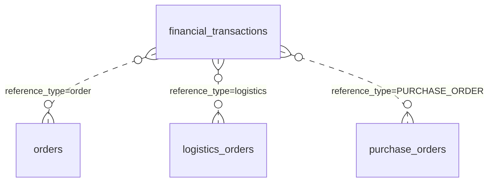
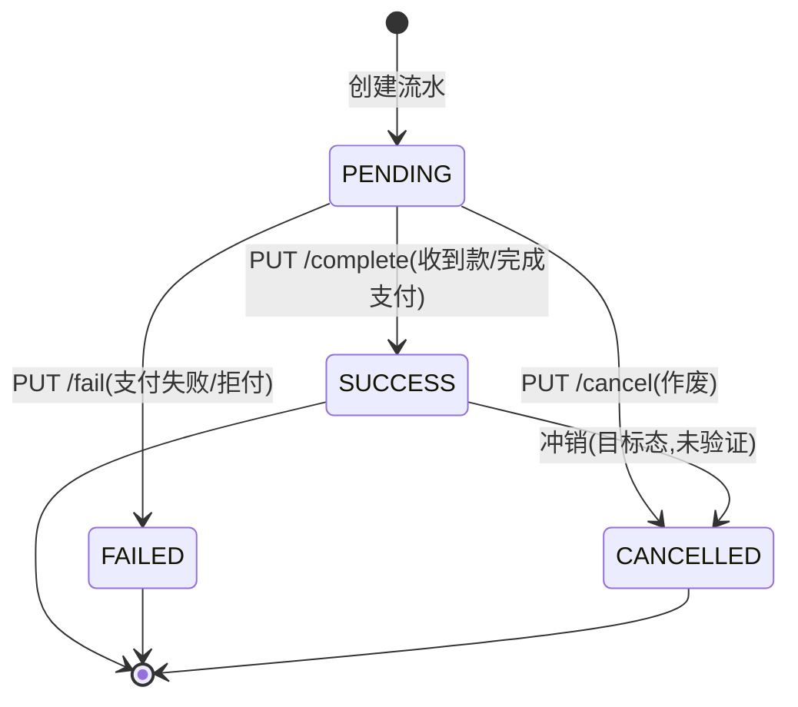

# 功能规格 · 财务管理（支撑域）

| 项 | 内容 |
|---|---|
| 子域 | 支撑域（Finance Bounded Context） |
| 聚合根 | `FinancialTransaction` |
| 值对象 | `TransactionType`、`TransactionStatus` |
| 领域服务 | `FinancialTransactionService` / `FinancialTransactionServiceImpl` |
| 数据表 | `financial_transactions` |
| 前端 | `frontend/user-web/src/pages/finance/{FinanceList,FinanceDetail,CreateFinance}.jsx` |

---

## 1. 模块定位

财务是**结果层**：把订单（收入）、物流（运费支出）、采购（货款支出）、退款（负数）归集到统一的流水上，从而支持对账与毛利核算。

**核心设计**：`FinancialTransaction` 采用**多态引用** `referenceId` + `referenceType`，一张流水表可以挂到任意业务单据上——这是灵活的做法，代价是没有外键约束，且 `referenceType` 的合法取值只存在于调用方代码里（数据字典 R-05/R-08）。

**核心缺口**：流水目前只能手工录入，业务动作不自动产生流水，因此"自动记账"尚未发生。

---

## 2. 概念模型

| 字段 | 说明 | 备注 |
|---|---|---|
| `transaction_id` | 主键 | 由领域层赋值 |
| `type` | 收入/支出/退款/调整 | 存储为**小写 code** |
| `amount` | 金额 | ~~`DECIMAL(19,2)` ✅（本项目少数正确的金额字段）~~ → 🔄 **2026-03-22 按 `information_schema` 实测更正：`decimal(38,2)`**。`FinancialTransactionJpaEntity:33` 的 `@Column(name="amount", nullable=false)` **没写 `precision/scale`**，Hibernate 对未声明精度的 `BigDecimal` 默认给 38；全库唯一显式 `DECIMAL(19,2)` 的金额列是 `payment_infos.amount`。「比 `DOUBLE` 强」这个结论不变（DECIMAL 仍是正确方向），但**精度口径与文档描述不一致**，且 38,2 与 19,2 混用在同库里 ⇒ 见 [../db/data-dictionary.md](../db/data-dictionary.md) R-09 与 [../db/migration-plan.md](../db/migration-plan.md) `V7` |
| `currency` | 币种 | `CHAR(3)`，全库唯一显式收紧长度的列 |
| `reference_id` / `reference_type` | 多态指向业务单据 | 无外键、无枚举约束 |
| `status` | 待处理/成功/失败/已取消 | 存储为**小写 code** |
| `description` | 摘要 | — |

---

## 3. 状态机

| 枚举名 | 存储值 | 中文 |
|---|---|---|
| `PENDING` | `pending` | 待处理 |
| `SUCCESS` | `success` | 成功 |
| `FAILED` | `failed` | 失败 |
| `CANCELLED` | `cancelled` | 已取消 |

### 交易类型

| 枚举名 | 存储值 | 中文 | 典型来源 |
|---|---|---|---|
| `INCOME` | `income` | 收入 | 订单完成 ⚪ |
| `EXPENSE` | `expense` | 支出 | 运费、采购货款 ~~⚪~~ → 🔄 **2026-03-22：采购货款这一支已自动入账**（到货编排写 `EXPENSE`，`reference_type="PURCHASE_ORDER"`，见 BR-06）；运费仍只有手工/导入，`LogisticsCompletedEvent` 的处理器是空壳（`EventHandler.java:76-87` 只打日志） |
| `REFUND` | `refund` | 退款 | 买家退款 ⚪ |
| `ADJUSTMENT` | `adjustment` | 调整 | 对账差异/汇兑 ⚪ |

---

## 4. 业务规则

| 编号 | 规则 | 状态 | 说明 |
|---|---|---|---|
| BR-01 | 金额必须为正数（方向由 `type` 表达） | 🟡 | 建议在领域层强制校验 |
| BR-02 | 币种使用 ISO 4217 三字符代码 | 🟡 | `CHAR(3)`，但无字典校验 |
| BR-03 | 同一业务单据的同类流水不可重复生成（幂等） | ⚪ | **无幂等键**，建议补 `UNIQUE(reference_id, reference_type, type)`（R-05） |
| BR-04 | 订单完成时自动产生 `income` 流水 | ⚪ | 无联动（核心缺口） |
| BR-05 | 物流单创建时自动产生 `expense` 流水 | ⚪ | 无联动 |
| BR-06 | 采购到货入库时自动产生 `expense` 流水 | ~~⚪~~ → ✅ **2026-03-22** | ~~无联动~~ → `PurchaseApplicationService.markPurchaseOrderAsDelivered()`（`purchase/PurchaseApplicationService.java:256-262`）在同事务内先入库再记账：`createPurchasePayable()`（`:299-310`）调本域的 `createFinancialTransaction(TransactionType.EXPENSE, totalAmount, "CNY", purchaseOrderId, "PURCHASE_ORDER", description, tenantId)`（`:307-308` → 本域 `FinanceApplicationService.java:72` 的 7 参重载）。⚠️ 三点口径：①`TransactionType` **没有「应付」值**，用的是 `EXPENSE`，靠 `reference_type="PURCHASE_ORDER"` 识别（常量 `:45`）；②**金额为 0/空时跳过入账**但仍完成入库（`:301-304`）；③`financial_transactions` **无 `(reference_id,reference_type)` 唯一键、实体无 `@Version`** ⇒ 并发重复到货会重复入账（见 [../db/data-dictionary.md](../db/data-dictionary.md)）。测试：`PurchaseApplicationServiceTest:74-113` |
| BR-07 | 退款发生时产生 `refund` 流水并冲抵原收入 | ⚪ | 无退款流程 |
| BR-08 | 流水状态只在 `PENDING` 时可推进 | 🟡 | 建议服务端强校验 |
| BR-09 | 支持按关联单据追溯（钻取到源单） | 🟡 | `GET /by-reference` 可用，前端未接 |
| BR-10 | 支持按时间区间查询与导出 | ⚪ | 无时间范围查询 |
| BR-11 | 对账差异生成 `adjustment` 流水并留痕 | ⚪ | 无对账引擎 |

---

## 5. 功能清单

| 功能 | 前端 | 后端 | 状态 |
|---|---|---|---|
| 创建流水 | `CreateFinance.jsx`（未提交） | `POST /api/finance/transactions?type=` | 🟡 手工录入 |
| 流水详情 | `FinanceDetail.jsx`~~（mock）~~ | `GET /api/finance/transactions/{transactionId}`（`FinanceController.java:106`） | ~~🟡~~ → 🟡 **2026-01-25 逐页复测**（判据：页面内 `*Api.` 调用点数）：`FinanceDetail.jsx` 有 2 个 `financeApi.*` 调用点，已联网 |
| 按状态查询 | `FinanceList.jsx`~~（mock）~~ | `GET /by-status`（`FinanceController.java:121`）；另有分页全量列表 `GET /api/finance/transactions`（`:79`，`page` 默认 0 / `size` 默认 20） | ~~🟡~~ → 🟡 **2026-01-25 逐页复测**（判据：页面内 `*Api.` 调用点数）：`:53` 调 `financeApi.getTransactions(params)`（`api.js:381`），分页列表已接；`/by-type`（`:138`）、`/by-reference`（`:155`）也已联网 |
| 按类型查询 | — | `GET /by-type` | 🟡 |
| 按关联单据查询 | — | `GET /by-reference` | 🟡 |
| 标记成功 | — | `PUT /{id}/complete` | 🟡 |
| 标记失败 | — | `PUT /{id}/fail` | 🟡 |
| 作废 | — | `PUT /{id}/cancel` | 🟡 |
| **全量列表 / 时间区间 / 分页** | — | **无端点** | ⚪ **P0 缺口** |
| **自动记账（由业务事件驱动）** | — | 无 | ⚪ **P1 缺口** |
| **对账差异处理** | — | 无 | ⚪ |
| **报表与导出** | — | 无 | ⚪ |

---

## 6. 接口对照

| 场景 | 方法 | 路径 |
|---|---|---|
| 创建交易 | POST | `/api/finance/transactions?type=income\|expense\|refund\|adjustment` |
| 详情 | GET | `/api/finance/transactions/{transactionId}` |
| 按状态查 | GET | `/api/finance/transactions/by-status` |
| 按类型查 | GET | `/api/finance/transactions/by-type` |
| 按关联单据查 | GET | `/api/finance/transactions/by-reference` |
| 标记成功 | PUT | `/api/finance/transactions/{transactionId}/complete` |
| 标记失败 | PUT | `/api/finance/transactions/{transactionId}/fail` |
| 作废 | PUT | `/api/finance/transactions/{transactionId}/cancel` |

---

## 7. 领域事件

| 事件 | 期望下游 | 现状 |
|---|---|---|
| `FinancialTransactionCreatedEvent` | 更新资金账户余额 | ⚪ |
| `FinancialTransactionStatusChangedEvent` | 触发对账状态刷新 | ⚪ |

---

## 8. 现状缺口与待办

| 优先级 | 缺口 | 建议 |
|---|---|---|
| **P0** | 无全量列表、无时间区间查询、无分页 | 新增 `GET /api/finance/transactions?from=&to=&type=&status=&page=` |
| ~~**P0**~~ → ✅ 已完成 | ~~前端三个页面全部 mock~~ → **2026-01-25 逐页复测**（判据：页面内 `*Api.` 调用点数）：`FinanceList.jsx`(1)、`FinanceDetail.jsx`(2)、`CreateFinance.jsx`(1) 全部调真实接口，页面内已无 mock 数组 | ~~补齐 `financeApi`~~（`api.js:378-394` 的 `financeApi` 已含分页列表/详情/按状态/按类型/按关联查询与创建） |
| **P1** | ~~业务不自动产生流水~~ 🔄 **2026-03-22：采购这一支已闭合，其余两支仍未闭合** | ~~消费 `OrderCompletedEvent` / `LogisticsOrderCreatedEvent` / `PurchaseOrderStatusChangedEvent` 自动生成对应流水~~ → 到货货款已由**同事务同步编排**写入（BR-06，不走事件订阅，所以这条路不依赖 ISS-062）；**订单收入与物流运费仍未自动入账**：`EventHandler.java:76-87` 与 `LogisticsCompletedEventConsumer.java:24-29` 都只打日志（后者注释 `:26` 直说「物流费用到财务结算记录的记账规则未定义」）⇒ 剩两支要先定义口径再选通道，且**不建议照搬事件驱动**（那两支的事件本身发不出来，ISS-062） |
| **P1** | 无幂等约束 | 补 `UNIQUE(reference_id, reference_type, type)` |
| **P1** | 无报表与导出 | 至少提供三类：日记账、应收应付账龄、订单毛利；支持 Excel/CSV 导出 |
| **P2** | 币种/汇率缺失 | 新增 `exchange_rates(date, from, to, rate)`，支持结算币种与本位币换算 |
| **P2** | 无账户/资金账户概念 | 新增 `accounts` 表（现金/平台钱包/对公账户），流水绑定账户才有余额语义 |
| **P3** | 无平台账单导入 | 支持导入 Amazon/eBay 结算报告 CSV 做自动对账 |

---

## 9. 验收要点

1. 创建流水时金额为负、币种非法（非 3 位）应被拒绝。
2. 同一单据重复创建同类流水应失败（幂等约束生效后）。
3. `PENDING` 之外的流水不可再次"标记成功"。
4. 通过 `by-reference` 能查到某订单的全部关联流水（含收入、运费、退款）。
5. 订单完成后应能自动查到一条 `income` 流水（v0.2 验收项）。
