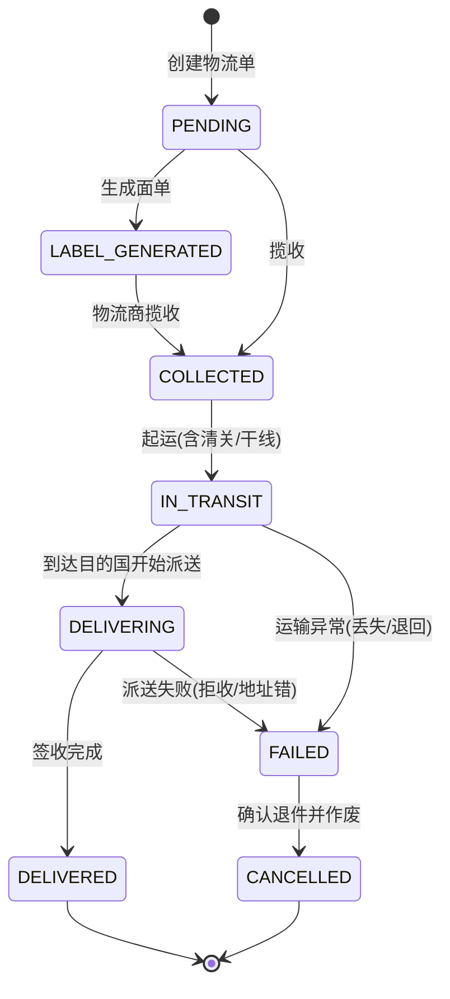

# 功能规格 · 物流管理（核心域）

| 项 | 内容 |
|---|---|
| 子域 | 核心域（Logistics Bounded Context） |
| 聚合根 | `LogisticsOrder` |
| 实体 | `LogisticsChannel` |
| 值对象 | `LogisticsStatus`、`LogisticsLabel`、`LogisticsFee`、`PriceRule` |
| 领域服务 | `LogisticsOrderProcessingService`、`LogisticsTrackingService`、`LogisticsChannelService` |
| 数据表 | `logistics_orders`、`logistics_channels`、`logistics_labels`、`logistics_fees` |
| 前端 | `frontend/user-web/src/pages/logistics/{LogisticsList,LogisticsDetail,CreateLogistics}.jsx` |

---

## 1. 模块定位

物流直接决定客户体验与毛利。本上下文负责：

1. 为一个订单生成一张**物流单**（运单），绑定渠道、面单、运费、追踪号；
2. 维护**物流渠道档案与价格规则**，为比价提供基础；
3. 维护**物流状态**，为客服与买家提供轨迹。

> 当前的价值缺口：渠道无法在系统内维护（无 REST 端点）、面单是真桩、没有轨迹明细。因此物流模块目前只能演示"一张运单的状态变更"。

---

## 2. 概念模型

```mermaid
erDiagram
    logistics_channels ||--o{ logistics_orders : "logistics_channel_id"
    logistics_labels   ||--o| logistics_orders : "logistics_label_id"
    logistics_fees     ||--o| logistics_orders : "logistics_fee_id"
    orders             ..> logistics_orders   : "order_id 裸引用"
```

| 概念 | 说明 | 关键字段 |
|---|---|---|
| 物流单 | 一次发货的载体 | `logisticsOrderNumber`(唯一)、`orderId`、`status`、`trackingNumber` |
| 物流渠道 | 承运方案 | `channelName`(唯一)、`channelCode`(唯一)、`active`、`basePrice`、`pricePerGram` |
| 面单/标签 | 贴包裹的运单标签 | `labelData`(TEXT)、`labelUrl`、`labelFormat` |
| 运费 | 一次发货的费用明细 | `baseFee`、`weightFee`、`totalFee`、`currency` |
| 价格规则 | 计费参数 | `basePrice`、`pricePerGram` |

---

## 3. 状态机



| 枚举名 | 存储值 | 中文 | 业务含义 |
|---|---|---|---|
| `PENDING` | `pending` | 待处理 | 运单已创建，等待打单 |
| `LABEL_GENERATED` | `generated` | 已打单 | 面单已生成，等待揽收 |
| `COLLECTED` | `collected` | 已揽收 | 物流商已取件 |
| `IN_TRANSIT` | `in_transit` | 运输中 | 干线段（跨境场景常见于干线+清关） |
| `DELIVERING` | `delivering` | 派送中 | 尾程派送 |
| `DELIVERED` | `delivered` | 已送达 | 买家签收 |
| `FAILED` | `failed` | 配送失败 | 需要人工介入：重发/退款 |
| `CANCELLED` | `cancelled` | 已取消 | 退件或作废 |

> ⚠️ **无状态迁移校验**：`PUT /api/logistics/{id}/status` 可把任意状态改为任意状态（含"已送达→待处理"）。建议补迁移白名单（ISS-005）。

---

## 4. 业务规则

| 编号 | 规则 | 状态 | 说明 |
|---|---|---|---|
| BR-01 | 一张物流单必须绑定一个物流渠道（`nullable=false`） | ✅ | `logistics_orders.logistics_channel_id` |
| BR-02 | 物流单号 `logisticsOrderNumber` 必须唯一 | ✅ | 列上有唯一约束（但需在领域层生成，注意别重蹈订单号 ISS-001 的覆辙） |
| BR-03 | 物流单通过 `orderId` 关联订单（裸引用，无物理外键） | ✅ | 见数据字典 R-01 |
| BR-04 | 运费 = 基础费 + 重量费 | 🟡 | `PriceRule`/`LogisticsFee` 有模型，未前端暴露试算 |
| BR-05 | 状态迁移必须符合 3 图的边 | ⚪ | 接口无校验（ISS-005） |
| BR-06 | 每次状态变更应产生一条轨迹明细（时间 + 节点 + 操作来源） | ⚪ | 无轨迹表，见 US-202 |
| BR-07 | 生成面单后回写 `trackingNumber` 到订单/物流单 | 🟡 | 字段存在，生成逻辑是桩 |
| BR-08 | 渠道停用后不可被新运单选择 | ⚪ | 渠道无维护端点 |
| BR-09 | 计费重取实重与抛重较大者 | ⚪ | 无抛重公式 |
| BR-10 | 物流费用自动驱动财务应付流水 | ⚪ | 无联动 |
| BR-11 | 配送失败需生成待办，提醒客服跟进 | ⚪ | 无待办机制 |

---

## 5. 功能清单

| 功能 | 前端 | 后端 | 状态 |
|---|---|---|---|
| 创建物流单 | ~~`CreateLogistics.jsx`（仅弹提示，未提交）~~ → 🔄 **2026-03-22 复测：已真实提交**（`CreateLogistics.jsx:87` `logisticsApi.createLogistics(...)` → `:95` `message.success` → `:96` `navigate(/logistics/${id})`；另 `:47` 拉渠道、`:64` 按订单号查单） | `POST /api/logistics`（`@RequestBody CreateLogisticsRequest`，`LogisticsController:67-68`） | ~~🟡~~ → 🟢 |
| 物流单列表 | `LogisticsList.jsx`~~（mock）~~ | `GET /api/logistics` | ~~🟡 无分页无筛选~~ → 🟡 **2026-01-25 逐页复测**（判据：页面内 `*Api.` 调用点数）：**后端已改为分页检索**（`LogisticsController.java:73`起，返回 `PageResult<LogisticsOrderDto>`，支持 `trackingNumber`/`orderId`/`channelId`(或渠道编码)/`status`/`keyword`/`startDate`/`endDate`/分页；前端入口 `api.js:177` 的 `logisticsApi.getLogisticsOrders(params)`），该页有 6 个调用点 |
| 物流单详情 | `LogisticsDetail.jsx`~~（mock）~~ | `GET /api/logistics/{id}`（`api.js:178`）、`GET /api/logistics/order/{orderId}` | ~~🟡~~ → 🟡 **2026-01-25 逐页复测**（判据：页面内 `*Api.` 调用点数）：8 个调用点，已联网。⚠️ 状态流转仍只挡终态回退、中间态可乱跳（ISS-005） |
| 按订单查物流单 | ~~未使用~~ | `GET /api/logistics/order/{orderId}`（`api.js:179`） | ~~🟡~~ → 🟢 2026-03-22：入口已接 |
| 变更物流状态 | ~~无入口~~ → 🔄 `LogisticsDetail.jsx:84` `updateStatus` | `PUT /api/logistics/{id}/status` | ~~🟡 无迁移校验~~ → 🟡 **2026-03-22 复测：仍只挡终态回退**（ISS-005 未修）；本轮另加 `POST /{id}/ship`（`:123`）、`POST /{id}/cancel`（`:132`，`LogisticsApplicationService:205+` 已拒"已揽收/在途/已送达"的取消）、`POST /batch-ship`（`:158`）、`DELETE /{id}`（`:169`）、`GET /statuses` 字典（`:90`） |
| **物流渠道管理** | ~~无页面~~ → 🔄 **`pages/logistics/LogisticsChannels.jsx`**（`:131` 调 `calculateFee`） | ~~**无端点**~~ → 🔄 **2026-03-22 复测：孤儿聚合已接上，`LogisticsChannelController` 6 个端点**（`GET /api/logistics-channels`:45、`GET /{id}`:57、`POST`:65、`PUT /{id}`:77、`PUT /{id}/status`:100、`DELETE /{id}`:108；前端 `api.js:200-208` 六个方法一一对应） | ~~⚪ **孤儿聚合**~~ → 🟢 **已解除**；⚠️ 代价：`GET` 是 `Result<List<LogisticsChannelDto>>` **全量返回、无分页**（M-07），且该类**无方法级 `@PreAuthorize`**（M-06 的 10 个之一） |
| **面单生成/打印** | ~~无入口~~ → 🔄 `LogisticsDetail.jsx:167`、`LogisticsList.jsx:220` 均有「生成面单」按钮 | ~~无端点~~ → 🔄 **`POST /api/logistics/{id}/label`**（`LogisticsController:138-139` → `LogisticsApplicationService:171-187 generateLabel`，`api.js:186`） | ~~⚪ 桩~~ → 🟡 **端点已真实但内容仍是半桩**：`generateLabel` 组的是 `LogisticsLabel.builder()`（`trackingNumber` + `buildRecipientInfo(order)` + **空的 `PackageInfo.builder().build()`** + `labelFormat("PDF")`），**没有任何 PDF 字节流、条码生成、渠道回传**；`logistics_labels` 表存在（`docs/db/schema.sql:217`）；已发 `LogisticsLabelGeneratedEvent`，但因 ISS-062（`:185-187` 发布的是 `save()` 副本）该事件到不了发布器 |
| **轨迹明细** | ~~无~~ → 🔄 `LogisticsDetail.jsx:96` `addTrace` | ~~无表无端点~~ → 🔄 **2026-03-22 复测：有端点、有存储**——`POST /api/logistics/{id}/track`（`:144`，拉取刷新）与 `POST /{id}/traces`（`:150`，`AddTraceRequest`/`LogisticsTraceDto`），存法不是独立表而是 `logistics_orders.tracking_traces` 列（`LogisticsOrderJpaEntity:90` `@Column(length=4000)`，`LogisticsOrderMapper:64/94` 用 JSON 序列化往返，聚合内 `LogisticsOrder:324-330` **上限 100 条**，超出从头截断） | ~~⚪~~ → 🟡 **无真实渠道回传**（`track` 是本地追加而非调承运商），且 4000 字符 + 100 条的截断意味着长轨迹会静默丢历史 |
| **费用试算与比价** | ~~无~~ → 🔄 `LogisticsChannels.jsx:131` | ~~无端点~~ → 🔄 **`GET /api/logistics-channels/{id}/fee?weight=&country=`**（`LogisticsChannelController:115-116`，返回 `Result<LogisticsFee>`；前端 `api.js:207-208`） | ~~⚪~~ → 🟡 **单渠道试算可跑，但"比价"仍不存在**（没有跨渠道择优端点）；⚠️ `LogisticsFee` 是值对象却直接做出参（ISS-063 契约泄漏，域内唯一一处） |

> **"孤儿聚合"** 指领域对象与数据表存在、但没有任何 REST 入口的情况。这类设计会导致数据只能靠初始化脚本或手工 SQL 写入，业务上等于不可用。

---

## 6. 接口对照

| 场景 | 方法 | 路径 | 备注 |
|---|---|---|---|
| 创建物流单 | POST | `/api/logistics` | `tenantId` 通过 `@RequestParam` 传入，未做租户校验 |
| 按 ID 查询 | GET | `/api/logistics/{id}` | — |
| 按订单查询 | GET | `/api/logistics/order/{orderId}` | 支持一个订单多运单（拆单） |
| 全量查询 | GET | `/api/logistics` | 无分页 |
| 变更状态 | PUT | `/api/logistics/{id}/status` | 无迁移校验 |

---

## 7. 领域事件

| 事件 | 期望下游 | 现状 |
|---|---|---|
| `LogisticsOrderCreatedEvent` | 生成运费应付流水 | ⚪ |
| `LogisticsStatusChangedEvent` | 写入轨迹明细；`DELIVERED` 时推动订单完成 | ⚪ |
| `LogisticsLabelGeneratedEvent` | 通知仓库打印；回写面单 URL | ⚪ |
| `LogisticsCompletedEvent` | 触发收入确认、结清运费 | ⚪ |

---

## 8. 现状缺口与待办

| 优先级 | 缺口 | 建议 |
|---|---|---|
| **P1** | 物流渠道与价格规则无 REST 端点 | 新增 `/api/logistics/channels`、`/api/logistics/channels/{id}/price-rules` 完整 CRUD |
| **P1** | 缺轨迹明细 | 新增 `logistics_traces(物流单ID, 状态, 描述, 节点, 时间)` 表 + `GET /api/logistics/{id}/traces` |
| **P1** | 状态迁移无校验 | 在 `LogisticsOrder` 内实现 `changeTo(LogisticsStatus)` 白名单校验 |
| ~~**P1**~~ → ✅ 已完成 | ~~前端三个页面全部 mock~~ → **2026-01-25 逐页复测**（判据：页面内 `*Api.` 调用点数）：`LogisticsList.jsx`(6)、`LogisticsDetail.jsx`(8)、`CreateLogistics.jsx`(2)、`BatchShipModal.jsx`(2)、`LogisticsChannels.jsx`(≥1) 均已调真实接口 | ~~补齐 `logisticsApi` 并接入真实接口~~（`api.js:174-197` 的 `logisticsApi` 已到位） |
| **P2** | 面单是桩 | 引入 PDF 生成（如 iText / flying-saucer），并定义渠道面单模板 |
| **P2** | 无计费重/分区/时效 | 扩展 `PriceRule`：目的国分区、首重续重、抛重系数、时效 |
| **P2** | 无外部承运商 API 对接 | 定义 `CarrierClient` 接口（下单/取号/取面单/查轨迹），先实现 1 家做样板 |
| **P3** | 异常件无处理流 | 新增重发/退回/理赔子流程 |

---

## 9. 验收要点

1. 创建物流单必须选择有效渠道；渠道不存在时报错。
2. 物流单号唯一；同一订单可存在多张运单（拆单场景）。
3. 非法状态迁移（如"已送达→待处理"）必须被拒绝。
4. 每次状态变更后，轨迹明细应新增一条记录（当前无此能力，作为 v0.2 验收项）。
5. 运费 = 基础费 + 重量费，金额与币种字段完整。
