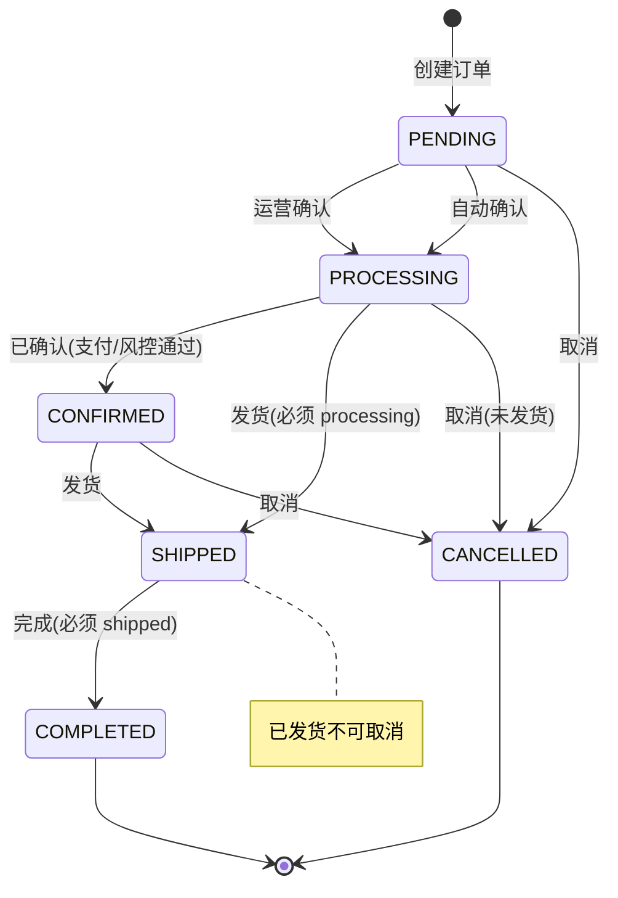

# 功能规格 · 订单管理（核心域）

| 项 | 内容 |
|---|---|
| 子域 | 核心域（Order Bounded Context） |
| 聚合根 | `Order` |
| 实体 | `OrderItem` |
| 值对象 | `OrderStatus`、`ShippingAddress`、`PaymentInfo` |
| 领域服务 | `OrderProcessingService`、~~`OrderSyncService`~~（**该类已删除**；平台拉单改由 `PlatformFetcherRegistry` + `OrderImportApplicationService` 承担，见 [spec/platform-integration.md](platform-integration.md)） |
| 应用服务 | `OrderApplicationService` |
| 仓储 | 领域接口 `OrderRepository` → `OrderRepositoryImpl` → `OrderJpaRepository` |
| 数据表 | `orders`、`order_items`、`shipping_addresses`、`payment_infos`（见 [`../db/er-diagram.md`](../db/er-diagram.md) 第 2 节）；🔄 2026-10-21 补：导入侧另有 `order_import_jobs`、`order_import_job_errors`、`order_field_mappings` 三张（实体同在 `infrastructure/persistence/jpa/entity/order/`） |
| 前端 | `frontend/user-web/src/pages/order/{OrderList,OrderDetail,CreateOrder}.jsx`（🔄 2026-10-21 补：另有 `OrderImport.jsx`，对应 `OrderImportController` 的 11 个导入端点） |

---

## 1. 模块定位

订单是系统的**价值起点**：所有后续动作（占库存、发货、收款、核算）都由它触发。订单上下文的核心职责是：

1. 承载"买家想要什么、寄到哪、付了多少"这一事实；
2. 维护订单从创建到（完成｜取消）的**状态机**；
3. 作为对外集成的输入（平台拉取）与输出（触发履约与记账）。

**不可变性原则**：订单一旦创建，其行项中的 `product_name`、`sku_code`、`unit_price` 是**下单时的快照**，商品后续改名/下架不影响历史订单。这是正确的设计，但需要在 UI 上说明"这是历史快照"，避免被误认为脏数据。

---

## 2. 角色与权限

| 角色 | 权限 | 当前实现 |
|---|---|---|
| 运营专员 | 创建、查看、状态流转、取消 | ⚪ ~~无角色校验，登录即可操作~~ |
| 仓库主管 | 查看（含发货相关信息） | ⚪ |
| 财务/老板 | 只读 | ⚪ |
| 客服 | 只读（含物流状态） | ⚪ |

> 🔄 **2026-10-21 复测：本表四行的"当前实现"全部过期**（原文保留以便对照）。`OrderController` 现在 **9 个端点 / 9 处方法级 `@PreAuthorize`**（`interfaces/controller/order/OrderController.java:55,74,95,106,115,124,135,145,155`），谓词只有两档，定义在同文件 `:41-45` 的常量：
> - `HAS_ORDER_READ = hasRole('PLATFORM_ADMIN') or hasAuthority('order:read')` ⇒ 列表 / 字典 / 按订单号 / 按 ID / 按客户（5 个读端点）；
> - `HAS_ORDER_WRITE = hasRole('PLATFORM_ADMIN') or hasAuthority('order:write')` ⇒ 创建 / 改状态 / 取消 / 删除（4 个写端点）。
>
> 所以"登录即可操作"不成立，未认证是 401、缺权限点是 403。**但表里期望的那套四档角色仍没有落点**：目录里只有 `order:read`/`order:write`/`order:import` 三个订单权限点（`domain/tenant/PermissionPoints.java`），"仓库主管只读发货信息""财务只读""客服只读"这种**读写之外的粒度**（字段级、单据级）后端无处表达 —— 这一行是本模块真实的缺口，不是权限点缺失。
> ⚠️ 另两点：① 创建路径已不接受客户端传 `tenantId`（`resolveTenant` 在 `:184-193`：请求参数经 `TenantContext.normalizeRequested` → 登录租户 → `OrderApplicationService.DEFAULT_TENANT_ID`）；② 写端点全部挂了 `@Auditable`（`:58,126,136,147`），留痕链路见 [../qa/known-issues.md](../qa/known-issues.md) ISS-099。

---

## 3. 状态机

### 3.1 目标态（领域层已定义的规则）

| 迁移 | 前置条件 | 实现位置 | 是否生效 |
|---|---|---|---|
| `* → PENDING` | 创建（行项非空、地址/支付非空、金额一致） | `OrderProcessingService.validateOrderInfo` | ✅ |
| `PENDING/PROCESSING/CONFIRMED → SHIPPED` | 当前必须为 `PROCESSING` | `OrderProcessingService.shipOrder` | ⚪ 未被 REST 端点调用 |
| `SHIPPED → COMPLETED` | 当前必须为 `SHIPPED` | `OrderProcessingService.completeOrder` | ⚪ 未被 REST 端点调用 |
| `→ CANCELLED` | 不得为 `SHIPPED` / `COMPLETED` | `OrderProcessingService.cancelOrder` | ⚪ 未被 REST 端点调用 |
| **任意 → 任意** | **无校验** | `OrderApplicationService.updateOrderStatus`（直接 `order.updateStatus`） | ❌ **实际对外接口走的是这条** |

> 🔴 ~~**重要缺陷**：`PUT /api/orders/{id}/status` 绕过全部业务约束，当前可以从「待处理」直接跳到「已完成」，也可以把「已完成」改回「待处理」。详见 [`../qa/known-issues.md`](../qa/known-issues.md) ISS-003。~~
> 🔄 **2026-10-21 复测：这条 🔴 已作废（ISS-003 于 2026-01-25 关闭），上表"是否生效"三行需要同样改判**（原文保留）：
> - 校验**下沉到聚合**：`Order.updateStatus`（`domain/order/aggregate/Order.java:246-256`）先对 `null` 抛 `ValidationException`，再用 `oldStatus.canTransitionTo(newStatus)` 拦截非法迁移并抛 `InvalidOperationException`，消息里带出 `allowedNextStatuses()` 的中文标签 ⇒ "任意 → 任意"那一行的 ❌ 不再成立，对外端点走的这条**已经有约束**。
> - **"未被 REST 端点调用"这一列只对了一半**：`POST /api/orders/{id}/cancel`（`OrderController.java:137`）确实经 `OrderApplicationService.cancelOrder` 走到 `OrderProcessingService.cancelOrder`，取消约束生效；但 `shipOrder` / `completeOrder` 两个领域方法**至今没有端点**，发货/完成只能通过 `PUT /{id}/status?status=SHIPPED|COMPLETED` 表达。⇒ 第 3.1 节图里"发货(必须 processing)"这类前置条件由 `canTransitionTo` 兜住了，缺的是**语义化端点**，不是校验。
> - 顺带一条**已生效的联动**（§8 的 P1"发货不联动"要看这条）：`OrderApplicationService.updateOrderStatus:98-100` 在 `oldStatus != SHIPPED && newStatus == SHIPPED` 时调用 `deductInventoryForOrder(order)` ⇒ 改状态到已发货会真实扣减库存；:93 再套一层 `TenantAccessGuard.requireOwned("Order", …)`。⚠️ 但这条扣减挂在"状态被改成 SHIPPED"上，**不挂在物流单发出上**：走 `POST /api/logistics/{id}/ship` 而不回写订单状态时库存不动，两边的一致性靠调用方自觉。

### 3.2 状态取值

| 枚举名 | 存储值 | 中文 | 展示建议 |
|---|---|---|---|
| `PENDING` | `pending` | 待处理 | 橙色 Tag |
| `PROCESSING` | `processing` | 处理中 | 蓝色 Tag |
| `CON_FIRMED` | `confirmed` | 已确认 | 青色 Tag |
| `SHIPPED` | `shipped` | 已发货 | 紫色 Tag |
| `COMPLETED` | `completed` | 已完成 | 绿色 Tag |
| `CANCELLED` | `cancelled` | 已取消 | 灰色 Tag |

> ⚠️ 领域枚举常量名 `CON_FIRMED` 拼写异常，持久化侧同义枚举写的是 `CONFIRMED`，按枚举名转换会失败（ISS-004）。
>
> 🔄 **2026-10-21 复测：本表"存储值"一列口径错了，ISS-004 的"会失败"也没发生**（原文保留）：
> - **落库存的是大写的持久化枚举名，不是小写 code**。`OrderJpaEntity:52-54` 是 `@Enumerated(EnumType.STRING)` 挂在另一个枚举 `infrastructure/persistence/jpa/entity/order/OrderStatusJpaEntity`（常量 `PENDING/PROCESSING/CONFIRMED/SHIPPED/COMPLETED/CANCELLED`）上；`ecommerce_logistics_erp` 库实测该列类型是原生 `enum('CANCELLED','COMPLETED','CONFIRMED','PENDING','PROCESSING','SHIPPED')`，现有 4 行数据取值 `PENDING`/`PROCESSING`/`SHIPPED` 全大写。表里 `pending`/`confirmed` 那一列是**领域枚举的 `code` 字段**（`OrderStatus.java:14-19`），只在 DTO/前端标签链上出现，库里查不到。
> - **两套枚举靠显式 switch 桥接，所以 `CON_FIRMED` 拼写异常目前是"债"不是"故障"**：`OrderMapper.orderStatusToJpaEntity:201-217`（`CON_FIRMED → CONFIRMED` 在 `:208`）、`orderStatusFromJpaEntity:219-`，另有 `OrderSpecification` 里的查询侧转换。⚠️ 行号相对 [../qa/known-issues.md](../qa/known-issues.md) ISS-004 记的 `:195,213` 已漂移（那是 2026-01-25 的位置）。**风险面要改写**：两个方向都是穷尽的 arrow `switch`（`:205-212`、`:223-230`，无 `default`），所以"新增枚举常量后漏写 case"会被编译器拦住，ISS-004 担心的那条其实有编译期保护；**真正静默的是 null 分支**——`orderStatusToJpaEntity:202-204` 与 `orderStatusFromJpaEntity:220-222` 在入参为 `null` 时一律返回 `PENDING`，于是一条状态列为空的脏行会被读成"待处理"、还能原样写回去，而不是抛错。这一条没人测过，也和本文件 BR-03"初始状态固定为 `PENDING`"混在一起难以分辨。

---

## 4. 业务规则

| 编号 | 规则 | 状态 | 实现位置 |
|---|---|---|---|
| BR-01 | 订单 ID 由领域层 `UUID.randomUUID()` 生成 | ✅ | `Order.create` |
| BR-02 | 订单编号 `orderNumber` 必须非空且唯一 | ✅ 非空已修 / ⚠️ 唯一仅靠随机 | **ISS-001 已修（2026-01-25）**：`Order.create`（`Order.java:128`）与重载（`:162-163`，优先用 `platformOrderId`）、`Builder`（`:505`）不再传 `null`，缺省时走 `generateOrderNumber()`（`:195-198`，`"ORD" + yyyyMMdd + UUID 前 8 位大写`）→ `OrderJpaEntity.order_number` 的 `unique=true, nullable=false` 可满足，真实 MySQL 上建单链路已跑通。**残留风险**：编号唯一性由随机串保证而非序列/DB 生成，同一天理论可碰撞（约 1/4.3e9），且没有 `uk` 冲突的定制错误文案，冲突时会变成 500 |
| BR-03 | 初始状态固定为 `PENDING` | ✅ | `Order.create` |
| BR-04 | 行项不能为空 | ✅ | `validateOrderInfo` |
| BR-05 | 客户 ID 不能为空 | ✅ | `validateOrderInfo` |
| BR-06 | 收货地址不能为空 | ✅ | `validateOrderInfo` |
| BR-07 | 支付信息不能为空 | ✅ | `validateOrderInfo` |
| BR-08 | **订单金额必须等于支付金额**（`BigDecimal` 精确比较） | ✅ | `validateOrderInfo` |
| BR-09 | 订单行项保存商品名与 SKU 编码快照，不持有商品外键 | ✅ | `OrderItem`（有意为之） |
| BR-10 | 保存客户名/邮箱快照，客户资料变更不回写历史订单 | ✅ | `orders.customer_name/customer_email` |
| BR-11 | 创建/更新时刷新 `updatedAt` | ✅ | `Order.updateStatus` 等 |
| BR-12 | 状态流转必须满足前置约束（见 3.1） | ⚪ | ~~规则在 `OrderProcessingService`，但 REST 未走它（ISS-003）~~ → ✅ **2026-10-21 复测：已生效**。约束在聚合自身 `Order.updateStatus:246-256`（`canTransitionTo` + `allowedNextStatuses` 报错文案），对外端点 `PUT /api/orders/{id}/status`（`OrderController.java:126`）经 `OrderApplicationService.updateOrderStatus:90-100` 调用它，另加 `:93` 的 `TenantAccessGuard.requireOwned`。ISS-003 已于 2026-01-25 关闭 |
| BR-13 | 取消订单需释放已占用库存 | ⚪ | 无库存占用概念（仍然成立：发货时 `deductInventoryForOrder` 扣的是实库存，不是"占用"，所以取消也没有反向释放的对象） |
| BR-14 | 取消需记录原因与操作人 | ⚪ | 无字段（仍然成立：`POST /{id}/cancel` 无请求体，`orders` 表实测 14 列里没有 `cancel_reason`/`cancelled_by`；留痕只在 `audit_logs`，不在订单行上） |
| BR-15 | 订单必须归属租户，跨租户不可见 | ❌ | ~~`createOrder` 中硬编码 `"default-tenant"`（ISS-002）~~ → ✅ **2026-10-21 复测：写侧已收口**。创建走 `resolveTenant`（`OrderController.java:184-193`：客户端传值先过 `TenantContext.normalizeRequested`，未传取登录租户），读侧列表 `searchOrders` + `withinCurrentTenant:190-198` 收敛，按 ID/取消/删除走 `requireOwned`。⚠️ 残留不是"没隔离"而是**回落桶**：`interfaces/` 下唯一的 `"default-tenant"` 字面量在 `FinanceController.java:125`，订单侧走的是 `OrderApplicationService.DEFAULT_TENANT_ID` 常量而非 `TenantContext.LEGACY_TENANT_ID` 别名（同一族的 13 处声明见 [../adr/0010-mapstruct-domain-jpa-bridge.md](../adr/0010-mapstruct-domain-jpa-bridge.md) 后果 6） |
| BR-16 | 订单无 `tenant_id` 列，物理上无法隔离 | ❌ | ~~`orders` 表结构（见数据字典 R-07）~~ → ✅ **列已存在**：`information_schema` 实测 `ecommerce_logistics_erp.orders` 有 `tenant_id varchar(64)`（全库 45 表中 25 张带该列） |
| BR-17 | 同一平台订单号不可重复入库（幂等） | ⚪ | ~~无平台订单号字段~~ → ✅ **2026-10-21 复测：字段与库级唯一键都在**（原文判据已过时）：`orders.platform_order_id varchar(128)` 实测存在；`OrderJpaEntity:27-35` 声明 `@UniqueConstraint(name="uk_orders_platform_order", columnNames={"tenant_id","platform","platform_order_id"})`，`information_schema.statistics` 复现该索引且 `non_unique=0`（同表另有三个自动命名的唯一键：`order_number`＝`UKnthkiu7pgmnqnu86i2jyoe2v7`、`payment_info_id`、`shipping_address_id`，来自列上的 `unique=true` 与 `@OneToOne`）。导入侧在此之上做**读后判**：`OrderImportApplicationService:357` 用 `findByPlatformOrderId` 命中已有行，`updateExisting=false` 时 `recordSkipped` 跳过、`true` 时按原 ID 重建（`:369-386`）。⇒ 手工 `POST /api/orders`（`platform=MANUAL`、`platform_order_id` 为 null）**不受该键约束**（MySQL 唯一索引允许多行 NULL），这正是期望行为，但"重复建单"因此只能靠应用层，而应用层**没有**查重：`OrderRepository.existsByPlatformOrderId`（接口 `:75` + 实现 `OrderRepositoryImpl:99-104`）全仓**零调用方**，是一条写了没接的幂等门。 |
| BR-18 | 金额字段应使用 `DECIMAL` 而非 `DOUBLE` | ✅ | ~~`orders.total_amount` 为 `DOUBLE`（数据字典 R-09）~~ → ✅ **2026-10-10 已修（ISS-023 关闭，见 [../qa/known-issues.md](../qa/known-issues.md) §20 / R-52~R-54）**：`orders.total_amount`、`order_items.unit_price`/`total_price`、`payment_infos.amount` 现为 `DECIMAL(19,2)`，实体侧 `BigDecimal` 且显式声明 `precision=19, scale=2`，mapper 同类型直传（不再有 `doubleValue()` / `BigDecimal.valueOf(Double)` 中转）。全库 15 个金额列 = 14 × `19,2` + `logistics_channels.price_per_gram` `19,4`（每克费率必须 4 位，R-52），浮点列只剩两个重量列。常驻位：`MoneyPrecisionGuardTest` 6 例 + `MoneyPrecisionRoundTripTest` 4 例 + `smoke.sh` §14 12 条 |

---

## 5. 功能清单

| 功能 | 说明 | 前端 | 后端 | 状态 |
|---|---|---|---|---|
| 创建订单 | 填写客户/行项/地址/支付创建订单 | `CreateOrder.jsx` 已联网 | `POST /api/orders` | ~~🟡 受 ISS-001 影响会落库失败~~ → 🟡 **2026-10-21 复测：ISS-001 已修，落库正常**（`Order.generateOrderNumber:195-198`）；这一行降级为 🟡 的两个**新**原因：① 校验失败仍走 JDK 异常（`OrderProcessingService.validateOrderInfo:139-152` 抛 `IllegalArgumentException`，靠 ISS-037 的全局映射才变成 400）；② **全链路无币种**：`orders`/`order_items`/`payment_infos` 三张表实测都没有 `currency` 列（`total_amount`、`unit_price`、`total_price`、`payment_infos.amount` 全是 `decimal(19,2)`），跨币种订单只能按数值相加（与 [product.md](product.md) BR-07 同源） |
| 查询订单详情 | 按 ID 查询 | `OrderDetail.jsx`~~（mock）~~ | `GET /api/orders/{id}` | ~~🟡~~ → 🟡 **2026-01-25 逐页复测：已接真实接口**（该页 4 个 `orderApi.*` 调用点；`api.js:133` 起的 `orderApi` 已含详情与分页列表方法），不再读页面内 mock |
| 变更订单状态 | 修改订单状态 | ~~无入口~~ → `OrderDetail.jsx:87`（`orderApi.updateOrderStatus`） | `PUT /api/orders/{id}/status?status=` | ~~🟡 无校验（ISS-003）~~ → ✅ **2026-10-21 复测：入口与校验都在**（见 §3.1 复测块；非法迁移 400 + `INVALID_OPERATION`，消息带允许的下一状态） |
| 查询客户订单 | 按客户 ID 查询其所有订单 | ~~未使用~~ → 客户详情页时间线在用（`CustomerDetail.jsx` 双查合并） | `GET /api/orders/customer/{customerId}` | ~~🟡~~ → 🟡 **2026-10-21 复测：读侧已按登录租户收敛，但机制是"先查后滤"**（`withinCurrentTenant:190-198`） |

> **2026-01-25 就地更正（本模块已从 4 个端点扩到 9 个，上表多行已过期，原文保留以便对照）**：
> ⚠️ **本块引用的行号全是 2026-01-25 的位置**（`OrderController` 的 `:47-59/:64-80/:84/:94/:110-117/:119-126/:127-133/:135-140/:163-171`、`OrderApplicationService:71-81`、`Order.java:251`、`api.js:133-145`），类体在下面这大半年里整体上移过；**现行锚点以 §6 的复测表为准**（同一批端点，行号已重测）。结论本身没有再变，所以不逐条划掉。
> - ✅ **ISS-001 已修**：创建不再因 `order_number` 为 null 落库失败（见 §4 BR-02）；`OrderController.java:47-59` 的 `createOrder` 走 `resolveTenant(null)`（`:163-171`：请求参数 → `TenantContext` → `DEFAULT_TENANT_ID`），**创建路径已不接受客户端传租户**（ISS-014 收敛）。
> - ✅ **「缺订单列表/分页」已修**：新增 `GET /api/orders`（`:64-80`），返回 `Result<PageResult<OrderDto>>`，支持 `orderNumber`（模糊）/`customerId`/`customerName`（模糊）/`status`/`platform`/`keyword`/`startDate`/`endDate`/`page`/`size`（默认 0/10）；`OrderList.jsx:34-37,74-84` 用服务端分页（`total` 来自 `PageResult`），不再是 mock。
> - ✅ **ISS-003 已修**：`PUT /{id}/status`（`:110-117`）→ `OrderApplicationService.updateOrderStatus`（`:71-81`）→ `Order.updateStatus`，非法迁移在 `Order.java:251` 由 `OrderStatus.canTransitionTo`（`OrderStatus.java:57`）拦截；`OrderDetail.jsx` 已接状态变更（`:70`）、取消（`:84`）、删除（`:95`）。
> - 另外新增：`POST /api/orders/{id}/cancel`（`:119-126`，走 `OrderProcessingService.cancelOrder`，已发货/已完成不可取消）、`DELETE /api/orders/{id}`（`:127-133`）、`GET /api/orders/number/{orderNumber}`（`:94`）、`GET /api/orders/statuses`（`:84`）；`orderApi` 前端也从 4 个方法扩到 **9 个**（`services/api.js:133-145`）。
> - ⚠️ ~~读路径仍未收敛（ISS-050 同类）：`GET /api/orders` 的 `tenantId` 依然可由 `@RequestParam` 传入（`:66`，虽会被 `TenantIsolationAspect` 校验、但不能过滤出别人租户的数据要靠仓储谓词）；`GET /api/orders/customer/{customerId}`（`:135-140`）**根本没有租户维度**，只按 `customerId` 查，任何已认证调用方可枚举他人订单。~~
>   → 🔄 **2026-10-21 复测：这段的两条判据都已过期**（ISS-050 在订单域已关闭，原文保留）：① 列表把租户条件交给了谓词——`OrderApplicationService.searchOrders:215-222` 组装 `OrderQuery` 时先过 `TenantAccessGuard.scopedTenantId(tenantId)`（传别家 ⇒ 403，未传 ⇒ 登录租户）；② `GET /customer/{customerId}` 现在经 `findOrdersByCustomerId:179-181` 套 `withinCurrentTenant:190-198` 收敛，返回前按 `TenantAccessGuard.currentTenantId()` 过滤。
>   ⚠️ **改判后仍留的一条不是隔离、是形状**：`withinCurrentTenant` 是**先查后滤的内存过滤**（`findByCustomerId` 不带租户条件），平台管理员与无租户上下文时 `currentTenantId()` 返回 null ⇒ 直接返回全量不过滤（`:192-194`）。所以按客户枚举这条路径会把该客户的全部订单（跨租户）读进内存再丢弃别人的行：数据越不出租户，但**取回的行数不受租户约束**，与带租户条件的 SQL 谓词路径不等价。库里实测已有 1 行 `customer_id=''`（来自导入侧 `OrderImportApplicationService:354` 的 `customerId = hasText(...) ? ... : ""` 兜底，手工建单则被 `validateOrderInfo:141-143` 拒绝），这类行按空串查询会把别人的空串订单一起读出来——虽然仍被内存过滤挡住。
| 订单列表 / 分页 / 筛选 | ~~⚪ 未实现~~ → ✅ 已实现 | `OrderList.jsx`~~（mock）~~ | ~~无端点~~ → `GET /api/orders`（`OrderController.java:63-81`，参数 `:66-76`：`orderNumber`/`customerId`/`customerName`/`status`/`platform`/`keyword`/`startDate`/`endDate`/`page`/`size`，返回 `Result<PageResult<OrderDto>>`） | ~~⚪ **P0 缺口**~~ → ✅ **2026-01-25 复测缺口已闭合**：端点存在，`api.js:137` 的 `orderApi.getOrders(params)` 与之对应，`OrderList.jsx` 已按参数分页查询（现行位置 `:70`，控制器映射在 `OrderController.java:75`、`@PreAuthorize` 在 `:74`）。 ~~⚠️ 残留：查询**不带租户条件**（ISS-050），`tenantId` 省略时回落 `default-tenant`（ISS-051）~~ → 🔄 **2026-10-21 复测：这条残留已关闭**——`searchOrders:219` 组装查询前过 `TenantAccessGuard.scopedTenantId(tenantId)`（显式他租户 ⇒ 403 `TENANT_ACCESS_DENIED`，未传 ⇒ 登录租户），控制器侧 `resolveTenant:184-193` 只在**没有登录租户上下文**时才落 `DEFAULT_TENANT_ID` |
| 订单取消（含原因） | ⚪ 未独立暴露 | — | 仅 `cancelOrder` 领域方法，无端点 | ⚪ |
| 平台订单同步 | ⚪ 桩 | — | `PlatformIntegrationController#syncOrders` | ⚪ |
| 订单导出 | ⚪ 未实现 | — | — | ⚪ |

---

## 6. 接口对照

> 🔴 **本表自 2026-01-25 起就是错的，且与本文件 §5 上方的更正块互相矛盾**（同一文件里一处写"✅ 列表已实现（`OrderController.java:63-81`）"、另一处写"⚪ 不存在"）。原文按惯例保留以便对照，**以表后的复测表为准**；端点清单的唯一权威仍是 [../api/api.md](../api/api.md)。

| 场景 | 方法 | 路径 | 请求 | 状态 |
|---|---|---|---|---|
| 创建订单 | POST | `/api/orders` | `CreateOrderDto{customerId, orderItems[], shippingAddress, paymentInfo}` | 🟡 |
| 按 ID 查询 | GET | `/api/orders/{id}` | — | 🟡 |
| 变更状态 | PUT | `/api/orders/{id}/status` | `?status=PENDING\|PROCESSING\|CONFIRMED\|SHIPPED\|COMPLETED\|CANCELLED` | 🟡 无校验 |
| 按客户查询 | GET | `/api/orders/customer/{customerId}` | — | 🟡 |
| 订单列表 | GET | `/api/orders` | — | ⚪ ~~**不存在**~~ → **存在**（见下表） |

> 🔄 **2026-10-21 复测：`OrderController` 当前 9 个端点**（逐条对 `interfaces/controller/order/OrderController.java` 的注解扫描；权限常量 `:41-45`，守卫行号 `:55,74,95,106,115,124,135,145,155`）：
>
> | 场景 | 方法 | 路径 | 映射行 | 权限 | 状态 |
> |---|---|---|---|---|---|
> | 创建订单 | POST | `/api/orders` | `:57` | `order:write` | 🟡 校验用 JDK 异常、无币种 |
> | 分页条件列表 | GET | `/api/orders` | `:75` | `order:read` | ✅ 11 个筛选参数 + `PageResult`，租户经 `scopedTenantId` |
> | 状态字典 | GET | `/api/orders/statuses` | `:96` | `order:read` | ✅ 供前端下拉，返回枚举名＋中文 |
> | 按订单号查询 | GET | `/api/orders/number/{orderNumber}` | `:107` | `order:read` | ✅ |
> | 按 ID 查询 | GET | `/api/orders/{id}` | `:116` | `order:read` | ✅ |
> | 变更状态 | PUT | `/api/orders/{id}/status?status=` | `:126` | `order:write` | ✅ 原表"无校验"已作废（聚合层 `canTransitionTo`） |
> | 取消订单 | POST | `/api/orders/{id}/cancel` | `:137` | `order:write` | ✅ 走领域服务；~~缺原因/操作人字段~~ 仍缺 |
> | 删除订单 | DELETE | `/api/orders/{id}` | `:147` | `order:write` | ✅ 硬删，并级联删联动物流单（`:146` 的 `@Auditable` label 写"删除订单（连同联动物流单）"） |
> | 按客户查询 | GET | `/api/orders/customer/{customerId}` | `:156` | `order:read` | 🟡 返回 `List` 不分页，租户收敛靠内存过滤 |
>
> 另有 **11 个导入端点**在 `/api/orders/import`（`OrderImportController.java:69,75,81,87,96,102,114,151,162,172,178`：目标字段字典、转换规则、状态字典、字段映射读写、`/preview`、`/upload`、导入、任务列表/详情、CSV 模板），类级守卫 `@PreAuthorize("hasRole('PLATFORM_ADMIN') or hasAuthority('order:import')")` 在 `:61`。⚠️ 这 11 个端点在本文件的接口对照里**一直没有登记**，订单模块的对外面其实是 20 个端点（9 + 11），与 [../api/api.md](../api/api.md) 的 214 总数口径一致。

统一响应与错误码见 [`../api/README.md`](../api/README.md)。

---

## 7. 领域事件

| 事件 | 触发时机 | 期望下游 | 现状 |
|---|---|---|---|
| `OrderCreatedEvent` | 订单创建 | 占用库存、记为待收款 | ⚪ ~~已发布无消费~~ → 见下方复测（进程内有真下游，但下游是"建物流单"不是"占库存/记收款"） |
| `OrderStatusChangedEvent` | 状态变更 | 通知平台、通知买家 | ⚪ 有监听器、无真下游（见复测第 2 条） |
| `OrderShippedEvent` | 发货 | 扣减库存、生成运费应付 | ⚪ |
| `OrderCompletedEvent` | 完成 | 生成收入流水 | ⚪ |

> 🔄 **2026-10-21 复测：四个事件类的发布/消费现状分四档；"⚪ 已发布无消费"这一格只对 `OrderCreatedEvent` 明确不再成立（它有一个真下游），其余三格仍成立但原因都换了**（原文保留）：
> 1. **发布**：`Order.updateStatus`（`domain/order/aggregate/Order.java:246`）在 `:261-267` 注册 `OrderStatusChangedEvent`，并在目标态为已发货/已完成时**额外**注册 `OrderShippedEvent`（`:270-276`）与 `OrderCompletedEvent`（`:279-285`）；创建路径在 `:140` 与 `:180` 两处注册 `OrderCreatedEvent`。事件能不能到发布器，取决于 `OrderRepositoryImpl.save():44` 的 `carryOverEvents(...)`（ADR-0010 后果 7 那条"第三条收口路线"），**漏调不报错**。
> 2. **进程内消费默认生效，但四个监听器里只有两个真有下游**：`infrastructure/messaging/EventHandler.java` 是无条件 `@Component`（`:22`），4 个 `@EventListener`（`:45,61,76,92`）——`OrderCreatedEvent` ⇒ `createLogisticsOrder(tenantId, orderId, "DEFAULT_CHANNEL")`（`:51`，**这就是"下单自动生成物流单"的落点**）；`OrderStatusChangedEvent` ⇒ 只打一行日志，"预留库存"是注释里的 TODO（`:67-70`）；`LogisticsCompletedEvent` 与 `InventoryShortageEvent` 两个监听器同样存在，前者是空 `try`（`:81-85`，里面只有注释与一行日志）、后者真调用 `replenishmentApplicationService.replenishForShortage`（`:100`）。⚠️ 渠道写死 `"DEFAULT_CHANNEL"`，意味着自动建的物流单能不能落到真实渠道上，取决于库里是否存在这个编码的渠道行，失败只进 `log.error`（异常被吞，调用方与订单状态都不回滚）。
> 3. **RocketMQ 那条通道默认关闭**：`OrderCreatedEventConsumer` 与 `OrderStatusChangedEventConsumer`（`infrastructure/messaging/consumer/`）挂 `@ConditionalOnProperty(prefix="rocketmq", name="internal-consumers.enabled", havingValue="true")`，而 `backend/src/main/resources/application.yml:41-46` 当前是 **false** ⇒ 跨进程消费没有注册，"已发布无消费"只对**MQ 通道**成立，对进程内通道不成立（这正是 ISS-062 复测后改写的那条口径）。
> 4. **`OrderShippedEvent`/`OrderCompletedEvent` 全仓零消费方**（连消费者类都没有；`grep` 只命中聚合与事件类自身），且发货扣库存这条腿**不依赖事件**——它写在 `OrderApplicationService.updateOrderStatus:98-100` 里同步执行；"生成运费应付/收入流水"确实没有任何实现。
>
> ⚠️ 另两条口径：① 平台侧通知（`OrderStatusChangedEvent` 的期望下游"通知平台"）目前只有 `POST /api/platform-integrations/{id}/push-fulfillment` 这条**手工**通道（`PlatformIntegrationController.java:384`，4 家平台有发货回写适配器），没有事件驱动的回推；② `rocketmq.enabled: true` 时同名事件还会走 MQ 通道，两个开关同时为 true 会**双份消费**，目前只有 [../adr/0006-rocketmq-domain-events.md](../adr/0006-rocketmq-domain-events.md) 复测块记着这条"没有启动期断言"。

---

## 8. 现状缺口与待办

| 优先级 | 缺口 | 影响 | 建议 |
|---|---|---|---|
| ~~**P0**~~ | ~~`orderNumber` 未生成导致落库失败（ISS-001）~~ | ~~创建订单在真实数据库上不可用~~ | ~~引入 `OrderNumberGenerator`（如 `yyyyMMdd + 序列`），并补 null 校验~~ → ✅ **2026-01-25 已修**（§4 BR-02）；🔄 2026-10-21 复测：现在只剩"随机串碰撞 ⇒ 500 且无定制错误文案"，不是建不了单 |
| ~~**P0**~~ → ✅ 已完成 | ~~缺订单列表/分页/筛选~~ | ~~前端只能 mock~~ → 端点与前端都已到位 | ~~新增 `GET /api/orders`，支持状态/时间/关键词筛选与分页~~（2026-01-25 复测：`OrderController.java:63-81` + `api.js:137` + `OrderList.jsx` 已联网；下一位工作改成"列表查询补租户条件"，即 ISS-050）——🔄 2026-10-21：那句"下一位工作"也已做完（`OrderApplicationService.searchOrders:219` 过 `scopedTenantId`），本行只剩行号漂移（列表映射现在在 `:75`、守卫在 `:74`） |
| ~~**P0**~~ | ~~租户未透传（硬编码 `default-tenant`）~~ | ~~多租户不成立~~ | ~~由认证上下文注入 `tenantId`；补 `orders.tenant_id` 列~~ → ✅ **两条都落地**：列实测存在（`tenant_id varchar(64)`），注入在 `OrderController.resolveTenant:184-193` + 查询侧 `scopedTenantId`；详见 BR-15/BR-16 的复测 |
| ~~**P1**~~ | ~~状态机约束被接口绕过~~ | ~~数据可被改成非法状态~~ | ~~`PUT /status` 改为调用 `OrderProcessingService` 的 process/ship/complete/cancel 分支~~ → ✅ 约束已在聚合（`Order.updateStatus:246-256`）；🔄 2026-10-21：本行剩下的真缺口是 **`ship`/`complete` 两个语义化端点仍不存在**（只有 `cancel` 有，`:137`），以及"把扣库存挂在状态参数上"这个形状 |
| **P1** | 缺取消原因与操作人字段 | 无法解释订单为何关闭 | ~~新增 `POST /api/orders/{id}/cancel`~~（**端点已存在** `:137`）→ 只剩字段：给 `orders` 加 `cancel_reason`/`cancelled_by` 并让端点收请求体。目前"谁在什么时候取消"只活在 `audit_logs`，订单行自己答不出来 |
| **P1** | 下单/发货/完成不联动其他上下文 | 流程不闭环 | ~~消费领域事件驱动库存与财务~~ → 🔄 2026-10-21：**这条要拆开才成立**。已联动 3 条：下单 → 自动建物流单（`EventHandler:51`）、状态改为已发货 → 同步扣库存（`OrderApplicationService:98-100`）、缺货 → 自动建补货采购单（`EventHandler:100`）。**未联动**：`OrderShippedEvent`/`OrderCompletedEvent` 零消费方 ⇒ 运费应付与收入流水仍靠手工录入（[finance.md](finance.md) 的"自动记账尚未发生"正是这一条的后果）；"确认时预留库存"仍是一句日志（`EventHandler:67-70`） |
| **P2** | 金额用 `DOUBLE` | ~~精度丢失风险~~ → ✅ **2026-10-10 已消除**（ISS-023 关闭 / R-52~R-54，见 [../qa/known-issues.md](../qa/known-issues.md) §20）：修复前的现场产物是 76 行商品价格求和回显 `828.399999999999`，且损失发生在 JDBC→Java 那一跳，列改成 `DECIMAL` 也救不回来 | ~~改为 `DECIMAL(19,2)`~~ → ✅ 已按影子列流程改完（`V7`/`V7.1`），实体侧同步 `BigDecimal` + 显式 `precision=19, scale=2`（费率是 `scale=4`，R-52），并配静态守卫 + 往返测试 + `smoke.sh` §14 常驻位 |
| **P2** | `Order` 未继承 `BaseAggregateRoot` | 领域事件实现重复 | 统一基类。🔄 2026-10-21 复测：**仍成立，且现在是全仓唯一的形状**——`extends BaseAggregateRoot` 只命中 6 个聚合（Customer、FinancialTransaction、PlatformIntegration、PurchaseOrder、Shop、Tenant），`Order`（`domain/order/aggregate/Order.java:26`）自带 `protected List<Object> domainEvents`（`:36`）与自己的 `getDomainEvents/clear/add`（`:205-218`）。代价不只是重复：ADR-0010 的 `carryOverEvents` 挂在基类上，订单靠**反射读自己那份同名字段**才搬得动事件，基类字段一改就静默失效（且全仓 0 个 `@SpringBootTest` 能测出来） |
| ~~**P2**~~ | ~~缺平台订单号字段~~ | ~~无法做同步幂等~~ | ~~新增 `platform_order_no` 唯一索引~~ → ✅ **已建**：列 `platform_order_id` + `@UniqueConstraint("uk_orders_platform_order", {tenant_id, platform, platform_order_id})`（`OrderJpaEntity:27-35`），库侧 `non_unique=0` 复现（BR-17）。🔄 剩下的两条：`OrderRepository.existsByPlatformOrderId`（接口 `:75`、实现 `OrderRepositoryImpl:99-104`）**零调用方**；手工建单（`platform=MANUAL`、`platform_order_id` 为 NULL）不受该键约束，查重全在导入层 |

---

## 9. 验收要点（测试视角）

1. ~~**创建订单**：金额一致时成功；金额不一致、行项为空、地址为空时**当前**返回 HTTP 500 + `SYSTEM_ERROR`（`IllegalArgumentException` 落入兜底处理器，信息被吞，见 ISS-037），**期望态**为 400 + 指明具体校验项的错误文案。此外受 ISS-001 影响，即使校验通过也会因 `order_number` 为 null 而落库失败。~~
   → 🔄 **2026-10-21 复测：这条的三截只剩一截**。① 500 已改 400：`GlobalExceptionHandler:203-211` 把 `IllegalArgumentException`/`IllegalStateException` 映射成 **HTTP 400 + `code=INVALID_OPERATION` + 原始消息**（ISS-037 已修；该文件记的 `:104-112` 已漂移）。② ISS-001 落库失败已修。③ **仍未达标的是"指明具体校验项"这一半**：`OrderApplicationService.createOrder:71-79` 确实经 `:74` 调到 `OrderProcessingService.createOrder`（所以 `validateOrderInfo:139-152` 的四项校验在 REST 建单路径上会生效），但**消息是硬编码英文**（`"Customer ID cannot be null or empty"`、`"Order items cannot be null or empty"`…），与 §3.1 里 `Order.updateStatus` 那条中文消息（带 `getLabel()` 与允许的下一状态）口径不一致；`Result.code` 也只能给一个笼统的 `INVALID_OPERATION`，前端拿不到"哪个字段错了"的结构化信息。验收时应确认：400 + 中文 + 点名字段，三者缺一不可。
2. **状态流转**：不得出现「待处理→已完成」的跳跃；已发货订单取消必须失败。→ ✅ 两条都有实现（`Order.updateStatus:246-256` 与 `OrderProcessingService.cancelOrder:86-88`），且 `PUT /{id}/status` 的非法迁移消息里带出允许的下一状态。⚠️ 但"待处理→已完成"这类跨档跳跃的**通过**用例依赖 `canTransitionTo` 的表本身（`OrderStatus.java:57`）——要验的是表写对了没，不是接口挡不挡。
3. **查询**：按客户查询只返回该客户的订单；订单不存在时返回 `ENTITY_NOT_FOUND`。→ 🔄 2026-10-21 补：按客户查询现在还只返回**登录租户**的该客户订单（`withinCurrentTenant:190-198`），但机制是内存过滤（见 §5 复测块）；`ENTITY_NOT_FOUND` 由 `OrderApplicationService.findOrderById` 抛 `EntityNotFoundException` 后统一映射。
4. **幂等**：同一订单重复创建（未来有平台单号时）不产生重复记录。→ 🔄 2026-10-21：**"未来"已到，但只覆盖导入通道**——库级 `uk_orders_platform_order` + 导入侧 `findByPlatformOrderId` 读后判（跳过或覆盖）。验收要补一条负例：`POST /api/orders` 手工重复建单**不会**被拒（`platform_order_id` 为 NULL，唯一索引允许多个 NULL）。
5. **租户**：A 租户用户不可查询到 B 租户订单。→ ✅ 2026-10-21 复测成立（读：`scopedTenantId` / `withinCurrentTenant`；按 ID 读写：`TenantAccessGuard.requireOwned`，`OrderApplicationService:93`）。⚠️ 前提是调用方带**真实登录租户上下文**：无租户上下文（内部调用、无认证任务）时列表回落 `DEFAULT_TENANT_ID`、`withinCurrentTenant` 直接返回全量，这一档不在 HTTP 主链路上，但探针与定时任务会走。
