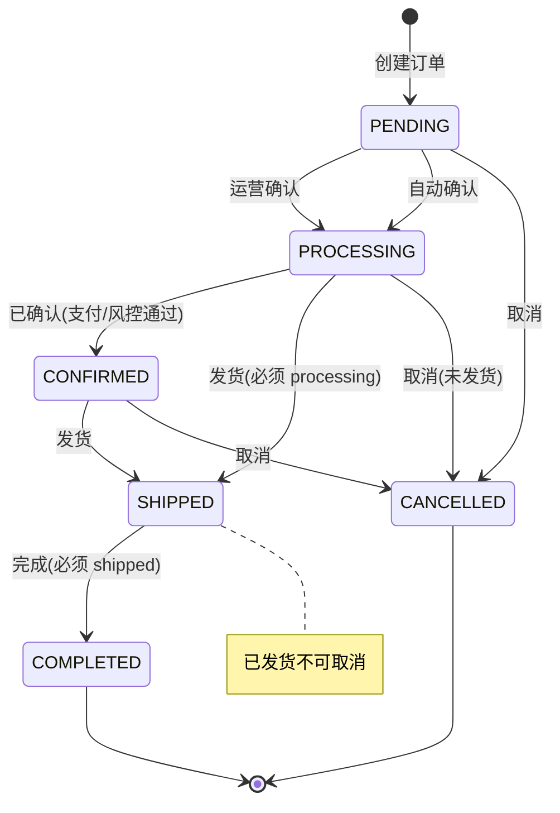

# 功能规格 · 订单管理（核心域）

| 项 | 内容 |
|---|---|
| 子域 | 核心域（Order Bounded Context） |
| 聚合根 | `Order` |
| 实体 | `OrderItem` |
| 值对象 | `OrderStatus`、`ShippingAddress`、`PaymentInfo` |
| 领域服务 | `OrderProcessingService`、~~`OrderSyncService`~~（**该类已删除**；平台拉单改由 `PlatformFetcherRegistry` + `OrderImportApplicationService` 承担，见 [spec/platform-integration.md](platform-integration.md)） |
| 应用服务 | `OrderApplicationService` |
| 仓储 | 领域接口 `OrderRepository` → `OrderRepositoryImpl` → `OrderJpaRepository` |
| 数据表 | `orders`、`order_items`、`shipping_addresses`、`payment_infos`（见 [`../db/er-diagram.md`](../db/er-diagram.md) 第 2 节） |
| 前端 | `frontend/user-web/src/pages/order/{OrderList,OrderDetail,CreateOrder}.jsx` |

---

## 1. 模块定位

订单是系统的**价值起点**：所有后续动作（占库存、发货、收款、核算）都由它触发。订单上下文的核心职责是：

1. 承载"买家想要什么、寄到哪、付了多少"这一事实；
2. 维护订单从创建到（完成｜取消）的**状态机**；
3. 作为对外集成的输入（平台拉取）与输出（触发履约与记账）。

**不可变性原则**：订单一旦创建，其行项中的 `product_name`、`sku_code`、`unit_price` 是**下单时的快照**，商品后续改名/下架不影响历史订单。这是正确的设计，但需要在 UI 上说明"这是历史快照"，避免被误认为脏数据。

---

## 2. 角色与权限

| 角色 | 权限 | 当前实现 |
|---|---|---|
| 运营专员 | 创建、查看、状态流转、取消 | ⚪ 无角色校验，登录即可操作 |
| 仓库主管 | 查看（含发货相关信息） | ⚪ |
| 财务/老板 | 只读 | ⚪ |
| 客服 | 只读（含物流状态） | ⚪ |

---

## 3. 状态机

### 3.1 目标态（领域层已定义的规则）

| 迁移 | 前置条件 | 实现位置 | 是否生效 |
|---|---|---|---|
| `* → PENDING` | 创建（行项非空、地址/支付非空、金额一致） | `OrderProcessingService.validateOrderInfo` | ✅ |
| `PENDING/PROCESSING/CONFIRMED → SHIPPED` | 当前必须为 `PROCESSING` | `OrderProcessingService.shipOrder` | ⚪ 未被 REST 端点调用 |
| `SHIPPED → COMPLETED` | 当前必须为 `SHIPPED` | `OrderProcessingService.completeOrder` | ⚪ 未被 REST 端点调用 |
| `→ CANCELLED` | 不得为 `SHIPPED` / `COMPLETED` | `OrderProcessingService.cancelOrder` | ⚪ 未被 REST 端点调用 |
| **任意 → 任意** | **无校验** | `OrderApplicationService.updateOrderStatus`（直接 `order.updateStatus`） | ❌ **实际对外接口走的是这条** |

> 🔴 **重要缺陷**：`PUT /api/orders/{id}/status` 绕过全部业务约束，当前可以从「待处理」直接跳到「已完成」，也可以把「已完成」改回「待处理」。详见 [`../qa/known-issues.md`](../qa/known-issues.md) ISS-003。

### 3.2 状态取值

| 枚举名 | 存储值 | 中文 | 展示建议 |
|---|---|---|---|
| `PENDING` | `pending` | 待处理 | 橙色 Tag |
| `PROCESSING` | `processing` | 处理中 | 蓝色 Tag |
| `CON_FIRMED` | `confirmed` | 已确认 | 青色 Tag |
| `SHIPPED` | `shipped` | 已发货 | 紫色 Tag |
| `COMPLETED` | `completed` | 已完成 | 绿色 Tag |
| `CANCELLED` | `cancelled` | 已取消 | 灰色 Tag |

> ⚠️ 领域枚举常量名 `CON_FIRMED` 拼写异常，持久化侧同义枚举写的是 `CONFIRMED`，按枚举名转换会失败（ISS-004）。

---

## 4. 业务规则

| 编号 | 规则 | 状态 | 实现位置 |
|---|---|---|---|
| BR-01 | 订单 ID 由领域层 `UUID.randomUUID()` 生成 | ✅ | `Order.create` |
| BR-02 | 订单编号 `orderNumber` 必须非空且唯一 | ✅ 非空已修 / ⚠️ 唯一仅靠随机 | **ISS-001 已修（2026-01-25）**：`Order.create`（`Order.java:128`）与重载（`:162-163`，优先用 `platformOrderId`）、`Builder`（`:505`）不再传 `null`，缺省时走 `generateOrderNumber()`（`:195-198`，`"ORD" + yyyyMMdd + UUID 前 8 位大写`）→ `OrderJpaEntity.order_number` 的 `unique=true, nullable=false` 可满足，真实 MySQL 上建单链路已跑通。**残留风险**：编号唯一性由随机串保证而非序列/DB 生成，同一天理论可碰撞（约 1/4.3e9），且没有 `uk` 冲突的定制错误文案，冲突时会变成 500 |
| BR-03 | 初始状态固定为 `PENDING` | ✅ | `Order.create` |
| BR-04 | 行项不能为空 | ✅ | `validateOrderInfo` |
| BR-05 | 客户 ID 不能为空 | ✅ | `validateOrderInfo` |
| BR-06 | 收货地址不能为空 | ✅ | `validateOrderInfo` |
| BR-07 | 支付信息不能为空 | ✅ | `validateOrderInfo` |
| BR-08 | **订单金额必须等于支付金额**（`BigDecimal` 精确比较） | ✅ | `validateOrderInfo` |
| BR-09 | 订单行项保存商品名与 SKU 编码快照，不持有商品外键 | ✅ | `OrderItem`（有意为之） |
| BR-10 | 保存客户名/邮箱快照，客户资料变更不回写历史订单 | ✅ | `orders.customer_name/customer_email` |
| BR-11 | 创建/更新时刷新 `updatedAt` | ✅ | `Order.updateStatus` 等 |
| BR-12 | 状态流转必须满足前置约束（见 3.1） | ⚪ | 规则在 `OrderProcessingService`，但 REST 未走它（ISS-003） |
| BR-13 | 取消订单需释放已占用库存 | ⚪ | 无库存占用概念 |
| BR-14 | 取消需记录原因与操作人 | ⚪ | 无字段 |
| BR-15 | 订单必须归属租户，跨租户不可见 | ❌ | `createOrder` 中硬编码 `"default-tenant"`（ISS-002） |
| BR-16 | 订单无 `tenant_id` 列，物理上无法隔离 | ❌ | `orders` 表结构（见数据字典 R-07） |
| BR-17 | 同一平台订单号不可重复入库（幂等） | ⚪ | 无平台订单号字段 |
| BR-18 | 金额字段应使用 `DECIMAL` 而非 `DOUBLE` | ✅ | ~~`orders.total_amount` 为 `DOUBLE`（数据字典 R-09）~~ → ✅ **2026-10-10 已修（ISS-023 关闭，见 [../qa/known-issues.md](../qa/known-issues.md) §20 / R-52~R-54）**：`orders.total_amount`、`order_items.unit_price`/`total_price`、`payment_infos.amount` 现为 `DECIMAL(19,2)`，实体侧 `BigDecimal` 且显式声明 `precision=19, scale=2`，mapper 同类型直传（不再有 `doubleValue()` / `BigDecimal.valueOf(Double)` 中转）。全库 15 个金额列 = 14 × `19,2` + `logistics_channels.price_per_gram` `19,4`（每克费率必须 4 位，R-52），浮点列只剩两个重量列。常驻位：`MoneyPrecisionGuardTest` 6 例 + `MoneyPrecisionRoundTripTest` 4 例 + `smoke.sh` §14 12 条 |

---

## 5. 功能清单

| 功能 | 说明 | 前端 | 后端 | 状态 |
|---|---|---|---|---|
| 创建订单 | 填写客户/行项/地址/支付创建订单 | `CreateOrder.jsx` 已联网 | `POST /api/orders` | 🟡 受 ISS-001 影响会落库失败 |
| 查询订单详情 | 按 ID 查询 | `OrderDetail.jsx`~~（mock）~~ | `GET /api/orders/{id}` | ~~🟡~~ → 🟡 **2026-01-25 逐页复测：已接真实接口**（该页 4 个 `orderApi.*` 调用点；`api.js:133` 起的 `orderApi` 已含详情与分页列表方法），不再读页面内 mock |
| 变更订单状态 | 修改订单状态 | 无入口 | `PUT /api/orders/{id}/status?status=` | 🟡 无校验（ISS-003） |
| 查询客户订单 | 按客户 ID 查询其所有订单 | 未使用 | `GET /api/orders/customer/{customerId}` | 🟡 |

> **2026-01-25 就地更正（本模块已从 4 个端点扩到 9 个，上表多行已过期，原文保留以便对照）**：
> - ✅ **ISS-001 已修**：创建不再因 `order_number` 为 null 落库失败（见 §4 BR-02）；`OrderController.java:47-59` 的 `createOrder` 走 `resolveTenant(null)`（`:163-171`：请求参数 → `TenantContext` → `DEFAULT_TENANT_ID`），**创建路径已不接受客户端传租户**（ISS-014 收敛）。
> - ✅ **「缺订单列表/分页」已修**：新增 `GET /api/orders`（`:64-80`），返回 `Result<PageResult<OrderDto>>`，支持 `orderNumber`（模糊）/`customerId`/`customerName`（模糊）/`status`/`platform`/`keyword`/`startDate`/`endDate`/`page`/`size`（默认 0/10）；`OrderList.jsx:34-37,74-84` 用服务端分页（`total` 来自 `PageResult`），不再是 mock。
> - ✅ **ISS-003 已修**：`PUT /{id}/status`（`:110-117`）→ `OrderApplicationService.updateOrderStatus`（`:71-81`）→ `Order.updateStatus`，非法迁移在 `Order.java:251` 由 `OrderStatus.canTransitionTo`（`OrderStatus.java:57`）拦截；`OrderDetail.jsx` 已接状态变更（`:70`）、取消（`:84`）、删除（`:95`）。
> - 另外新增：`POST /api/orders/{id}/cancel`（`:119-126`，走 `OrderProcessingService.cancelOrder`，已发货/已完成不可取消）、`DELETE /api/orders/{id}`（`:127-133`）、`GET /api/orders/number/{orderNumber}`（`:94`）、`GET /api/orders/statuses`（`:84`）；`orderApi` 前端也从 4 个方法扩到 **9 个**（`services/api.js:133-145`）。
> - ⚠️ 读路径仍未收敛（ISS-050 同类）：`GET /api/orders` 的 `tenantId` 依然可由 `@RequestParam` 传入（`:66`，虽会被 `TenantIsolationAspect` 校验、但不能过滤出别人租户的数据要靠仓储谓词）；`GET /api/orders/customer/{customerId}`（`:135-140`）**根本没有租户维度**，只按 `customerId` 查，任何已认证调用方可枚举他人订单。
| 订单列表 / 分页 / 筛选 | ~~⚪ 未实现~~ → ✅ 已实现 | `OrderList.jsx`~~（mock）~~ | ~~无端点~~ → `GET /api/orders`（`OrderController.java:63-81`，参数 `:66-76`：`orderNumber`/`customerId`/`customerName`/`status`/`platform`/`keyword`/`startDate`/`endDate`/`page`/`size`，返回 `Result<PageResult<OrderDto>>`） | ~~⚪ **P0 缺口**~~ → ✅ **2026-01-25 复测缺口已闭合**：端点存在，`api.js:137` 的 `orderApi.getOrders(params)` 与之对应，`OrderList.jsx` 已按参数分页查询。 ⚠️ 残留：查询**不带租户条件**（ISS-050），`tenantId` 省略时回落 `default-tenant`（ISS-051） |
| 订单取消（含原因） | ⚪ 未独立暴露 | — | 仅 `cancelOrder` 领域方法，无端点 | ⚪ |
| 平台订单同步 | ⚪ 桩 | — | `PlatformIntegrationController#syncOrders` | ⚪ |
| 订单导出 | ⚪ 未实现 | — | — | ⚪ |

---

## 6. 接口对照

| 场景 | 方法 | 路径 | 请求 | 状态 |
|---|---|---|---|---|
| 创建订单 | POST | `/api/orders` | `CreateOrderDto{customerId, orderItems[], shippingAddress, paymentInfo}` | 🟡 |
| 按 ID 查询 | GET | `/api/orders/{id}` | — | 🟡 |
| 变更状态 | PUT | `/api/orders/{id}/status` | `?status=PENDING\|PROCESSING\|CONFIRMED\|SHIPPED\|COMPLETED\|CANCELLED` | 🟡 无校验 |
| 按客户查询 | GET | `/api/orders/customer/{customerId}` | — | 🟡 |
| 订单列表 | GET | `/api/orders` | — | ⚪ **不存在** |

统一响应与错误码见 [`../api/README.md`](../api/README.md)。

---

## 7. 领域事件

| 事件 | 触发时机 | 期望下游 | 现状 |
|---|---|---|---|
| `OrderCreatedEvent` | 订单创建 | 占用库存、记为待收款 | ⚪ 已发布无消费 |
| `OrderStatusChangedEvent` | 状态变更 | 通知平台、通知买家 | ⚪ |
| `OrderShippedEvent` | 发货 | 扣减库存、生成运费应付 | ⚪ |
| `OrderCompletedEvent` | 完成 | 生成收入流水 | ⚪ |

---

## 8. 现状缺口与待办

| 优先级 | 缺口 | 影响 | 建议 |
|---|---|---|---|
| **P0** | `orderNumber` 未生成导致落库失败（ISS-001） | 创建订单在真实数据库上不可用 | 引入 `OrderNumberGenerator`（如 `yyyyMMdd + 序列`），并补 null 校验 |
| ~~**P0**~~ → ✅ 已完成 | ~~缺订单列表/分页/筛选~~ | ~~前端只能 mock~~ → 端点与前端都已到位 | ~~新增 `GET /api/orders`，支持状态/时间/关键词筛选与分页~~（2026-01-25 复测：`OrderController.java:63-81` + `api.js:137` + `OrderList.jsx` 已联网；下一位工作改成"列表查询补租户条件"，即 ISS-050） |
| **P0** | 租户未透传（硬编码 `default-tenant`） | 多租户不成立 | 由认证上下文注入 `tenantId`；补 `orders.tenant_id` 列 |
| **P1** | 状态机约束被接口绕过 | 数据可被改成非法状态 | `PUT /status` 改为调用 `OrderProcessingService` 的 process/ship/complete/cancel 分支 |
| **P1** | 缺取消端点与取消原因 | 无法解释订单为何关闭 | 新增 `POST /api/orders/{id}/cancel` + `cancelReason` 字段 |
| **P1** | 下单/发货/完成不联动其他上下文 | 流程不闭环 | 消费领域事件驱动库存与财务 |
| **P2** | 金额用 `DOUBLE` | ~~精度丢失风险~~ → ✅ **2026-10-10 已消除**（ISS-023 关闭 / R-52~R-54，见 [../qa/known-issues.md](../qa/known-issues.md) §20）：修复前的现场产物是 76 行商品价格求和回显 `828.399999999999`，且损失发生在 JDBC→Java 那一跳，列改成 `DECIMAL` 也救不回来 | ~~改为 `DECIMAL(19,2)`~~ → ✅ 已按影子列流程改完（`V7`/`V7.1`），实体侧同步 `BigDecimal` + 显式 `precision=19, scale=2`（费率是 `scale=4`，R-52），并配静态守卫 + 往返测试 + `smoke.sh` §14 常驻位 |
| **P2** | `Order` 未继承 `BaseAggregateRoot` | 领域事件实现重复 | 统一基类 |
| **P2** | 缺平台订单号字段 | 无法做同步幂等 | 新增 `platform_order_no` 唯一索引 |

---

## 9. 验收要点（测试视角）

1. **创建订单**：金额一致时成功；金额不一致、行项为空、地址为空时**当前**返回 HTTP 500 + `SYSTEM_ERROR`（`IllegalArgumentException` 落入兜底处理器，信息被吞，见 ISS-037），**期望态**为 400 + 指明具体校验项的错误文案。此外受 ISS-001 影响，即使校验通过也会因 `order_number` 为 null 而落库失败。
2. **状态流转**：不得出现「待处理→已完成」的跳跃；已发货订单取消必须失败。
3. **查询**：按客户查询只返回该客户的订单；订单不存在时返回 `ENTITY_NOT_FOUND`。
4. **幂等**：同一订单重复创建（未来有平台单号时）不产生重复记录。
5. **租户**：A 租户用户不可查询到 B 租户订单。
