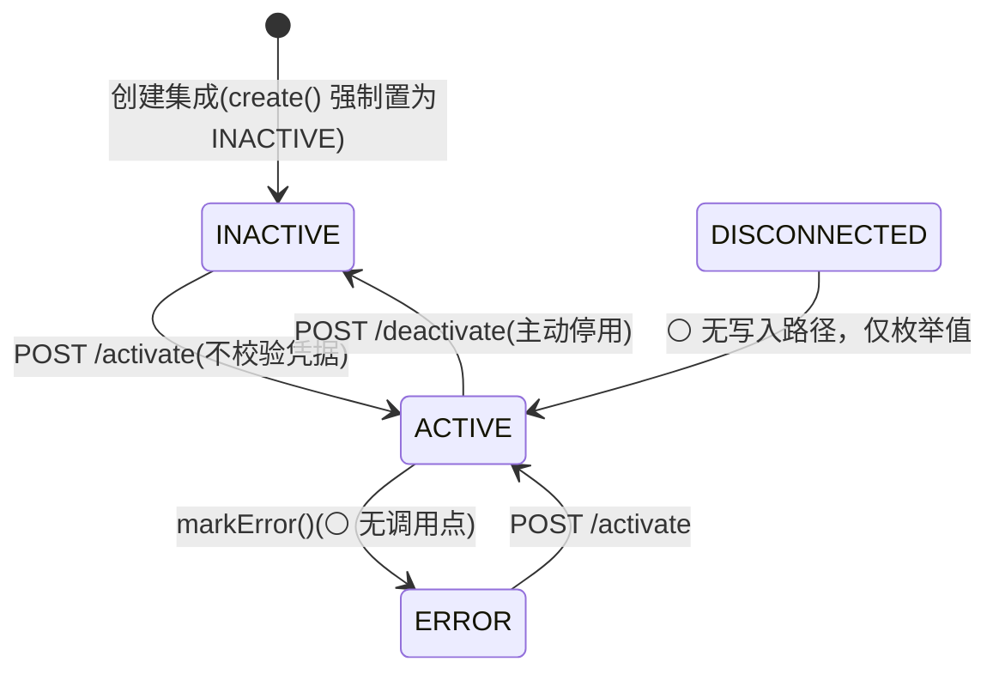

# 功能规格 · 平台集成（通用域）

| 项 | 内容 |
|---|---|
| 子域 | 通用域（Platform Integration Bounded Context） |
| 聚合根 | `PlatformIntegration`（`domain/platform/aggregate/PlatformIntegration.java:20`）；同族新增 `Shop`（`domain/shop/aggregate/Shop.java`，见 §9.4） |
| 值对象 | `PlatformName`（**12** 个枚举常量，`:9-20`）、`PlatformStatus`（4 个，`:9-12`）、`PlatformAuthType`（**11** 个，`:17-58`）、`PlatformAuthSpec` + `PlatformAuthCatalog`（**11** 行协议目录，`PlatformAuthCatalog.java:20-206`，`all()` 于 `:207`） |
| 领域服务 | `PlatformIntegrationService` / `PlatformIntegrationServiceImpl`（`domain/platform/service/PlatformIntegrationServiceImpl.java:39`） |
| 应用服务 | `PlatformIntegrationApplicationService`（`application/service/platform/PlatformIntegrationApplicationService.java:42`，编排 6 条同步线 + 连通性测试 + 发货回写）、`ShopApplicationService`、`ShopWarehouseApplicationService` |
| 端口 | `domain/platform/client/` **8 个端口**：`Platform{Order,Product,Customer,Logistics,Warehouse,Finance}Fetcher` + `PlatformFulfillmentPusher` + `PlatformConnectionTester`（另有 `PlatformCredential`、6 个 `*FetchRequest`、6 个 `*FetchException`） |
| 适配器 | `infrastructure/platform/PlatformFetcherRegistry.java:31`（8 张 `Map<String, 端口>`，`:38-45`，构造器注入 8 个 `List<端口>` 后按 `type()` 下标，`:47-63`）+ **37 个端口适配器**：`HttpPlatform*`(CUSTOM_SHOP，7) / `SamplePlatform*`(SAMPLE，6) / `shopify/*`(4) / `amazon/*`(2) / `ebay/*`(3) / `aliexpress/*`(2) / `shopee/*`(3) / `mercado/*`(2) / `ozon/*`(4) / `magento/*`(4)；另有 **4 个 `PlatformTokenExchange`**（amazon / ebay / shopee / mercado，不进这张注册表）⇒ 全目录 `implements Platform*` 类共 **41 个**（2026-10-21 实测，逐 vendor 清点见 §7.1）；`TEMU`、`TIKTOK_SHOP` **0 个** |
| 数据表 | `platform_integrations`（活库 **19 列**，2026-10-21 `information_schema` 复测；索引**只有 `PRIMARY(id)`**，**0 行**）；同域另有 `shops`（**23 列**、0 行，两个唯一键 `uk_shops_tenant_code(tenant_id, shop_code)` 与 `uk_shops_marketplace(tenant_id, platform, marketplace_id)` + 普通索引 `idx_shops_integration(integration_id)`、`idx_shops_tenant(tenant_id)`）、`shop_warehouses`、`shop_warehouse_import_jobs`、`shop_warehouse_field_mappings` |
| 控制器 | `interfaces/controller/platform/PlatformIntegrationController.java`（**15** 端点）、`interfaces/controller/warehouse/ShopWarehouseController.java`（5）、`interfaces/controller/shop/ShopController.java`（7） |
| 前端 | `frontend/user-web/src/pages/platform-integration/{PlatformIntegration,PlatformIntegrationDetail,CreatePlatformIntegration}.jsx`、`pages/shop/ShopList.jsx`、`pages/warehouse/ShopWarehouseSync.jsx` |
| 技术设计 | [tech/integration-design.md](../tech/integration-design.md)（含各平台官方文档与对接前置清单） |

---

## 1. 模块定位

平台集成是系统的**入口阀门**：它把分散在 Amazon / eBay / Shopify / 速卖通等平台的订单拉进系统，并把系统的商品库存与发货结果推回平台。

~~**这是产品价值主张的核心，也是当前实现最薄弱的部分**——三个同步接口都是空逻辑桩，没有一家平台的真实对接。在产品层面这意味着：**系统目前无法真正"接单"，只能手工建单**。~~

> ⚠️ 口径 **2026-03-08 工作树**（本节早期结论已随 ISS-013 修复失效，保留修订记录）。
>
> ~~三个 `sync-*` 是空逻辑桩~~ → ✅ **桩已消除**：6 条数据线（订单 / 商品 / 客户 / 物流 / 店铺仓 / 财务）各自有 `Platform*Fetcher` 端口与真实 HTTP 适配器，同步端点复用「拉取 → 字段映射 → 批量导入 → 作业明细」链路（`{X}ImportJobDto` 逐行返回成功/跳过/失败）。
> ✅ ~~分派是 `useSample ? sample : http` 布尔三元~~ → 改为 **按认证协议（`PlatformAuthType`）的适配器注册表** `PlatformFetcherRegistry`；新增一家平台只需注册一个 `type()` 返回该协议名的适配器，不改导入服务。
> ✅ **Shopify 成为第一家按官方协议对接的平台**：Admin REST 增量拉单、商品拉取、发货回写、连通性测试。
> 🔴 **但未经真实平台验证**（已登记 **ISS-064**，P0）：无任一平台的沙箱凭据，正确性证据只有本地 fixture 契约测试（`ShopifyAdminApiContractTest` ~~10 例~~ → **12 例** + `ShopifyAdapterMappingTest` 17 例 = **29 例**，2026-10-21 按 surefire 订正）。**上线前必须先做凭据演练**（见 §10 完成标准）。
> ⚪ 其余平台（Amazon / eBay / AliExpress / Wish / Magento）**仍未对接**，且阻塞点不在代码而在平台侧准入（开发者账号审核、OAuth 授权、`scope` 申请），逐家前置见 [tech/integration-design.md §11](../tech/integration-design.md)；同一结论在缺陷侧见 **ISS-064**。
>
> 🔄 **2026-10-21 复测（本文件其余部分按本轮活码逐条订正）**：
> ①上面那句"其余平台仍未对接"**在代码侧已经不成立**——Amazon / eBay / 速卖通 / Shopee / Mercado / Ozon / Magento 七家的适配器本轮仍在库里（全仓 `implements Platform*` 适配器类 **41** 个 = 8 端口注册适配器 **37** + 令牌交换 **4**，见 §7.1），`PlatformName` 已从 7 值扩到 **12** 值；真正没适配器的只有 `TEMU` 与 `TIKTOK_SHOP`，且 `PlatformAuthCatalog` 用 `verified=false` 把这两家的"规范核实不到"写进了数据而不是文档（`TIKTOK_SHOP` 行 `:122`、标志 `:134`；`TEMU` 行 `:188`、标志 `:198`）。
> ②本模块的**头号风险换了**：不再"没有对接"，而是**对外呼这把枪没有装租户准星**——`sync-inventory` 汇总的是**全库**库存（`PlatformIntegrationServiceImpl:202` 用 `inventoryRecordRepository.findAll()`，而 `inventory_records` 表**根本没有 `tenant_id` 列**），却按调用方指定的那条集成推到外部 `storeUrl`。判据与后果见 §4 BR-10 与 [../security-findings.md](../security-findings.md) **M-11**。
> ③鉴权口径变了：类级统一门禁已**拆成读写两套**（`PlatformIntegrationController:53-61` 类注释），3 个读端点改为"任何登录用户 + 会话租户过滤"，12 个写端点保留方法级 `platform:manage`；按 id 的写操作统一过 `requireOwnedIntegration:407-414`（ISS-122）。

---

## 2. 概念模型

| 字段 | 说明 | 安全评估 |
|---|---|---|
| `id` | UUID，`@GeneratedValue`（库内实际是 `binary(16)`） | ✅ |
| `tenant_id` | 租户归属；历史行为 NULL | 🟡 列存在（`varchar(64)`，可空），但 **`SHOW INDEX FROM platform_integrations` 只有 `PRIMARY(id)` 一条**——连普通索引都没有，"按租户查集成"是全表扫（订正上一版"只有普通索引级别"的说法）。🔄 2026-10-21 行为侧已收口：读路径按会话租户过滤、写路径按 id 先验归属，见 §4 BR-11 与 ISS-121/122 |
| `platform_name` | 平台标识（枚举，大写名）——**业务标签**，不参与分派 | ✅ 库里是 `enum('ALIEXPRESS','AMAZON','EBAY','MAGENTO','MERCADO_LIBRE','OTHER','OZON','SHOPEE','SHOPIFY','TEMU','TIKTOK_SHOP','WISH')`（**12** 值，`@Enumerated(EnumType.STRING)`，`PlatformIntegrationJpaEntity:54-56`）——与 `tenants.status` 那种"VARCHAR 存枚举"不同，本表三个枚举列都有 DB 层约束 |
| `auth_type` | 对接协议（`CUSTOM_SHOP`/`SHOPIFY`…共 **11** 值）——**这才是外呼分派键**，为空按 `CUSTOM_SHOP` | ✅ 2026-03-08 新增；库里同为 `enum(...)`（`:61-63`）。⚠️ 枚举有 11 值但**只有 9 家有适配器**，`TEMU`/`TIKTOK_SHOP` 是"能存不能调"的占位值 |
| `api_key` | 平台 API 密钥（`varchar(1024) NOT NULL`） | ~~🔴 明文存储~~ → ✅ **AES-256-GCM 密文列**（`enc:v1:` 前缀），出参只给掩码 `PlatformIntegrationDto.apiKeyMasked` |
| `api_secret` | 平台 API 密钥 Secret（`varchar(1024) NOT NULL`） | ~~🔴 明文存储，且 `GET /{id}` 会原样返回给前端~~ → ✅ 密文列；出参只给 `hasApiSecret` 布尔位，**永不回传** |
| `access_token` | 访问令牌密文（Shopify `shpat_`，`varchar(1024)` 可空） | ✅ 密文列；出参只给 `hasAccessToken` |
| `refresh_token` | 刷新令牌密文（`varchar(1024)` 可空） | ~~✅ 密文列；**尚无刷新实现**~~ → 🔄 **2026-10-21 订正：刷新已实现**。`PlatformTokenExchange` 端口有 4 家注册（`AmazonLwaTokenExchange`、`EbayOAuthTokenExchange`、`MercadoTokenExchange`、`ShopeeTokenExchange`），Magento 走用户名口令换 Bearer；轮换值经 `PlatformCredentials` 回写聚合 `applyToken:127-138`（注释原话："令牌由本方法落在聚合上后，必须经仓储 save 才会加密持久化——否则会退回到每次外呼都重新刷新，既浪费平台配额，也可能触发「刷新令牌一次性」类平台的作废"） |
| `token_expires_at` | 令牌过期时间 | ✅ 出参可见（非敏感） |
| `api_version` | 平台接口版本（Shopify 形如 `2026-01`），为空取全局配置 | ✅ 配置侧 `platform.shopify.api-version: ${SHOPIFY_API_VERSION:}` **故意不给默认值**（yml `:67-70` 注释：版本有 12 个月支持窗口，写死会随时间静默失效），集成记录优先于全局 |
| `store_url` | 店铺地址（`varchar(255)`） | ✅ 但 **9 家协议已改为"host 来自配置/内置常量"**（`PlatformAuthSpec.hostFromConfig=true`，目录 `:65`/`:81`/`:103`/`:122`/`:139`/`:156`/`:173`/`:188` 等），只有 `CUSTOM_SHOP`/`SHOPIFY`/`MAGENTO` 三家仍把 `storeUrl` 列为必填——上一版"每个平台都要填 storeUrl"的口径已不成立 |
| `region` | 区域/站点（`varchar(32)`，`:102-103`） | ✅ **2026-10-21 新增记录**：AMAZON_SP_API 取 `NA`/`EU`/`FE`（目录 `:71`），候选值由 `PlatformAuthSpec.regionOptions` 下发给界面，不在前端硬编码 |
| `external_shop_id` | 平台侧店铺/商户 ID（`varchar(128)`，`:108-109`） | ✅ **2026-10-21 新增记录**：Shopee 的 `shop_id`/`merchant_id` 这类"签名参数要参与、但不在凭据里"的标识走这一列 |
| `marketplace_ids` | 站点/市场列表（`varchar(512)`，`:114-115`） | ✅ **2026-10-21 新增记录**：Amazon SP-API 的 `MarketplaceIds` 是**必填 query 参数**（目录把 `marketplaceIds` 列为必填字段 `:68`），没有它请求根本发不出去 |
| `status` | 连接状态 | — 库里是 `enum('ACTIVE','DISCONNECTED','ERROR','INACTIVE') NOT NULL`（`:117-119`）；可达性见 §3 |

加解密收敛在**仓储边界**（`PlatformIntegrationRepositoryImpl.encryptSecrets/decryptSecrets`），领域聚合与上层只见明文；密文格式与主密钥来源见 [tech/integration-design.md §4](../tech/integration-design.md)。
⚠️ **加密以部署环境注入 `PLATFORM_CREDENTIAL_MASTER_KEY` 为生效前提**：未注入时 `CredentialCipher` 打 WARN 并按明文读写——即 ISS-011 只有在运维配好密钥后才真正关闭。历史明文行无 `enc:v1:` 前缀，读取时原样返回、下次写入自动收敛为密文。

---

## 3. 状态机

| 枚举名 | 中文 | 业务含义 |
|---|---|---|
| `ACTIVE` | 已激活 | 可参与同步 |
| `INACTIVE` | 已停用 | 人为关闭 |
| `DISCONNECTED` | 未连接 | ⚪ **不可达**：`PlatformStatus.DISCONNECTED` 在主源码里 0 个写入点，只有枚举定义 |
| `ERROR` | 异常 | 🟡 `markError()` 已实现但 0 个调用点，实际不会出现 |

> ⚠️ 口径 **2026-03-08 工作树**，🔄 **2026-10-21 按活码复测：三条边的判定全部成立，只有行号要换**。
>
> - 聚合有 `markError()`（~~`PlatformIntegration.java:81-88`~~ 现行 `:96-102`），但**全仓 0 个调用点**（`grep -rn "markError\(\)"` 只命中定义行）——同步/外呼失败不会把集成改成 `ERROR`，只会在响应里报错。
> - `POST /{id}/test-connection` **故意不改状态**：连通性测试失败是预期分支（凭据没填对、店铺还没开权限），直接把集成打回 `DISCONNECTED/ERROR` 会让运维看不出"是我不对还是平台不对"。测试通过也不会自动激活（BR-04 未收口的部分）。
> - `DISCONNECTED` 只有两处出现：`domain/platform/valueobject/PlatformStatus.java:11` 与 JPA 侧 `infrastructure/persistence/jpa/entity/platform/PlatformStatusJpaEntity.java:11`，**没有任何写入点**（库里那 4 个 ENUM 取值是 DDL 建出来的，不代表数据能到得了）。
> - 只有 `activate`（`:77-83`）/`deactivate`（`:85-91`）会写状态，且都带**幂等短路**（`status != ACTIVE` / `== ACTIVE` 才改并注册事件）；`activate` 不做任何凭据校验（详见 §9 P1）。
> - 🔄 本轮补一条**图上没有的约束**：`status` 在全域只有一个消费者——`sync-inventory` 会拒绝非 `ACTIVE`（`PlatformIntegrationServiceImpl:187-190`，`PLATFORM_INTEGRATION_INACTIVE`），其余 5 条同步线与发货回写、连通性测试**都不看状态**。所以"停用集成＝停止同步"只在库存推送这一条上成立（见 §10.3）。

---

## 4. 业务规则

> 口径 **2026-03-08 工作树**。状态列的含义：**✅ 已实现（有代码路径 + 测试）** ｜ **🟡 部分实现** ｜ **⚪ 未实现** ｜ **🔴 违反**。
> ⚠️ 所有 ✅ 的**验证级别都只到 fixture 契约测试**（本地 `com.sun.net.httpserver` 桩），无一经过真实平台凭据演练。

| 编号 | 规则 | 状态 | 说明 |
|---|---|---|---|
| BR-01 | 平台密钥必须加密存储（至少 AES + KMS/环境变量托管） | ✅ **代码就绪，运维待配** | `CredentialCipher`：AES-256/GCM/NoPadding，IV 12 字节、tag 128 位，密文带 `enc:v1:` 前缀；加解密在仓储边界（`PlatformIntegrationRepositoryImpl`），4 个凭据字段全覆盖。 🔑 **主密钥只从环境变量 `PLATFORM_CREDENTIAL_MASTER_KEY` 注入**，不入库、不入 Git。 ⚠️ 未注入密钥时 `CredentialCipher` 打 WARN 并**按明文读写**（不阻断启动）——所以这条规则在运维配好密钥前只是"事实上关闭"；32 字节 Base64 以外的串会走 SHA-256 派生并 WARN。 历史明文行无前缀 → 读取原样返回、下次保存自动收敛为密文（不要求一次性回填）。 |
| BR-02 | 密钥不应对外返回，只返回掩码 | ✅ | `PlatformIntegrationDto` 出 `apiKeyMasked`（前 3 + `****` + 后 4；≤7 位整体 `****`）+ `hasApiSecret`/`hasAccessToken` 布尔位；`apiSecret`/`accessToken`/`refreshToken` **字段本身不在 DTO 上**。 配套：更新接口凭据留空 = 沿用库里原值（`PlatformIntegrationSaveRequest.toAggregate(existing)`），所以"不回显"不会导致"改个名字就丢密钥"。 |
| BR-03 | 同一租户同一平台同一店铺不可重复创建 | ⚪ | 表上**无任何唯一约束**——🔄 **2026-10-21 直接查库**：`SHOW INDEX FROM platform_integrations` 返回**只有 `PRIMARY(id)` 一条**（订正上一版"`tenant_id` 有普通索引级别"的说法：连普通索引也没有）。同一 storeUrl 重复建单会重复拉单，靠幂等键兜住（见 BR-05），不会产生重复订单但会产生两条集成记录。 |
| BR-04 | 创建/激活时必须做一次连通性测试 | 🟡 | ✅ 端点已落地：`POST /{id}/test-connection`（`PlatformIntegrationController:363-380`，写侧门 `:363` + 留痕 `:364`），按协议分派 `PlatformConnectionTester`，返回 `record(success, adapterType, latencyMs, message)`，失败**不抛异常**而是 200 + `success=false`（要把原因回显给运维）。 🔄 **2026-10-21 新增**：协议元数据已收敛成一张表并可下发——`GET /api/platform-integrations/auth-specs`（`:90-94`，**无 `@PreAuthorize`**，注释原话"纯静态目录不读库，任何登录用户可读，供租户端创建页渲染下拉"），数据源 `PlatformAuthCatalog.SPECS` **11 行**（`:20-206`，`all()` 于 `:207`），每行含 `requiredFields/optionalFields/hostFromConfig/regionOptions/tokenGuide/docUrls/verified/note`。 ❌ **但该端点目前 0 个前端消费方**：`user-web/src/services/api.js` 里没有 `auth-specs` 调用，创建页用的是 `constants/product.js` 硬编码的 `authTypeOptions`（`CreatePlatformIntegration.jsx:6`）⇒ "界面与后端读同一张表"这条只在后端成立，前端仍是第二份口径（对齐 ADR-0013 §6 步骤 7 未做的同一形状）。 ❌ **不强制**：`activate` 不调用它，创建时也不调用；测试失败不改 `status`。 ❌ `CUSTOM_SHOP` 探测没有独立 health 端点，走的是代价最小的一条真实业务查询（`GET {storeUrl}/orders?page=1&pageSize=1`，`X-API-Key`/`X-API-Secret` 头，`HttpPlatformConnectionTester:35/:59/:63-64`）——自建店铺没有该接口时会一直判失败。 |
| BR-05 | 订单拉取必须增量、幂等（按平台订单号去重） | ✅（Shopify 路径） | 增量：`updatedFrom/updatedTo` → Shopify `updated_at_min`；游标分页走完 `Link` 头 `page_info`，`cursor.max-pages=20` 兜底（`ShopifyAdminApi:66` 读 `platform.shopify.cursor.max-pages:20`，yml `:71-72` 同值）。 幂等：~~`syncFromPlatform` 固定 `enableIdempotency=true`，按 `(tenantId, platform, platformOrderId)` 查已有单（`OrderImportApplicationService:348-350`）~~ → 🔄 **2026-10-21 行号订正**：同步入口在 `syncFromPlatform` 里同时钉死 `setUpdateExisting(TRUE)` 与 `setEnableIdempotency(TRUE)`（`:221-222`），命中查询是 `orderRepository.findByPlatformOrderId(tenantId, platform, externalOrderId)`（`:357`，接口声明 `OrderRepository.java:70`），命中则**更新**而不是插入。 ⚠️ `updateExisting` 也是 `TRUE`，所以"平台订单号已存在且未开启覆盖更新，已跳过"（~~`:354-357`~~ 现行 `:362-366`）这条分支在同步路径上不会走到，它服务的是 Excel 导入且未开覆盖的场景。 ⚠️ 两条**硬拒**（不是跳过）也在同一段里：平台订单号为空 → `ValidationException("平台订单号为空，无法建立幂等关联")`（`:326`）、订单明细为空 → `ValidationException("订单明细为空")`（`:331`）；幂等键只是查询条件，**库里没有 `platform_order_no` 唯一索引**，并发同步仍可能双插（见 §9.1 末行）。 |
| BR-06 | 同步需有定时调度能力 | ⚪ | 🔄 **2026-10-21 复测**：`grep -rn "@Scheduled\|@EnableScheduling" backend/src/main/java` = **0 处**。只有手工触发端点，且见 §3 最后一条——手工端点里也只有 `sync-inventory` 看 `status`。 |
| BR-07 | 每次同步需记录成功/失败明细以便排查 | 🟡 | 没有独立的 `sync_jobs` 表，但**任务化落库已经存在**：~~6 张 `*_import_jobs`~~ → 🔄 **2026-10-21 查库：6 条线共 12 张表**（`{order,product,customer,logistics,finance,shop_warehouse}_import_jobs` + 同名 `_field_mappings`，含 total/success/failed 与 `tenant_id` 索引），并有 `GET /api/{线}-import/jobs` 分页查询。店铺仓这条线的任务表本轮已接到平台触发口（见 §5）。 缺口是**平台侧调度**与"集成维度"的聚合视图（现在按导入任务看，不按 platform 看）。 |
| BR-08 | 失败需有重试与退避策略，避免触发平台限流 | ✅ | ~~（仅 Shopify）~~ → 🔄 **2026-10-21 复测：共用组件确认**——`infrastructure/platform/PlatformHttpExchange.java`（类注释原话："九家平台的传输约束高度同构（429 要按 `Retry-After` 等、401/403 重试没有意义、5xx 与网络抖动值得重试），所以收敛到一个组件，各适配器只负责拼 URL 与鉴权头/签名"），参数取 `platform.http.retry.max-attempts:3` / `max-wait:30s`（`:49-50`）；Shopify 保留自己的 `ShopifyAdminApi`（`:67-68` 读 `platform.shopify.retry.*`，`:184-237` 同一套语义），另有超时闸 `platform.http.connect-timeout: 5s` / `read-timeout: 15s`（yml `:57-61`，注释写明"JDK HttpClient 默认不超时，平台挂起会占住导入线程与数据库连接"）。 ~~`CUSTOM_SHOP` 的 `HttpPlatform*Fetcher` 无重试~~ → 已走共用传输，`PlatformHttpExchangeTest` 6 例覆盖。 |
| BR-09 | 平台 API 限流需被尊重（并发控制/令牌桶） | 🟡 | ✅ **被动**：尊重平台返回的 `429 + Retry-After`（`PlatformHttpExchange:100-104`、`ShopifyAdminApi:203-208`）；请求间无并发放大（单线程串行翻页），Shopify `limit` 被 `clampPageSize()` 钉到官方上限 250（`:142-144`）。 ⚪ **主动**：无令牌桶/速率预约。Shopify 官方口径是 leaky bucket 40 次/店铺、每秒回补 2 次，靠被动退避能用，但多集成并发拉取时没有全局闸。 |
| BR-10 | 库存同步应在库存变动后触发 | 🔴 | **两个问题分开说。** ①「变动后触发」这一半仍是 ⚪：无联动、无调度，`POST /{id}/sync-inventory`（`PlatformIntegrationController:317-332`）是全量手工推送，且只支持 `CUSTOM_SHOP`——非该协议显式返回 `PLATFORM_INVENTORY_PUSH_UNSUPPORTED`（`PlatformIntegrationServiceImpl:191-194`，消息里点名"Shopify 需要先把本地 SKU 映射到 inventory_item_id 与 location_id，当前表结构没有该映射"）。**没有** `PlatformInventoryPusher` 端口（`domain/platform/client/` 里 8 个端口不含它），所以这条不会"误推到不存在的路径"，判 ⚪ 是对的。 🔴 ②「推什么」这一半本轮实测出**新的横向越权**（登记为 [../security-findings.md](../security-findings.md) **M-11**）：库存汇总取 `inventoryRecordRepository.findAll()`（`:202`），**没有任何租户条件**，而 `inventory_records` 表**根本没有 `tenant_id` 列**（2026-10-21 查 `information_schema`：全库 **25** 张表有该列，`inventory_records` 不在其中；`InventoryRecordRepository` 也没有任何按租户的查询方法）。⇒ **任何持有 `platform:manage` 的账号**建一条指向外部地址的集成后调这个端点，就能把**全平台所有租户**的 SKU 数量合计推到自己控制的一个 URL 上。归属校验（`requireOwnedIntegration:407-414`）只保证"这条集成是我的"，**不保证"被汇总的库存是我的"**。 ⚠️ 触发门槛要说准：`platform:manage` 是 `PermissionPoints.PLATFORM_SCOPED_PERMISSIONS` 里唯一一项**平台级**点，租户管理员默认的 25 项里没有它；但 `PUT /api/roles/{id}/permissions` 只校验格式（`Role.PERMISSION_PATTERN`，见 [tenant-and-iam.md §5](tenant-and-iam.md)）不校验成员，而 authorities 每请求回库重建 ⇒ 租户内角色一旦被授上这个点（自授或平台侧误授），这条通道立刻可用。同一形状的横向风险还有一条更容易走到的：`ShopWarehouseController` 的 `shop:sync` 是**租户级**点，但它按 id 触发外呼时不做归属校验（BR-13）。 ⚠️ 附带一条：`Math.max(record.getQuantity(), 0)`（`:206`）把负库存夹成 0 后累加，超卖信息在推送前就被抹掉了。 |
| BR-11 | 同步必须归属租户 | 🟡 | ~~✅ `tenant_id` 列存在…；❌ 但 `tenantId` 是入参可选（`@RequestParam(required=false)`）而不是从 `SecurityContext` 取，读路径仍不按租户过滤（对齐 ISS-010/ISS-050 口径）~~ → 🔄 **2026-10-21 三条链路分别复测，读侧已收口、写侧靠两道门、库存推送除外（BR-10）**： **读**：列表 `resolveTenantScope`（`PlatformIntegrationController:447-452`）——平台管理员入参为空才给全量，普通用户**忽略入参强制用登录租户**；详情 `assertTenantVisible`（`:457-466`）不等则抛 `TENANT_ACCESS_DENIED`，且这段刻意放在 `try` 外以免被兜底 `catch` 压成 500（`:129` 注释）。 **写**：按 id 的写先过 `requireOwnedIntegration`（`:407-414`，不存在与他租户**都回 404**，不用状态码差异确认他租户资源存在性）；归属由会话决定——`toAggregate`（`:416-426`）先 `TenantAccessGuard.resolveWriteTenant(requestedTenantId, LEGACY_TENANT_ID)`（注释原话：否则建出来的集成连凭据一起写进"谁也查不出来的幻影桶"，**ISS-121** 实测残留 35 条），再 `requireExistingTenant`（**ISS-135**：`tenant_id` 是普通列不是外键，平台管理员点名一个库里没有的 UUID 会 200 落库）；更新的归属由既有行决定、请求体不能把行迁到别的租户（`toAggregateForUpdate:432-436`）。 **同步**：`syncOrdersFromPlatform(UUID, String tenantId, …)`（`PlatformIntegrationApplicationService:136-138`）形参名就叫 `tenantId` ⇒ 落在 `TenantIsolationAspect.beforeServiceMethod` 的射程内（切点 `application.service..`，`:96-98` 只对名为 `tenantId` 的 `String` 参数生效），跨租户入参在切面里就抛 `TENANT_ACCESS_DENIED`；历史默认桶字面量先 `TenantContext.normalizeRequested`（`:101`）归一为"未指定"，所以前端 `DEFAULT_TENANT_ID`（`constants/product.js:7`：取 `localStorage.getItem('tenantId')`，缺省时回落到字面量 `default-tenant`）不会被判成越权。 ⚠️ 残留两条：①**仓储读路径依然不带租户谓词**（`PlatformIntegrationRepositoryImpl.findAll():79-83` 是全表扫，过滤发生在控制器挑方法上），对齐 **ISS-050**；②**`sync-inventory` 的库存聚合完全在这套门之外**（BR-10 ②），因为它查的是另一张没有租户列的表。 |
| BR-12 | 凭据写入必须与主数据写入分离授权 | ✅ **2026-10-21 登记（原表无此条，出自 ADR-0013）** | 同一件事拆成 3 个点，控制器按语义挑门：`ShopController` 的 `HAS_SHOP_READ`/`HAS_SHOP_WRITE`/`HAS_SHOP_CREDENTIAL_WRITE` 三个常量（`:68-73`）分别守 `GET /api/shops`+`/{id}`（`:85`/`:98`）、主数据写 `POST`/`PUT`/`push-back-policy`/`DELETE`（`:108`/`:120`/`:147`/`:160`）与**换 token** 的 `PUT /{id}/credentials`（`:134`）。 **为什么要拆**（ADR-0013 的理由，这里按活码复述）：把已有店铺指向别人的 token，就能用受害者配额拉回攻击者的数据并污染订单归属 ⇒ 老板可以给运营 `shop:read + shop:sync` 而不交出写凭据的能力。 ⚠️ 边界：这条**只对 `/api/shops` 生效**；`/api/platform-integrations` 的创建/更新仍然一把钥匙同时能改 `storeUrl + apiKey + apiSecret`（`PlatformIntegrationSaveRequest` 一个 DTO 全覆盖，门只有一个 `platform:manage`）⇒ 同一风险在集成侧没有拆，`shop:*` 的四点设计目前是"新域已按口径做、旧域未回填"。 |
| BR-13 | 店铺仓库同步要按编码自动绑定，但绑定范围必须收敛在本租户 | 🟡 | ✅ `ShopWarehouseApplicationService.syncShopWarehousesFromPlatform:111-218` 走「拉取 → 自动绑定」，绑定索引刻意按登录租户收敛（`:136-145`：`:137` 取 `TenantAccessGuard.currentTenantId()`，`:139` 扫 `warehouseRepository.findAll()`，`:140-142` 不等即 `continue`，注释原话："避免编码撞车时绑到他家仓库，**ISS-050**"）——注意它是在**内存里过滤** `warehouseRepository.findAll()`，不是 SQL 谓词。 🟡 端点 `POST /api/warehouses/shop/sync/{integrationId}`（`ShopWarehouseController:81-95`）的门是 `shop:sync`（`:81`，唯一消费该权限点的端点），但它**不做 `requireOwnedIntegration` 那类按 id 归属校验**：`integrationId` 是路径里的字符串，跨租户的集成 id 一样能拿来触发外呼（用谁的凭据拉谁的仓）。前端入口在 `user-web/src/pages/warehouse/ShopWarehouseSync.jsx`。 |

---

## 5. 功能清单

> 口径 **2026-03-08 工作树**。前端列的 ✅ 指"页面确实打了真实接口"，不代表后端链路已用真凭据演练。

| 功能 | 前端 | 后端 | 状态 |
|---|---|---|---|
| 创建集成 | `CreatePlatformIntegration.jsx:24` `createIntegration`（`handleSubmit` 于 `:20`，`:25` 把 `DEFAULT_TENANT_ID` 当 tenantId 发出去，归属由服务端 `toAggregate:416-426` 收回登录租户） | `POST /api/platform-integrations` | ✅ 按协议分岔必填项（Shopify 只要 `accessToken`）；出参已掩码 |
| 集成列表 | `PlatformIntegration.jsx:49` `getIntegrations()`（**不带参数**） | `GET /api/platform-integrations`（`PlatformIntegrationController:142`） | 🟡 全量数组、**分页是前端做的**（`useState` 于 `:41`、`pagination` 传 `Table` 于 `:512-515`，`total` 来自本地数组长度）⇒ 对齐 ISS-014 的"列表未分页"清单；🔄 2026-10-21 改判：~~无租户过滤~~ → **有**，`resolveTenantScope:447-452` 对普通用户忽略入参强制登录租户 |
| 集成详情 | `PlatformIntegrationDetail.jsx:30` `fetchDetail` | `GET /api/platform-integrations/{id}`（`:116`） | ✅ ~~🔴 返回明文密钥~~ → 出参只有 `apiKeyMasked` + `hasApiSecret`/`hasAccessToken`（ISS-011 关闭，前提是主密钥已注入）；跨租户回 403 `TENANT_ACCESS_DENIED`（`assertTenantVisible`，`@Operation` 里就写明） |
| 更新集成 | 无编辑页：`platformIntegrationApi.updateIntegration` **只在 `api.js:524` 定义，调用点 0** | `PUT /api/platform-integrations/{id}`（`:160-186`） | 🟡 后端可用；凭据留空=保留原值（`PlatformIntegrationSaveRequest.toAggregate(existing)`），所以缺前端入口 |
| 删除集成 | ✅ 详情页 `:128-135` `handleDelete` + `:171-172` 的 `Popconfirm` 危险按钮 | `DELETE /api/platform-integrations/{id}`（`:188-201`） | 🔄 2026-10-21：~~🟡 有端点、无入口~~ → 入口已补（`deleteIntegration` 于 `api.js:525`） |
| 激活 / 停用 | `PlatformIntegrationDetail.jsx:46` `handleToggleActive`（按钮 `:170`）；列表页 `:95`/`:97` 各自调 deactivate/activate | `POST /{id}/activate`、`/deactivate` | 🟡 可用，但 `activate` 不校验凭据（BR-04） |
| **连通性测试** | `PlatformIntegration.jsx:272` + 详情页 `:112`/按钮 `:158`（`ApiOutlined`），失败用 `Modal.warning` 回显 | `POST /{id}/test-connection` | ✅ 2026-03-08 新增。Shopify 打 `shop.json`，`CUSTOM_SHOP` 打 `/orders?page=1&pageSize=1`；失败也回 200，前端用 `Modal.warning` 显示原因 |
| **订单同步** | 列表页 `:167` 手工触发（详情页只有商品/客户/物流三个按钮，订单同步与库存推送、发货回写都没进详情页） | `POST /{id}/sync-orders` | ✅ ~~空逻辑桩~~ → 真实外呼 + 字段映射 + 落库，返回 `OrderImportJobDto`（逐行明细）。**仅 Shopify / CUSTOM_SHOP 两种协议** |
| **商品同步** | `PlatformIntegrationDetail.jsx:63` | `POST /{id}/sync-products` | ✅ 同上，返回 `ProductImportJobDto`；Shopify 按变体出行 |
| **客户同步** | `PlatformIntegrationDetail.jsx:78` | `POST /{id}/sync-customers` | 🟡 `sourceType=CUSTOMERS` 只有 `CUSTOM_SHOP`/`SAMPLE` 适配器；**Shopify 走 `sourceType=ORDERS`**（从订单萃取买家，测试 `shouldYieldBuyerIdentityKeysRecognisableByTheCustomerAliasTable` 证明其别名可识别） |
| **物流同步** | `PlatformIntegrationDetail.jsx:93` | `POST /{id}/sync-logistics` | 🟡 同上：数据线适配器只有 `CUSTOM_SHOP`/`SAMPLE`，Shopify 未实现（其物流信息本就在订单的 `fulfillments` 里） |
| **发货回写** | — | `POST /{id}/push-fulfillment` | ✅ 2026-03-08 新增，**仅 Shopify**。四道前置（已发货 / 有运单号 / 未回写过 / 订单来源平台匹配），成功后把平台发货单号记在 `logistics_orders.external_logistics_id` 上，重复调用直接拒。前端无入口（需先有已发货物流单） |
| **库存同步** | `PlatformIntegration.jsx:237`（列表行操作） | `POST /{id}/sync-inventory`（`PlatformIntegrationController:319`） | 🔴 ~~🟡 **只支持 `CUSTOM_SHOP`**（`{storeUrl}/inventory`）；其他协议返回 `PLATFORM_INVENTORY_PUSH_UNSUPPORTED`（BR-10）~~ → 🔄 **2026-10-21 降级为 🔴**：协议限制这条仍成立（`PlatformIntegrationServiceImpl:191-194`），但推送的库存明细来自 `inventoryRecordRepository.findAll()`（`:202`，**无租户条件**）而 `inventory_records` 表**没有 `tenant_id` 列** ⇒ 跨租户库存外泄，见 §4 BR-10 ②与 [../security-findings.md](../security-findings.md) **M-11** |
| **财务同步** | — | ❌ **无端点** | ⚪ 应用服务有 `syncFinanceFromPlatform`（`PlatformIntegrationApplicationService:199-205`），**全仓调用点 0**（`grep -rn "syncFinanceFromPlatform"` 只命中声明行）→ 事实上的死方法。财务数据线适配器（`HttpPlatformFinanceFetcher`/`SamplePlatformFinanceFetcher`）与 `finance_import_jobs`/`finance_field_mappings` 两张表都在，只差一个入口 |
| **店铺仓同步** | ✅ `pages/warehouse/ShopWarehouseSync.jsx` | ✅ `POST /api/warehouses/shop/sync/{integrationId}`（`ShopWarehouseController:83`，门 `shop:sync` `:81`、留痕 `:82`） | 🔄 **2026-10-21 改判**：~~❌ 无端点｜⚪ `ShopWarehouseImport*` 与 `shop_warehouse_*` 三张表齐备，平台触发入口缺失~~ → 端点与页面都已补上（同族另有 `/api/warehouses/shop` 列表 `:47`、详情 `:57`、`/bind` `:66`、`/{id}/unbind` `:74`，共 5 个）；残留是按 id 的归属校验缺失（BR-13） |
| **店铺主数据与凭据（ADR-0013 新域）** | ✅ `pages/shop/ShopList.jsx`（`api.js:556-572` `shopApi` 8 个方法里 **6 个有调用**：`getShops :62`、`createShop :113`、`updateShop :142/:158`、`bindCredentials :192`、`changePushBackPolicy :214`、`deleteShop :230`；`getShopById`（`api.js:559`）**调用点 0**） | `ShopController`（`/api/shops`，7 端点：列表 `:86`、详情 `:99`、创建 `:109`、更新 `:121`、**凭据写** `:135`、回写策略 `:148`、删除 `:161`），5 处 `@Auditable` | ✅ **2026-10-21 登记（本表此前无此条）**：`shops` 表 **23 列**（2026-10-21 `information_schema` 复测：`tenant_id varchar(64) NOT NULL`、`shop_code`/`shop_name`/`platform`/`auth_status varchar(24)`/`push_back_policy varchar(16)` 均 NOT NULL、`access_token`/`refresh_token varchar(2048)`、`integration_id varchar(36)` 可空并带 `idx_shops_integration`），凭据读写与集成侧共用 `CredentialCipher`；权限点按读/写/凭据写三分（BR-12）。**它与 `platform_integrations` 是两套并行的「店铺」模型**，关系靠 `shops.integration_id` 指过去；`api.js:554` 的注释写清了口径：「不填(null)=保留原值，填空串=清除该字段；任何写入都会把授权状态打回 `PENDING`」——这是本模块下一步最容易出事的地方（见 §9.4）。 |
| **同步日志与结果查看** | 导入任务页（`*Import` 页面） | `GET /api/{线}-import/jobs`、`/jobs/{jobId}` | 🟡 6 条线各自有任务表与查询端点（**12 张表**），**没有按平台聚合的视图** |
| **定时调度** | — | 无 | ⚪ `@Scheduled` 全仓 0 处（BR-06，2026-10-21 复测） |
| **字段映射维护** | 各导入页的映射配置 | `GET/PUT /api/{线}-import/field-mappings` | ✅ 6 张 `*_field_mappings`（含 `shop_warehouse_field_mappings`）；平台适配器输出**中立键**，正因为映射表的别名匹配是子串式的（原始 Shopify 键会被误配，见 §9.3） |

---

## 6. 接口对照

`PlatformIntegrationController` 共 **15 个端点**（`/api/platform-integrations`）。

> 🔄 **2026-10-21 整节按活码重写**：上一版记的是"**14** 个端点 + **类级** `@PreAuthorize("hasRole('PLATFORM_ADMIN') or hasAuthority('platform:manage')")`"，两处都不成立。
> ① 少了 `GET /auth-specs`（`:90`）⇒ 现 **15** 个。
> ② **类级注解已删除**，改为读写拆分（类注释 `:53-61` 原话："鉴权分两类（原先是类级统一门禁，现按读写拆分）"）：**3 个读端点**（`/auth-specs`、`GET /{id}`、`GET /`）**没有 `@PreAuthorize`**，门槛只剩 `SecurityConfig` 的 `/api/** authenticated()`，越权靠控制器内部的会话租户判定（BR-11）；**12 个写端点**逐个挂方法级 `@PreAuthorize(HAS_PLATFORM_MANAGE)`（常量定义 `:71-72`）。
> ③ 12 个写端点**全部有 `@Auditable`**（`AuditActions.PLATFORM_INTEGRATION_{CREATE,UPDATE,DELETE,STATUS_UPDATE,SYNC,TEST}` + `PLATFORM_FULFILLMENT_PUSH`），下表"门"列给出注解行号。
> ⚠️ 口径提醒：`platform:manage` 在 `PermissionPoints` 里属于 **`PLATFORM_SCOPED_PERMISSIONS`**（唯一一项平台级点，租户管理员的 25 项里**没有**它，见 [tenant-and-iam.md §2](tenant-and-iam.md)）⇒ "租户管理员也有 platform:manage"是错的；能把这套写口发给租户内角色的是 `hasRole('PLATFORM_ADMIN') or …` 这个 OR 结构本身，不是权限点分配。所以 BR-12 那句"同一风险在集成侧没有拆"要按"门本来就只发给平台侧"来读，风险面比 `/api/shops` 小，但集成侧一旦有人把 `platform:manage` 授给租户角色就会立刻成立。

| # | 场景 | 方法 | 路径 | 入参 | 出参 | 门（行号） | 状态 |
|---|---|---|---|---|---|---|---|
| 0 | **协议目录**（🔄 2026-10-21 新增，上一版漏记） | GET | `/auth-specs` | — | `Result<List<PlatformAuthSpecDto>>`（11 行） | **无**（任何登录用户） | ✅ 静态目录不读库（`:90-94`）；⚠️ 前端 0 消费方（BR-04） |
| 1 | 创建 | POST | `/api/platform-integrations` | `PlatformIntegrationSaveRequest` | `Result<PlatformIntegrationDto>`（掩码） | `:96` + `@Auditable :98` | ✅ 400 走 `BusinessException.errorCode`；归属由 `toAggregate:416-426` 按会话决定（ISS-121/135） |
| 2 | 详情 | GET | `/{id}` | — | `Result<PlatformIntegrationDto>` | **无**，改用 `assertTenantVisible`（定义 `:457`，调用 `:132`） | ✅ ~~🔴 返回明文密钥~~ → 已掩码；跨租户 403 `TENANT_ACCESS_DENIED` |
| 3 | 列表 | GET | `/` | `tenantId`（仅平台管理员有效） | `Result<List<PlatformIntegrationDto>>` | **无**，改用 `resolveTenantScope`（定义 `:447`，调用 `:146`） | 🟡 全量数组（分页在前端）；租户用户忽略入参 |
| 4 | 更新 | PUT | `/{id}` | `PlatformIntegrationSaveRequest` | `Result<PlatformIntegrationDto>` | `:160` + `@Auditable :162` | ✅ 凭据留空=沿用库中原值；`tenantId` 不能迁移归属（`:432`） |
| 5 | 删除 | DELETE | `/{id}` | — | `Result<Void>` | `:188` + `@Auditable :190` | ✅ 前端入口已补（§5） |
| 6 | 激活 | POST | `/{id}/activate` | — | `Result<PlatformIntegrationDto>` | `:203` + `@Auditable :205` | 🟡 不做连通性校验（BR-04） |
| 7 | 停用 | POST | `/{id}/deactivate` | — | `Result<PlatformIntegrationDto>` | `:223` + `@Auditable :225` | 🟡 停用只影响 `sync-inventory`（§3 末条） |
| 8 | 同步订单 | POST | `/{id}/sync-orders` | `tenantId, orderNumber, updatedFrom, updatedTo, limit, useSampleData` | `Result<OrderImportJobDto>` | `:243` + `@Auditable :244`，归属校验调用点 `:256` | ✅ ~~空逻辑~~ → 真实拉取+导入 |
| 9 | 同步客户 | POST | `/{id}/sync-customers` | `tenantId, sourceType(CUSTOMERS\|ORDERS), keyword, limit, useSampleData` | `Result<CustomerImportJobDto>` | `:271` + `@Auditable :272` | 🟡 Shopify 只支持 `ORDERS` 通路 |
| 10 | 同步商品 | POST | `/{id}/sync-products` | `tenantId` | `Result<ProductImportJobDto>` | `:297` + `@Auditable :298` | ✅ |
| 11 | 同步库存（推送） | POST | `/{id}/sync-inventory` | — | `Result<Object>`（`InventorySyncResult`） | `:317` + `@Auditable :318`，归属校验调用点 `:321` | 🔴 仅 `CUSTOM_SHOP`；**库存来源无租户边界**（BR-10 ②／M-11） |
| 12 | 同步物流 | POST | `/{id}/sync-logistics` | `tenantId, orderNumber, trackingNumber, shippedFrom, shippedTo, limit, useSampleData` | `Result<LogisticsImportJobDto>` | `:334` + `@Auditable :335` | 🟡 仅 `CUSTOM_SHOP`/`SAMPLE` |
| 13 | **连通性测试** | POST | `/{id}/test-connection` | — | `Result<PlatformConnectionTestResult>` | `:363` + `@Auditable :364` | ✅ 2026-03-08 新增；失败也 200 |
| 14 | **发货回写** | POST | `/{id}/push-fulfillment` | `PlatformFulfillmentPushRequest{logisticsOrderId, notifyCustomer}` | `Result<PlatformFulfillmentResult>` | `:382` + `@Auditable :383` | ✅ 2026-03-08 新增；仅 Shopify |

> ⚠️ 错误约定不统一（不修，登记为口径问题）：**未找到** 走 `Result.fail(...)` + 404，**业务校验失败** 走 `Result.error(code, msg)` + 400，**其余异常** 走 500 并把 `e.getMessage()` 拼进响应体——`test-connection`/`push-fulfillment` 的 500 分支理论上可能带出底层异常文本（Shopify 侧的报错文本本身不含凭据，`ShopifyAdminApi` 抛错时只写 `accessToken` 这个词，不写值）。
> 🔄 **2026-10-21 按控制器实测把量级钉住**（`grep -c` 于 `PlatformIntegrationController.java`）：`catch (BusinessException)` **10** 处 → 400，`catch (Exception)` **14** 处 → **14 个 500 分支**，`HttpStatus.FORBIDDEN` 只有 **1** 处（`assertTenantVisible` 命中，`:134`），`NOT_FOUND` **4** 处；**24 处把 `e.getMessage()` 拼进响应体**。⇒ 与 [finance.md §8](finance.md) 的"本地 catch 把领域异常压成 HTTP 2xx"不同，本控制器的 500 分支至少保住了状态码，**问题在另一头**：14 个兜底 `catch (Exception)` 会把 `EntityNotFoundException`/`ValidationException` 之外的任何底层异常（含 HTTP 客户端异常文本）都归到 500 + 原文回显，这是 [../security-findings.md](../security-findings.md) 里"错误信息外泄"口径的同一处实例，登记时按 **14** 而不是按"两个端点"计。
> ⚠️ 另一处**行为差异**：`sync-inventory` 的领域异常是 `BusinessException`（`PLATFORM_INTEGRATION_INACTIVE` / `PLATFORM_INVENTORY_PUSH_UNSUPPORTED` / `PLATFORM_STORE_URL_MISSING` / `PLATFORM_INVENTORY_PUSH_FAILED`）⇒ **400**；而 `sync-orders` 等在导入侧抛的 `ValidationException`（如"订单明细为空"，`OrderImportApplicationService:331`）走的是全局处理器的 `ValidationException` 分支（`GlobalExceptionHandler:96-103`），它调 `Result.fail(message)`，而 `Result.java:107-109` 把 `code` 硬编码成字面量 `"400"`（不带任何业务错误码）。⇒ 两条路径同为 HTTP 400，但 `code` 一个是业务错误码、一个是字符串 `"400"`；前端按 `code` 分支时不要把本模块当成同构。

---

## 7. 平台对接状态矩阵

### 7.1 按认证协议（决定能不能真调通）

> 🔄 **2026-03-08 按代码实测重写**（`infrastructure/platform/<vendor>/` 主源文件清点，括号内是文件数）。
> 上一版只有 `CUSTOM_SHOP`/`SHOPIFY`/`SAMPLE` 三行、其余协议一律记为「仅枚举」——那个口径已经不成立。
>
> 🔄 **2026-10-21 复测口径（把"文件数"和"注册适配器数"分开）**：行内括号里数是**目录主源文件数**，含不向注册表注册键的辅助类（传输客户端 `AmazonSpApi` / `EbaySellApi` / `ShopeeOpenApi` / `MercadoApi` / `OzonSellerApi` / `MagentoRestApi` / `AliexpressTopClient` / `ShopifyAdminApi`、签名器 `ShopeeSignature`、`ShopifyJson`、`MagentoAdminToken`）。按 `implements Platform*` 逐类点清的**注册键数**是：`CUSTOM_SHOP` 7、`SAMPLE` 6、`SHOPIFY` 4、`OZON` 4、`MAGENTO` 4、`EBAY_SELL` 3、`SHOPEE` 3、`AMAZON_SP_API` 2、`ALIEXPRESS` 2、`MERCADO_LIBRE` 2 ⇒ 八张端口表合计 **37**；再加 `PlatformTokenExchange` 4 个（不进注册表）＝ **41** 个适配器类。`TEMU` / `TIKTOK_SHOP` 仍为 0。
> 全表逐格与代码一致，本轮无需改判据；唯一措辞订正是 `CUSTOM_SHOP` 的发货回写格——`PlatformFulfillmentPusher` **端口存在**（Shopify / eBay / Ozon / Magento 四家实现了），只是 `CUSTOM_SHOP` 没写这个适配器。

| 协议（`auth_type`） | 订单 | 商品 | 客户 | 物流 | 店铺仓 | 财务 | 发货回写 | 连通性测试 | 库存推送 |
|---|---|---|---|---|---|---|---|---|---|
| `CUSTOM_SHOP`（默认，7 个适配器） | ✅ | ✅ | ✅ | ✅ | ✅ | ✅ | ⚪ 端口存在但无该协议适配器 | ✅ | ✅（`{storeUrl}/inventory`） |
| `SHOPIFY`（4 个适配器） | ✅ | ✅ | 🟡 走订单萃取 | ⚪ | ⚪ | ⚪ | ✅ | ✅ | ⚪ 显式拒绝 |
| `AMAZON_SP_API`（4：传输 + LWA 令牌交换 + 拉单 + 连通性） | ✅ | ⚪ | ⚪ | ⚪ | ⚪ | ⚪ | ⚪ | ✅ | ⚪ |
| `EBAY_SELL`（5：传输 + OAuth 令牌交换 + 拉单 + 发货回写 + 连通性） | ✅ | ⚪ | ⚪ | ⚪ | ⚪ | ⚪ | ✅ | ✅ | ⚪ |
| `ALIEXPRESS`（3：TOP 网关客户端 + 拉单 + 连通性） | ✅ | ⚪ | ⚪ | ⚪ | ⚪ | ⚪ | ⚪ | ✅ | ⚪ |
| `SHOPEE`（6：传输 + 签名器 + 令牌交换 + 拉单 + 商品 + 连通性） | ✅ | ✅ | ⚪ | ⚪ | ⚪ | ⚪ | ⚪ | ✅ | ⚪ |
| `MERCADO_LIBRE`（4：传输 + 令牌交换 + 拉单 + 连通性） | ✅ | ⚪ | ⚪ | ⚪ | ⚪ | ⚪ | ⚪ | ✅ | ⚪ |
| `OZON`（5：传输 + 拉单 + 商品 + 发货回写 + 连通性） | ✅ | ✅ | ⚪ | ⚪ | ⚪ | ⚪ | ✅ | ✅ | ⚪ |
| `MAGENTO`（6：传输 + 管理员令牌换取 + 拉单 + 商品 + 发货回写 + 连通性） | ✅ | ✅ | ⚪ | ⚪ | ⚪ | ⚪ | ✅ | ✅ | ⚪ |
| `TIKTOK_SHOP` | ⚪ 无适配器 | ⚪ | ⚪ | ⚪ | ⚪ | ⚪ | ⚪ | ⚪ | ⚪ |
| `TEMU` | ⚪ 无适配器 | ⚪ | ⚪ | ⚪ | ⚪ | ⚪ | ⚪ | ⚪ | ⚪ |
| `SAMPLE`（6 个适配器，`useSampleData=true` 时优先于协议） | ✅ | ✅ | ✅ | ✅ | ✅ | ✅ | ⚪ | ⚪ | ⚪ |

⚪ 分两类，含义不同：**客户 / 物流 / 店铺仓 / 财务四个端口七家新平台一个都没实现**（这四种数据在多数平台没有
对应的公开只读端点，或要额外 scope 申报，核实不到就不写）；商品与发货回写的 ⚪ 是「核实到的端点不足以安全读写」
而显式省略。缺端口一律 `PLATFORM_ADAPTER_NOT_FOUND`（消息里列出已注册键），不会静默返回空集。

令牌交换（`PlatformTokenExchange`）注册了 `AMAZON_SP_API` / `EBAY_SELL` / `SHOPEE` / `MERCADO_LIBRE` 四家；
Magento 用用户名口令直接换 Bearer（`PUT /rest/V1/integration/admin/token`）；
`CUSTOM_SHOP` / `SHOPIFY` / `OZON` 是静态凭据，不需要交换。

> 反向链路（发货回写 / 库存推送）**没有 SAMPLE 分支**——回写是真写平台，用示例数据没有意义（`PlatformFetcherRegistry.fulfillmentPusher()` 固定 `useSample=false`）。

### 7.2 按平台（`platform_name` 是业务标签，不代表能对接）

| 平台 | 枚举 | 应走协议 | 现状 | 阻塞点 |
|---|---|---|---|---|
| Shopify | `SHOPIFY` | `SHOPIFY` | 🟡 代码按官方规范完成，fixture 契约测试 ~~27 例~~ → **29 例**绿（`ShopifyAdminApiContractTest` 12 + `ShopifyAdapterMappingTest` 17，2026-10-21 surefire 实测） | 🔴 未经真实店铺验证（ISS-064），上线前必须做凭据演练（§10） |
| 通用自建店铺 | `OTHER` 等 | `CUSTOM_SHOP` | 🟡 协议为真，端点形状（`{storeUrl}/orders`、`/products`…）是本系统自定约定 | 需要真实店铺对端才能验证；不是任何公开平台的官方协议 |
| Amazon | `AMAZON` | `AMAZON_SP_API` | 🟡 v0 订单拉取 + LWA 刷新令牌换访问令牌 + 连通性测试，30 例绿 | 🔴 无凭据演练；响应体订单/明细键名是候选键探测而非官方核实（ISS-065 ⑤⑩）；商品与发货端口未做；SP-API 开发者审核与 data-distribution 申报仍是准入前提 |
| eBay | `EBAY` | `EBAY_SELL` | 🟡 Sell Fulfillment v1 订单 + 发货回写 + OAuth，26 例绿 | 🔴 无凭据演练；`next` 游标行为与响应体键名待实测（ISS-065 ④⑩）；商品端口未做 |
| 速卖通 | `ALIEXPRESS` | `ALIEXPRESS` | 🟡 TOP 同源网关签名 + 卖家订单列表 + 连通性，17 例绿 | 🔴 无凭据演练；`session` 要 ISV 应用审核 + 卖家授权（ISS-065 ③）；商品与发货端口未做 |
| Shopee | `SHOPEE` | `SHOPEE` | 🟡 签名 + 订单（列表→详情二跳）+ 商品 + 一次性刷新令牌回写 + 连通性，40 例绿 | 🔴 无凭据演练；`shop_id`/`merchant_id` 授权链路要卖家账号（ISS-065 ⑨⑩）；发货回写未做 |
| Mercado Libre | `MERCADO_LIBRE`（~~旧版记作 `MERCADO`~~） | `MERCADO_LIBRE` | 🟡 订单搜索 + 翻页 + 令牌轮换回写 + 连通性，29 例绿 | 🔴 无凭据演练；`orders/search` 响应体明细结构待实测（ISS-065 ⑥⑩）；商品与发货未做 |
| Ozon | `OZON` | `OZON` | 🟡 FBS 列表→单据详情二跳、商品属性、发货回写、连通性，44 例绿 | 🔴 无凭据演练；`Client-Id`/`Api-Key` 要从卖家后台取（ISS-065 ⑧）；状态词表按探测 |
| Magento | `MAGENTO` | `MAGENTO` | 🟢 搜索条件分页、admin token 换取、发货回写、连通性，52 例绿 | 🔴 无凭据演练；admin 取令牌端点按版本二选一（ISS-065 ⑦）。**但它是唯一能自己搭环境把 ISS-064 那次真实调用补上的一家**：本地起 Magento 即可，无需第三方审核 |
| TikTok Shop | `TIKTOK_SHOP`（~~旧版记作 `TIKTOK`，枚举里没有该值~~） | `TIKTOK_SHOP` | ⚪ 无适配器 | 🔴 现役 202309 代接口与 `X-Tts-*` 头只在登录后的 Partner Center 里，公开文档只剩平台自标 `v1_deprecated` 的 202212 代；不在弃用代上写适配器（[api-reference §10.1](platform-api-reference.md)） |
| Temu | `TEMU` | `TEMU` | ⚪ 无适配器 | 🔴 网关与请求信封已实测，但签名算法与各接口 `type` 只存在于需登录卖家账号的文档站（[api-reference §10](platform-api-reference.md)） |
| Wish | `WISH` | 需新增 | ⚪ 仅枚举 | 🟡 官方 Merchant API 文档可达性差、平台活跃度下降，建议排在最后或不排 |

> 🔴 **口径更正（2026-03-08）**：旧版在这里写「除 Shopify 外的平台未对接，卡点不在本项目代码量，而在平台侧准入」，
> 并据此只把 Shopify 做成端到端样板。前半句现在只对新平台的**一半**成立：
> ① 七家的适配器代码与 fixture 契约测试本轮已写完，但**一次真实调用都没跑过**（ISS-064），所有 🟡 都只是 fixture 级证据；
> ② Temu 与 TikTok Shop 缺的是可核实的官方规范，不是代码量——没有出处就写端点等于凭想象编程，所以显式留白。
>
> 🔄 **2026-10-21 枚举与列定义复测**（`PlatformName.java:9-20` / `PlatformAuthType.java` / 活库 `information_schema.columns`）：
> `platform_name` 12 值 = `ALIEXPRESS, AMAZON, EBAY, MAGENTO, MERCADO_LIBRE, OTHER, OZON, SHOPEE, SHOPIFY, TEMU, TIKTOK_SHOP, WISH`；
> `auth_type` 11 值 = `ALIEXPRESS, AMAZON_SP_API, CUSTOM_SHOP, EBAY_SELL, MAGENTO, MERCADO_LIBRE, OZON, SHOPEE, SHOPIFY, TEMU, TIKTOK_SHOP`；
> `status` 4 值 = `ACTIVE, DISCONNECTED, ERROR, INACTIVE`。三个列在库里都是**真 MySQL `enum` 类型**（见 §2），所以"加一家平台"要先 `ALTER TABLE` 扩枚举再改代码——`ddl-auto: update` 会给新增值补上，但**删不掉旧值**，这是 §9.2 那条 DDL 决策的实际影响面。
> `TEMU` 与 `TIKTOK_SHOP` **在 `auth_type` 里已可选**（能被创建出来），但注册表里 0 个适配器 ⇒ 选了它们只会让每个同步端点抛 `PLATFORM_ADAPTER_NOT_FOUND`，创建成功不代表能对接。

---

## 8. 领域事件

> ⚠️ 口径 **2026-03-08**：本节当时判定"两个事件都从未发布"。
>
> 🔄 **2026-10-21 复测：创建路径已经真的发出去了，状态变更路径仍然没有**——本模块是 [ISS-062](../qa/known-issues.md) 全域缺口里**唯一被补上的一半**。

| 事件 | 注册点 | 期望下游 | 现状 |
|---|---|---|---|
| `PlatformIntegrationCreatedEvent` | `PlatformIntegration.create()`（`:145`） | 引导完成授权 | 🟡 **会发布**：`PlatformIntegrationRepositoryImpl.save():69` 用 `BaseAggregateRoot.carryOverEvents(源聚合, 副本)` 把事件搬回 `toDomain()` 新建的副本，应用服务 `:87` 再调 `publishEventsFrom(integration)`，`DomainEventPublisher:40-49` 见非空即双发（Spring `publishEvent` + RocketMQ）。 🔴 **但没有下游**：全仓 4 个 `@EventListener` 只监听订单/物流/库存事件（`EventHandler:45,61,76,92`），4 个 MQ 消费者只订 `order-events`/`logistics-events`/`inventory-events`——`platform-events`（`DomainEventPublisher:126-127` 按包名 `platform.event` 路由）**有生产者、零消费者** |
| `PlatformIntegrationStatusChangedEvent` | `activate()`（`:81`）/ `deactivate()`（`:89`）/ `markError()`（`:100`） | 停止同步任务 | 🔴 **仍然从未发布**：聚合确实注册了事件、仓储也会搬运到副本，但应用服务把 `activate`/`deactivate` 写成了一行透传（`PlatformIntegrationApplicationService:122-125`、`:127-130`，直接 `return platformIntegrationService.activatePlatformIntegration(id)`），**没有 `publishEventsFrom` 调用点**；`markError()` 本身 0 调用（§3）。事件随事务提交后随对象一起被丢弃 |

> 机理与 [ISS-062](../qa/known-issues.md) 完全一致，且本模块是**唯一"看起来已经接好"的那一类**：
> ~~`PlatformIntegrationApplicationService.createPlatformIntegration():83` 确实调了 `domainEventPublisher.publishEventsFrom(integration)`——
> 但 `integration` 是 `PlatformIntegrationRepositoryImpl.save()` 用 `toDomain(savedEntity)` **新映射出来的副本**，副本的 `domainEvents` 天生为空，
> `DomainEventPublisher.java:40` 见空集合就静默返回。所以"有调用点"不等于"事件发出去了"。~~
> ✅ **这条已在 2026-10-21 复测时失效**：`save()` 补了 `carryOverEvents`（`PlatformIntegrationRepositoryImpl:68-69` 的注释直接点名 ISS-062），发布调用点也从 `:83` 移到了 `:87`；同样的搬运在 `OrderRepositoryImpl:44`、`WarehouseRepositoryImpl:36`、`LogisticsOrderRepositoryImpl:47`、`CustomerRepositoryImpl:50` 共 5 个仓储里都有（`BaseAggregateRoot.java:48` 定义）。
> `activate/deactivate` 更前面一步：应用服务（`:122-130`）根本没有 `publishEventsFrom` 调用。
> ⚠️ 因此**不能**按"集成状态变更会被下游感知"来设计任何流程；"集成创建会被下游感知"目前也只能算半成立——事件出了进程，但没有任何本地订阅者接它。
>
> 📡 另外要留一句运维口径：`application.yml:42` `rocketmq.enabled: true`、`:45-46` `internal-consumers.enabled: false`（ISS-054）。
> 所以创建事件现在会**真的往 broker 发一条 `platform-events`**（无消费者订阅），而进程内 `@EventListener` 通道对平台事件永远是空的；
> 若 broker 不可达，`publishEventsFrom` 整体包在 `try/catch` 里（`DomainEventPublisher:36,51-53`，只 `log.error` 不抛）——**创建集成不会因为发消息失败而回滚**，这也是为什么"有事件"不能当业务保证用。

---

## 9. 现状缺口与待办

### 9.1 本轮（2026-03-08）已关闭

| 原缺口 | 处置 |
|---|---|
| ~~P0 密钥明文存储且明文返回~~ | ✅ AES-256-GCM 密文列 + 出参掩码（BR-01/BR-02）。⚠️ **前提是运维注入 `PLATFORM_CREDENTIAL_MASTER_KEY`**；未注入时按明文读写并打 WARN。历史明文行视为已泄露，**先在各平台侧轮换凭据、再重新录入** |
| ~~P0 无任何平台真实对接~~ | ✅ Shopify 端到端样板：增量拉单 → 字段映射 → 落库 → 回写发货 + 连通性测试。 🔄 **2026-03-08 追加**：Amazon/eBay/速卖通/Shopee/Mercado/Ozon/Magento 七家的适配器与 fixture 契约测试也写完（~~238 例~~ → 按 2026-10-21 surefire 复测，七家 238 + 共用 `PlatformOAuthClientTest` 7 + Shopify 29 = **274 例**，逐类计数见 §10.1 第 4b 行），但「真实对接」这条**仍未关闭**——一次真实调用都没跑过（ISS-064），见 §10.2 |
| ~~P1 同步为桩~~ | ✅ 6 条数据线走真实 HTTP，按 `PlatformAuthType` 注册表分派；`useSample?sample:http` 布尔开关已删除 |
| ~~P2 无连接测试~~ | ✅ `POST /{id}/test-connection` |
| ~~P2 无限流与重试~~ | ✅ 429/`Retry-After` 退避重试 + 401/403 快速失败，已收进共用 `PlatformHttpExchange`，九家协议共用（Shopify 保留自己的 `ShopifyAdminApi` 传输，契约相同；未引入 Resilience4j，见下表） |
| ~~"无幂等"~~ | ✅ 按 `(tenant, platform, platformOrderId)` 幂等更新（BR-05）。**没有**新增 `platform_order_no` 唯一索引——幂等靠查询而非库约束，并发同步仍可能双插 |

> 🔄 **2026-10-21 复测**：这六条里除 ~~P0 无任何平台真实对接~~（本来就没声称关闭，ISS-064 仍开）之外**全部仍然成立**，判据未回退——`PlatformFetcherRegistry` 仍是唯一分派点、`PlatformHttpExchange` 仍是共用退避传输、`CredentialCipher` 的 `enc:v1:` 前缀与出参掩码都在。唯一新增的**反例**是本表第一行的 M-11：库存推送那条线当时被评为 P2 的"无幂等索引"级别问题，本轮实测后升为 P0。

### 9.2 仍未关闭（按可推进性排序）

| 优先级 | 缺口 | 建议 | 卡点 |
|---|---|---|---|
| **P0** | **`sync-inventory` 把全库库存推到调用方指定的任意外部端点**（**M-11** / BR-10，2026-10-21 新增判据）。`PlatformIntegrationServiceImpl:181-207` 里汇总库存用的是 `inventoryRecordRepository.findAll()`（`:202`），而活库 `inventory_records` **没有 `tenant_id` 列**；这条线又是 12 个受门禁写端点之一，且 `requireOwnedIntegration`（控制器 `:321`）只保证"被点的集成是调用方自己的"，**不保证"被汇总的库存是调用方自己的"** ⇒ 建一条指向外部地址的集成即可把全平台 SKU 数量合计推出去 | 先收**数据面**：给 `inventory_records` 补 `tenant_id`（与 [../db/schema.sql](../db/schema.sql) 的 45 表基线一起做），聚合改为按租户过滤；再收**权限面**：`sync-inventory` 现在只校验 `status==ACTIVE`（`:187-190`）而不校验集成归属，应与其余写端点一样走 `requireOwnedIntegration`（`:407-414`）。两者都做之前，**不要在任何多租户环境开放该端点** | 纯代码 + 一次 DDL；DDL 受"不引入 Flyway"决策牵制（ADR-0002） |
| **P0** | **全部九家协议未经真实平台验证**（**ISS-064**）。原先只列 Shopify，2026-03-08 起覆盖面变成九家（新增 7 家适配器） | 每家拿一个开发/沙箱账号，按 §10.2 清单跑一遍：先 `test-connection`，再拉一页真实订单，把响应原文回填成 fixture 并据此收掉 ISS-065 ⑩ 的探测键清单；**每家第一眼要看的却是 ISS-065 ⑪——列表响应里到底带不带订单明细**：九家里只有 Shopee 与 Ozon 做了「列表→明细」二跳，其余六家单跳，明细缺失时导入侧硬拒（`OrderImportApplicationService.java:330-331` 抛 `ValidationException("订单明细为空")`），表现是**导入 0 行而不是报错**。Magento 可自建实例，是唯一不需要第三方审核就能先跑的一家 | 需要人给凭据，代码已就位 |
| **P0** | 主密钥未注入时静默走明文（**ISS-064** ③ / 门槛见 ISS-011） | 生产 profile 下改为**启动失败**（fail fast），或在文档/健康检查里显式暴露"凭据未加密"状态 | 需要与运维约定 profile 策略 |
| **P1** | 无定时调度（BR-06） | 先 Spring `@Scheduled` + 分布式锁（单实例够用），按集成逐条遍历 `ACTIVE` 的集成做增量拉单；同步日志已经能落 `*_import_jobs` | 纯代码工作，可立即做 |
| **P1** | Shopify 库存推送未实现（BR-10） | 需要 `skus` 侧存 `inventory_item_id` + 拉 `locations.json` 建映射，再走 `inventory_levels/set.json`。**这是跨模块 schema 变更，不能只改平台层** | 需要先定主数据归属 |
| **P1** | ~~财务/店铺仓**没有平台触发入口**~~ → 2026-10-21 拆开说：**店铺仓这条已经补上了**（`ShopWarehouseController` 5 端点，`:81-95` 是从平台拉取并导入的触发口，见 §5 与 BR-13）；**财务这条仍是死的**——`syncFinanceFromPlatform`（`PlatformIntegrationApplicationService:199-205`）全仓**唯一命中就是它自己的定义**，0 个调用点，`PlatformIntegrationController` 的 15 个端点里没有 `sync-finance` | 财务补 1 个端点即可：适配器（`HttpPlatformFinanceFetcher` / `SamplePlatformFinanceFetcher`）、`finance_import_jobs` 三张表、导入服务都在，只差映射一条线。**照抄店铺仓那条线时别把它的缺口一起抄**（BR-13 的归属校验） | 纯代码工作 |
| **P1** | 读路径的租户边界**只做到控制器挑方法**（BR-11）：仓储 `findAll()`（`PlatformIntegrationRepositoryImpl:79-83`）是全表扫，过滤发生在上层；`tenantId` 仍是同步端点的可选入参而不是从 `SecurityContext` 取 | 把谓词下推到仓储（对齐 [ISS-050](../qa/known-issues.md) 全域口径）；`ShopWarehouseController:81-95` 这类"按 id 触发外呼但不校验归属"的端点应与 `PlatformIntegrationController` 一样走 `requireOwned*`（BR-13） | 全域改造，不属本模块单独收口 |
| **P2** | `activate` 不校验凭据（BR-04） | 激活前调一次 `testConnection`，失败即拒；或让 `markError()` 在同步连续失败 N 次后生效（方法已写好，0 调用点） | 纯代码工作 |
| **P2** | 无 `(tenant_id, platform_name, store_url)` 唯一约束（BR-03） | 与 Flyway/DDL 基线一起做（[docs/db/migration-plan.md](../db/migration-plan.md) M0） | 依赖 DDL 管理决策（ADR 不引入 Flyway） |
| **P2** | 主动限流闸（BR-09） | 多集成并发拉取时按"店铺"维度做令牌桶（Shopify 官方口径 40 次/桶、每秒回补 2） | 需要引入 Resilience4j 或自研，目前只有被动退避 |
| **P2** | ~~事件从不发布（§8）~~ → 🔄 2026-10-21 复测**已关闭一半**：仓储 `save()` 补了 `BaseAggregateRoot.carryOverEvents`（`PlatformIntegrationRepositoryImpl:69`，注释点名 ISS-062），创建事件现在真的会双发；**剩下的两半**是①`activate`/`deactivate` 仍是单行透传、没有 `publishEventsFrom`（`PlatformIntegrationApplicationService:122-130`），②`platform-events` topic **有生产者、零消费者**（`EventHandler` 4 个监听器与 4 个 MQ 消费者都不覆盖平台域） | 状态变更那半：在应用服务里补 `publishEventsFrom(saved)`。下游那半：要么写订阅者，要么在文档里明确"平台事件仅供外部系统集成消费" | 前半纯代码；后半要先定事件契约。属 ISS-062 全域收口，勿在本模块单点特化 |
| **P3** | 无 webhook | Shopify 支持 webhook（需 App 级 `webhooks/create`），可显著降低轮询与限流压力 | 需要公网回调地址与 App 配置 |
| **P3** | `CUSTOM_SHOP` 协议无官方规范 | 它是本系统自定约定（`{storeUrl}/orders` 等）。若真有自建店铺客户，需要单独立一份对接约定文档 | 当前无客户 |

### 9.3 一条容易踩的实现陷阱（保留给后来人）

平台适配器**必须输出导入侧别名表认识的中立键**，不能把平台原始字段直接抛给映射层：
`*ImportTargetField.detectByAlias/detectFuzzy` 是**子串匹配**，Shopify 的 `id` 会被认成 `CUSTOMER_ID`、`name` 会被认成 `ITEM_NAME`、`weight_unit` 会顶掉 `WEIGHT_IN_GRAMS`。
这条约束由 `ShopifyAdapterMappingTest.shouldEmitOnlyKeysTheAliasTableRecognises` 锁住（断言行里**不含** `financial_status`/`shipping_address` 等原始键）。

### 9.4 两套并行的「店铺」模型（2026-10-21 新登记，读代码时最容易走错门）

ADR-0013 之后，"一个店铺"在库里有**两张表**，字段几乎重叠但**语义与生命周期不同**：

| | `platform_integrations`（本文件 §2） | `shops`（[../adr/0013-shop-credential-boundary.md](../adr/0013-shop-credential-boundary.md)） |
|---|---|---|
| 定位 | **对接定义**：一份协议 + 一套凭据 + 一条外呼通道 | **店铺主数据**：租户在某个平台上的一个店（`shop_code`、`region`、`marketplace_id`）——见 [../adr/0013-shop-entity-and-platform-connection-split.md](../adr/0013-shop-entity-and-platform-connection-split.md) |
| 键 | `id binary(16)`，`@GeneratedValue` | `id varchar(36)`（应用侧生成），`tenant_id NOT NULL` |
| 凭据列 | `api_key`/`api_secret` `varchar(1024) NOT NULL`、`access_token`/`refresh_token` `varchar(1024)` | 同名四列但 `access_token`/`refresh_token` 是 `varchar(2048)`、`api_key`/`api_secret` `varchar(512)` 可空 |
| 状态列 | `status` = 真 MySQL `enum('ACTIVE','DISCONNECTED','ERROR','INACTIVE')` | `auth_status` = `varchar(24)`，值 `PENDING`/`ACTIVE`/`ERROR`（`ShopAuthStatus.java:17,22,27`）——**刻意不用 `@Enumerated`**，理由写在 `ShopJpaEntity.java:17` 的类注释里（枚举列加值要 `ALTER`） |
| 关系 | — | `shops.integration_id`（可空，`idx_shops_integration`）指向上一条；建店时 `validateIntegration`（`ShopApplicationService.java:240-253`）**会校验它存在且属于本租户** |
| 唯一性 | **无任何唯一约束**（BR-03，`SHOW INDEX` 只有 `PRIMARY`） | 有两条：`uk_shops_tenant_code(tenant_id, shop_code)`、`uk_shops_marketplace(tenant_id, platform, marketplace_id)` |
| 谁在用 | `PlatformIntegrationController` 的 8 个按 id 端点（`sync-orders`/`sync-customers`/`sync-products`/`sync-logistics`/`sync-inventory`/`test-connection`/`push-fulfillment` + 详情）都吃 `platform_integrations.id`；**店铺仓线不在这里**——它走 `POST /api/warehouses/shop/sync/{integrationId}`（`ShopWarehouseController:83`，路径参数同样是集成 id）；**财务线没有端点**（§9.2） | 前端 `pages/shop/ShopList.jsx`、店铺仓自动绑定（BR-13：`ShopWarehouseApplicationService:136-145` 内存过滤）、回写策略 `push_back_policy`（`AUTO`/`MANUAL`，`PushBackPolicy.java:17,22`） |

三条实际影响，按危险程度排：

1. **凭据有两个家**。同一个 Shopify 店可以在两张表里各存一份 token，而**同步链路只读 `platform_integrations`**——在店铺页改了凭据（`bindCredentials`，`ShopApplicationService.java:163-187`）不会影响拉单行为，反之亦然。`bindCredentials` 每次写入都把 `auth_status` 打回 `PENDING`（聚合里 `changeAuthStatus(PENDING)`，`Shop.java:260`，注释原话"换 token 等于换数据来源"），但 **`platform_integrations.status` 不受这个动作影响**，所以"店铺显示 PENDING、集成还能正常拉单"是**当前代码的合法状态**，不是 bug 现场。
2. **`shops` 有唯一键、`platform_integrations` 没有**（BR-03）。同一 `storeUrl` 重复建集成不会被数据库拒，只会被幂等键兜住订单重复（BR-05），结果是"两条集成、两次外呼、两份配额消耗"。给 `platform_integrations` 补唯一键这件事不能与 `shops` 的那两条混为一谈：前者要先决定 `NULL` 与非 NULL 的 `tenant_id`（历史行 `tenant_id` 可为空，见 ISS-121 的 35 条残留）怎么参与唯一性。
3. **权限点是两套门**（BR-12）。`/api/shops` 拆 `shop:read` / `shop:write` / `shop:credential_write` 三点，`/api/platform-integrations` 保持单个 `platform:manage` + 按 id 的归属校验。所以"能改店铺凭据"不等于"能触发拉单"，反之也不等于——排查越权问题时**两张贴表都要看**。

---

## 10. 验收要点 / 完成标准

### 10.1 已达成（fixture 级验证）

> 口径 **2026-03-08 立条，2026-10-21 复测并当场重跑**：第 1/3/4b/7/8 行的数字按本轮 `mvn -o test`（10:12，102 类 / 801 例全绿）与 `vite build`/`eslint` 实测订正，其余行的判据未变。

判据是**代码路径 + 自动化测试**，不是"看起来能跑"：

| # | 标准 | 证据 |
|---|---|---|
| 1 | 任何接口出参不出现完整凭据 | `PlatformIntegrationDto` 无 `apiSecret/accessToken/refreshToken` 字段；~~`PlatformIntegrationControllerTest` 10 例~~ → **14 例** + `PlatformIntegrationControllerTenantGuardTest` **9 例**（2026-10-21 surefire 复测，后者是本轮新增的横向越权用例） |
| 2 | 密文落库、明文只在内存 | `CredentialCipherTest` 9 例（GCM 往返、`enc:v1:` 前缀、非 32 字节密钥派生、无主密钥时明文回退） |
| 3 | 认证方式符合官方规范 | `ShopifyAdminApiContractTest` ~~10 例~~ → **12 例**：`X-Shopify-Access-Token` 头（**不**发旧版 key/password）、`limit` clamp 到 250、`updated_at_min` 用 UTC、**跟随 `Link` 头 `page_info` 且从不发 `page` 参数**、`max-pages` 停止、429→退避重试成功、401/403 不重试、连续 5xx 放弃、缺 `api_version` 报错、`admin.shopify.com` 被拒 |
| 4 | 数据格式桥接正确 | `ShopifyAdapterMappingTest` 17 例：嵌套订单→中立键、三标志合成状态、变体出行、重量→克、options→属性对、空 SKU 交给导入侧报必填、HTML 描述转纯文本、回写只发可履约行、非数字订单号在拼 URL 前拒绝、测试回显店铺名而**不泄露令牌** |
| 4b | 七家新平台的请求形状可复算 | **2026-03-08 本轮新增，共 238 例契约测试**（本地 `HttpServer` + fixture，无真实凭据）：Amazon 30（`x-amz-access-token` 头、无 SigV4、`CreatedAfter`/`LastUpdatedAfter` 二选一、`MarketplaceIds` 必填、`NextToken` 游标不推进即收手、跨页重复单去重）、eBay 26（Bearer + `Ebay-Auth-Scopes`、`filter=lastmodifieddate:[..]` 而非废弃的 `creation_date_range`、`next` 指向外站时重钉到配置 base、发货回写 `fulfillments`）、速卖通 17（TOP 网关 MD5/HMAC 签名可复算、`aliexpress.trade.seller.orderlist.get` 1 起始翻页、错误信封 `error_response` → `PLATFORM_TOP_ERROR`）、Shopee 40（`partner_id+path+timestamp[+access_token+shop_id]` 小写 HMAC-SHA256、15 天窗口 clamp、列表→详情二跳、刷新令牌轮换回写）、Mercado 29（JSON body 凭据、`orders/search` + `paging`、`+00:00` 偏移时间戳、一次性刷新令牌）、Ozon 44（`Client-Id`/`Api-Key` 头、`/v2/posting/fbs/list`→`fbs/get`、`/v3/product/list`→`v4/info/attributes`、`posts/add` 回写、带偏移时间格式）、Magento 52（admin token 裸字符串响应体、`searchCriteria` 分组过滤、分页 `currentPage` 递增、发货回写 `shipment` 建单）、共用令牌解析 7（`PlatformOAuthClientTest`：`expires_in`/`expiresIn`/`expire_time`/`expires_at` 四种到期形态、`data` 信封解包、缺 `access_token` 报 `PLATFORM_TOKEN_RESPONSE_INVALID`）。另有 ~~`PlatformCredentials` 的刷新值回写与轮换矩阵~~、`PlatformFetcherRegistry` 的注册键冲突检查。 🔄 **2026-10-21 逐类复测（surefire `Tests run` 原值，全部 0 failures / 0 errors）**：Shopify `ShopifyAdminApiContractTest` 12 + `ShopifyAdapterMappingTest` 17 = 29；Amazon `AmazonOrderFetcherContractTest` 19 + `AmazonSpApiContractTest` 11 = 30；eBay `EbayOrderFetcherContractTest` 18 + `EbayFulfillmentPusherContractTest` 8 = 26；速卖通 `AliexpressOrderFetcherContractTest` 9 + `AliexpressTopClientContractTest` 8 = 17；Shopee `ShopeeOpenApiContractTest` 12 + `ShopeeOrderFetcherContractTest` 11 + `ShopeeProductFetcherContractTest` 11 + `ShopeeSignatureTest` 6 = 40；Mercado `MercadoOrderFetcherContractTest` 23 + `MercadoTokenExchangeContractTest` 6 = 29；Ozon `OzonOrderFetcherContractTest` 17 + `OzonProductFetcherContractTest` 12 + `OzonSellerApiContractTest` 8 + `OzonFulfillmentPusherContractTest` 7 = 44；Magento `MagentoRestApiContractTest` 17 + `MagentoOrderFetcherContractTest` 16 + `MagentoFulfillmentPusherContractTest` 10 + `MagentoProductFetcherContractTest` 9 = 52；共用 `PlatformOAuthClientTest` 7。**逐家总数与上一版记的数字全部吻合**（唯一变动的还是 Shopify 27→29）。 ⚠️ 但**旧版尾部那句"另有 `PlatformCredentials` 的刷新值回写与轮换矩阵"没有对应测试类**（`test/.../infrastructure/platform/` 顶层只有 3 个类：`PlatformFetcherRegistryTest` 7、`PlatformHttpExchangeTest` 6、`HttpPlatformLogisticsFetcherTest` 4），刷新值回写的断言实际落在 `PlatformOAuthClientTest` 与各 vendor 的 `*TokenExchangeContractTest` 里；`PlatformCredentials`（`infrastructure/platform/oauth/PlatformCredentials.java`）本身是共用装配类，**没有独立单测** |
| 5 | 重复同步不产生重复订单 | ~~`OrderImportApplicationService:348-350`~~ → **`:356-366`**：`Order existing = idempotency ? … : null`（`:356`，仓储方法在 `OrderRepository.java:70`）命中即走更新分支（`:361`），`updateExisting=false` 时才记"已跳过"（`:362-366`）（BR-05） |
| 6 | 协议分派可扩展、不静默走错通道 | `PlatformFetcherRegistryTest` 7 例；未知协议抛 `PLATFORM_ADAPTER_NOT_FOUND` 并在消息里列出已注册键 |
| 7 | 后端全量回归 | ~~`mvn -o test` → **52 个测试类 / 456 例全绿**（2026-03-08）~~ → 🔄 **2026-10-21 本轮当场重跑**：`mvn -o test` **exit 0**，surefire 汇总 **102 个测试类 / 801 例，Failures 0 / Errors 0 / Skipped 0**（`backend/target/surefire-reports`，10:12 生成）。`infrastructure.platform.*` 目录 **26 个测试类 / 291 例**（七家新平台 238 + Shopify 29 + 共用 OAuth 7 + 顶层注册表/传输/物流适配器 17，第 4b 行有逐类计数），另有本模块的控制器 14 + 租户守卫 9 + 领域服务 5 + 仓储 3 + 加解密 9 = 40 例。上一版记的 456 例与更早的 211 例都是历史基线 |
| 8 | 前端构建 + 改动文件零 lint 问题 | ~~✅ `user-web` `vite build` exit 0（31.3s）；eslint 定向无输出。⚠️ "前端 eslint 退出 0"不成立：`user-web` 全量 `eslint src` = **exit 1，19 errors + 7 warnings**，`admin-web` = **16 errors + 1 warning**（2026-03-08）~~ → 🔄 **2026-10-21 当场重跑，两端口径都变了**： ✅ `frontend/user-web` `npx vite build` **exit 0**（`✓ built in 2.55s`）； ✅ `npx eslint src/pages/platform-integration src/pages/shop src/pages/warehouse src/services/api.js` **0 errors**； ✅ **两端的 error 已被清零**（本轮无关，是后续提交的成果）：`user-web` 全量 `npx eslint src` = **0 errors / 8 warnings**（8 条全是 `react-hooks/exhaustive-deps`，每文件一条：`pages/finance/FinanceList`、`pages/logistics/BatchShipModal`、`pages/logistics/LogisticsList`、`pages/order/OrderList`、`pages/purchase/PurchaseList`、`pages/tenant/TenantDetail`、`pages/user/UserDetail`、`pages/warehouse/WarehouseList`，**没有一条在本模块文件里**）；`admin-web` 全量 = **无任何输出、exit 0**。 ⚠️ 结论口径随之改一档：以前只能写"本轮改动文件干净、既有文件带病"，现在可以写"两端 lint 门禁 0 error，剩 8 条 hook 依赖告警按 ISS-055 边界保留" |

### 10.2 未达成 —— "对接完成"的真正的门（凭据演练清单）

> 🔄 **2026-03-08 范围更新**：下面 6 条是 **Shopify 一家的实例**，门本身按平台计数——本轮新写完的 Amazon / eBay / 速卖通 / Shopee / Mercado / Ozon / Magento **每家都要各跑一遍同构的 6 条**（把 `shop.json` 换成该家的连通性端点、`Link` 游标换成该家的翻页机制、发货回写换成该家的建单接口）。每家具体要先实测确认的那几项已经逐条登记在 [ISS-065](../qa/known-issues.md) 与 [platform-api-reference.md](platform-api-reference.md) 各节的「未核实」小节，演练通过一项销一项。
⚠️ **在完成下面全部 6 条之前，本模块只能声称"按官方文档实现并通过契约测试"，不能声称"已对接 Shopify"。**
每条都要留证据（响应原文存档 → 回填成 fixture，替换手写样本）：

1. **凭据有效性**：真实开发店铺 + Custom App（scope `read_orders`/`read_products`/`write_fulfillments`），`POST /{id}/test-connection` 返回 `success=true` 且 message 里出现**店铺真实名称与币种**（证明 `shop.json` 不是本地桩）。
2. **拉单真实性**：`POST /{id}/sync-orders?limit=5` 落库的订单，其 `platformOrderId`、金额、收件地址与 Shopify 后台**逐字段一致**；`orderTime` 无时区偏移（本侧按 UTC `yyyy-MM-dd HH:mm:ss` 落，历史上 `-04:00` 的 08:30 必须写成 12:30）。
3. **分页真实性**：拉取 >250 条（`limit=300`），确认走的是 `Link` 头游标而非报错；对照官方"发 `page` 参数会直接报错"的口径。
4. **限流真实性**：连续快速调用触发 429 后，日志出现退避重试且最终成功；确认没有把订单写成半截（导入是任务化、逐行结果的）。
5. **回写真实性**：`POST /{id}/push-fulfillment` 后，Shopify 后台订单出现**发货单 + 运单号 + 跟踪链接**，`notifyCustomer=true` 时买家收到邮件；重复调用被本地拒（`external_logistics_id` 已存在）。
6. **商品/买家一致性**：`sync-products` 的变体行（SKU/价格/重量克数/属性对）与后台一致；`sync-customers?sourceType=ORDERS` 的去重结果与订单买家数吻合。

演练通过后再补两件事：① 把手写 fixture 换成真实响应存档；② 在 [docs/qa/known-issues.md](../qa/known-issues.md) 关闭"未经验证"这条，并把 ISS-011 从"已修（有运维门槛）"改为完全关闭。

### 10.3 与旧版验收要点的差异

> 🔄 **2026-10-21 复核本条**：仍成立，且现在有精确出处——全仓 `@Scheduled` / `@EnableScheduling` 命中 **0** 处（BR-06 复测），15 个端点里唯一读 `status` 的是 `sync-inventory`（`PlatformIntegrationServiceImpl:187-190` 拒非 `ACTIVE`）；`activate`/`deactivate`/`test-connection`/6 条 `sync-*` 都不看状态。所以"停用一条集成"在当前代码里**不会停止任何拉取**。

旧版 5 条里，第 4 条「集成状态为 `INACTIVE` 时不应被调度拉取」**仍然不成立**——不但没有调度器，连手工端点也不检查 `status`（只有 `sync-inventory` 检查）。这条留给 BR-06 一起做。

