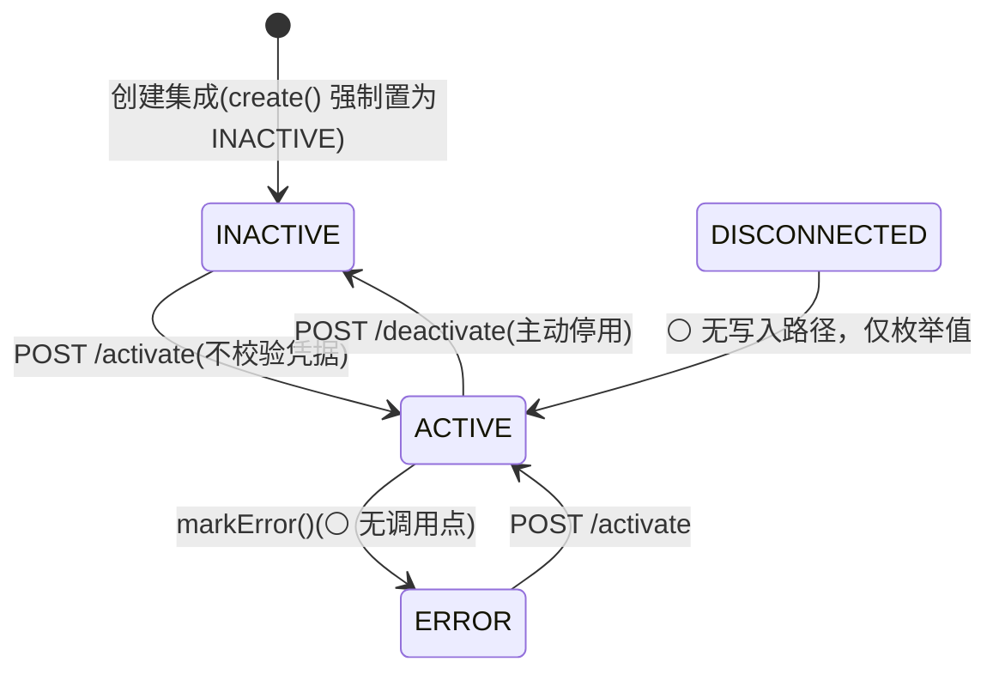

# 功能规格 · 平台集成（通用域）

| 项 | 内容 |
|---|---|
| 子域 | 通用域（Platform Integration Bounded Context） |
| 聚合根 | `PlatformIntegration` |
| 值对象 | `PlatformName`、`PlatformStatus`、`PlatformAuthType` |
| 领域服务 | `PlatformIntegrationService` / `PlatformIntegrationServiceImpl` |
| 适配器 | `infrastructure/platform/PlatformFetcherRegistry` + `HttpPlatform*`(CUSTOM_SHOP) + `shopify/*`(SHOPIFY) + `SamplePlatform*` |
| 数据表 | `platform_integrations` |
| 前端 | `frontend/user-web/src/pages/platform-integration/{PlatformIntegration,PlatformIntegrationDetail,CreatePlatformIntegration}.jsx` |
| 技术设计 | [tech/integration-design.md](../tech/integration-design.md)（含各平台官方文档与对接前置清单） |

---

## 1. 模块定位

平台集成是系统的**入口阀门**：它把分散在 Amazon / eBay / Shopify / 速卖通等平台的订单拉进系统，并把系统的商品库存与发货结果推回平台。

~~**这是产品价值主张的核心，也是当前实现最薄弱的部分**——三个同步接口都是空逻辑桩，没有一家平台的真实对接。在产品层面这意味着：**系统目前无法真正"接单"，只能手工建单**。~~

> ⚠️ 口径 **2026-03-08 工作树**（本节早期结论已随 ISS-013 修复失效，保留修订记录）。
>
> ~~三个 `sync-*` 是空逻辑桩~~ → ✅ **桩已消除**：6 条数据线（订单 / 商品 / 客户 / 物流 / 店铺仓 / 财务）各自有 `Platform*Fetcher` 端口与真实 HTTP 适配器，同步端点复用「拉取 → 字段映射 → 批量导入 → 作业明细」链路（`{X}ImportJobDto` 逐行返回成功/跳过/失败）。
> ✅ ~~分派是 `useSample ? sample : http` 布尔三元~~ → 改为 **按认证协议（`PlatformAuthType`）的适配器注册表** `PlatformFetcherRegistry`；新增一家平台只需注册一个 `type()` 返回该协议名的适配器，不改导入服务。
> ✅ **Shopify 成为第一家按官方协议对接的平台**：Admin REST 增量拉单、商品拉取、发货回写、连通性测试。
> 🔴 **但未经真实平台验证**（已登记 **ISS-064**，P0）：无任一平台的沙箱凭据，正确性证据只有本地 fixture 契约测试（`ShopifyAdminApiContractTest` 10 例 + `ShopifyAdapterMappingTest` 17 例）。**上线前必须先做凭据演练**（见 §10 完成标准）。
> ⚪ 其余平台（Amazon / eBay / AliExpress / Wish / Magento）**仍未对接**，且阻塞点不在代码而在平台侧准入（开发者账号审核、OAuth 授权、`scope` 申请），逐家前置见 [tech/integration-design.md §11](../tech/integration-design.md)；同一结论在缺陷侧见 **ISS-064**。

---

## 2. 概念模型

| 字段 | 说明 | 安全评估 |
|---|---|---|
| `id` | UUID，`@GeneratedValue`（库内实际是 `binary(16)`） | ✅ |
| `tenant_id` | 租户归属；历史行为 NULL | 🟡 列存在，但无唯一约束、读路径未按租户过滤（BR-03/BR-11） |
| `platform_name` | 平台标识（枚举，大写名）——**业务标签**，不参与分派 | ✅ |
| `auth_type` | 对接协议（`CUSTOM_SHOP`/`SHOPIFY`）——**这才是外呼分派键**，为空按 `CUSTOM_SHOP` | ✅ 2026-03-08 新增 |
| `api_key` | 平台 API 密钥 | ~~🔴 明文存储~~ → ✅ **AES-256-GCM 密文列**（`enc:v1:` 前缀），出参只给掩码 `PlatformIntegrationDto.apiKeyMasked` |
| `api_secret` | 平台 API 密钥 Secret | ~~🔴 明文存储，且 `GET /{id}` 会原样返回给前端~~ → ✅ 密文列；出参只给 `hasApiSecret` 布尔位，**永不回传** |
| `access_token` | 访问令牌密文（Shopify `shpat_`） | ✅ 密文列；出参只给 `hasAccessToken` |
| `refresh_token` | 刷新令牌密文，为需要令牌轮换的平台预留（Amazon LWA / eBay OAuth） | ✅ 密文列；**尚无刷新实现** |
| `token_expires_at` | 令牌过期时间 | ✅ 出参可见（非敏感） |
| `api_version` | 平台接口版本（Shopify 形如 `2026-01`），为空取全局配置 | ✅ |
| `store_url` | 店铺地址 | ✅ |
| `status` | 连接状态 | — |

加解密收敛在**仓储边界**（`PlatformIntegrationRepositoryImpl.encryptSecrets/decryptSecrets`），领域聚合与上层只见明文；密文格式与主密钥来源见 [tech/integration-design.md §4](../tech/integration-design.md)。
⚠️ **加密以部署环境注入 `PLATFORM_CREDENTIAL_MASTER_KEY` 为生效前提**：未注入时 `CredentialCipher` 打 WARN 并按明文读写——即 ISS-011 只有在运维配好密钥后才真正关闭。历史明文行无 `enc:v1:` 前缀，读取时原样返回、下次写入自动收敛为密文。

---

## 3. 状态机

| 枚举名 | 中文 | 业务含义 |
|---|---|---|
| `ACTIVE` | 已激活 | 可参与同步 |
| `INACTIVE` | 已停用 | 人为关闭 |
| `DISCONNECTED` | 未连接 | ⚪ **不可达**：`PlatformStatus.DISCONNECTED` 在主源码里 0 个写入点，只有枚举定义 |
| `ERROR` | 异常 | 🟡 `markError()` 已实现但 0 个调用点，实际不会出现 |

> ⚠️ 口径 **2026-03-08 工作树**。上图的 `ACTIVE → ERROR` 与 `ACTIVE → DISCONNECTED` 两条边**目前只是声明**：
>
> - 聚合有 `markError()`（`PlatformIntegration.java:81-88`），但**全仓 0 个调用点**——同步/外呼失败不会把集成改成 `ERROR`，只会在响应里报错。
> - `POST /{id}/test-connection` **故意不改状态**：连通性测试失败是预期分支（凭据没填对、店铺还没开权限），直接把集成打回 `DISCONNECTED/ERROR` 会让运维看不出"是我不对还是平台不对"。测试通过也不会自动激活（BR-04 未收口的部分）。
> - 只有 `activate`/`deactivate` 会写状态；`activate` 不做任何凭据校验（详见 §9 P1）。

---

## 4. 业务规则

> 口径 **2026-03-08 工作树**。状态列的含义：**✅ 已实现（有代码路径 + 测试）** ｜ **🟡 部分实现** ｜ **⚪ 未实现** ｜ **🔴 违反**。
> ⚠️ 所有 ✅ 的**验证级别都只到 fixture 契约测试**（本地 `com.sun.net.httpserver` 桩），无一经过真实平台凭据演练。

| 编号 | 规则 | 状态 | 说明 |
|---|---|---|---|
| BR-01 | 平台密钥必须加密存储（至少 AES + KMS/环境变量托管） | ✅ **代码就绪，运维待配** | `CredentialCipher`：AES-256/GCM/NoPadding，IV 12 字节、tag 128 位，密文带 `enc:v1:` 前缀；加解密在仓储边界（`PlatformIntegrationRepositoryImpl`），4 个凭据字段全覆盖。 🔑 **主密钥只从环境变量 `PLATFORM_CREDENTIAL_MASTER_KEY` 注入**，不入库、不入 Git。 ⚠️ 未注入密钥时 `CredentialCipher` 打 WARN 并**按明文读写**（不阻断启动）——所以这条规则在运维配好密钥前只是"事实上关闭"；32 字节 Base64 以外的串会走 SHA-256 派生并 WARN。 历史明文行无前缀 → 读取原样返回、下次保存自动收敛为密文（不要求一次性回填）。 |
| BR-02 | 密钥不应对外返回，只返回掩码 | ✅ | `PlatformIntegrationDto` 出 `apiKeyMasked`（前 3 + `****` + 后 4；≤7 位整体 `****`）+ `hasApiSecret`/`hasAccessToken` 布尔位；`apiSecret`/`accessToken`/`refreshToken` **字段本身不在 DTO 上**。 配套：更新接口凭据留空 = 沿用库里原值（`PlatformIntegrationSaveRequest.toAggregate(existing)`），所以"不回显"不会导致"改个名字就丢密钥"。 |
| BR-03 | 同一租户同一平台同一店铺不可重复创建 | ⚪ | 表上**无任何唯一约束**（`tenant_id` 列已有，但只有普通索引级别）。同一 storeUrl 重复建单会重复拉单，靠幂等键兜住（见 BR-05），不会产生重复订单但会产生两条集成记录。 |
| BR-04 | 创建/激活时必须做一次连通性测试 | 🟡 | ✅ 端点已落地：`POST /{id}/test-connection`，按协议分派 `PlatformConnectionTester`，返回 `record(success, adapterType, latencyMs, message)`，失败**不抛异常**而是 200 + `success=false`（要把原因回显给运维）。 ❌ **不强制**：`activate` 不调用它，创建时也不调用；测试失败不改 `status`。 ❌ `CUSTOM_SHOP` 探测没有独立 health 端点，走的是代价最小的一条真实业务查询（`GET {storeUrl}/orders?page=1&pageSize=1`，`X-API-Key/X-API-Secret` 头）——自建店铺没有该接口时会一直判失败。 |
| BR-05 | 订单拉取必须增量、幂等（按平台订单号去重） | ✅（Shopify 路径） | 增量：`updatedFrom/updatedTo` → Shopify `updated_at_min`；游标分页走完 `Link` 头 `page_info`，`cursor.max-pages=20` 兜底。 幂等：`syncFromPlatform` 固定 `enableIdempotency=true`，按 `(tenantId, platform, platformOrderId)` 查已有单（`OrderImportApplicationService:348-350`），命中则**更新**而不是插入。 ⚠️ `updateExisting` 也是 `TRUE`，所以"平台订单号已存在…已跳过"（`:354-357`）这条分支在同步路径上不会走到，它服务的是 Excel 导入且未开覆盖的场景。 |
| BR-06 | 同步需有定时调度能力 | ⚪ | 全主源码 **`@Scheduled` 0 处、`@EnableScheduling` 0 处**。只有手工触发端点。 |
| BR-07 | 每次同步需记录成功/失败明细以便排查 | 🟡 | 没有独立的 `sync_jobs` 表，但**任务化落库已经存在**：6 张 `*_import_jobs`（含 total/success/failed 与 `tenant_id` 索引）+ 6 张 `*_import_job_errors`（逐行 成功/跳过/失败 + 字段名 + 原因），并有 `GET /api/{线}-import/jobs` 分页查询。 缺口是**平台侧调度**与"集成维度"的聚合视图（现在按导入任务看，不按 platform 看）。 |
| BR-08 | 失败需有重试与退避策略，避免触发平台限流 | ✅（仅 Shopify） | `ShopifyAdminApi.execute()`：429 与 5xx/网络异常按 `Retry-After` 退避重试（`retry.max-attempts=3`、`retry.max-wait=30s`），401/403 **立即失败**不重试；耗尽后抛 `SHOPIFY_REQUEST_FAILED`。 `CUSTOM_SHOP` 的 `HttpPlatform*Fetcher` 无重试。 |
| BR-09 | 平台 API 限流需被尊重（并发控制/令牌桶） | 🟡 | ✅ **被动**：尊重 Shopify 返回的 `429 + Retry-After`；请求间无并发放大（单线程串行翻页），`limit` 被 clamp 到官方上限 250。 ⚪ **主动**：无令牌桶/速率预约。Shopify 官方口径是 leaky bucket 40 次/店铺、每秒回补 2 次，靠被动退避能用，但多集成并发拉取时没有全局闸。 |
| BR-10 | 库存同步应在库存变动后触发 | ⚪ | 无联动。`POST /{id}/sync-inventory` 是全量手工推送，且**只支持 `CUSTOM_SHOP`**（打 `{storeUrl}/inventory`）；Shopify 需要 `inventory_levels/set.json` + `inventory_item_id`/`location_id` 映射，本地表结构没有该映射 → 现在会直接返回 `PLATFORM_INVENTORY_PUSH_UNSUPPORTED` 而不是误推到不存在的路径。 |
| BR-11 | 同步必须归属租户 | 🟡 | ✅ `tenant_id` 列存在（本轮之前它被记成"无列"，那已过期），`*_import_jobs` 有租户索引。 ❌ 但 `tenantId` 是**入参可选**（`@RequestParam(required=false)`）而不是从 `SecurityContext` 取，读路径仍不按租户过滤（对齐 ISS-010/ISS-050 口径）。 |

---

## 5. 功能清单

> 口径 **2026-03-08 工作树**。前端列的 ✅ 指"页面确实打了真实接口"，不代表后端链路已用真凭据演练。

| 功能 | 前端 | 后端 | 状态 |
|---|---|---|---|
| 创建集成 | `CreatePlatformIntegration.jsx:23` `createIntegration` | `POST /api/platform-integrations` | ✅ 按协议分岔必填项（Shopify 只要 `accessToken`）；出参已掩码 |
| 集成列表 | `PlatformIntegration.jsx:50` `getIntegrations` | `GET /api/platform-integrations` | 🟡 全量数组、无服务端分页（对齐 ISS-014 的"8 个列表未分页"清单）；新增「对接协议 / 密钥掩码 / 接口版本」三列 |
| 集成详情 | `PlatformIntegrationDetail.jsx:34` | `GET /api/platform-integrations/{id}` | ✅ ~~🔴 返回明文密钥~~ → 出参只有 `apiKeyMasked` + `hasApiSecret`/`hasAccessToken`（ISS-011 关闭，前提是主密钥已注入） |
| 更新集成 | 无编辑页（仅详情+停用/启用） | `PUT /api/platform-integrations/{id}` | 🟡 后端可用；凭据留空=保留原值，所以缺前端入口 |
| 删除集成 | — | `DELETE /api/platform-integrations/{id}` | 🟡 有端点、无入口 |
| 激活 / 停用 | `PlatformIntegrationDetail.jsx:50,52` | `POST /{id}/activate`、`/deactivate` | 🟡 可用，但 `activate` 不校验凭据（BR-04） |
| **连通性测试** | `PlatformIntegration.jsx` + 详情页各一个按钮（`ApiOutlined`） | `POST /{id}/test-connection` | ✅ 2026-03-08 新增。Shopify 打 `shop.json`，`CUSTOM_SHOP` 打 `/orders?page=1&pageSize=1`；失败也回 200，前端用 `Modal.warning` 显示原因 |
| **订单同步** | 详情页手工触发 | `POST /{id}/sync-orders` | ✅ ~~空逻辑桩~~ → 真实外呼 + 字段映射 + 落库，返回 `OrderImportJobDto`（逐行明细）。**仅 Shopify / CUSTOM_SHOP 两种协议** |
| **商品同步** | `PlatformIntegrationDetail.jsx:64` | `POST /{id}/sync-products` | ✅ 同上，返回 `ProductImportJobDto`；Shopify 按变体出行 |
| **客户同步** | `PlatformIntegrationDetail.jsx:79` | `POST /{id}/sync-customers` | 🟡 `sourceType=CUSTOMERS` 只有 `CUSTOM_SHOP`/`SAMPLE` 适配器；**Shopify 走 `sourceType=ORDERS`**（从订单萃取买家，测试 `shouldYieldBuyerIdentityKeysRecognisableByTheCustomerAliasTable` 证明其别名可识别） |
| **物流同步** | `PlatformIntegrationDetail.jsx:94` | `POST /{id}/sync-logistics` | 🟡 同上：数据线适配器只有 `CUSTOM_SHOP`/`SAMPLE`，Shopify 未实现（其物流信息本就在订单的 `fulfillments` 里） |
| **发货回写** | — | `POST /{id}/push-fulfillment` | ✅ 2026-03-08 新增，**仅 Shopify**。四道前置（已发货 / 有运单号 / 未回写过 / 订单来源平台匹配），成功后把平台发货单号记在 `logistics_orders.external_logistics_id` 上，重复调用直接拒。前端无入口（需先有已发货物流单） |
| **库存同步** | — | `POST /{id}/sync-inventory` | 🟡 **只支持 `CUSTOM_SHOP`**（`{storeUrl}/inventory`）；其他协议返回 `PLATFORM_INVENTORY_PUSH_UNSUPPORTED`（BR-10） |
| **财务同步** | — | ❌ **无端点** | ⚪ 应用服务有 `syncFinanceFromPlatform()`，控制器没有映射它 → 事实上的死方法。财务数据线适配器（`CUSTOM_SHOP`/`SAMPLE`）与 `finance_import_jobs` 表都在，只差一个入口 |
| **店铺仓同步** | — | ❌ 无端点 | ⚪ 同上：`ShopWarehouseImport*` 与 `shop_warehouse_*` 三张表齐备，平台触发入口缺失 |
| **同步日志与结果查看** | 导入任务页（`*Import` 页面） | `GET /api/{线}-import/jobs`、`/jobs/{jobId}` | 🟡 6 条线各自有任务表与查询端点，**没有按平台聚合的视图** |
| **定时调度** | — | 无 | ⚪ `@Scheduled` 全仓 0 处（BR-06） |
| **字段映射维护** | 各导入页的映射配置 | `GET/PUT /api/{线}-import/field-mappings` | ✅ 6 张 `*_field_mappings`；平台适配器输出**中立键**，正因为映射表的别名匹配是子串式的（原始 Shopify 键会被误配，见 §9） |

---

## 6. 接口对照

`PlatformIntegrationController` 共 **14 个端点**（`/api/platform-integrations`，类级 `@PreAuthorize("hasRole('PLATFORM_ADMIN') or hasAuthority('platform:manage')")`）。

| # | 场景 | 方法 | 路径 | 入参 | 出参 | 状态 |
|---|---|---|---|---|---|---|
| 1 | 创建 | POST | `/api/platform-integrations` | `PlatformIntegrationSaveRequest` | `Result<PlatformIntegrationDto>`（掩码） | ✅ 400 走 `BusinessException.errorCode` |
| 2 | 详情 | GET | `/{id}` | — | `Result<PlatformIntegrationDto>` | ✅ ~~🔴 返回明文密钥~~ → 已掩码 |
| 3 | 列表 | GET | `/` | — | `Result<List<PlatformIntegrationDto>>` | 🟡 全量数组，无分页/无租户过滤 |
| 4 | 更新 | PUT | `/{id}` | `PlatformIntegrationSaveRequest` | `Result<PlatformIntegrationDto>` | ✅ 凭据留空=沿用库中原值 |
| 5 | 删除 | DELETE | `/{id}` | — | `Result<Void>` | 🟡 无入口 |
| 6 | 激活 | POST | `/{id}/activate` | — | `Result<PlatformIntegrationDto>` | 🟡 不做连通性校验 |
| 7 | 停用 | POST | `/{id}/deactivate` | — | `Result<PlatformIntegrationDto>` | 🟡 |
| 8 | 同步订单 | POST | `/{id}/sync-orders` | `tenantId, orderNumber, updatedFrom, updatedTo, limit, useSampleData` | `Result<OrderImportJobDto>` | ✅ ~~空逻辑~~ → 真实拉取+导入 |
| 9 | 同步客户 | POST | `/{id}/sync-customers` | `tenantId, sourceType(CUSTOMERS\|ORDERS), keyword, limit, useSampleData` | `Result<CustomerImportJobDto>` | 🟡 Shopify 只支持 `ORDERS` 通路 |
| 10 | 同步商品 | POST | `/{id}/sync-products` | `tenantId` | `Result<ProductImportJobDto>` | ✅ |
| 11 | 同步物流 | POST | `/{id}/sync-logistics` | `tenantId, orderNumber, trackingNumber, shippedFrom, shippedTo, limit, useSampleData` | `Result<LogisticsImportJobDto>` | 🟡 仅 `CUSTOM_SHOP`/`SAMPLE` |
| 12 | 同步库存（推送） | POST | `/{id}/sync-inventory` | — | `Result<Object>`（`InventorySyncResult`） | 🟡 仅 `CUSTOM_SHOP`，其他协议 `PLATFORM_INVENTORY_PUSH_UNSUPPORTED` |
| 13 | **连通性测试** | POST | `/{id}/test-connection` | — | `Result<PlatformConnectionTestResult>` | ✅ 2026-03-08 新增；失败也 200 |
| 14 | **发货回写** | POST | `/{id}/push-fulfillment` | `PlatformFulfillmentPushRequest{logisticsOrderId, notifyCustomer}` | `Result<PlatformFulfillmentResult>` | ✅ 2026-03-08 新增；仅 Shopify |

> ⚠️ 错误约定不统一（不修，登记为口径问题）：**未找到** 走 `Result.fail(...)` + 404，**业务校验失败** 走 `Result.error(code, msg)` + 400，**其余异常** 走 500 并把 `e.getMessage()` 拼进响应体——`test-connection`/`push-fulfillment` 的 500 分支理论上可能带出底层异常文本（Shopify 侧的报错文本本身不含凭据，`ShopifyAdminApi` 抛错时只写 `accessToken` 这个词，不写值）。

---

## 7. 平台对接状态矩阵

### 7.1 按认证协议（决定能不能真调通）

> 🔄 **2026-03-08 按代码实测重写**（`infrastructure/platform/<vendor>/` 主源文件清点，括号内是文件数）。
> 上一版只有 `CUSTOM_SHOP`/`SHOPIFY`/`SAMPLE` 三行、其余协议一律记为「仅枚举」——那个口径已经不成立。

| 协议（`auth_type`） | 订单 | 商品 | 客户 | 物流 | 店铺仓 | 财务 | 发货回写 | 连通性测试 | 库存推送 |
|---|---|---|---|---|---|---|---|---|---|
| `CUSTOM_SHOP`（默认，7 个适配器） | ✅ | ✅ | ✅ | ✅ | ✅ | ✅ | ⚪ 无端口 | ✅ | ✅（`{storeUrl}/inventory`） |
| `SHOPIFY`（4 个适配器） | ✅ | ✅ | 🟡 走订单萃取 | ⚪ | ⚪ | ⚪ | ✅ | ✅ | ⚪ 显式拒绝 |
| `AMAZON_SP_API`（4：传输 + LWA 令牌交换 + 拉单 + 连通性） | ✅ | ⚪ | ⚪ | ⚪ | ⚪ | ⚪ | ⚪ | ✅ | ⚪ |
| `EBAY_SELL`（5：传输 + OAuth 令牌交换 + 拉单 + 发货回写 + 连通性） | ✅ | ⚪ | ⚪ | ⚪ | ⚪ | ⚪ | ✅ | ✅ | ⚪ |
| `ALIEXPRESS`（3：TOP 网关客户端 + 拉单 + 连通性） | ✅ | ⚪ | ⚪ | ⚪ | ⚪ | ⚪ | ⚪ | ✅ | ⚪ |
| `SHOPEE`（6：传输 + 签名器 + 令牌交换 + 拉单 + 商品 + 连通性） | ✅ | ✅ | ⚪ | ⚪ | ⚪ | ⚪ | ⚪ | ✅ | ⚪ |
| `MERCADO_LIBRE`（4：传输 + 令牌交换 + 拉单 + 连通性） | ✅ | ⚪ | ⚪ | ⚪ | ⚪ | ⚪ | ⚪ | ✅ | ⚪ |
| `OZON`（5：传输 + 拉单 + 商品 + 发货回写 + 连通性） | ✅ | ✅ | ⚪ | ⚪ | ⚪ | ⚪ | ✅ | ✅ | ⚪ |
| `MAGENTO`（6：传输 + 管理员令牌换取 + 拉单 + 商品 + 发货回写 + 连通性） | ✅ | ✅ | ⚪ | ⚪ | ⚪ | ⚪ | ✅ | ✅ | ⚪ |
| `TIKTOK_SHOP` | ⚪ 无适配器 | ⚪ | ⚪ | ⚪ | ⚪ | ⚪ | ⚪ | ⚪ | ⚪ |
| `TEMU` | ⚪ 无适配器 | ⚪ | ⚪ | ⚪ | ⚪ | ⚪ | ⚪ | ⚪ | ⚪ |
| `SAMPLE`（6 个适配器，`useSampleData=true` 时优先于协议） | ✅ | ✅ | ✅ | ✅ | ✅ | ✅ | ⚪ | ⚪ | ⚪ |

⚪ 分两类，含义不同：**客户 / 物流 / 店铺仓 / 财务四个端口七家新平台一个都没实现**（这四种数据在多数平台没有
对应的公开只读端点，或要额外 scope 申报，核实不到就不写）；商品与发货回写的 ⚪ 是「核实到的端点不足以安全读写」
而显式省略。缺端口一律 `PLATFORM_ADAPTER_NOT_FOUND`（消息里列出已注册键），不会静默返回空集。

令牌交换（`PlatformTokenExchange`）注册了 `AMAZON_SP_API` / `EBAY_SELL` / `SHOPEE` / `MERCADO_LIBRE` 四家；
Magento 用用户名口令直接换 Bearer（`PUT /rest/V1/integration/admin/token`）；
`CUSTOM_SHOP` / `SHOPIFY` / `OZON` 是静态凭据，不需要交换。

> 反向链路（发货回写 / 库存推送）**没有 SAMPLE 分支**——回写是真写平台，用示例数据没有意义（`PlatformFetcherRegistry.fulfillmentPusher()` 固定 `useSample=false`）。

### 7.2 按平台（`platform_name` 是业务标签，不代表能对接）

| 平台 | 枚举 | 应走协议 | 现状 | 阻塞点 |
|---|---|---|---|---|
| Shopify | `SHOPIFY` | `SHOPIFY` | 🟡 代码按官方规范完成，fixture 契约测试 27 例绿 | 🔴 未经真实店铺验证（ISS-064），上线前必须做凭据演练（§10） |
| 通用自建店铺 | `OTHER` 等 | `CUSTOM_SHOP` | 🟡 协议为真，端点形状（`{storeUrl}/orders`、`/products`…）是本系统自定约定 | 需要真实店铺对端才能验证；不是任何公开平台的官方协议 |
| Amazon | `AMAZON` | `AMAZON_SP_API` | 🟡 v0 订单拉取 + LWA 刷新令牌换访问令牌 + 连通性测试，30 例绿 | 🔴 无凭据演练；响应体订单/明细键名是候选键探测而非官方核实（ISS-065 ⑤⑩）；商品与发货端口未做；SP-API 开发者审核与 data-distribution 申报仍是准入前提 |
| eBay | `EBAY` | `EBAY_SELL` | 🟡 Sell Fulfillment v1 订单 + 发货回写 + OAuth，26 例绿 | 🔴 无凭据演练；`next` 游标行为与响应体键名待实测（ISS-065 ④⑩）；商品端口未做 |
| 速卖通 | `ALIEXPRESS` | `ALIEXPRESS` | 🟡 TOP 同源网关签名 + 卖家订单列表 + 连通性，17 例绿 | 🔴 无凭据演练；`session` 要 ISV 应用审核 + 卖家授权（ISS-065 ③）；商品与发货端口未做 |
| Shopee | `SHOPEE` | `SHOPEE` | 🟡 签名 + 订单（列表→详情二跳）+ 商品 + 一次性刷新令牌回写 + 连通性，40 例绿 | 🔴 无凭据演练；`shop_id`/`merchant_id` 授权链路要卖家账号（ISS-065 ⑨⑩）；发货回写未做 |
| Mercado Libre | `MERCADO` | `MERCADO_LIBRE` | 🟡 订单搜索 + 翻页 + 令牌轮换回写 + 连通性，29 例绿 | 🔴 无凭据演练；`orders/search` 响应体明细结构待实测（ISS-065 ⑥⑩）；商品与发货未做 |
| Ozon | `OZON` | `OZON` | 🟡 FBS 列表→单据详情二跳、商品属性、发货回写、连通性，44 例绿 | 🔴 无凭据演练；`Client-Id`/`Api-Key` 要从卖家后台取（ISS-065 ⑧）；状态词表按探测 |
| Magento | `MAGENTO` | `MAGENTO` | 🟢 搜索条件分页、admin token 换取、发货回写、连通性，52 例绿 | 🔴 无凭据演练；admin 取令牌端点按版本二选一（ISS-065 ⑦）。**但它是唯一能自己搭环境把 ISS-064 那次真实调用补上的一家**：本地起 Magento 即可，无需第三方审核 |
| TikTok Shop | `TIKTOK` | `TIKTOK_SHOP` | ⚪ 无适配器 | 🔴 现役 202309 代接口与 `X-Tts-*` 头只在登录后的 Partner Center 里，公开文档只剩平台自标 `v1_deprecated` 的 202212 代；不在弃用代上写适配器（[api-reference §10.1](platform-api-reference.md)） |
| Temu | `TEMU` | `TEMU` | ⚪ 无适配器 | 🔴 网关与请求信封已实测，但签名算法与各接口 `type` 只存在于需登录卖家账号的文档站（[api-reference §10](platform-api-reference.md)） |
| Wish | `WISH` | 需新增 | ⚪ 仅枚举 | 🟡 官方 Merchant API 文档可达性差、平台活跃度下降，建议排在最后或不排 |

> 🔴 **口径更正（2026-03-08）**：旧版在这里写「除 Shopify 外的平台未对接，卡点不在本项目代码量，而在平台侧准入」，
> 并据此只把 Shopify 做成端到端样板。前半句现在只对新平台的**一半**成立：
> ① 七家的适配器代码与 fixture 契约测试本轮已写完，但**一次真实调用都没跑过**（ISS-064），所有 🟡 都只是 fixture 级证据；
> ② Temu 与 TikTok Shop 缺的是可核实的官方规范，不是代码量——没有出处就写端点等于凭想象编程，所以显式留白。

---

## 8. 领域事件

| 事件 | 注册点 | 期望下游 | 现状 |
|---|---|---|---|
| `PlatformIntegrationCreatedEvent` | `PlatformIntegration.create()`（`:110`） | 引导完成授权 | 🔴 **从未发布** |
| `PlatformIntegrationStatusChangedEvent` | `activate()`/`deactivate()`/`markError()`（`:66,74,85`） | 停止同步任务 | 🔴 **从未发布** |

> 机理与 [ISS-062](../qa/known-issues.md) 完全一致，且本模块是**唯一"看起来已经接好"的那一类**：
> `PlatformIntegrationApplicationService.createPlatformIntegration():83` 确实调了 `domainEventPublisher.publishEventsFrom(integration)`——
> 但 `integration` 是 `PlatformIntegrationRepositoryImpl.save()` 用 `toDomain(savedEntity)` **新映射出来的副本**，副本的 `domainEvents` 天生为空，
> `DomainEventPublisher.java:40` 见空集合就静默返回。所以"有调用点"不等于"事件发出去了"。
> `activate/deactivate` 更前面一步：应用服务（`:105-113`）根本没有 `publishEventsFrom` 调用。
> ⚠️ 因此**不能**按"集成创建/状态变更会被下游感知"来设计任何流程。

---

## 9. 现状缺口与待办

### 9.1 本轮（2026-03-08）已关闭

| 原缺口 | 处置 |
|---|---|
| ~~P0 密钥明文存储且明文返回~~ | ✅ AES-256-GCM 密文列 + 出参掩码（BR-01/BR-02）。⚠️ **前提是运维注入 `PLATFORM_CREDENTIAL_MASTER_KEY`**；未注入时按明文读写并打 WARN。历史明文行视为已泄露，**先在各平台侧轮换凭据、再重新录入** |
| ~~P0 无任何平台真实对接~~ | ✅ Shopify 端到端样板：增量拉单 → 字段映射 → 落库 → 回写发货 + 连通性测试。 🔄 **2026-03-08 追加**：Amazon/eBay/速卖通/Shopee/Mercado/Ozon/Magento 七家的适配器与 fixture 契约测试也写完（238 例），但「真实对接」这条**仍未关闭**——一次真实调用都没跑过（ISS-064），见 §10.2 |
| ~~P1 同步为桩~~ | ✅ 6 条数据线走真实 HTTP，按 `PlatformAuthType` 注册表分派；`useSample?sample:http` 布尔开关已删除 |
| ~~P2 无连接测试~~ | ✅ `POST /{id}/test-connection` |
| ~~P2 无限流与重试~~ | ✅ 429/`Retry-After` 退避重试 + 401/403 快速失败，已收进共用 `PlatformHttpExchange`，九家协议共用（Shopify 保留自己的 `ShopifyAdminApi` 传输，契约相同；未引入 Resilience4j，见下表） |
| ~~"无幂等"~~ | ✅ 按 `(tenant, platform, platformOrderId)` 幂等更新（BR-05）。**没有**新增 `platform_order_no` 唯一索引——幂等靠查询而非库约束，并发同步仍可能双插 |

### 9.2 仍未关闭（按可推进性排序）

| 优先级 | 缺口 | 建议 | 卡点 |
|---|---|---|---|
| **P0** | **全部九家协议未经真实平台验证**（**ISS-064**）。原先只列 Shopify，2026-03-08 起覆盖面变成九家（新增 7 家适配器） | 每家拿一个开发/沙箱账号，按 §10.2 清单跑一遍：先 `test-connection`，再拉一页真实订单，把响应原文回填成 fixture 并据此收掉 ISS-065 ⑩ 的探测键清单；**每家第一眼要看的却是 ISS-065 ⑪——列表响应里到底带不带订单明细**：九家里只有 Shopee 与 Ozon 做了「列表→明细」二跳，其余六家单跳，明细缺失时导入侧硬拒（`OrderImportApplicationService.java:325-327`），表现是**导入 0 行而不是报错**。Magento 可自建实例，是唯一不需要第三方审核就能先跑的一家 | 需要人给凭据，代码已就位 |
| **P0** | 主密钥未注入时静默走明文（**ISS-064** ③ / 门槛见 ISS-011） | 生产 profile 下改为**启动失败**（fail fast），或在文档/健康检查里显式暴露"凭据未加密"状态 | 需要与运维约定 profile 策略 |
| **P1** | 无定时调度（BR-06） | 先 Spring `@Scheduled` + 分布式锁（单实例够用），按集成逐条遍历 `ACTIVE` 的集成做增量拉单；同步日志已经能落 `*_import_jobs` | 纯代码工作，可立即做 |
| **P1** | Shopify 库存推送未实现（BR-10） | 需要 `skus` 侧存 `inventory_item_id` + 拉 `locations.json` 建映射，再走 `inventory_levels/set.json`。**这是跨模块 schema 变更，不能只改平台层** | 需要先定主数据归属 |
| **P1** | 财务/店铺仓**没有平台触发入口**（`syncFinanceFromPlatform` 是死方法） | 各补 1 个端点即可，适配器与任务表齐了 | 纯代码工作 |
| **P1** | 读路径不按租户过滤（BR-11） | `tenantId` 应从 `SecurityContext` 取而不是可选入参；与 [ISS-050](../qa/known-issues.md) 一并处理 | 全域改造，不属本模块单独收口 |
| **P2** | `activate` 不校验凭据（BR-04） | 激活前调一次 `testConnection`，失败即拒；或让 `markError()` 在同步连续失败 N 次后生效（方法已写好，0 调用点） | 纯代码工作 |
| **P2** | 无 `(tenant_id, platform_name, store_url)` 唯一约束（BR-03） | 与 Flyway/DDL 基线一起做（[docs/db/migration-plan.md](../db/migration-plan.md) M0） | 依赖 DDL 管理决策（ADR 不引入 Flyway） |
| **P2** | 主动限流闸（BR-09） | 多集成并发拉取时按"店铺"维度做令牌桶（Shopify 官方口径 40 次/桶、每秒回补 2） | 需要引入 Resilience4j 或自研，目前只有被动退避 |
| **P2** | 事件从不发布（§8） | 让 `publishEventsFrom` 收到**注册了事件的聚合本身**（保存前对象），或仓储返回前把事件搬运到副本上 | 属 ISS-062 全域收口，勿在本模块单点特化 |
| **P3** | 无 webhook | Shopify 支持 webhook（需 App 级 `webhooks/create`），可显著降低轮询与限流压力 | 需要公网回调地址与 App 配置 |
| **P3** | `CUSTOM_SHOP` 协议无官方规范 | 它是本系统自定约定（`{storeUrl}/orders` 等）。若真有自建店铺客户，需要单独立一份对接约定文档 | 当前无客户 |

### 9.3 一条容易踩的实现陷阱（保留给后来人）

平台适配器**必须输出导入侧别名表认识的中立键**，不能把平台原始字段直接抛给映射层：
`*ImportTargetField.detectByAlias/detectFuzzy` 是**子串匹配**，Shopify 的 `id` 会被认成 `CUSTOMER_ID`、`name` 会被认成 `ITEM_NAME`、`weight_unit` 会顶掉 `WEIGHT_IN_GRAMS`。
这条约束由 `ShopifyAdapterMappingTest.shouldEmitOnlyKeysTheAliasTableRecognises` 锁住（断言行里**不含** `financial_status`/`shipping_address` 等原始键）。

---

## 10. 验收要点 / 完成标准

### 10.1 已达成（fixture 级验证，2026-03-08）

判据是**代码路径 + 自动化测试**，不是"看起来能跑"：

| # | 标准 | 证据 |
|---|---|---|
| 1 | 任何接口出参不出现完整凭据 | `PlatformIntegrationDto` 无 `apiSecret/accessToken/refreshToken` 字段；`PlatformIntegrationControllerTest` 10 例绿 |
| 2 | 密文落库、明文只在内存 | `CredentialCipherTest` 9 例（GCM 往返、`enc:v1:` 前缀、非 32 字节密钥派生、无主密钥时明文回退） |
| 3 | 认证方式符合官方规范 | `ShopifyAdminApiContractTest` 10 例：`X-Shopify-Access-Token` 头（**不**发旧版 key/password）、`limit` clamp 到 250、`updated_at_min` 用 UTC、**跟随 `Link` 头 `page_info` 且从不发 `page` 参数**、`max-pages` 停止、429→退避重试成功、401/403 不重试、连续 5xx 放弃、缺 `api_version` 报错、`admin.shopify.com` 被拒 |
| 4 | 数据格式桥接正确 | `ShopifyAdapterMappingTest` 17 例：嵌套订单→中立键、三标志合成状态、变体出行、重量→克、options→属性对、空 SKU 交给导入侧报必填、HTML 描述转纯文本、回写只发可履约行、非数字订单号在拼 URL 前拒绝、测试回显店铺名而**不泄露令牌** |
| 4b | 七家新平台的请求形状可复算 | **2026-03-08 本轮新增，共 238 例契约测试**（本地 `HttpServer` + fixture，无真实凭据）：Amazon 30（`x-amz-access-token` 头、无 SigV4、`CreatedAfter`/`LastUpdatedAfter` 二选一、`MarketplaceIds` 必填、`NextToken` 游标不推进即收手、跨页重复单去重）、eBay 26（Bearer + `Ebay-Auth-Scopes`、`filter=lastmodifieddate:[..]` 而非废弃的 `creation_date_range`、`next` 指向外站时重钉到配置 base、发货回写 `fulfillments`）、速卖通 17（TOP 网关 MD5/HMAC 签名可复算、`aliexpress.trade.seller.orderlist.get` 1 起始翻页、错误信封 `error_response` → `PLATFORM_TOP_ERROR`）、Shopee 40（`partner_id+path+timestamp[+access_token+shop_id]` 小写 HMAC-SHA256、15 天窗口 clamp、列表→详情二跳、刷新令牌轮换回写）、Mercado 29（JSON body 凭据、`orders/search` + `paging`、`+00:00` 偏移时间戳、一次性刷新令牌）、Ozon 44（`Client-Id`/`Api-Key` 头、`/v2/posting/fbs/list`→`fbs/get`、`/v3/product/list`→`v4/info/attributes`、`posts/add` 回写、带偏移时间格式）、Magento 52（admin token 裸字符串响应体、`searchCriteria` 分组过滤、分页 `currentPage` 递增、发货回写 `shipment` 建单）、共用令牌解析 7（`PlatformOAuthClientTest`：`expires_in`/`expiresIn`/`expire_time`/`expires_at` 四种到期形态、`data` 信封解包、缺 `access_token` 报 `PLATFORM_TOKEN_RESPONSE_INVALID`）。另有 `PlatformCredentials` 的刷新值回写与轮换矩阵、`PlatformFetcherRegistry` 的注册键冲突检查 |
| 5 | 重复同步不产生重复订单 | `OrderImportApplicationService:348-350` 按 `(tenant, platform, platformOrderId)` 命中即更新（BR-05） |
| 6 | 协议分派可扩展、不静默走错通道 | `PlatformFetcherRegistryTest` 7 例；未知协议抛 `PLATFORM_ADAPTER_NOT_FOUND` 并在消息里列出已注册键 |
| 7 | 后端全量回归 | `mvn -o test` → **52 个测试类 / 456 例全绿**（`Tests run: 456, Failures: 0, Errors: 0, Skipped: 0`，BUILD SUCCESS，2026-03-08 本轮适配器接线后当场重跑）。上一版记的 31 类 / 211 例是七家新平台落地前的基线 |
| 8 | 前端构建 + 本轮改动文件零 lint 问题 | ✅ `user-web` `vite build` **exit 0**（31.3s）；✅ `eslint src/pages/platform-integration src/services/api.js` **无输出**（本轮改的两个前端文件干净）。 ⚠️ **但"前端 eslint 退出 0"不成立，特此订正**：`user-web` 全量 `eslint src` = **exit 1，19 errors + 7 warnings**，`admin-web` = **16 errors + 1 warning**——逐文件核对，报错全在 `App.jsx`/`AuthContext.jsx`/`AuthGuard`/`Login`/`Home`/`SystemConfig`/`RoleList`/`TenantList`/`CreateTenant`/`UserList`/`UserDetail` 等**既有文件**（多为 `no-unused-vars` 的 `catch (error)` 与 `react-hooks/exhaustive-deps`），**与本轮平台改动无因果关系**，按"只修与本轮改动有因果的问题"原则保留（同 ISS-055 的边界） |

### 10.2 未达成 —— "对接完成"的真正的门（凭据演练清单）

> 🔄 **2026-03-08 范围更新**：下面 6 条是 **Shopify 一家的实例**，门本身按平台计数——本轮新写完的 Amazon / eBay / 速卖通 / Shopee / Mercado / Ozon / Magento **每家都要各跑一遍同构的 6 条**（把 `shop.json` 换成该家的连通性端点、`Link` 游标换成该家的翻页机制、发货回写换成该家的建单接口）。每家具体要先实测确认的那几项已经逐条登记在 [ISS-065](../qa/known-issues.md) 与 [platform-api-reference.md](platform-api-reference.md) 各节的「未核实」小节，演练通过一项销一项。
⚠️ **在完成下面全部 6 条之前，本模块只能声称"按官方文档实现并通过契约测试"，不能声称"已对接 Shopify"。**
每条都要留证据（响应原文存档 → 回填成 fixture，替换手写样本）：

1. **凭据有效性**：真实开发店铺 + Custom App（scope `read_orders`/`read_products`/`write_fulfillments`），`POST /{id}/test-connection` 返回 `success=true` 且 message 里出现**店铺真实名称与币种**（证明 `shop.json` 不是本地桩）。
2. **拉单真实性**：`POST /{id}/sync-orders?limit=5` 落库的订单，其 `platformOrderId`、金额、收件地址与 Shopify 后台**逐字段一致**；`orderTime` 无时区偏移（本侧按 UTC `yyyy-MM-dd HH:mm:ss` 落，历史上 `-04:00` 的 08:30 必须写成 12:30）。
3. **分页真实性**：拉取 >250 条（`limit=300`），确认走的是 `Link` 头游标而非报错；对照官方"发 `page` 参数会直接报错"的口径。
4. **限流真实性**：连续快速调用触发 429 后，日志出现退避重试且最终成功；确认没有把订单写成半截（导入是任务化、逐行结果的）。
5. **回写真实性**：`POST /{id}/push-fulfillment` 后，Shopify 后台订单出现**发货单 + 运单号 + 跟踪链接**，`notifyCustomer=true` 时买家收到邮件；重复调用被本地拒（`external_logistics_id` 已存在）。
6. **商品/买家一致性**：`sync-products` 的变体行（SKU/价格/重量克数/属性对）与后台一致；`sync-customers?sourceType=ORDERS` 的去重结果与订单买家数吻合。

演练通过后再补两件事：① 把手写 fixture 换成真实响应存档；② 在 [docs/qa/known-issues.md](../qa/known-issues.md) 关闭"未经验证"这条，并把 ISS-011 从"已修（有运维门槛）"改为完全关闭。

### 10.3 与旧版验收要点的差异

旧版 5 条里，第 4 条「集成状态为 `INACTIVE` 时不应被调度拉取」**仍然不成立**——不但没有调度器，连手工端点也不检查 `status`（只有 `sync-inventory` 检查）。这条留给 BR-06 一起做。

