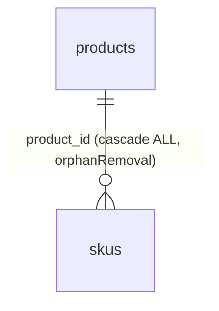
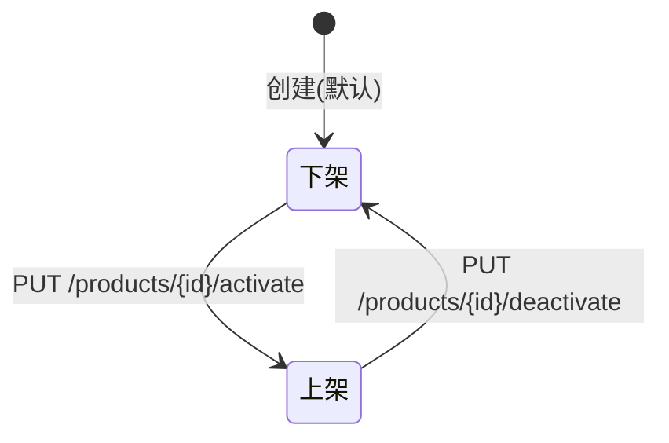

# 功能规格 · 产品管理（支撑域）

| 项 | 内容 |
|---|---|
| 子域 | 支撑域（Product Bounded Context） |
| 聚合根 | `Product` |
| 实体 | `SKU`、`ProductCategory` |
| 值对象 | `ProductPrice`、`ProductAttribute` |
| 领域服务 | `ProductManagementService`、`SKUManagementService`、`ProductCategoryService` |
| 数据表 | `products`、`skus`（无 `categories` 表）；🔄 2026-10-21 补：导入侧另有 `product_import_jobs`、`product_import_job_errors`、`product_field_mappings` |
| 前端 | `frontend/user-web/src/pages/product/{ProductList,ProductDetail,CreateProduct}.jsx`；🔄 2026-10-21 补：实际 6 个页面文件——`ProductList`、`ProductDetail`、`CreateProduct`、`EditProduct`、`ProductForm`（真实调用都集中在它）、`ProductImport` |
| 应用服务 | 🔄 2026-10-21 补：`ProductApplicationService`、`ProductImportApplicationService`（本表原先没有这一行，而同文件 §6/§8 通篇在用） |

---

## 1. 模块定位

产品是**主数据**：订单行项、库存记录、采购明细都以 `sku_code` 指向它。在跨境场景下，产品还承载额外使命——多平台上架的多语言文案、多币种价格、变体属性。

当前模型处在"最小可用"阶段：只有产品 + SKU 两层，缺分类树、缺属性持久化、缺 Listing/多语言/多币种。

---

## 2. 概念模型

| 概念 | 说明 | 关键字段 | 现状 |
|---|---|---|---|
| 产品 | 概念层面的商品 | `name`、`description`、`categoryId`、`categoryName`、`active` | 🟡 |
| SKU | 可售的最小单位 | `skuCode`(唯一)、`skuName`、`price`、`weight`、`dimensions`、`active` | 🟡 |
| 分类 | 品类树 | 仅有 `categoryId` + `categoryName` 两个冗余字段 | ⚪ **无 categories 表** |
| 价格 | 售价 | `ProductPrice` 值对象 | 🟡 ~~无币种~~ → 见下方复测：`skus.currency` 已有列，缺的是**订单/流水侧没有币种** |
| 属性 | 变体维度（颜色/尺码等） | `ProductAttribute` 值对象 | ⚪ ~~**未持久化**~~ → 🟡 见下方复测：已整包落 `skus.attributes_json` |

> 🔄 **2026-10-21 按 `information_schema` 复测：SKU 这一层的字段比本表写的多**（原文保留）。`skus` 实测 11 列：`id`、`sku_code`、`sku_name`、`price decimal(19,2)`、**`cost_price decimal(19,2)`**、**`currency varchar(8)`**、`weight double`、**`volume_cc int`**、**`attributes_json varchar(4000)`**、`active bit(1)`、`product_id`。⇒ 三条判据要改：
> - **"无币种"只对了一半**：`ProductPrice`（`domain/product/valueobject/ProductPrice.java:25`）与 `skus.currency` 都带币种，请求/响应 DTO 也透传（`interfaces/dto/product/SkuRequestDto.java:22`、`ProductSkuDto.java:17`），导入侧有 `CURRENCY` 目标字段与别名映射（`domain/product/valueobject/ImportTargetField.java:20` + `ProductFieldMappingService.java:133,169`）。**真缺口在链路下游**：`orders`/`order_items`/`payment_infos`/`financial_transactions` 实测都没有币种列，所以"带币种的价格"进不了订单与流水，跨币种求和仍按数值直接相加（[order.md](order.md) BR-06 的复测记的就是这条）。
> - **"属性未持久化"已不成立**：`SKU.attributes`（`List<ProductAttribute>`，`domain/product/entity/SKU.java:43`）经 `ProductMapper` 整包序列化为 JSON 落 `skus.attributes_json`（写 `:64`、读 `:95`、`jsonToAttributes:186-194`），导入字段表里也有 `ATTRIBUTES`（`ImportTargetField.java:23` 带 `variation_attributes` 等别名）。⚠️ 但它是**快照式 JSON，不是属性主数据**：没有 `product_attributes`/`sku_attribute_values` 表、无法按属性检索或聚合、`ObjectMapper.readValue` 解析失败时（`:191`）静默返回空列表——所以 §4 BR-09"属性可组合生成 SKU 变体"仍是 ⚪，§8 那条 P1 的建议方向不变。
> - **`weight` 是浮点、`volume_cc` 是整型立方厘米**：领域侧对应 `SKU.weightInGrams`（`Integer`，`domain/product/entity/SKU.java:35`）与 `volumeInCubicCentimeters`（`:39`）。⚠️ 本表"关键字段"列写的 `dimensions` 是**旧字段名**，现在既没有 `dimensions` 列也没有该属性（域侧换成了 `volumeInCubicCentimeters`）；而且**没有任何计费路径读体积**（[logistics.md](logistics.md) BR-04 的计费重只读 `weight`）⇒ 抛重仍算不出来。§4 BR-06 已经记过这条，本行别再按 `dimensions` 验收。

> 已知数据问题：`products.category_id` 由 `ProductApplicationService` 现场生成 `UUID.randomUUID().toString()`，指向不存在的 `categories` 表，因此**无法 join，也无法保证同一分类多次创建的一致性**（数据字典 R-01）。

---

## 3. 状态机

产品与 SKU 采用**上架/下架**二态（布尔），而非多状态流转。

| 状态 | 字段值 | 业务含义 |
|---|---|---|
| 上架 | `active = true` | 可销售、可出现在下单选择中 |
| 下架 | `active = false` | 不可销售，历史订单不受影响 |

> 目标态应补充更多状态（草稿 / 待审核 / 已上架 / 已停售 / 已归档）与定时上下架能力。

---

## 4. 业务规则

| 编号 | 规则 | 状态 | 说明 |
|---|---|---|---|
| BR-01 | SKU 编码全局唯一 | ✅ | `skus.sku_code` 唯一约束 |
| BR-02 | 删除产品时级联删除其所有 SKU | ✅ | `cascade=ALL, orphanRemoval` |
| BR-03 | 产品必须属于某个分类 | ⚪ | 无分类主数据，classification 只能填冗余字符串 |
| BR-04 | 同一产品可有多个 SKU | 🟡 | ~~模型支持，但无独立 SKU 维护端点~~ → ✅ **2026-10-21 复测：端点已有**：`POST /api/products/{id}/skus`（`ProductController.java:166`）与 `DELETE /api/products/{id}/skus/{skuCode}`（`:176`），均挂 `product:write`；领域侧 `Product.addSKU`（`Product.java:147` 注册 `SKUCreatedEvent`）。前端 `productApi.addSku/removeSku` 已接 |
| BR-05 | 下架不影响历史订单 | ✅ | 订单行项是快照设计 |
| BR-06 | SKU 需维护重量与体积以支撑运费计费 | 🟡 | ~~`weight`/`dimensions` 存在，但 `dimensions` 是自由字符串，无单位约定。2026-10-10 实测补记：运费计费链路已经接通（logistics.md BR-04 / known-issues R-57，计费重＝`Σ skus.weight × 件数`，单位克），但库里 88 行 SKU 的 `weight` 有值的是 0 行 ⇒ 现有全部商品的续重都是 `0.00`，运费只收得到首重；这一半是录入缺口不是代码缺口：`POST /api/products` 接受 `weightInGrams`（探针就是这么建出 500 克的），`ProductForm.jsx:173-177` 有"重量"列（kg ⇄ 克换算在 `:52`/`:75`），`ProductDetail.jsx:169`、`ProductList.jsx:210`、`ProductImport.jsx:363` 都带该字段；缺重量时按 0 克计、不拒建物流单（R-55）~~ → 🔄 **2026-10-21 复测：字段形状已改，缺口位置没变**。现在没有 `dimensions` 列了——重量是 `skus.weight double`（领域 `SKU.weightInGrams:Integer`，单位克），体积是 `skus.volume_cc int`（立方厘米，领域侧 `volumeInCubicCentimeters`）。运费链路只读重量，**没有任何计费路径读 `volume_cc`** ⇒ 抛重仍算不出来；"88 行里 0 行有重量"这条**本轮已重跑**：`skus` 现 113 行，**112 行 `weight` 为 NULL 或 0**、仅 1 行有正重量（冒烟探针的 500 克 SKU），`volume_cc` 113/113 全空 ⇒ 录入缺口 + 体积没人读这两半都还在 |
| BR-07 | SKU 价格需带币种 | ⚪ | ~~`skus.price` 无币种字段~~ → 🟡 **2026-10-21 复测：SKU 侧已有**（`skus.currency varchar(8)` + `ProductPrice:25` + `SkuRequestDto:22`/`ProductSkuDto:17` + 导入 `CURRENCY` 字段），**订单/流水侧没有**（`orders`/`order_items`/`payment_infos` 实测均无 `currency`）⇒ 币种进不了单据，跨币种汇总仍是数值相加 |
| BR-08 | 支持多语言标题/描述以上架不同站点 | ⚪ | 无字段（仍然成立：`products` 实测 11 列只有 `name` + `description varchar(2000)`，无 `locale`/i18n 表） |
| BR-09 | 属性可组合生成 SKU 变体 | ⚪ | ~~`ProductAttribute` 未持久化~~ → 🟡 **2026-10-21 复测：属性已能存，但"组合生成变体"没有**。`SKU.attributes` 整包 JSON 落 `skus.attributes_json`（§2 复测块），没有属性主数据表、没有笛卡尔积生成逻辑；解析失败静默成空列表（`ProductMapper:186-194`）⇒ 本条的"生成"这半仍 ⚪ |
| BR-10 | 产品变更应通知平台同步 | ⚪ | 无联动（仍然成立，但要补一句方向：现有的是**拉**不是**推**——`POST /api/platform-integrations/{id}/sync-products`（`PlatformIntegrationController.java:299`）把平台商品拉进系统，`ProductUpdatedEvent`（`Product.java:130` 注册）**零消费方**，系统改价后不会回推平台） |

---

## 5. 功能清单

| 功能 | 前端 | 后端 | 状态 |
|---|---|---|---|
| 创建产品（含 SKU） | `CreateProduct.jsx`（未提交） | `POST /api/products` | 🟡 |
| 按 ID 查询 | `ProductDetail.jsx`~~（mock）~~ | `GET /api/products/{id}`（`ProductController.java:103`） | ~~🟡~~ → 🟡 **2026-01-25 逐页复测：已接真实接口**（该页 5 个 `productApi.*` 调用点） |
| 按 SKU 编码查询 | 未使用 | `GET /api/products/sku/{skuCode}` | 🟡 |
| **产品列表 / 搜索 / 分页** | `ProductList.jsx`~~（mock）~~ | ~~**无端点**~~ → ✅ `GET /api/products`（~~`ProductController.java:54`~~ 现行映射在 `:63`，2026-10-21 复测；参数已扩到 9 个：`tenantId`/`keyword`/`categoryName`/`active`/`sourcePlatform`/`skuCode`/`page`/`size`/`sort`），前端入口 `api.js` 的 `productApi.getProducts(params)` | ~~⚪ **P0 缺口**~~ → ✅ **2026-01-25 复测已闭合**：`ProductList.jsx` 有 6 个 `productApi.*` 调用点；`CreateProduct.jsx`/`EditProduct.jsx` 是 `ProductForm.jsx` 的薄包装（真实调用集中在 `ProductForm`，3 个点），本身无调用点属正常结构，不是 mock 🔄 2026-10-21：列表查询**已按登录租户收敛**——`ProductApplicationService.findProducts:319-325` 组装 `ProductQuery` 前过 `TenantAccessGuard.scopedTenantId(query.tenantId())`，`findBySkuCode` 路径另加 `requireOwned`（`:337-341`） |
| 上架 / 下架 | ~~无入口~~ → `ProductList.jsx:120-122` 单行切换 + `:137` 批量（`productApi.activateProduct/deactivateProduct/batchChangeActive`） | `PUT /api/products/{id}/activate` / `deactivate` + `PUT /api/products/batch/active`（`ProductController.java:187`） | ~~🟡~~ → ✅ **2026-10-21 复测：入口、端点、批量都有** |
| SKU 独立维护 | 有（`productApi.addSku/removeSku`） | ~~无端点~~ → `POST /api/products/{id}/skus`（`:166`）、`DELETE /api/products/{id}/skus/{skuCode}`（`:176`） | ~~⚪~~ → 🟡 **2026-10-21 复测：增删有，改没有**（没有 `PUT .../skus/{skuCode}`，改价要整包重提 `PUT /api/products/{id}`） |
| 分类树维护 | 无 | 无端点、无表 | ⚪（仍然成立：`categories` 表实测不存在，`category_id` 是现场生成的 UUID） |
| 属性/变体维护 | 无独立界面（随 SKU 整包提交） | ~~值对象未持久化~~ → 整包 JSON 落 `skus.attributes_json` | ~~⚪~~ → 🟡 见 §2 复测块与 BR-09 |
| 多语言文案 | 无 | 无字段 | ⚪（仍然成立） |
| 批量导入/导出 | ~~无~~ → `ProductImport.jsx` | ~~无~~ → `ProductImportController`（`/api/products/import`）**10 个端点** | ~~⚪~~ → ✅ **2026-10-21 复测：导入管线已落地**，与其他模块同构（`GET /target-fields:68`、`/transforms:74`、`/field-mappings:80`、`PUT /field-mappings:89`、`POST /preview:95`、`POST /upload:107`、`POST /:143`、`GET /jobs:154`、`GET /jobs/{jobId}:163`、`GET /template:169`），类级守卫 `product:import` 在 `:60`。⚠️ **"导出"这一半仍 ⚪**：`/template` 下发的是空模板 CSV，不是商品数据导出 |

---

## 6. 接口对照

> 🔴 **本表 6 行里有 1 行判错、6 行缺漏**：`GET /api/products` 早已存在（本文件 §5 的更正块就是这么写的），导入侧 10 个端点则从未登记。原文按惯例保留，**以表后的复测表为准**；端点清单唯一权威是 [../api/api.md](../api/api.md)。

| 场景 | 方法 | 路径 | 状态 |
|---|---|---|---|
| 创建产品 | POST | `/api/products` | 🟡 |
| 按 ID 查询 | GET | `/api/products/{id}` | 🟡 |
| 按 SKU 查询 | GET | `/api/products/sku/{skuCode}` | 🟡 |
| 上架 | PUT | `/api/products/{id}/activate` | 🟡 |
| 下架 | PUT | `/api/products/{id}/deactivate` | 🟡 |
| 产品列表 | GET | `/api/products` | ⚪ ~~**不存在**~~ → **存在**（下表 `:63`） |

> 🔄 **2026-10-21 复测：`ProductController` 当前 12 个端点**（逐条对 `interfaces/controller/product/ProductController.java` 的注解扫描；`@PreAuthorize` 全 12 处，读用 `product:read`、写用 `product:write`，均放行 `PLATFORM_ADMIN`）：
>
> | 场景 | 方法 | 路径 | 映射行 |
> |---|---|---|---|
> | 分页条件列表 | GET | `/api/products` | `:63` |
> | 创建产品（可带 SKU） | POST | `/api/products` | `:92` |
> | 按 ID 查询 | GET | `/api/products/{id}` | `:101` |
> | 更新产品 | PUT | `/api/products/{id}` | `:117` |
> | 按 SKU 编码查询 | GET | `/api/products/sku/{skuCode}` | `:126` |
> | 上架 | PUT | `/api/products/{id}/activate` | `:136` |
> | 下架 | PUT | `/api/products/{id}/deactivate` | `:146` |
> | 删除产品 | DELETE | `/api/products/{id}` | `:156` |
> | 新增 SKU | POST | `/api/products/{id}/skus` | `:166` |
> | 删除 SKU | DELETE | `/api/products/{id}/skus/{skuCode}` | `:176` |
> | 批量上下架 | PUT | `/api/products/batch/active` | `:187` |
> | 批量删除 | DELETE | `/api/products/batch` | `:197` |
>
> 另 **10 个导入端点**在 `/api/products/import`（行号见 §5 最后一行），类级守卫 `product:import`（`ProductImportController.java:60`）⇒ 商品对外面是 **22 个端点**（12 + 10）。
>
> ~~注意：产品控制器直接返回领域聚合对象（无 DTO 封装），会把内部结构一并暴露。建议统一为 DTO（ISS-0xx 详见已知缺陷文档）。~~ → 🔄 **2026-10-21 复测：这条已经改完，但换了个问题**。12 个端点全部返回 `ProductDto`/`PageResult<ProductDto>`/`ProductSkuDto`（经 `ProductMapper.toDto`；控制器 `import ...infrastructure.persistence.jpa.mapper.product.ProductMapper` 在 `:26`、字段 `:54`、构造器注入 `:56-59`），领域聚合不再出现在响应里（ISS-063 在商品域已消）。**新问题是分层**：控制器直接 import `infrastructure.persistence.jpa.mapper.product.ProductMapper`，这是 [../adr/0010-mapstruct-domain-jpa-bridge.md](../adr/0010-mapstruct-domain-jpa-bridge.md) 后果 3 记的 21 处 `interfaces → infrastructure` 之一（同族的 4 个"控制器直接用 JPA 桥 mapper"里就有它）⇒ DTO 泄漏修掉了，桥接层被提到了接口层用。

---

## 7. 领域事件

| 事件 | 期望下游 | 现状 |
|---|---|---|
| `ProductCreatedEvent` | 初始化各仓库库存记录（0 库存） | ⚪ |
| `ProductUpdatedEvent` | 触发平台商品信息同步 | ⚪ |
| `SKUCreatedEvent` | 建立 SKU 与默认仓库的库存记录 | ⚪ |

> 🔄 **2026-10-21 复测：三行都该从 ⚪ 改判成"已发布、零消费"**（原文保留，判据换成消费侧）：
> - **发布确实发生**：`ProductCreatedEvent` 在 `Product.java:112` 注册（`ProductApplicationService:104` 也直接往聚合的事件列表里 `add` 一份），`ProductUpdatedEvent` 在 `:130`，`SKUCreatedEvent` 在 `:147` 与 `:177` 两处；交付给发布器的路径是 `ProductApplicationService:73`/`:126` 的 `domainEventPublisher.publishEventsFrom(product)`。⚠️ 商品是**不继承 `BaseAggregateRoot` 的聚合**（`Product.java:22` 自带 `private final List<Object> domainEvents:38`），能取到事件靠的是 `DomainEventPublisher.resolveDomainEvents` 的**沿继承链反射兜底**（`infrastructure/messaging/DomainEventPublisher.java:61-75`，由 `publishEventsFrom:35` 在 `:38` 调它），整个 `publishEventsFrom` 还包在 `try/catch(Exception) → log.error` 里（`:51-53`）⇒ 装配出错不会让业务请求失败，只会让事件静默消失。
> - **消费确实没有**：`infrastructure/messaging/EventHandler.java` 的 4 个 `@EventListener` 只覆盖订单/物流完成/库存缺货，`grep ProductCreatedEvent|ProductUpdatedEvent|SKUCreatedEvent` 在 `infrastructure/` 与 `application/` 下**零命中消费者**；RocketMQ 侧也没有对应的 3 个消费者类（只有订单/物流/库存 4 个）。⇒ "初始化 0 库存记录""建 SKU 与默认仓库存量"这两条期望下游仍是空的，库存记录只在入库/导入路径上被动创建。
> - 顺带修正 [../adr/0006-rocketmq-domain-events.md](../adr/0006-rocketmq-domain-events.md) 的一句口径：商品这条链**不需要** `carryOverEvents`（它由 `ProductApplicationService:104` 直接往聚合列表里 `add`，绕开了"映射副本事件为空"那个坑），所以 ISS-062 的 5 个补桥点里没有商品仓储；但**事件能否序列化上 MQ 另说**——24 个事件类里只有 4 个带 `@JsonCreator`，商品这 3 个都不在其中。

---

## 8. 现状缺口与待办

| 优先级 | 缺口 | 建议 |
|---|---|---|
| ~~**P0**~~ → ✅ 已完成 | ~~缺产品列表 / 搜索 / 分页~~ | ~~新增 `GET /api/products`，支持名称、SKU、分类、状态筛选~~（2026-10-21 复测：`ProductController.java:63` 已有，9 个筛选参数（含 `categoryName`/`sourcePlatform`/`skuCode`）+ `page/size/sort`，返回 `PageResult<ProductDto>`，查询按登录租户收敛 `ProductApplicationService.findProducts:319-325`；下一位工作改成"分类是自由字符串，`categoryName` 筛选无法成树"） |
| ~~**P0**~~ → ✅ 已完成 | ~~前端三个页面全部 mock~~ → **2026-01-25 逐页复测**：`ProductList.jsx`(6)、`ProductDetail.jsx`(5)、`ProductForm.jsx`(3) 均调真实接口，`CreateProduct`/`EditProduct` 复用 `ProductForm` | ~~补齐 `productApi`~~（`api.js:240-257` 的 `productApi` 已含列表/详情/SKU 与增删改） |
| **P1** | 分类树缺失 | 新增 `categories` 表（含 `parent_id`、`path`、`sort`）+ CRUD |
| ~~**P1**~~ → 🟡 半成 | ~~属性/变体未持久化~~ → **持久化这一半已经做了**（整包 JSON 落 `skus.attributes_json`，见 §2/BR-09），**"变体"这一半没做** | 新增 `product_attributes`、`sku_attribute_values`（属性主数据 + 按属性可检索），再补笛卡尔积生成 SKU；⚠️ 顺手处理 `ProductMapper.jsonToAttributes:186-194` 的**静默失败**——脏 JSON 现在会读成空列表，商品看起来"没有属性"，日志里也没有 |
| ~~**P1**~~ → 🟡 拆成两条 | ~~缺币种与多语言~~ | **币种**：SKU 侧已落（`skus.currency varchar(8)` + DTO 透传 + 导入 `CURRENCY` 映射），剩下的缺口在**下游单据**——`orders`/`order_items`/`payment_infos`/`financial_transactions` 实测都无 `currency` 列，跨币种汇总仍在数值上直接相加；**多语言**：仍然 ⚪，`products` 只有 `name` + `description varchar(2000)`，新增 `product_i18n(product_id, locale, title, description)` |
| ~~**P1**~~ → ✅ 已完成（换成了分层问题） | ~~控制器直返领域聚合~~ | ~~统一 DTO，避免内部结构泄漏~~（2026-10-21 复测：12 个端点全返回 `ProductDto`/`PageResult<ProductDto>`/`ProductSkuDto`）→ 下一位工作是 **`ProductController:26` 直接 import `infrastructure...mapper.product.ProductMapper`**，属 ADR-0010 后果 3 的 `interfaces → infrastructure` 越层点，应收回应用层 |
| **P1** | 上架状态在下单链路无人校验 | 商品/ SKU 的 `active=false` 后端不拦（订单上下文 `grep Product` 只命中 `OrderItem` 的快照字段 getter，创建路径不查商品仓储），前端 `CreateOrder.jsx:158` 的 `skuCode` 又是自由文本 ⇒ 建议下单时按 `skuCode` 反查商品并拒绝下架/不存在的 SKU（详见 §9 第 3 条） |
| **P2** | 缺 Listing 概念 | 新增 `listings(sku_code, platform, listing_id, url, 上架状态)`，用于多平台上架管理（2026-10-21 复测：代码与库里都确认没有——`@Table` 扫描无 listings 实体，`information_schema` 按 `%listing%` 查询为空） |
| **P2** | 缺图片与图片桶 | 新增 `product_images`（同上：实体与表都不存在） |
| ~~**P2**~~ → ✅ 已完成 | ~~缺批量导入~~ | ~~提供 Excel 模板 + 异步导入任务~~（2026-10-21 复测：`ProductImportController` 10 端点 + `product_import_jobs`/`product_import_job_errors`/`product_field_mappings` 三表齐备，与其他模块同构）→ 剩下的 **导出 ⚪**：`GET /api/products/import/template:169` 下发的是空模板，不是商品数据导出 |

---

## 9. 验收要点

> 🔄 **2026-10-21 复测：四条都补上"怎么验、验哪一层"**（原文保留）。

1. ~~SKU 编码重复时必须拒绝创建并返回明确错误。~~ → **成立，且分两层**：应用层有三处前置查重——同批内重复 `ProductApplicationService:116-118`（`商品SKU编码重复: {code}`）、库内已存在 `:119-121` 与单条加 SKU `:269-271`（`SKU编码已存在: {code}`）、整包覆盖路径 `:384-390`（先放行"本就属于该产品"的 SKU，再查外部冲突）；`ValidationException` → **HTTP 400 + `Result.fail` ⇒ 响应体 `code` 是字符串 `"400"`**（`GlobalExceptionHandler.java:97-103`、`interfaces/common/Result.java:107-109`）。并发漏网时由唯一索引兜底：`skus.sku_code` 带 `unique=true`（`SkuJpaEntity.java:33`），冲突转 **HTTP 409 + `code=DATA_CONFLICT`**（`GlobalExceptionHandler.java:265-276`，SQL 与索引名只进日志）。⚠️ 验收时两条都要跑：只测 400 会漏掉 409 这条并发分支。
2. ~~删除产品时其 SKU 一并删除，且不影响历史订单数据。~~ → **成立**：`ProductJpaEntity.java:65` 的 `@OneToMany(mappedBy="product", cascade=ALL, orphanRemoval=true)` 负责级联删；"不影响历史订单"之所以稳，是因为 `OrderItem` 存的是 `productId`/`sku`/`productName` 三个**快照字符串**（`domain/order/entity/OrderItem.java:17-19`），既没有外键也不回查商品 ⇒ 删商品不会打断历史订单，但**同一条也意味着第 3 条无人把关**。
3. ~~下架产品不应出现在任何下单选择中（当前无下单选择 UI，作为未来验收项）。~~ → **判据要改**：不是"没有选择 UI"，而是"下单链路根本不读商品状态"。订单上下文里 `Product` 只出现在 `OrderItem` 的字段与 getter 上，创建/更新路径**没有任何商品仓储引用**；前端 `CreateOrder.jsx:158` 用 `Form.List` 手填 `skuCode`，不拉 `productApi`。⇒ 现在给下架产品、甚至给一个不存在的 SKU 编码下单都会成功。这条从"未来验收项"升级为 §8 的 **P1 缺口**（下单时按 `skuCode` 反查并校验 `active`）。
4. ~~无法为空的判断：`products.category_id` 当前指向不存在的表，任何依赖 join 分类的查询都会失败。~~ → **仍然成立且已复核**：`categories` 表在 `information_schema` 里查不到，`@Table` 扫描也没有对应实体；`category_id` 由应用层现场生成 UUID（§2 末尾注）。⚠️ 补一条边界：列表接口的 `categoryName` 筛选走的是 `products.category_name` 这个**冗余字符串列**，所以它按名字精确过滤能用，但**永远组不成层级**，也不会在 `category_id` 变化时同步。
