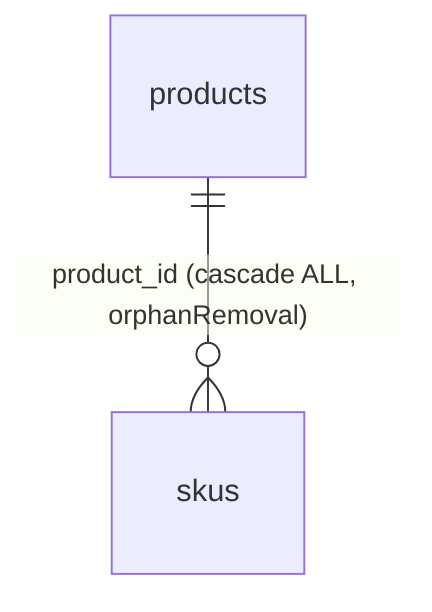
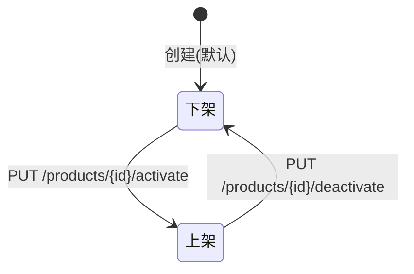

# 功能规格 · 产品管理（支撑域）

| 项 | 内容 |
|---|---|
| 子域 | 支撑域（Product Bounded Context） |
| 聚合根 | `Product` |
| 实体 | `SKU`、`ProductCategory` |
| 值对象 | `ProductPrice`、`ProductAttribute` |
| 领域服务 | `ProductManagementService`、`SKUManagementService`、`ProductCategoryService` |
| 数据表 | `products`、`skus`（无 `categories` 表） |
| 前端 | `frontend/user-web/src/pages/product/{ProductList,ProductDetail,CreateProduct}.jsx` |

---

## 1. 模块定位

产品是**主数据**：订单行项、库存记录、采购明细都以 `sku_code` 指向它。在跨境场景下，产品还承载额外使命——多平台上架的多语言文案、多币种价格、变体属性。

当前模型处在"最小可用"阶段：只有产品 + SKU 两层，缺分类树、缺属性持久化、缺 Listing/多语言/多币种。

---

## 2. 概念模型

| 概念 | 说明 | 关键字段 | 现状 |
|---|---|---|---|
| 产品 | 概念层面的商品 | `name`、`description`、`categoryId`、`categoryName`、`active` | 🟡 |
| SKU | 可售的最小单位 | `skuCode`(唯一)、`skuName`、`price`、`weight`、`dimensions`、`active` | 🟡 |
| 分类 | 品类树 | 仅有 `categoryId` + `categoryName` 两个冗余字段 | ⚪ **无 categories 表** |
| 价格 | 售价 | `ProductPrice` 值对象 | 🟡 无币种 |
| 属性 | 变体维度（颜色/尺码等） | `ProductAttribute` 值对象 | ⚪ **未持久化** |

> 已知数据问题：`products.category_id` 由 `ProductApplicationService` 现场生成 `UUID.randomUUID().toString()`，指向不存在的 `categories` 表，因此**无法 join，也无法保证同一分类多次创建的一致性**（数据字典 R-01）。

---

## 3. 状态机

产品与 SKU 采用**上架/下架**二态（布尔），而非多状态流转。

| 状态 | 字段值 | 业务含义 |
|---|---|---|
| 上架 | `active = true` | 可销售、可出现在下单选择中 |
| 下架 | `active = false` | 不可销售，历史订单不受影响 |

> 目标态应补充更多状态（草稿 / 待审核 / 已上架 / 已停售 / 已归档）与定时上下架能力。

---

## 4. 业务规则

| 编号 | 规则 | 状态 | 说明 |
|---|---|---|---|
| BR-01 | SKU 编码全局唯一 | ✅ | `skus.sku_code` 唯一约束 |
| BR-02 | 删除产品时级联删除其所有 SKU | ✅ | `cascade=ALL, orphanRemoval` |
| BR-03 | 产品必须属于某个分类 | ⚪ | 无分类主数据，classification 只能填冗余字符串 |
| BR-04 | 同一产品可有多个 SKU | 🟡 | 模型支持，但无独立 SKU 维护端点 |
| BR-05 | 下架不影响历史订单 | ✅ | 订单行项是快照设计 |
| BR-06 | SKU 需维护重量与体积以支撑运费计费 | 🟡 | `weight`/`dimensions` 存在，但 `dimensions` 是自由字符串，无单位约定。**2026-10-10 实测补记**：运费计费链路已经接通（[logistics.md](logistics.md) BR-04 / [../qa/known-issues.md](../qa/known-issues.md) R-57，计费重＝`Σ skus.weight × 件数`，单位克），但**库里 88 行 SKU 的 `weight` 有值的是 0 行** ⇒ 现有全部商品的续重都是 `0.00`，运费只收得到首重。这一半是**录入缺口不是代码缺口**：`POST /api/products` 接受 `weightInGrams`（探针就是这么建出 500 克的），`ProductForm.jsx:173-177` 有"重量"列（kg ⇄ 克换算在 `:52`/`:75`），`ProductDetail.jsx:169`、`ProductList.jsx:210`、`ProductImport.jsx:363` 都带该字段。缺重量时按 0 克计、**不拒建物流单**（R-55）；抛重所需的尺寸字段只有 `volumeInCubicCentimeters`，且没有任何计费路径读它 |
| BR-07 | SKU 价格需带币种 | ⚪ | `skus.price` 无币种字段 |
| BR-08 | 支持多语言标题/描述以上架不同站点 | ⚪ | 无字段 |
| BR-09 | 属性可组合生成 SKU 变体 | ⚪ | `ProductAttribute` 未持久化 |
| BR-10 | 产品变更应通知平台同步 | ⚪ | 无联动 |

---

## 5. 功能清单

| 功能 | 前端 | 后端 | 状态 |
|---|---|---|---|
| 创建产品（含 SKU） | `CreateProduct.jsx`（未提交） | `POST /api/products` | 🟡 |
| 按 ID 查询 | `ProductDetail.jsx`~~（mock）~~ | `GET /api/products/{id}`（`ProductController.java:103`） | ~~🟡~~ → 🟡 **2026-01-25 逐页复测：已接真实接口**（该页 5 个 `productApi.*` 调用点） |
| 按 SKU 编码查询 | 未使用 | `GET /api/products/sku/{skuCode}` | 🟡 |
| 上架 / 下架 | 无入口 | `PUT /api/products/{id}/activate` / `deactivate` | 🟡 |
| **产品列表 / 搜索 / 分页** | `ProductList.jsx`~~（mock）~~ | ~~**无端点**~~ → ✅ `GET /api/products`（`ProductController.java:54`，`tenantId`/`keyword`(匹配商品名/描述/SKU 编码)/分页），前端入口 `api.js:242` 的 `productApi.getProducts(params)` | ~~⚪ **P0 缺口**~~ → ✅ **2026-01-25 复测已闭合**：`ProductList.jsx` 有 6 个 `productApi.*` 调用点；`CreateProduct.jsx`/`EditProduct.jsx` 是 `ProductForm.jsx` 的薄包装（真实调用集中在 `ProductForm`，3 个点），本身无调用点属正常结构，不是 mock |
| SKU 独立维护 | 无 | 无端点 | ⚪ |
| 分类树维护 | 无 | 无端点、无表 | ⚪ |
| 属性/变体维护 | 无 | 值对象未持久化 | ⚪ |
| 多语言文案 | 无 | 无字段 | ⚪ |
| 批量导入/导出 | 无 | 无 | ⚪ |

---

## 6. 接口对照

| 场景 | 方法 | 路径 | 状态 |
|---|---|---|---|
| 创建产品 | POST | `/api/products` | 🟡 |
| 按 ID 查询 | GET | `/api/products/{id}` | 🟡 |
| 按 SKU 查询 | GET | `/api/products/sku/{skuCode}` | 🟡 |
| 上架 | PUT | `/api/products/{id}/activate` | 🟡 |
| 下架 | PUT | `/api/products/{id}/deactivate` | 🟡 |
| 产品列表 | GET | `/api/products` | ⚪ **不存在** |

> 注意：产品控制器直接返回领域聚合对象（无 DTO 封装），会把内部结构一并暴露。建议统一为 DTO（ISS-0xx 详见已知缺陷文档）。

---

## 7. 领域事件

| 事件 | 期望下游 | 现状 |
|---|---|---|
| `ProductCreatedEvent` | 初始化各仓库库存记录（0 库存） | ⚪ |
| `ProductUpdatedEvent` | 触发平台商品信息同步 | ⚪ |
| `SKUCreatedEvent` | 建立 SKU 与默认仓库的库存记录 | ⚪ |

---

## 8. 现状缺口与待办

| 优先级 | 缺口 | 建议 |
|---|---|---|
| **P0** | 缺产品列表 / 搜索 / 分页 | 新增 `GET /api/products`，支持名称、SKU、分类、状态筛选 |
| ~~**P0**~~ → ✅ 已完成 | ~~前端三个页面全部 mock~~ → **2026-01-25 逐页复测**：`ProductList.jsx`(6)、`ProductDetail.jsx`(5)、`ProductForm.jsx`(3) 均调真实接口，`CreateProduct`/`EditProduct` 复用 `ProductForm` | ~~补齐 `productApi`~~（`api.js:240-257` 的 `productApi` 已含列表/详情/SKU 与增删改） |
| **P1** | 分类树缺失 | 新增 `categories` 表（含 `parent_id`、`path`、`sort`）+ CRUD |
| **P1** | 属性/变体未持久化 | 新增 `product_attributes`、`sku_attribute_values`，支持笛卡尔积生成 SKU |
| **P1** | 缺币种与多语言 | SKU 增加 `currency`；新增 `product_i18n(product_id, locale, title, description)` |
| **P1** | 控制器直返领域聚合 | 统一 DTO，避免内部结构泄漏 |
| **P2** | 缺 Listing 概念 | 新增 `listings(sku_code, platform, listing_id, url, 上架状态)`，用于多平台上架管理 |
| **P2** | 缺图片与图片桶 | 新增 `product_images` |
| **P2** | 缺批量导入 | 提供 Excel 模板 + 异步导入任务 |

---

## 9. 验收要点

1. SKU 编码重复时必须拒绝创建并返回明确错误。
2. 删除产品时其 SKU 一并删除，且不影响历史订单数据。
3. 下架产品不应出现在任何下单选择中（当前无下单选择 UI，作为未来验收项）。
4. 无法为空的判断：`products.category_id` 当前指向不存在的表，任何依赖 join 分类的查询都会失败。
