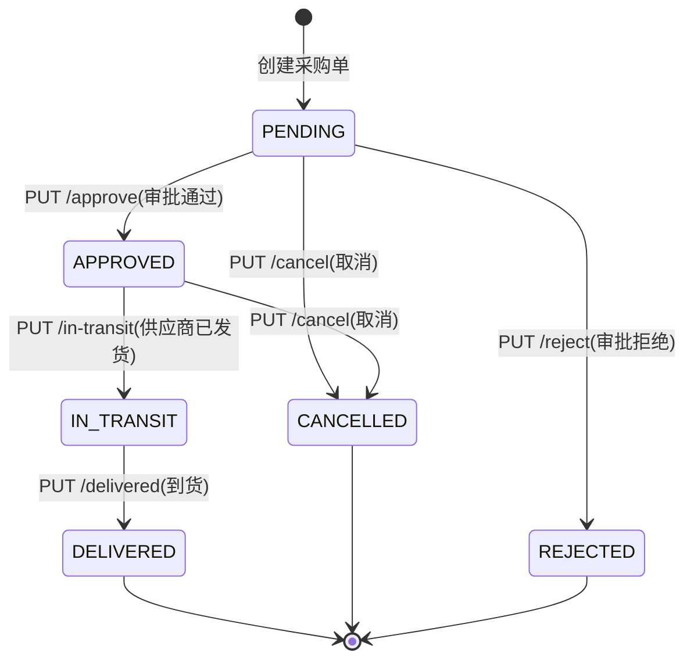

# 功能规格 · 采购管理（支撑域）

| 项 | 内容 |
|---|---|
| 子域 | 支撑域（Purchase Bounded Context） |
| 聚合根 | `PurchaseOrder` |
| 实体 | `PurchaseOrderItem` |
| 值对象 | `PurchaseStatus` |
| 领域服务 | `PurchaseOrderService` / `PurchaseOrderServiceImpl` |
| 数据表 | `purchase_orders`、`purchase_order_items` |
| 前端 | `frontend/user-web/src/pages/purchase/{PurchaseList,PurchaseDetail,CreatePurchase}.jsx` |

---

## 1. 模块定位

采购回答"什么时候补、补多少、向谁补"。它把仓储的缺货信号转成**受控的资金支出**：采购单 → 审批 → 供应商发货 → 到货入库 → 应付入账。

**本模块是全系统状态机最完整的一块**——审批流齊备且 API 完整，可作为其他模块实现状态机的参考样板。

---

## 2. 概念模型

| 概念 | 说明 | 关键字段 |
|---|---|---|
| 采购单 | 一次向供应商的采购请求 | `purchaseOrderId`(主键名与其他表不同)、`supplierId`、`supplierName`、`warehouseId`、`status`、`totalAmount`(DECIMAL) |
| 采购明细行 | 单个 SKU 的采购项 | `skuCode`、`productName`、`quantity`、`unitPrice`、`totalPrice`（DECIMAL），自增主键 |
| 审批 | ~~由状态机表达，尚无审批意见/审批人字段~~ → 🔄 **2026-03-22**：状态机 + 审批留痕字段都已落地 | `approvedBy`、`approvedAt`、`approvalComment`（`PurchaseOrder.java:146-148` 批准、`:172-174` 拒绝时写入；拒绝强制填原因 `:167-169`） |
| 明细行 ID | 采购项由数据库自增主键标识，改/删按此 ID 定位 | `PurchaseOrderItem.id`；创建/加行后服务端**回读一次**把 ID 带进出参（`PurchaseApplicationService:104-105`、`:163-164`、`:183`、`:198`） |

⚠️ **命名陷阱**：`purchase_orders` 的主键列名为 `purchase_order_id`（~~全库 24 张表里的孤例~~ → **2026-01-25 按 `information_schema` 实测：42 张表里主键列名不是 `id` 的有 3 处**——`purchase_orders.purchase_order_id`、`financial_transactions.transaction_id`、以及 `user_roles(user_id, role_id)` **复合主键**；另有 `role_jpa_entity_permissions` 是 `@ElementCollection` 生成的集合表，**完全没有主键**，列为 `role_jpa_entity_id` + `permission`），手写 SQL 或后续引入 MyBatis 时极易踩坑（数据字典 R-11）。

---

## 3. 状态机

| 枚举名 | 存储值 | 中文 | 允许的前置状态 |
|---|---|---|---|
| `PENDING` | `pending` | 待处理 | 新建 |
| `APPROVED` | `approved` | 已批准 | `PENDING` |
| `REJECTED` | `rejected` | 已拒绝 | `PENDING` |
| `IN_TRANSIT` | `in_transit` | 运输中 | `APPROVED` |
| `DELIVERED` | `delivered` | 已送达 | `IN_TRANSIT` |
| `CANCELLED` | `cancelled` | 已取消 | `PENDING` / `APPROVED` |

> 领域层提供了完备的谓词方法：`isPending/isApproved/isRejected/isInTransit/isDelivered/isCancelled`。
> ⚠️ ~~但接口层是否据此校验迁移合法性需在联调时确认，建议补迁移白名单并在服务端强制（ISS-006）。~~ → 🔄 **2026-03-22 复测：白名单已落地并在服务端强制**。`PurchaseStatus.allowedNextStatuses()`（`domain/purchase/valueobject/PurchaseStatus.java:111-118`）给出 `PENDING→{APPROVED,REJECTED,CANCELLED}`、`APPROVED→{IN_TRANSIT,CANCELLED}`、`IN_TRANSIT→{DELIVERED}`、终态空集；`canTransitionTo()` `:126` + `requireTransitionTo()` `:139-145` 在每个状态方法首行调用，违规抛 `INVALID_STATUS_TRANSITION`（刻意不复用 `INVALID_OPERATION`，见 `:132-135` 注释）。`domain/purchase/aggregate/PurchaseOrderTest`（**17 个 `@Test`**）逐项断言白名单（`:48`、`:57`、`:63`）。
> ✅ **ISS-006 已收敛（2026-01-25 复核，方法名与原文不同）**：服务端强校验在聚合里，方法是 `approve()`（~~`PurchaseOrder.java:96`~~ 🔄 **`:142`**，要求 `PENDING`）、`reject()`（~~`:114`~~ **`:165`**）、`markAsInTransit()`（~~`:131`~~ **`:188`**）、`markAsDelivered()`（~~`:150`~~ **`:205`**）、`cancel()`（~~`:168`~~ **`:225`**）——**不是**原文建议里写的 `markInTransit()/markDelivered()`。~~非法迁移抛 `IllegalArgumentException`，由 `GlobalExceptionHandler.java:104-110` 映射为 **HTTP 400**（不再是 500 + `SYSTEM_ERROR`）~~ → 🔄 **2026-03-22 复测**：①行号整体下移（采购模块轮新增 `updateItem :115`、`removeItem :129`、`requireEditable :243`，原引用行全部失效）；②异常类型已换成 `BusinessException(…, "INVALID_STATUS_TRANSITION")`（`PurchaseStatus.java:139-145`），由 `GlobalExceptionHandler.java:41-49` 映射为 **HTTP 400** + `code=INVALID_STATUS_TRANSITION`（`Result.error(errorCode, message)`，`:45`）；`:108-110` 的 `IllegalArgumentException/IllegalStateException` 分支仍在，但采购路径已不走它。
> ~~但与上表**不完全一致的一点**：`cancel()` 只挡 `DELIVERED`（`:169`），实际允许 `REJECTED → CANCELLED` 与 `CANCELLED → CANCELLED`（幂等重写 + 再发一次状态变更事件），而表格把 CANCELLED 的前置写成 `PENDING`/`APPROVED`。要么收紧 `cancel()`，要么把表格改为「除 DELIVERED 外均可取消」——见 [known-issues ISS-043](../qa/known-issues.md)。~~ → 🔄 **2026-03-22 复测：已按第一种方案收紧，本条口径差异消失**。`cancel()`（`PurchaseOrder.java:225-237`）第一行即 `this.status.requireTransitionTo(PurchaseStatus.CANCELLED)`（`:226`），只有 `PENDING`/`APPROVED` 能取消（白名单 `PurchaseStatus.java:113-114`），`IN_TRANSIT` 与三个终态一律 400；`:220-223` 注释写明「已发货需走退货流程，终态不可回退」。表格与代码现已同口径。

---

## 4. 业务规则

| 编号 | 规则 | 状态 | 说明 |
|---|---|---|---|
| BR-01 | 采购单必须指向收货仓库 | ~~🟡~~ → ✅ **2026-03-22** | `warehouse_id` 为裸引用；~~无外键校验仓库存在性~~ → 服务端已有 `requireWarehouseOfTenant(tenantId, warehouseId)`（`PurchaseApplicationService.createPurchaseOrder` 首行），仓库不存在或不属于本租户即被拒 |
| BR-02 | 明细行小计 = 单价 × 数量 | ✅ | `PurchaseOrderItem:30` `totalPrice = unitPrice × quantity`，`create()` 另校验 `skuCode`/`productName` 非空、`quantity > 0`、`unitPrice > 0` |
| BR-03 | 采购单总金额 = 所有明细小计之和 | ✅ | ~~`total_amount` DECIMAL(19,2)~~ → 增/改/删明细后统一走 `recalculateTotalAmount()`（`PurchaseOrder.java:263-266`，覆盖式重算而非累加），杜绝累加漂移。🔄 类型实测更正：`total_amount` 是 **`DECIMAL(38,2)`** 不是 19,2——实体未写 `precision`，Hibernate 默认给 38（`payment_infos.amount` 才是全库唯一显式 19,2；见 [../db/data-dictionary.md](../db/data-dictionary.md) R-09）。✅ **2026-10-10 已收敛（ISS-023 / R-53，见 [../qa/known-issues.md](../qa/known-issues.md) §20）**：`purchase_orders.total_amount` 与 `purchase_order_items.unit_price`/`total_price` 现为 **`DECIMAL(19,2)`**（`V7.2` + `V7.2.1` 影子列流程，**纯收窄也走影子、不给一步 `MODIFY` 开先例**），三个实体的字段都已显式声明 `precision = 19, scale = 2`。收窄前后逐列对照**迁移时点（2026-10-10 10:38）实测**：**350 行、`SUM(total_amount)` = `1644.00`、`MAX(ABS(...))` = `35.00`** —— 老列与新列逐值相等、无截断（19,2 的容量远未触顶）。⚠️ 02:51 复算已是 **365 行 / `SUM` = `1687.00`**（多出的 15 行来自其后又跑的冒烟轮建单），所以这两个数是**历史时点值**，不要当当前总量引用 |
| BR-04 | 只有 `PENDING` 状态的单据可被审批/拒绝 | ~~🟡 建议服务端强制~~ → ✅ **2026-03-22** | `PurchaseStatus.requireTransitionTo()`（`PurchaseStatus.java:139-145`）+ `approve()` `:143` / `reject()` `:166`，非法迁移抛 `BusinessException(…, "INVALID_STATUS_TRANSITION")`；拒绝另强制 `comment` 非空（`:167-169`） |
| BR-05 | 已取消/已拒绝的采购单不可再推进 | ~~🟡 同上~~ → ✅ **2026-03-22** | `allowedNextStatuses()`（`:111-118`）：`DELIVERED`/`REJECTED`/`CANCELLED` 返回**空列表**（终态不可再推进），`IN_TRANSIT` 不可取消 |
| BR-06 | 审批需记录审批人与审批时间与意见 | ~~⚪ 无字段~~ → ✅ **2026-03-22** | ~~无字段~~ → 聚合有 `approvedBy:35` / `approvedAt:36` / `approvalComment`，`approve()/reject()` 均写入（`:146-148`、`:172-174`）；运行时库 `purchase_orders` 实测有 `approved_by varchar(64)`、`approved_at datetime(6)`、`approval_comment varchar(512)` 三列；控制器侧 `resolveApprover()`（`PurchaseController:277-287`）缺省取登录账号、匿名记 `SYSTEM` |
| BR-07 | 金额超过阈值需上级审批（多级审批流） | ⚪ | 无审批流引擎 |
| BR-08 | 到货（DELIVERED）后自动生成待入库任务 | ~~⚪ 无联动~~ → ✅ **2026-03-22 复测：联动已落地，但刻意不走事件** | ~~`PurchaseOrderStatusChangedEvent` 外发到 `purchase-events` topic（`DomainEventPublisher:123`），但**仓内没有该 topic 的消费者**（4 个 MQ 消费者只订阅 `order-events`/`inventory-events`/`logistics-events`）~~ → 到货编排在应用服务里同步完成：`markPurchaseOrderAsDelivered()`（`PurchaseApplicationService.java:256-262`）在同一 `@Transactional`（`:255`）内先 `purchaseOrderService.markPurchaseOrderAsDelivered()`、再 `receiveIntoWarehouse()`（`:281-293`）、最后 `createPurchasePayable()`（`:299-310`），任一步抛出即整体回滚。类注释 `:30-32` 与 `PurchaseController:223-224` 的 `@Operation` 都写明「同事务内完成收货入库与采购应付入账」。「`purchase-events` 无仓内消费者」这一条**仍然成立**，但它是设计选择（事件只作对外订阅通道，不与编排双写），不再是缺口。测试：`PurchaseApplicationServiceTest`（11 个 `@Test`）`deliveredShouldStockInEveryLineAndBookPurchasePayable`（`:74-89`）逐行 verify `inventoryIn` + 应付流水 + `publishEventsFrom` |
| BR-09 | 收货入库后增加对应仓库库存 | ~~⚪ 与仓储上下文无集成~~ → ✅ **2026-03-22** | `receiveIntoWarehouse()` 按明细行逐条调用 `warehouseApplicationService.inventoryIn(item.getSkuCode(), purchaseOrder.getWarehouseId(), item.getQuantity())`（`PurchaseApplicationService:288`；实现 `WarehouseApplicationService.java:110`，入库前先 `requireWarehouse` 并校验 `skuCode` 非空、`quantity > 0`，`:111-117`）。无明细行时只 `log.warn` 跳过入库（`:283-286`，测试 `deliveredWithoutLinesShouldTouchNeitherInventoryNorFinance` `:92-101`）⇒ 空单到货＝状态变更，不产生库存动作 |
| BR-10 | 入库后生成采购应付流水 | ~~⚪ 与财务上下文无集成~~ → ✅ **2026-03-22**（带语义妥协） | `createPurchasePayable()` 调 `financeApplicationService.createFinancialTransaction(TransactionType.EXPENSE, totalAmount, "CNY", purchaseOrderId, "PURCHASE_ORDER", description, tenantId)`（`PurchaseApplicationService:307-308`；7 参重载 `FinanceApplicationService.java:72`，租户可空重载 `:49`）。⚠️ `TransactionType` **没有「应付」枚举值**，按资金流出记 `EXPENSE`、靠 `reference_type=PURCHASE_ORDER`（常量 `PAYABLE_REFERENCE_TYPE:45`）回溯成采购应付——不是真正的挂账/账期模型；金额 ≤0 时跳过入账但仍完成入库（`:301-304`，测试 `:104-113`） |
| BR-11 | 供应商需为主数据，可复用与比价 | ⚪ | 仅有 `supplier_id`/`supplier_name` 快照，无供应商表（运行时库 42 张表实测**无 `suppliers`**） |
| BR-12 | 缺货自动生成采购建议 | ✅ **2026-10-10 §24 轮交付（带明细行、可收货、可入账；定标 R-60／R-61）**；沿革 ~~⚪~~ → 🟡 **2026-03-22 复测：消费端已建齐，上游事件仍发不出来 ⇒ 事实上不可达** | ~~`processReplenishment()` 为空实现~~ → ①定时补偿路径：`BusinessProcessOrchestrationService.processReplenishment()`（`:91-111`）**已实现前半段**（查仓库 + 查库存 + 阈值比较），但第 3 步「触发采购」只剩注释（`:106-107` `// 实现采购逻辑`），且**全仓 0 个调用方**（grep `processReplenishment` 只命中定义行 `:91`）⇒ 仍是死代码。②事件路径**这轮新增了消费端**：进程内 `EventHandler.handleInventoryShortageEvent()`（`EventHandler.java:92-105`）与 MQ `InventoryShortageEventConsumer`（`@RocketMQMessageListener(topic="inventory-events", consumerGroup="purchase-group")`，`:19-20`）都会 `createPurchaseOrder("default-tenant", "DEFAULT_SUPPLIER", "Default Supplier", event.getWarehouseId())`。但**上游断点没修**：`InventoryShortageEvent` 只在 `Warehouse` 聚合出库时注册（`Warehouse.java:234-244`，`SHORTAGE`/`OUT_OF_STOCK` 触发，阈值硬编码 `10`），而出库入口 `WarehouseApplicationService.inventoryOut()`（`:125-134`）返回的是 `InventoryRecord`、从不调 `publishDomainEvents()`（该方法只在 `:45`、`:55`、`:102` 三处被调用，均为仓库/库位操作）⇒ 事件既不进进程内通道也不进 MQ，两个消费者都不会被点亮（与 [known-issues ISS-062](../qa/known-issues.md) 的结论一致）。 ⚠️ **新引入的次生风险**：一旦上游修好，①BR-01 的 `requireWarehouseOfTenant`（`PurchaseApplicationService:315-328`）会因为租户被硬编码成 `default-tenant`（`EventHandler:100`、`InventoryShortageEventConsumer:37`）而对非默认租户的仓库抛 `ValidationException`，且该异常被两端的 `catch (Exception e)` 吞成 error 日志；②双通道各建一张单（ISS-054），`InventoryShortageEventConsumer:35` 的注释已自认这一点；③生成的是**无明细行的空采购单**（4 参重载 `:82-84`），没有 SKU/数量，进不了 BR-09 的入库。所以「缺货→自动补货」端到端仍未交付。 🔄 **2026-10-10 §23 轮改判：①「上游事件发不出来」已经不成立**——出库路径现在把聚合事件交给发布器（`WarehouseApplicationService.inventoryOut:166` 的 `publishDomainEvents(result.warehouse())`，即 ISS-062 那一轮的修复，随提交 `177a8d3` 落地），实证是同轮探针里"出库到 0 ⇒ 该仓名下立刻多出 4 张 `DEFAULT_SUPPLIER` 采购单"（`mut-iss072.log` 18:19:20 的常驻位回读），且 18:06 复算 `purchase_orders` 里 `supplier_id='DEFAULT_SUPPLIER'` 共 **366** 行；②「租户被硬编码成 `default-tenant`」也已改掉（`EventHandler:100-102` 改成优先取事件载荷的 `tenantId`、缺省才回退，ISS-118 口径）；③双通道风险仍未点亮但保持成立（MQ 那条带 `@ConditionalOnProperty(rocketmq.internal-consumers.enabled=true)`，`application.yml:46` 为 `false`）。⇒ **BR-12 现在只差第③支：生成的是无明细行的空采购单**（`EventHandler:102` 调 4 参重载，不带 `PurchaseOrderItem`）——实测 **366/366 行 `purchase_order_items` 计数为 0**（`po_no_items=366` 与 `DEFAULT_SUPPLIER` 行数完全相等），而 `PurchaseOrderItem.create` 要求 `skuCode`／`productName` 非空、`quantity>0`、`unitPrice>0`，BR-09 的到货入库又是**逐行** `inventoryIn` ⇒ 这张单即使审批通过也入不了库，链路仍然不可用。登记为 [../qa/known-issues.md](../qa/known-issues.md) **ISS-143**（§23 结尾），修法与建议见该条。 🔄 **2026-10-10 §24 轮：第③支已交付 ⇒ BR-12 转 ✅（定标 R-60／R-61，证据见 [../qa/known-issues.md](../qa/known-issues.md) §24）**。缺货建单收敛成唯一入口 `ReplenishmentApplicationService.replenishForShortage(event)`，进程内 `EventHandler` 与 MQ `InventoryShortageEventConsumer` **都只委托它**（两条通道各写一套语义就是本缺陷的成因，守卫位 `ShortageReplenishmentGuardTest` 名册计数 2 并禁止消费者文件里出现 `createPurchaseOrder(`）；明细行按 `PurchaseOrderItem.create(skuCode, 商品名, Math.max(1, threshold - currentQuantity), skus.cost_price)` 组成，走**带明细的 5 参重载**，而**只给单头的 4 参重载已从 `PurchaseApplicationService`／`PurchaseOrderService`／`PurchaseOrderServiceImpl` 三处删除**（关掉门而不是只修调用方，R-61）。 **单价口径（R-60）**：只取 `skus.cost_price`，**取不到（`NULL` 或 `≤0`）就整张单不建**、只留缺货预警日志——不许拿 `selling_price` 顶替、不许填 0 或猜数（与 R-58 同一条底线：不能让一张能过审批、能生成 BR-10 应付的账带着不存在的金额进台账）。 **实测（本轮 19:12／19:21 两次同结果，日志在 `/tmp/round11/`、`/tmp/round12/`）**：探针把有成本价（`6.66`）的 SKU 出库到 0 ⇒ 该仓名下 **1 张**自动单、明细元组逐位 `SKU\|10\|6.66\|66.60`、`purchase_order_items` 计数 **1**（修复前恒 0）、`GET /api/purchases/{id}` 回读与库内一致；`approve → in-transit → delivered` 后**库存 0 → 10**（BR-09 的逐行入库终于有东西可入）并落一条 `pending\|66.60` 应付（BR-10，金额＝明细 10×6.66）。负例：同轮另一个 SKU `cost_price=NULL`（售价 `9.90`）出货到 0 ⇒ **名下 0 张单**。测试位＝`ReplenishmentApplicationServiceTest` 8 例（含四条跳过负例）＋上述静态守卫 4 例，全套 `mvn -o test` **801 例零失败**；两处变异实测（`List.of(item)`→`List.of()` 让单测与 live 探针同时变红 15/5、摘掉 MQ 通道委托让守卫变红）见 §24。 ⚠️ **语义边界（不要读成"自动补货已完备"）**：①阈值仍是硬编码 `10`（`InventoryRecord.calculateInventoryStatus:47-57`、`Warehouse:246` 的 `// 示例阈值`），建议量因此恒为 `10 − 现存量`，**这不等于"补到安全库存"**——真正的安全库存没有建模（`inventory_records` 无 `safety_stock` 列，见 [../product/06-glossary.md](../product/06-glossary.md)「安全库存 ⚪ 未建模」与 [../product/07-roadmap.md](../product/07-roadmap.md) R-301）；②**只有出库这一条触发线**，盘点把数量改到阈值以下不发缺货事件（登记 **ISS-145**，§24）；③第①支的载体 `BusinessProcessOrchestrationService` 已不存在（19:40 当场核对：`git status` 为暂存态 `D`、工作树无该文件、全仓无引用）⇒ 「定时补偿扫描」这一支不是死代码而是**已被移除**，缺货链现在只有事件这一条；④历史上已落库的 **359** 张 `DEFAULT_SUPPLIER` 空单**本轮一张都没删**（R-40：与用户手工出库产生的行同形，无法从数据自证归属；采购域也只有 `/{purchaseOrderId}/items/{itemId}` 这一级删除端点），守卫上线后**新增**已被常驻位挡住（复测：九份脚本跑完 `purchase_orders` 仍 530 行、`created_at ≥ 18:00` 的单 0 行） |
| BR-13 | 明细行只能在待处理阶段维护 | ✅ **2026-03-22 新增（本轮实测补记）** | 服务端 `requireEditable()`（`PurchaseOrder.java:243-249`）：状态非 `PENDING` 时 `addItem`/`updateItem`/`removeItem`（`:96`、`:116`、`:130`）一律抛 `BusinessException(…, "PURCHASE_ITEMS_LOCKED")` → 400。`addItem` 另按 SKU 去重（`:98-102`，`DUPLICATE_PURCHASE_ITEM`；应用层用 `equalsIgnoreCase`，DB 侧同口径的 `uk_po_item(purchase_order_id, sku_code)` 唯一约束见 `PurchaseOrderItemJpaEntity:25-26`，明细主键为 `Long` + `IDENTITY` `:30-32`）。前端同口径常量 `purchaseItemEditableStatus = 'PENDING'`（`frontend/user-web/src/constants/purchase.js:70`，用于 `PurchaseDetail.jsx:189` 的 `canEditItems`），注释 `:3` 明确「明细动作门禁由聚合的 `requireEditable` 判定」 |

---

## 5. 功能清单

| 功能 | 前端 | 后端 | 状态 |
|---|---|---|---|
| 创建采购单 | `CreatePurchase.jsx`（~~未提交~~ 🔄 2026-03-22：文件已入库、当前工作树为 `M` 未提交改动；`:72-79` 单头 + 明细**一次提交**） | `POST /api/purchases`（`PurchaseController:65`，`PurchaseCreateRequest` 请求体） | ~~🟡~~ → ✅ **2026-03-22**。金额由服务端按明细重算（不信任前端 `:169` 的本地合计）；建完回读一次带出自增明细 ID（`PurchaseApplicationService:104-105`） |
| 采购单列表 | `PurchaseList.jsx`~~（mock）~~ | `GET /api/purchases?…&page=&size=`（`PurchaseController:79-95`，11 个 query 参数） | ~~🟡 无分页（**这条后端限制仍在**）~~ → ✅ **2026-03-22：分页与条件查询都已下沉服务端**，出参 `Result<PageResult<PurchaseOrderDto>>`（`:79`）。前端 `:61-71` 下发 `page/size/purchaseOrderId/supplierId/supplierName/minTotalAmount/status/startDate/endDate`，`:72-77` 用返回的 `total`/`page` 回填分页器，`:90-101` 翻页与查询都重新请求。状态字典改为打 `GET /purchases/statuses`（`:41-53`，失败才回落本地 `purchaseStatusOptions`）。ISS-015/016 收尾 |
| 采购单详情 | `PurchaseDetail.jsx`~~（mock）~~ | `GET /api/purchases/{purchaseOrderId}`（`:117`） | ~~🟡 …`Result<PurchaseOrder>` 是聚合外露（ISS-063）~~ → ✅ **2026-03-22**。7 个动作全部接真接口（`purchaseApi.*` 12 方法，`api.js:427-458`）；按钮门禁改为**优先消费服务端下发的 `allowedNextStatuses`**（`PurchaseOrderDto:50`，`PurchaseDetail.jsx:86-89`），字典缺失时才回落本地状态机（`constants/purchase.js:30-37`）。`Result<PurchaseOrder>` 聚合外露已消除（ISS-063 采购域部分） |
| 添加明细行 | ~~无入口~~ `PurchaseDetail.jsx:117-121` 打开弹窗、`:256` 「添加采购项」按钮、`:135-158` 提交 | `POST /api/purchases/{id}/items`（`:129`） | ~~🟡~~ → ✅ 仅 `PENDING` 可加（BR-13），SKU 重复被拒（`DUPLICATE_PURCHASE_ITEM`） |
| 审批通过 / 拒绝 | ~~无入口~~ 同一个「采购审批」按钮 + 弹窗（`:259`、`:320-354`、`:97-108`，`approvalStatus` 可切换通过/拒绝，提交 `approvedBy` + `comment`） | `PUT /{id}/approve`（`:176`）/ `PUT /{id}/reject`（`:192`） | ~~🟡~~ → ✅ 拒绝原因双重强制：前端表单 + 控制器 `:198-200` + 聚合 `PurchaseOrder:167-169` |
| 标记运输中 | ~~无入口~~ `:261-263` 按 `allowedNextStatuses` 渲染 | `PUT /{id}/in-transit`（`:211`） | ~~🟡~~ → ✅ |
| 标记已送达 | ~~无入口~~ 同上，且 `purchaseActionMap.DELIVERED.confirm`（`constants/purchase.js:48-53`）**二次确认**「将增加库存并生成采购应付，不可撤销」 | `PUT /{id}/delivered`（`:226`） | ~~🟡~~ → ✅ 同事务完成入库 + 应付（BR-08/09/10） |
| 取消 | ~~无入口~~ 同上（`danger: true` + 二次确认 `:54-60`） | `PUT /{id}/cancel`（`:240`） | ~~🟡~~ → ✅ 仅 `PENDING`/`APPROVED`（§3 更正） |
| 修改/删除明细行 | ~~无~~ `PurchaseDetail.jsx:229` 行内「编辑」、`:123-131` 预填、`:138-145` 保存、`:165-166` 删除 | ~~无端点~~ `PUT /{id}/items/{itemId}`（`:145`）、`DELETE /{id}/items/{itemId}`（`:161`） | ~~⚪~~ → ✅ **2026-03-22**；改删后 `recalculateTotalAmount()` 覆盖式重算（BR-03） |
| 采购状态字典 | 新增：列表/详情下拉（`PurchaseList.jsx:41-53`） | `GET /api/purchases/statuses`（`:102-109`，`List<TargetFieldDto>`：`code`=枚举名、`label`=中文） | ✅ **本轮新增**，消除前后端枚举漂移 |
| 供应商档案 | 无 | 无表无端点 | ⚪（BR-11） |
| 到货入库联动 | 「确认送达」按钮即触发（无独立入库任务界面） | ~~无~~ 同步编排在 `PurchaseApplicationService:256-262` | ~~⚪~~ → 🟡 **联动已实现但没有「待入库任务」这一中间产物**：一步到位加库存，无法分批收货/部分入库，也没有质检环节（§8 P3） |

> **2026-01-25 就地更正**（前端已打通，上表当时的「mock / 无入口」列过期；**2026-03-22 复测：本节 4 条里前 3 条已被后续代码超越，逐条划线订正，保留原文以便对照**）：
> - `services/api.js:426-440` 补了 ~~**`purchaseApi` 9 个方法**~~ → 🔄 **2026-03-22：已扩到 12 个方法**（`api.js:427-458`；新增 `getStatuses`、`updatePurchaseOrderItem`、`removePurchaseOrderItem`），三个页面全部改为真实调用，不再有 mock 数据。文件位置在 `pages/purchase/`（原文写的裸文件名 `PurchaseList.jsx` 等找不到，实际是 `frontend/user-web/src/pages/purchase/{PurchaseList,PurchaseDetail,CreatePurchase}.jsx`）。
> - `PurchaseDetail.jsx:119-123` ~~用状态门禁渲染按钮，把「无入口」的 5 个操作全接上了：`canApproveOrReject = status==='PENDING'`、`canMarkInTransit === 'APPROVED'`、`canMarkDelivered === 'IN_TRANSIT'`、`canCancel` 排除 `DELIVERED/CANCELLED/REJECTED`、`canAddItem === 'PENDING'`~~ → 🔄 **2026-03-22 复测：前端门禁的实现方式已换**，不再本地硬编码每个状态：`PurchaseDetail.jsx:86-89` 优先取 `purchase.allowedNextStatuses`（服务端 `PurchaseOrderDto:50` 算好的可达状态集合），只在它缺失时回落到 `constants/purchase.js:30-37` 的本地 `purchaseStatusFlow` 兜底；`:261-263` 按该集合渲染 `IN_TRANSIT/DELIVERED/CANCELLED` 按钮，批准/拒绝合并成一个审批弹窗（`:259`）。明细行门禁独立用 `purchaseItemEditableStatus`（`:189`）。**服务端与前端同口径由 `PurchaseStatus.allowedNextStatuses()` 单点提供**，比原文那套「前端自己排状态」更不容易漂。
> - `PurchaseList.jsx:54-68` ~~：列表筛选是**前端本地过滤**（单号/供应商/「总金额≥」min-amount/按 `createdAt` 的 dateRange），只有 `status` 传给后端（`:78`）——因为 `PurchaseController` 没有分页与条件参数（M-07 未覆盖本模块，`PurchaseOrderRepositoryImpl` 也不用 `PageRequest`）。数据量上来后要改成服务端条件。~~ → 🔄 **2026-03-22 复测：这条已按建议改完**。控制器有 11 个 query 参数（`PurchaseController:80-90`），仓储侧改用 `PurchaseQuery` + `PageRequest` 分页（`PurchaseApplicationService:136-144` → `PurchaseOrderService`），前端 `:61-77` 全部下发条件并由服务端返回 `total/page`；本地过滤代码已删除。
> - `CreatePurchase.jsx:17-19` ~~：`tenantId` 取自 `useAuth()` 的登录租户（回落 `localStorage.tenantId` → `default-tenant`），因为 `PurchaseController.java:47` 仍要求 query 传租户（ISS-051），而 `TenantIsolationAspect` 会拒绝与令牌不一致的值~~ → 🔄 **2026-03-22 复测：改为不下发 `tenantId`**。`CreatePurchase.jsx:71` 注释写明「不传 tenantId：由后端从 JWT 租户上下文解析，传错值会被 TenantIsolationAspect 判越权」，`:72-79` 的请求体里没有租户；控制器侧 `tenantId` 全部 `@RequestParam(required = false)`（`:80`、`:118`、`:132`…）并由 `resolveTenant()`（`:264-272`）按「参数 → `TenantContext` → `DEFAULT_TENANT_ID`」优先级回落。`PurchaseList.jsx:60` 同口径。**原文担心的「非种子租户走 default-tenant 被判越权」由此规避**。
> - ~~仍未变的是：`⚪` 三行（明细行改删、供应商主数据、到货入库联动）依旧无实现；`PurchaseOrderStatusChangedEvent` 发出后**没有任何消费方**（ISS-053 无 outbox、ISS-054 双通道重复仍在）~~ → 🔄 **2026-03-22：三行里只剩「供应商主数据」为真**。明细改删已交付；到货联动改为**同事务同步编排**（BR-08/09/10），因此不再依赖 `purchase-events` 的消费者——该 topic 仓内确实仍无消费者，事件只作对外订阅（`PurchaseApplicationService:30-32` 注释）。ISS-053（无 outbox、MQ 发送异常被吞）与 ISS-054（双通道重复）作为平台级缺口**仍然存在**。

---

## 6. 接口对照

| 场景 | 方法 | 路径 |
|---|---|---|
| 创建采购单（单头 + 明细一次提交，JSON body `PurchaseCreateRequest`） | POST | `/api/purchases` |
| 列表（服务端分页 + 条件查询） | GET | `/api/purchases?purchaseOrderId=&supplierId=&supplierName=&warehouseId=&status=&minTotalAmount=&startDate=&endDate=&page=0&size=10` |
| 状态字典 | GET | `/api/purchases/statuses` |
| 详情 | GET | `/api/purchases/{purchaseOrderId}` |
| 添加明细 | POST | `/api/purchases/{purchaseOrderId}/items` |
| 修改明细（数量/单价） | PUT | `/api/purchases/{purchaseOrderId}/items/{itemId}` |
| 删除明细 | DELETE | `/api/purchases/{purchaseOrderId}/items/{itemId}` |
| 审批通过 | PUT | `/api/purchases/{purchaseOrderId}/approve`（body `PurchaseApprovalRequest{approvedBy,comment}`，可整体省略） |
| 审批拒绝 | PUT | `/api/purchases/{purchaseOrderId}/reject`（`comment` 必填） |
| 标记运输中 | PUT | `/api/purchases/{purchaseOrderId}/in-transit` |
| 标记已送达（同步入库 + 记应付） | PUT | `/api/purchases/{purchaseOrderId}/delivered` |
| 取消 | PUT | `/api/purchases/{purchaseOrderId}/cancel` |

> ~~（原表只有 9 行，路径与当时控制器一致）~~ → 🔄 **2026-03-22 复测：12 个端点**，与 `PurchaseController` 的注解扫描逐条对账（`@PostMapping:64`、`@GetMapping:78`、`@GetMapping("/statuses"):102`、`@GetMapping("/{purchaseOrderId}"):116`、`@PostMapping("/…/items"):129`、`@PutMapping("/…/items/…"):145`、`@DeleteMapping("/…/items/…"):161`、approve `:176`、reject `:192`、in-transit `:211`、delivered `:226`、cancel `:240`）。
> ⚠️ **`status` 取值是枚举名，不是存储值**：Spring 对 `@RequestParam PurchaseStatus status`（`:85`）用 `Enum.valueOf` 转换，所以 `?status=PENDING` 有效、~~`?status=pending`~~（原表的写法）会抛 `MethodArgumentTypeMismatchException` → 由 `GlobalExceptionHandler.java:171-` 映射为 400。数据库里存的是小写 code（`PurchaseStatus:15-20` 的 `pending/approved/…`），两者不要混——前端因此改打 `/statuses` 字典取 `code`（`PurchaseList.jsx:46`）。
> 🔒 12 个端点全部有 `@PreAuthorize`：类上无注解，方法级 `purchase:read`（列表/字典/详情 3 个）与 `purchase:write`（其余 9 个），并放行 `PLATFORM_ADMIN`（`:63,77,101,115,128,144,160,175,191,210,225,239`）。业务异常**不在控制器捕获**（全类 0 个 `try/catch`），由 `GlobalExceptionHandler` 统一出 400/404。

---

## 7. 领域事件

| 事件 | 注册点 | 期望下游 | 现状 |
|---|---|---|---|
| `PurchaseOrderCreatedEvent` | 静态工厂 `PurchaseOrder.create()`（`PurchaseOrder.java:65`）内在 `:68` 注册，`extends BaseDomainEvent` | 通知审批人 | ⚪ 无消费方——只外发到 `purchase-events` |
| `PurchaseOrderStatusChangedEvent` | `PurchaseOrder.java:151`（approve）、`:177`（reject）、`:194`（in-transit）、`:211`（delivered）、`:231`（cancel）——**5 个状态方法各注册一次**，旧状态与新状态成对带上 | 送达后驱动收货入库、释放资金占用 | 🔄 **2026-03-22：下游动作已实现，但不靠这个事件**。入库 + 应付改由 `PurchaseApplicationService.markPurchaseOrderAsDelivered()` 同事务同步编排（BR-08/09/10）；事件仍然照发（`:258`，早于编排两步），但**只作为对外订阅通道**，类注释 `:30-32` 明确「仓内不重复消费，避免与编排双写」 |

> ~~注：`DELIVERED` 是本模块唯一对外有业务意义的状态终点，目前没有任何消费方。~~ → 🔄 **2026-03-22 复测订正**：`purchase-events` topic（`DomainEventPublisher.getTopicForEvent`，`infrastructure/messaging/DomainEventPublisher.java:122-123` 按包名 `…purchase.event` 命中）在**仓内确实没有消费者**——4 个 `@RocketMQMessageListener` 只订阅 `order-events`/`inventory-events`/`logistics-events`，进程内 `EventHandler` 的 4 个 `@EventListener` 也不处理采购事件。所以「没有任何消费方」这句对**采购事件本身**仍然为真；不再为真的是「因此到货没有下游动作」——到货动作已改成同事务同步调用，不再依赖订阅。
> ⚠️ 两个反面事实（记在这里避免后被误读为「事件链路已通」）：①`purchase-events` 的消费方若要外挂，得自备反序列化（采购事件无 `@JsonCreator`，ISS-052）；②MQ 发送异常被 `publishEventsFrom` 吞掉只记日志、无 outbox（ISS-053），所以**到货成功而对外通知丢失**是可发生的，通知类下游不能只依赖这条通道。

---

## 8. 现状缺口与待办

| 优先级 | 缺口 | 建议 |
|---|---|---|
| **P1** | ~~前端三个页面全部 mock~~ ✅ **已完成（2026-01-25）**：`purchaseApi` ~~9 方法~~ → 🔄 **12 方法** + 三页真实调用 + 详情页 ~~状态门禁~~（改为消费服务端 `allowedNextStatuses`）（见 §5 更正） | ~~补齐 `purchaseApi` 并接入~~ |
| **P1** | ~~到货不入库~~ ✅ **已完成（2026-03-22 复测）**：~~消费 `PurchaseOrderStatusChangedEvent` → 生成入库任务 → 增加库存 → 生成应付流水~~ → 实际落地形态是**同事务同步编排**（`PurchaseApplicationService:256-262` → `receiveIntoWarehouse` + `createPurchasePayable`），不依赖事件订阅；已由 `PurchaseApplicationServiceTest` 3 个 `delivered*` 用例锁定 | 剩余部分降级为 P2：见下面「无入库任务中间态」与「无部分收货」两行 |
| **P1** | ~~无审批人/意见/时间~~ ✅ **已完成（2026-03-22 复测）**：`approvedBy`/`approvedAt`/`approvalComment` 三字段在聚合、DTO、运行时库（`approved_by varchar(64)`、`approved_at datetime(6)`、`approval_comment varchar(512)`）三层齐备；拒绝强制填原因 | 多级审批见下面 P2 |
| **P1** | ~~迁移无服务端强校验~~ ✅ **已完成（2026-01-25）**：`approve/reject/markAsInTransit/markAsDelivered/cancel` 各自前置校验，非法迁移 → 400（见 §3 更正）。🔄 2026-03-22 追加：`cancel()` 的口径放宽问题（`REJECTED → CANCELLED`）也已收紧，异常码改为专用 `INVALID_STATUS_TRANSITION`；明细行另有 `requireEditable` 门禁（BR-13） | ~~在 `PurchaseOrder` 内实现 `approve()/reject()/markInTransit()/markDelivered()/cancel()` 并各自校验前置状态~~ |
| **P1** | 🆕 **到货联动没有幂等保护**：`delivered` 端点每次都按全部明细行加一次库存并再记一笔 `EXPENSE` 流水。状态机挡住了「二次 delivered」（`DELIVERED` 是终态，400），但挡不住**并发双击**——两个请求都读到 `IN_TRANSIT` 就都会走完编排。本轮实测的两个前置事实：①**全仓 0 个 `@Version`**（grep 全部 JPA 实体，无一使用乐观锁），`purchase_orders` 的 `@Table` 只有 3 个普通索引（tenant_id/status/created_at，`PurchaseOrderJpaEntity:25-27`）；②`financial_transactions` 的 `@Table` **连一个索引都没有**（`FinancialTransactionJpaEntity:19`），`reference_id`/`reference_type` 上无唯一键 ⇒ 重复应付流水不会被数据库拦下。上架前需补：`purchase_orders` 加 `@Version`，或 `financial_transactions(reference_type, reference_id)` 建唯一索引 | 加乐观锁或入账唯一键 |
| **P2** | 无供应商主数据 | 新增 `suppliers` 表 + CRUD，采购单改为引用供应商 ID（现状 `supplier_id`/`supplier_name` 是快照；BR-11） |
| **P2** | ~~无缺货→采购建议~~ 🔄 **改为「链路两端已建齐、中间断开」**：`InventoryShortageEventConsumer`（MQ）与 `EventHandler:92-105`（进程内）都会自动建采购单，但 `InventoryShortageEvent` 在出库路径上从未被交给发布器（BR-12 详述） | 先修 ISS-062（让 `inventoryOut` 把聚合事件交给 `publishEventsFrom`），再把消费端硬编码的 `default-tenant`/`DEFAULT_SUPPLIER`/空明细改成事件里的真实租户与缺货 SKU 建议量，并二选一关掉双通道 |
| **P2** | 无入库任务中间态 | 「确认送达」直接改库存，跳过了「待入库任务/收货单」这一层，无法分批收货、无法在 WMS 侧留痕，也没有制单-复核分离 |
| **P2** | 应付语义借用了 `EXPENSE` | `TransactionType` 增加「应付/暂估」枚举，或引入独立的 `purchase_payables` 表；当前靠 `reference_type=PURCHASE_ORDER` 反查（BR-10） |
| **P2** | 无多级审批/金额阈值 | 引入轻量审批流配置（金额区间 → 审批角色）（BR-07） |
| **P2** | `IN_TRANSIT` 不能取消、也没有退货 | §3 白名单把在途单的出口只留了 `DELIVERED`；`PurchaseOrder.java:222` 注释说「已发货需走退货流程」，但退货在系统里不存在 ⇒ 在途错单当前无业务出路 |
| **P3** | 无采购到货质检与退货 | 增加质检环节 |
| **P3** | 采购事件通道不可靠 | ISS-053（无 outbox、MQ 异常被吞）+ ISS-052（事件无 `@JsonCreator`，消费端反序列化会失败）——若要外挂审批通知类订阅方，先解这两条 |

---

## 9. 验收要点

> 🔄 **2026-03-22 逐条按代码实测**（5 条里 4 条已具备服务端实现并有测试锚点，仅第 4 条部分达成）：

1. 新创建的采购单状态必须为 `PENDING`，金额自动汇总明细行。→ ✅ 构造器置 `PENDING`（`PurchaseOrder.java:48`）并把 `totalAmount` 清零（`:52`），金额走 `recalculateTotalAmount()`（定义 `:263`）覆盖式重算，全类 3 个调用点分别在 `addItem :104`、`updateItem :120`、`removeItem :132`；**创建路径也逐个走聚合的 `addItem`**（`PurchaseOrderServiceImpl:69-73`，注释 `:70` 写明「复用 SKU 去重与金额汇总，不让外部构造绕过规则」）⇒ 出「单头金额与明细不一致」这类脏数据的通路已被堵死。
2. 重复审批（已批准的单据再次 approve）必须被拒绝。→ ✅ `approve()` 首行 `requireTransitionTo(APPROVED)`（`:143`），`APPROVED.allowedNextStatuses()` 不含 `APPROVED`（`PurchaseStatus.java:114`）⇒ `BusinessException("采购单不允许从「已批准」变更为「已批准」", "INVALID_STATUS_TRANSITION")` → HTTP 400。测试锚点：`PurchaseOrderTest`（17 个 `@Test`）。
3. 已取消/已拒绝的单据不可再变更为运输中或已送达。→ ✅ 三个终态返回空白名单（`PurchaseStatus.java:116`）。
4. 到货（DELIVERED）后，目标仓库对应 SKU 库存应增加（~~当前无此联动，作为 v0.2 验收项~~）。→ ✅ **v0.2 项已在本轮落地**：`receiveIntoWarehouse()` 逐行 `inventoryIn(item.getSkuCode(), warehouseId, quantity)`（BR-09）。⚠️ 两点口径要记住：①库存记录的 `productId` 被写成 **`skuCode`**（`WarehouseApplicationService:118` → `inboundInventory(warehouseId, skuCode, skuCode, …)`），若商品主数据用另一套 `productId`，按商品维度查库存会查不到；②**无明细行的采购单不产生任何库存动作**（`:283-286`，只 `log.warn`），所以自动补货那条链路（BR-12）即使打通也加不出库存。
5. 明细行金额为 0 或负数时应拒绝。→ ✅ `PurchaseOrderItem.create()` 校验 `quantity > 0`（`entity/PurchaseOrderItem.java:49-51`）与 `unitPrice.signum() > 0`（`:52-54`），违规抛 `ValidationException` → 400；改明细走 `updatedCopy()`（`:65-69`）**复用同一套校验**，没有绕过路径。
6. 🆕（本轮补记，验收时容易被漏掉）：**审批通过后明细不可再改删** —— 非 `PENDING` 状态调用 `PUT/DELETE /{purchaseOrderId}/items/{itemId}` 必须 400（`PURCHASE_ITEMS_LOCKED`，BR-13）；**拒绝必须带原因**（`PurchaseController:198-200` + `PurchaseOrder:167-169`）；**`status` 查询参数用枚举名**（`?status=PENDING`，§6 注）。
