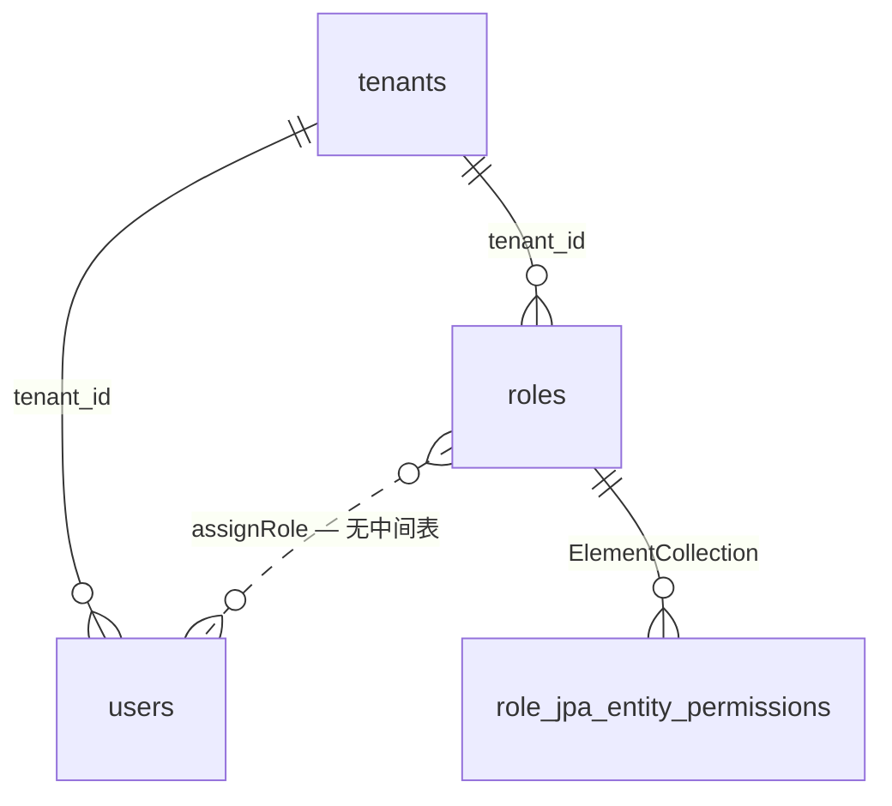
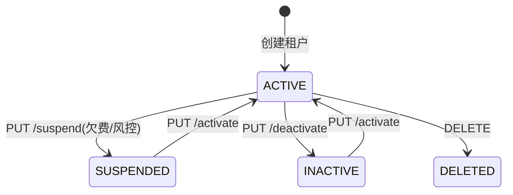
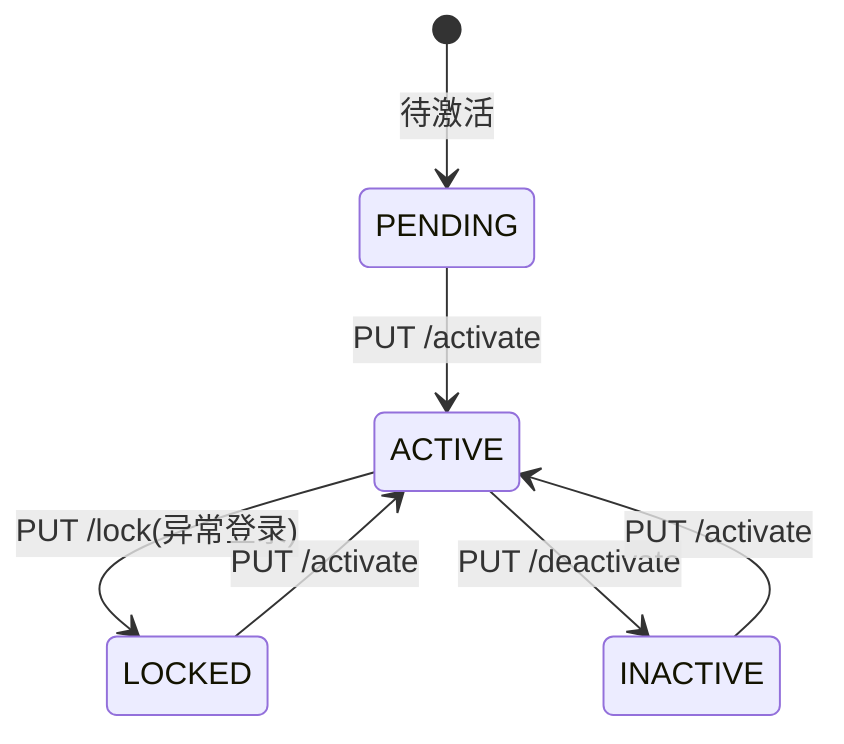
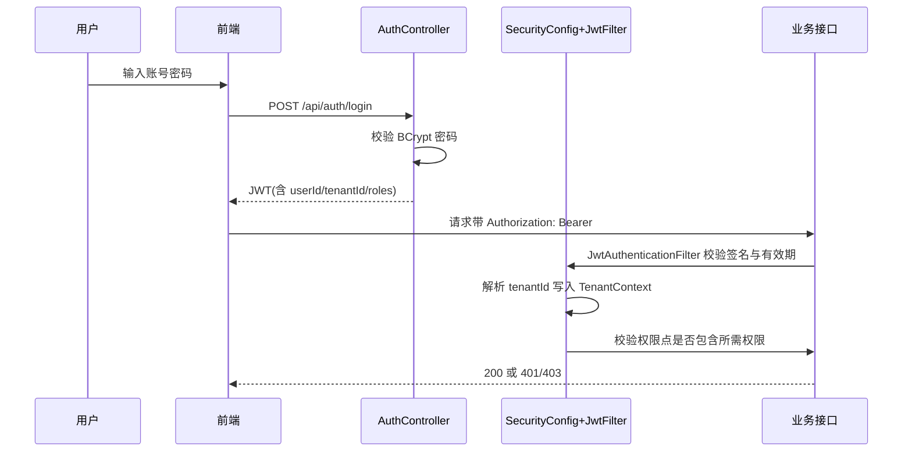

# 功能规格 · 多租户与权限（通用域）

| 项 | 内容 |
|---|---|
| 子域 | 通用域（Tenant Bounded Context） |
| 聚合根 | `Tenant` |
| 实体 | `User`、`Role` |
| 值对象 | `TenantStatus`、`UserStatus` |
| 领域服务 | `TenantService`、`UserService`、`RoleService`（实现放在应用层 `*ServiceImpl`）。 🔄 **2026-10-21 补两条本域新增的守卫服务**（原表未列，且它们才是登录链路的真正门）：`application/service/tenant/AccountLoginGuard.java:22`（账号态 + **所属租户态**双查，`:33-35`/`:48-62`，平台管理员例外 `:52-54`）、`application/service/tenant/LoginSecurityService.java:30`（登录失败限流，`:52-62`，窗口常量 `LOCK_WINDOW_MINUTES = 15` 在 `:35`，阈值取自系统配置） |
| 应用服务 | 🔄 **2026-10-21 补（原表未列）**：`application/service/config/SystemConfigApplicationService`（会话超时/锁定阈值等 12 项平台配置）、`application/service/audit/AuditApplicationService`（审计落库与查询） |
| 控制器 | 🔄 **2026-10-21 补（原表未列）**：`interfaces/controller/tenant/` 4 个（`AuthController` 4 端点、`TenantController` 9、`UserController` 11、`RoleController` 10）+ `interfaces/controller/audit/AuditLogController` 2 + `interfaces/controller/config/SystemConfigController` 2 = **38 端点**。守卫口径：`UserController:44` 与 `RoleController:42` 各 **1 处类级**（后者另加 2 处方法级 `hasRole('PLATFORM_ADMIN')` 锁住 `/system` 读写 `:75/:100`），`AuditLogController:31` 与 `SystemConfigController:30` 是**纯 `hasRole('PLATFORM_ADMIN')`、无 OR**（本仓唯二不给权限点通道的类级守卫），`TenantController` 0 处注解（由 `SecurityConfig.java:83` 的 URL 级规则把住），`AuthController` 0 处（`permitAll` + `authenticated()`） |
| 数据表 | ~~`tenants`、`users`、`roles`、`role_jpa_entity_permissions`~~ → 🔄 **2026-10-21 实测 7 张**：再加 `user_roles`（`UserJpaEntity` 的 `@CollectionTable`，当前 **5 行**）、`audit_logs`（**8181 行**，`tenant_id` 有复合索引 `idx_audit_logs_tenant_created`）、`system_configs`（主键就是业务键 `config_key`，12 行）。全库基线：**45 张表 / 25 张有 `tenant_id`** |
| 前端 | `frontend/user-web/src/pages/tenant/*`、`pages/user/*`；`frontend/admin-web/src/pages/{platform,tenant,user}/*`——🔄 2026-10-21 实测 admin-web **6 个页面**：`Login.jsx`、`platform/{PlatformDashboard,AuditLogList,SystemConfig}.jsx`、`tenant/TenantList.jsx`、`user/UserList.jsx`（**`AuditLogList` 与 `SystemConfig` 原表未列**）；user-web 侧 `tenant/`3 + `user/`3 + `role/RoleList.jsx` |

---

## 1. 模块定位

多租户决定了这套系统能否作为 **SaaS 售卖**。它解决三件事：

1. **开户**：创建一个租户（客户公司）+ 管理员账号；
2. **授权**：角色与权限点，控制成员能做什么；
3. **隔离**：同一套库里，A 公司永远看不到 B 公司的数据。

> 🔴 **结论先行**：~~目前 1、2 的 CRUD 与页面已端到端打通（全系统唯一完整链路），但**第 3 点（隔离）与安全校验基本没有生效**——这是上线前的 P0 阻断项。~~
> 🔄 **2026-10-21 复测改判**：这句话是本文件的**骨架期口径**，除"读路径"一支外全部作废，引用前请先看 §4/§5/§9 的 dated 订正。现状：
> - **"安全校验基本没有生效"已不成立**：authorities 由每次请求**回库重建**（`JwtAuthenticationFilter:64-90`，不再是"空列表"），401/403 都走 `Result` 信封（`SecurityConfig:89-96`），全仓 **130 处真实 `@PreAuthorize`**（22 个控制器，口径见 [../security-findings.md M-06](../security-findings.md)），登录有失败限流、签发/续期都过账号+租户双态门。
> - **"隔离"仍是一半**：写路径由 `TenantIsolationAspect:77-130` 挡，按 id 直读/直写由 `TenantAccessGuard` 逐聚合挡，**仓储层切面至今只打 trace**（`beforeRepositoryMethod:157-162`，注释原文"数据隔离由服务层参数校验保障"）⇒ 隔离是**应用层代码纪律**，不是框架保证；新写一个不经 `TenantAccessGuard` 的读方法，没有任何东西会拦（**ISS-050 的残留形态**）。
> - 上线前 P0 阻断项已换成：`../security-findings.md` 的 **M-11/M-12**（两条跨租户数据外泄/越权写，本轮新登记）与本文件 §9 的读路径条目。详见 [`../qa/known-issues.md`](../qa/known-issues.md)。

---

## 2. 概念模型

| 概念 | 说明 | 缺口 |
|---|---|---|
| 租户 | 客户组织 | ~~业务表无 `tenant_id`，无法物理隔离~~ → **2026-01-25 复测：列已经在了**，~~运行时 **23/42 张表有 `tenant_id`**、其中 **17 张建了索引**（`financial_transactions` / `platform_integrations` / `purchase_orders` / `roles` / `users` / `warehouses` 这 6 张有列无索引~~ → 🔄 **2026-10-21 按 `information_schema` 复测：全库 45 张基表，25 张有 `tenant_id`、其中 20 张有索引**，"有列无索引"缩到 **5 张**：`financial_transactions`、`platform_integrations`、`roles`、`users`、`warehouses`（`purchase_orders` 本轮已有 `idx_purchase_orders_tenant`，从旧名单里出去）；无列的 20 张 = 10 张子表（`order_items`/`skus`/`inventory_records`/`locations`/`logistics_channels`/`logistics_fees`/`logistics_labels`/`payment_infos`/`shipping_addresses`/`purchase_order_items`）+ 6 张 `*_import_job_errors` + `user_roles`/`role_jpa_entity_permissions` 两张集合表 + `tenants` 自身 + **`system_configs`（平台级，本就不该有）**。见 [`../db/data-dictionary.md`](../db/data-dictionary.md) R-06/R-07。 ❌ 残留的仍是**行为**而非列：写路径由 `TenantIsolationAspect.java:77-130`（~~`:55-86`~~ 现行）校验、`:127` 抛 `TENANT_ACCESS_DENIED`，**读路径仓储层不过滤**（`beforeRepositoryMethod:157-162` 仅 trace，注释原话"数据隔离由服务层参数校验保障"）⇒ **ISS-050**；~~租户值仍来自客户端入参（**ISS-051**）~~ → 🔄 已收口：入参在切面与服务层都先过 `TenantContext.normalizeRequested`（切面 `:101`），缺省回落 JWT 上下文（`resolveTenant` 三级回落，见 [finance.md §5](finance.md)），平台管理员跨租户**写**还要过 `TenantAccessGuard.requireExistingTenant`（切面 `:113-121`，ISS-135 补的幻影桶门） |
| 用户 | 登录账号 | `username`/`email` 是**全局唯一**，跨租户同名会被拒（语义冲突，R-07） |
| 角色 | 权限集合 | ~~无 `user_roles` 关联表，用户↔角色关系无三星表持久化~~ → **复测：表已存在**。`user_roles(user_id, role_id)` 复合主键，由 `UserJpaEntity.java:64-66` 的 `@ElementCollection` + 显式 `@CollectionTable(name = "user_roles")` 生成。 ⚠️ 实测 DDL 只有 1 条外键 `user_id → users.id`（活库 `FKhfh9dx7w3ubf1co1vdev94g3f`），**`role_id` 上没有指向 `roles` 的外键** ⇒ 关联可悬空（🔄 2026-10-21 实测：表 **5 行**，`LEFT JOIN roles` 全部命中、**当前 0 悬空**，但这是数据现状不是约束；另一侧 `role_jpa_entity_permissions`（`RoleJpaEntity.java:39` 未标 `@CollectionTable`）仍是隐式命名（ADR-0010 建议第 5 条只修了一半））。 🔄 本轮补两条：① `roles` 表**只有 `PRIMARY(id)`，角色名没有任何唯一约束** ⇒ 同名角色可重复建；② 现存 4 个角色里有一个业务侧手建的 `test`，它经 `user_roles` 挂在真实账号上（**5 行**的组成：3×`TENANT_ADMIN` + 1×`PLATFORM_ADMIN` + 1×`test`），冒烟脚本按角色名断言时要把它算进基数 |
| 权限点 | 最小授权单位 | 自由字符串，**无字典、未与菜单/路由绑定** —— 后端侧仍成立（无字典表、`POST /api/roles/{id}/permissions` 无校验）。 🔎 ~~**2026-01-25 补测**：前端有一份硬编码 `PERMISSION_PRESETS`（`user-web/src/pages/role/RoleList.jsx:12-33`，**21 项**），与库里的 **22** 个权限点不等价：**缺 `finance:import`**~~ → 🔄 **2026-10-21 复测：两侧已等值**——`PERMISSION_PRESETS` 现为 **26 项**（`RoleList.jsx:12-39`，`finance:import` 在 `:30`），与 `PermissionPoints` 目录（`:40-50` 的 25 租户级 + `:57-59` 的 1 平台级 = **26**）、活库 `role_jpa_entity_permissions` 的 `COUNT(DISTINCT permission)` = **26** 三处对齐；`Select mode="multiple"`（现 `:276`）仍**无法录入预设外的新点**（已知边界，由 R-22 守卫测试兜"三处漏改"）。~~菜单/路由绑定依然没有（`AuthContext.hasPermission` 调用点 0）~~ → 已被下面的 ISS-112 订正超越（`hasPermission` 现有真实消费方 `can()`）。 ✅ **2026-10-09 订正（见 [known-issues.md §12 ISS-112](../qa/known-issues.md)）**：前端 `PERMISSION_PRESETS` 已补齐到 **26 项**并与后端目录逐项等值；菜单/路由/按钮三层都改为按权限点收敛（`AuthContext.can()` `:137-140` → `hasPermission()` `:128`、`PermissionGuard`、`Can.jsx`）——🔄 2026-10-21 复核：`routes.jsx` 里 **23 处** `PermissionGuard permission="…"` 组路由，`user:manage`/`role:manage`/`platform:manage` 都在其中（`:162/:167/:172`）。仍成立的部分：后端确实没有字典表，`POST /api/roles/{id}/permissions`（`RoleController:148`）仍不校验点名的合法性（口径 R-22 用守卫测试兜"三处漏改"，而不是加字典表） |

---

## 3. 状态机

### 3.1 租户状态

### 3.2 用户状态

| 对象 | 取值 |
|---|---|
| `TenantStatus` | `ACTIVE` / `INACTIVE` / `SUSPENDED` / `DELETED` |
| `UserStatus` | `ACTIVE` / `INACTIVE` / `LOCKED` / `PENDING` |

> ⚠️ `tenants.status` 与 `users.status` 是普通 `VARCHAR`，没有 `@Enumerated` 映射，写入什么由应用层字符串决定——**枚举约束实际不存在**（数据字典 R-06）。
> 🔄 **2026-10-21 按活码补三条状态机实况**（两张图都是"目标态图"，不是实现图）：
> 1. **落库就是裸 `varchar(255)`**（`TenantJpaEntity:38-39`、`UserJpaEntity:52-53` 两侧都声明成 `private String status`），活库列型 `varchar(255)` 一致 ⇒ 写 `'ACTIVE '`／`'active'` 没人管，而 `AccountLoginGuard:60` 判的是 `== TenantStatus.ACTIVE`，字符串大小写不匹配就等于**把正常租户挡在登录门外**。
> 2. **`ACTIVE --> DELETED: DELETE` 这条边没有实现**：全仓 `TenantStatus.DELETED` **零引用**（只有枚举声明，`grep -rn "TenantStatus.DELETED\|\"DELETED\"" domain application` 无命中）。`DELETE /api/tenants/{id}`（`TenantController:139`）→ `TenantServiceImpl.deleteTenant:121` 走的是**物理删行**，且删前有两道拒绝门：①该租户下仍有平台管理员 ⇒ 拒（`:124-129`，防止删掉唯一能恢复现场的账号）；②仍有业务数据 ⇒ 拒（`:132-136`，因为业务表 `tenant_id` 没有指向 `tenants` 的外键、不会级联）；过门后身份数据（账号/角色/权限）随租户一起清理（`:139-`）。⇒ 图上这个态**永远不会出现在数据里**，删除失败的正确终态是"什么都没发生"。
> 3. **`[*] --> PENDING: 待激活` 也没有生产者**：`UserStatus.PENDING` 只在 `UserStatus.java:12` 声明，`domain/tenant/` 与 `application/service/tenant/` 全域**零处赋值** ⇒ 新建账号要么直接 `ACTIVE` 要么由初始化决定，"待激活"这条起始态当前不可达。
> ⚠️ 结论：这两张图**不能用来判断"某个态能不能进/能不能出"**，判断要看 §5 的 `AccountLoginGuard`（可用性只有 `ACTIVE` 一个合法态）与 §6 的状态端点清单。

---

## 4. 业务规则

| 编号 | 规则 | 状态 | 说明 |
|---|---|---|---|
| BR-01 | 租户名称、联系邮箱唯一 | ✅ | ~~列上有唯一约束~~ → 🔄 **2026-10-21 活库索引复取**：`tenants` 确有两条单列唯一索引 `UK4moql6miwoh3w0drxa2gmjbll(name)`、`UKh8eolq2o5fmgxjfnvbq1s2awt(contact_email)` ⇒ 本条成立。**同一轮的反例**：`roles` 表**只有 `PRIMARY(id)`，角色名没有唯一约束**，`users` 的两条唯一是全局单列（BR-09）⇒ "唯一约束"只覆盖租户这一张表 |
| BR-02 | 密码必须使用 BCrypt 存储 | ✅ | `BCryptPasswordEncoder`。🔄 2026-10-21 补一句边界：BCrypt 只管**存储**，**强度**由另一条门管（BR-13），两者都是 `application/service/config/SystemConfigApplicationService.requireAcceptablePassword:90-100`（空/不足 8 位抛 `ValidationException`） |
| BR-03 | 系统启动时创建默认租户与管理员账号 | ✅ | `DataInitializationConfig`。~~默认 `admin` / `123456`（⚠️ 弱口令，仅允许用于本地）~~ → 🔄 **2026-10-21 复测：口令已可注入，但缺省仍是 123456**——`:51` 是 `@Value("${app.seed.default-tenant-admin-password:123456}")`，`:226` 启动日志把口令来源打印出来并提示"生产环境请立即改密"。⚠️ 也就是说 §9 的「默认弱口令」条目只完成了**一半**（有了注入口，没关掉缺省）。另有幂等修复块 `:262-281` 保证 `admin` 一定持有 `PLATFORM_ADMIN`（ISS-061，就是 §4 BR-04 里 `user_roles` 那行的来源） |
| BR-04 | 用户可以拥有多个角色 | 🟡 | ~~API 支持，但无 `user_roles` 表~~ → **2026-01-25 实测：`user_roles` 表已存在**（`UserJpaEntity.roleIds` 的 `@CollectionTable`），~~当前有 2 行~~ → 🔄 2026-10-21 复测 **5 行**（3×`TENANT_ADMIN`、1×`PLATFORM_ADMIN`、1×手建的 `test`；后者由 `POST /api/users/{id}/roles`（`UserController:191`）写入，说明"任意角色可挂任意账号"这条写口是活的）。语义仍是「只存 id 字符串、`role_id` 无外键到 `roles`」，故保留 🟡 |
| BR-05 | 角色可包含多个权限点 | 🟡 | `@ElementCollection`，但权限点为自由字符串。🔄 2026-10-21 复测：活库 `role_jpa_entity_permissions` 的 `COUNT(DISTINCT permission)` = **26**，与 `PermissionPoints` 目录等值 ⇒ "自由字符串"仍然是真的（`POST /api/roles/{id}/permissions` `RoleController:148` 不校验取值），但**当前数据里没有孤儿点** |
| BR-06 | **所有业务数据必须按 tenant_id 隔离** | ❌ | ~~仅 2 张表（`users`/`roles`）有 `tenant_id`，其余 19 张无（R-07）~~ → **2026-01-25 实测：42 张表里 23 张有 `tenant_id` / 19 张没有**；🔄 **2026-10-21 复测：45 张里 25 张有（20 张已建索引）**；且「有列」≠「隔离生效」——写路径已由切面校验（`TenantIsolationAspect:77-130`），**读路径（仓储层）不带租户条件**（`beforeRepositoryMethod:157-162` 仅 trace，**ISS-050**）。⚠️ 本轮补一条更准的定性：读路径**不是完全没防**——按 id 直读走 `TenantAccessGuard.requireOwned`、缺省 tenantId 的列表走 `scopedTenantId`，这是**逐聚合手工接线**；新写一个绕过这两者的查询方法不会有任何机制拦截 ⇒ 隔离强度＝代码纪律，不是框架保证 |
| BR-07 | 请求必须携带有效的租户上下文，缺失即拒绝 | 🟡 | ~~`TenantIsolationAspect` 校验被注释~~ → **已生效**（~~`TenantIsolationAspect.java:55-86`~~ 现行 `:77-130`，不一致抛 `TENANT_ACCESS_DENIED`（~~`:83`~~ 现行 `:127`））；但「缺失即拒绝」不成立：入参没有 `tenantId` 时切面直接放行（~~`:57-60`~~ 现行 `:78-81`，注释写明"交由认证与业务层处理"），`admin` 亦放行（~~`:63-65`~~ 现行 `:113-121`）⇒ 仍不满足本条原文。 🔄 **2026-10-21 补：平台管理员的"放行"现在是有条件的**——跨租户**写**必须 `TenantAccessGuard.requireExistingTenant` 通过（切面 `:114-119`，ISS-135 起因是 `POST /api/platform-integrations` 带随机 UUID 返回 200 并行落库）；读写意图由**当前请求动词**判定（`isReadRequest:144-152`，GET/HEAD/OPTIONS 算读，**无请求上下文按写处理**）。⇒ "缺失即拒绝"仍 ⚪，但"点名不存在的租户"这一支已关 |
| BR-08 | JWT 必须被正确签名校验并过期失效 | 🟡 | ~~`validateToken()` 恒 `true`~~ → **已改为 `parseClaims(token) != null`**（~~`JwtTokenProvider.java:189-191`~~ 现行 `:204-205`，空串先拒 `:212-213`，解析体 `:211-230`）。残余：~~无显式 `clockSkew` 配置，且 `Result` 层不区分「过期」与「坏签名」~~ → 🔄 2026-10-21 复测：`clockSkew` 仍未配置（`grep clockSkew` 无命中）；**有效期已改成配置驱动**——访问令牌 TTL 取 `security.sessionTimeout`（`AuthController:185` → `SystemConfigApplicationService`），刷新令牌仍是 `jwt.refresh.expiration` 缺省 7 天（`JwtTokenProvider:45`）。⚠️ 本条**不含撤销**：JWT 无状态、无黑名单，"过期失效"之外的失效手段只有下面 BR-14 的每请求回库 |
| BR-09 | 用户名应在**租户内**唯一而非全局唯一 | ❌ | 当前全局唯一（R-07）。 🔎 **2026-01-25 直接查库确认**：`SHOW INDEX FROM users` 只有两条唯一索引（`username`、`email`），**均为单列、不含 `tenant_id`** → 「唯一键已改租户内」的说法不成立，[tech/security-design.md §4](../tech/security-design.md) 步骤 1 里那句「唯一键从全局改租户内」是**待办步骤**而非现状。 🔄 **2026-10-21 索引名复取**（便于巡检直接比对）：`UKr43af9ap4edm43mmtq01oddj6(username)`、`UK6dotkott2kjsp8vw4d0m25fb7(email)`，`roles` 无任何唯一索引；活库现 4 个账号 / 4 个角色 / 2 个租户，冲突面还没被业务量放大，**改约束的成本窗口仍然开着**（与 [finance.md §8](finance.md)、[warehouse.md §9 第 5 条](warehouse.md) 同性质） |
| BR-10 | 停用租户后其成员立即无法登录 | ~~⚪ 未实现联动~~ → ✅ **2026-10-21 登记（本轮实测到代码，尚未跑真 HTTP）** | ~~未实现联动~~ → 两道门都在：①**登录/续期**共用 `AccountLoginGuard.isUsable:33-35`（账号态 **且** 所属租户态必须 `ACTIVE`，`:59-61` 回库查 `tenants`；租户被删则 `findById` 空 ⇒ 同样拒），文案由 `describeBlocker:76-89` 区分"账号被停"与"租户被停"；②**每个请求**再过一次——`JwtAuthenticationFilter:64-69` 用 `findByUsername` 回库装载，非 `ACTIVE` 直接降级为匿名（注释原话"签名有效但账号已删除/停用/锁定的一律降级为匿名"）。⚠️ 三点边界：平台管理员**例外**（`AccountLoginGuard:52-54`，防止把运营方锁在门外）；**已签发令牌本身仍不撤销**（无黑名单，靠过滤器回库兜住，所以这条对"停用"有效、对"只想吊销某个令牌"无效）；`/auth/refresh` 也过这道门（`AuthController:140`），续期不能绕过。⇒ 判 ✅ 的依据是代码路径闭合，浏览器/HTTP 层的复跑证据仍缺（列入 §9 待办与 [../qa/known-issues.md](../qa/known-issues.md) 开放缺口） |
| BR-11 | 菜单与路由应按角色动态渲染 | 🟢 | ~~前端菜单是静态数组，角色校验被注释~~ → **2026-01-25 实测已实现（ISS-035）**：`AuthGuard.jsx:34` 做 `requiredRoles` 判角色、`:35-43` 命中失败渲染 403 `Result`；`PlatformAdminGuard:51-53` 要求 `PLATFORM_ADMIN`、`TenantAdminGuard:58-60` 要求 `TENANT_ADMIN`/`PLATFORM_ADMIN`，三种守卫**不再等同**；侧边栏已按角色过滤（`Layout.jsx:30` 取 `hasRole`、`:181` 用 `hasRole('PLATFORM_ADMIN')` 条件拼接菜单项、`:212` 展示角色名）。 ❌ ~~残余三处，所以本条只能算 🟡~~：① ~~`/tenants`、`/users`、`/roles` 三组管理页仍挂在裸 `AuthGuard`~~；② ~~`TenantAdminGuard` 组内一条路由都没有~~；③ ~~守卫判的是角色名，权限点级控制不存在~~。 ✅ **2026-10-09 三处残余全部收口（ISS-112/035）**：① `/users`、`/roles`、`/tenants` 已分别挂到 `PermissionGuard(user:manage / role:manage)` 与 `PlatformAdminGuard`；② `TenantAdminGuard` 的空壳组已删除（R-26），组件仍导出备用；③ 权限点级控制落地——`AuthContext.can()` 有真实消费方（菜单/路由/按钮三层），浏览器三身份实测 64/64 断言。 🔄 **2026-10-21 按活码复测，三条全部成立**：`routes.jsx` 现 **23 处** `PermissionGuard permission="…"`（`user:manage :167`、`role:manage :172`、`platform:manage :162`，覆盖 order/customer/logistics/product/warehouse/shop/purchase/finance 全模块）；`TenantAdminGuard` 只在 `AuthGuard.jsx:86` 导出、`routes.jsx:6` **已不 import**（备用组件属实）；`AuthContext.jsx` 的 `can:137-140` → `hasPermission:128` 有真实调用链 ⇒ 状态由 🟡 改判 🟢。⚠️ 仍要说明的是**层级**：前端渲染门 ≠ 授权门，真正的门是后端 130 处 `@PreAuthorize`；删掉前端一处 `PermissionGuard` 不会导致越权，只会导致"能进页面、接口 403" |
| BR-12 | 敏感操作需留审计日志 | ~~⚪ 无审计能力~~ → ✅ **2026-10-21 登记（本文件此前整条作废）** | ~~无审计能力~~ → 能力已完整落地且**在跑**：`@Auditable` **118 处 / 22 个文件**（`grep -rc '@Auditable'`），切面 `infrastructure/audit/AuditAspect.java:57`（`@Around("@annotation(auditable)")`，成功与失败都记：`describe(Throwable):270`、`describeBusinessFailure(returned):285`、`describePartialBatch(data):320`），落库 `AuditLogJpaEntity` 14 列（`tenant_id/actor_id/actor_name/action/action_label/target_type/target_id/detail/result/error_message/ip/trace_id/created_at`），活库 `audit_logs` 实测 **8181 行**、两个索引 `idx_audit_logs_tenant_created(tenant_id,created_at)` + `idx_audit_logs_actor_result_created(actor_name,result,created_at)`。读侧：`GET /api/audit-logs`（分页，`AuditLogController:45`）与 `GET /recent`（上限 50，`:60`），类级 `hasRole('PLATFORM_ADMIN')` `:31`（**无权限点 OR**）；前端 `admin-web/src/pages/platform/AuditLogList.jsx`。 ⚠️ 三条必须知道的口径：①**审计只覆盖挂了注解的端点**，本域 `TenantController` 7 处 / `UserController` 9 处 / `RoleController` 7 处 / `AuthController` 1 处（`logout`），其余靠各控制器自行挂；②**`trace_id` 有真实生产者**（`infrastructure/logging/ApiLoggingFilter.java:103` 每请求生成 8 位 UUID 进 MDC，`AuditRequestContext:79-80` 取出、`AuditAspect:65/:102` 落列），但 **`Result` 信封仍然只有 `code/message/data` 三字段**（`interfaces/common/Result.java:18-28`）⇒ 客户端出错时拿不到 traceId，"把用户报障对到一条审计/日志"这件事只有服务端单方面能做（这一条是 [../security-findings.md L-03](../security-findings.md) 的真残留）；③审计查询的 `tenantId` 是**可选参数**（"平台管理员留空表示全平台"），租户管理员看不到别人的记录靠的是控制器不暴露租户选择，不是 SQL 谓词 |
| BR-13 | 口令强度、会话时长、登录锁定应为**可配置**的平台参数 | ✅ **2026-10-21 登记（原表无此条）** | 参数目录 `domain/config/PlatformConfigKey.java:20-33` **12 项**（general 4 / email 4 / security 4），存储 `system_configs`（主键即业务键 `config_key`，活库 12 行），读写口 `GET /api/system-config` 与 `PUT /api/system-config`（`SystemConfigController:47/:56`，类级 `hasRole('PLATFORM_ADMIN')` `:30`，写侧留痕 `:57`）。**已接线的三项**：`security.sessionTimeout` → 访问令牌 TTL（`AuthController:185`）；`security.maxLoginAttempts` → 登录失败阈值（`LoginSecurityService:53`）；`security.passwordPolicyEnabled` → 口令至少 8 位（`SystemConfigApplicationService:90-100`，4 个写点调用：`TenantController:49/:157`、`UserController:70/:134`）。⚠️ **未接线的三项要写明，否则界面会给出错误的可用性暗示**：`email.*` 四项没有任何发信实现（`grep SMTP_HOST` 只命中配置的读写两侧）；`security.twoFactorAuthRequired` 不仅无消费者，保存时还被**硬写回 `"false"`**（`SystemConfigApplicationService:174`）⇒ 界面上勾了也不生效；`general.contactEmail/Phone` 仅展示 |
| BR-14 | 登录失败应限流，防止口令爆破 | ✅ **2026-10-21 登记（原表无此条）** | `LoginSecurityService.assertLoginAllowed:52-62`：15 分钟窗口内失败次数 ≥ `security.maxLoginAttempts`（缺省 5）⇒ 抛 `BusinessException("登录失败次数过多，请在 15 分钟后重试", "TOO_MANY_LOGIN_ATTEMPTS")`；阈值 `<= 0` 即关闭锁定（`:54-57`）。窗口计数复用 **审计表**（`countRecentFailures:67-75` 从上一次成功时间起算，动作集 `AuditActions.AUTH_FAILURE_ACTIONS`），成功/失败与刷新尝试都落审计（`recordLoginAttempt:81`、`recordRefreshAttempt:85`）。⚠️ 两条边界：计数键是**用户名**而非"用户名 + 来源 IP"，所以它挡不住对某用户名慢速定向爆破之外的分布式尝试；"锁定"是窗口内的软计数，**不改 `users.status`**（与 §3.2 的 `LOCKED` 态无关，`PUT /api/users/{id}/lock` `UserController:167` 是另一条人工口） |
| BR-15 | 请求/响应日志应带 traceId 且对凭据打码 | ✅ **2026-10-21 登记（原表无此条，且它与 [../security-findings.md L-03](../security-findings.md) 的旧结论冲突）** | `infrastructure/logging/ApiLoggingFilter.java:60`（`OncePerRequestFilter`，`ORDER = -200` **早于 Spring Security 链**，注释原话"这样被安全层拦下的 401/403 响应也能记录下来" `:63-65`）：每请求生成 traceId 进 MDC（`:102-103`）、请求行/头/体与响应状态/体**合并成一条日志**（`logCombined`，finally 里保证异常路径也记）、响应体 `copyBodyToResponse()` 回写。打码：头部名单 `authorization/proxy-authorization/cookie/set-cookie/x-api-key`（`ApiLoggingFilter:77-78`），体内按 JSON 字段名正则命中，词表 7 项 `password / passwd / token / secret / api[_-]?key / access[_-]?key / credential`（`:83-85`，`Pattern.CASE_INSENSITIVE`），`maxBodyLength` 缺省 4096（`ApiLoggingProperties:36`）。开关与粒度在 yml：`logging.level.…infrastructure.logging: DEBUG`（`application.yml:112`，"改成 INFO 或以上即可静音"）、console pattern 带 `%X{traceId:-}`（`:108`）。⚠️ **两条残留风险要一起登记**：① `ApiLoggingProperties.enabled` 缺省 **`true`** 且 `includeHeaders` 缺省 `true`（`:26/:31`，类注释自己写了"生产环境建议 `enabled: false`"）⇒ 生产按现配置会把**请求/响应体全量落日志**（凭据已打码，业务数据没有）；② 仍**没有文件 appender**（`src/main/resources` 只有 `application.yml`，无 `logback-*.xml`）⇒ 日志随进程 stdout 走，与 L-03 的"不可追溯"这一半仍然成立 |

---

## 5. 认证与鉴权流程（目标态）

**当前实际行为**

| 环节 | 现状 |
|---|---|
| 登录签发 Token | ✅ 正常。🔄 **2026-10-21 补链路上的四道门**（`POST /api/auth/login` 现行 `AuthController:67`，~~`:53`~~）：①`LoginSecurityService.assertLoginAllowed` 失败限流 → ②`CustomUserDetailsService` 认证 → ③`AccountLoginGuard.isUsable`（账号态 + 租户态）→ ④令牌 TTL 取 `security.sessionTimeout`（`:185`）。失败与成功都写审计（`recordLoginAttempt`），令牌带 `roles`/`permissions` 两个 claim（`JwtTokenProvider:107-108`） |
| Token 签名校验 | ~~❌ `validateToken()` 恒返回 `true`，任意非空 Bearer 串均可通过~~ → ✅ **已修（ISS-007）**：`validateToken` = `parseClaims(token) != null`（~~`JwtTokenProvider.java:189-191`~~ 现行 `:204-205`），~~`:201-205`~~ 现行 `:211-230` 真验签 + 过期，空串先拒（~~`:197`~~ 现行 `:212-213`）。~~⚠️ 非法令牌的响应是 **403 + 0 字节 body**，401 不可达（`SecurityConfig` 无 `exceptionHandling()`，**ISS-032/058**）~~ → 🔄 **2026-10-21 复测：这一句已作废（ISS-098 修的就是它）**——`SecurityConfig:89-96` 已装 `exceptionHandling()`，未认证 **401 `UNAUTHORIZED` + `Result` 信封**（`:90-92`）、越权 **403 `ACCESS_DENIED`**（`:93-95`），前端 `api.js:112-115` 的 401→`/login` 分支因此**可达**。 ⚠️ 本轮的**同族新破口**在业务侧不在安全侧：`FinanceController` 9 个端点里 8 个用本地 `catch (Exception)` 把领域异常压成 HTTP 200（[finance.md §8](finance.md)、[../security-findings.md M-08](../security-findings.md)）⇒ 引用"401/403 已正确"时不要顺手把 4xx 语义整体判绿 |
| 用户名/租户解析 | ~~❌ `getUsernameFromToken()` 返回 `""`，`getTenantIdFromToken()` 返回 `"default-tenant"`~~ → ✅ **已修（ISS-008）**：两者从 claim 读取（~~`:141-144`~~ 现行 `getUsernameFromToken:145-147`、`getTenantIdFromToken:156-158`），解析失败返回 `null`；`Bearer ` 前缀由过滤器剥离（~~`JwtAuthenticationFilter.java:88-89`~~ 现行 `:116`）。⚠️ `"default-tenant"` 作为**兜底**仍散落在服务层与消费者里（~~全仓 **17** 处字面量：interfaces 2 / application 10 / domain 1 / infrastructure 4~~ → 🔄 **2026-10-21 复测 18 处 / 18 个文件**：`application/service` 12、`interfaces` 2（controller + dto）、`domain/finance` 1、`infrastructure` 3（messaging / persistence / security）⇒ 数量没降，只是分布从"10 处应用层"变成 12；治理口径仍见 [adr/0010 后果 6](../adr/0010-mapstruct-domain-jpa-bridge.md)） |
| 生成权限（authorities） | ~~❌ 空列表 → `ROLE_PLATFORM_ADMIN` 规则永远不满足~~ → ✅ **已修（ISS-009/041）**🔄 **2026-10-21 复测：实现方式与这句旧描述不同，判绿理由要换**——~~登录写入 `roles`/`permissions` 两个 claim（`JwtAuthenticationFilter.java:46-47`），过滤器把角色加 `ROLE_` 前缀还原为 authorities（`:54-60`）~~ → **authorities 不读 claim**：过滤器每个请求 `userRepository.findByUsername` 回库装载（`JwtAuthenticationFilter:64-69`，注释原话"签名有效但账号已删除/停用/锁定的一律降级为匿名"），账号 `ACTIVE` 才继续，然后遍历 `user.getRoles()` 现场拼：角色名补 `ROLE_` 前缀（`:84-85`）、该角色的权限点原样加入（`:86-90`），`LinkedHashSet` 去重后成 authorities（`:92-95`）。⇒ 这**比旧写法更强**：改角色/收权限**即时生效**，不等令牌过期（BR-14 与 §5 的每请求回库是同一件事）。⇒ claim 里的 `roles`/`permissions`（`JwtTokenProvider:107-108`）现在只是冗余信息（给 `/auth/me` 与排查用），**鉴权不依赖它**；今后引用"权限写在令牌里"必须以本条为准，否则会把"吊销令牌"误当成可用的处置手段。 ⚠️ 残留口径更新：catalog 现为 **26** 个权限点（2026-10-07 实测 `admin` JWT 带 26 条；ADR-0013 的 `shop:*` 四点已计入），其中被 `hasAuthority()` 字面量引用的 ~~**15** 个（`grep -o "hasAuthority('…')" src/main/java \| sort -u` 实测，本轮新增 `shop:read`/`shop:write`/`shop:credential_write`；`shop:sync` 尚无消费方，等 §6 步骤 5 的外呼端点）~~ → 🔄 **2026-10-21 复测：26 个字面量、与 catalog 完全等值**（`grep -rho "hasAuthority('[a-z:_]*')" backend/src/main/java \| sort -u` = **26 行**，逐条比 `PermissionPoints` 无差集；`shop:sync` 的消费方就是下面 ISS-112 那条 `ShopWarehouseController`）⇒ "种了没人查"的差集这一维度**已归零**，判据请改用行号而不是差集描述；~~其余 11 点配了也不起作用。~~注解仍是 `hasRole('PLATFORM_ADMIN') **or** hasAuthority(...)` 的 OR 结构 ⇒ admin 绕过权限点（**2026-10-09 保留该结构并按 R-25 成文**：改成 AND 等于要求给平台管理员逐个配点，配错即自我锁死；因此"去掉某个点"的授权测试**必须用非平台管理员账号**跑）。 ✅ **2026-10-09 更新（ISS-112）**：目录 **26/26** 点有端点消费（`PermissionPointCoverageGuardTest` 守卫）；`shop:sync` 已接到 `POST /api/warehouses/shop/sync/{integrationId}`（`ShopWarehouseController:77`），不再存在"种上了但没人检查"的点。~~按钮级权限两端都没有（`Role.hasPermission` / `AuthContext.hasPermission` 调用点均为 0）~~ → 前端三处（菜单/路由/按钮）都改为消费权限点；后端领域层 `Role.hasPermission` 仍是 0 调用点（服务端只认 authorities），字段级权限未实现。另注意：**加权限点若点名不合 `Role.PERMISSION_PATTERN`（只许一个冒号），种子会整批静默回滚**——ISS-090。🔄 2026-10-21 把正则原文钉住（`Role.java:45`，校验点 `:147`）：`^[a-z][a-z0-9_]*:[a-z0-9_*-]+$` ⇒ **恰好一个冒号**（第二段不含 `:`），段内允许 `_`（所以 `shop:credential_write` 合法）、第二段还允许 `*` 与 `-`。⇒ 由此得出本条的精确边界：**格式有校验、成员没有**——`POST /api/roles/{id}/permissions`（`RoleController:148`）收 `order:whatever` 这种自造点照样通过，`PermissionPoints` 不是它的取值域 |
| 租户隔离切面 | ~~❌ 校验逻辑被注释，只打印日志~~ → ✅ **已生效**：~~`TenantIsolationAspect.java:55-86`~~ 现行 `:77-130` 对服务层方法做前置校验（切点 `serviceMethods:69-70`，打 `application.service..` 全部方法），不一致抛 `TENANT_ACCESS_DENIED`（~~`:83`~~ 现行 `:127`），`PLATFORM_ADMIN` 放行（现行为 `:113-121`，且**跨租户写**必须先过 `TenantAccessGuard.requireExistingTenant`，ISS-135 的幻影桶补丁）。 ❌ 残留：仓储层切面（~~`:91-97`~~ 现行 `beforeRepositoryMethod:157-162`，切点 `repositoryMethods:62-63` 打 `domain..*Repository.*`）**只打 trace**，注释原话「Repository层仅做调试追踪，不做过滤（数据隔离由服务层参数校验保障）」 ⇒ 读路径不隔离（**ISS-050**）；~~且租户仍由客户端传参（**ISS-051**）~~ → 🔄 **2026-10-21 复测：ISS-051 已收口**，入参先 `TenantContext.normalizeRequested`（`:101`），命中历史默认桶字面量按"未指定租户"处理并记 INFO（`:102-108`）。⚠️ 但本条真正的洞换了位置：**校验只在"方法签名里有名为 `tenantId` 的参数"时发生**（`:96-98` 不匹配就 `continue`），所以按 id 直读/直写、签名里没有 `tenantId` 的服务方法，切面一句都不问 ⇒ 那一支靠的是 `TenantAccessGuard.requireOwned` 逐聚合手工接线（切点 `:69-70` 的 `execution` 表达式是**结构性无保证**的：新加一个方法名不带 `tenantId` 的查询，没有任何机制提醒你补守卫）。 |
| CORS 允许来源 | ~~⚠️ 仅 `http://localhost:5173`，未包含 admin-web 的 5174~~ → ✅ 已含两端：~~`SecurityConfig.java:50`~~ → 🔄 2026-10-10 行号与值均更新为 `SecurityConfig.java:63` + `http://localhost:5110`/`http://localhost:5120`（旧 5173/5174 随固定端口作废）：~~`setAllowedOrigins(List.of("http://localhost:5173","http://localhost:5174"))`（`corsConfigurationSource()` 于 `:46-55`）~~ → 🔄 **2026-10-21 复测现值即 `setAllowedOrigins(List.of("http://localhost:5110", "http://localhost:5120"))`（`corsConfigurationSource()` 在 `:60-70`）**，上一句里那句 5173/5174 的源码引用是 2026-10-10 改判时没删干净的旧代码，现在两处都指向 5110/5120；仍是**硬编码白名单、无 profile 区分** ⇒ 生产换域名要改代码。⚠️ 新残留：两个 `vite.config.js` 都只有 `plugins: [react()]`（各自 `:6`）、**没有 dev proxy**，前端 baseURL 硬编码 `http://localhost:8082/api`（~~`user-web/src/services/api.js:6`~~ 现行 **`user-web:48`**，`admin-web/src/services/api.js:6` 同值）⇒ 换端口/换环境即断，见 [`../tech/frontend-architecture.md`](../tech/frontend-architecture.md) §8 |

---

## 6. 功能清单

| 功能 | 前端 | 后端 | 状态 |
|---|---|---|---|
| 登录 | `Login.jsx` 已联网 | `POST /api/auth/login` | 🟡 签发正常，~~校验失效~~ **校验已修**（真验签+过期）；~~残留：拒绝为 403 空 body、无 401 出口（ISS-032/058）~~ → 已修（ISS-098/111）：未认证 **401 `UNAUTHORIZED`**、越权 **403 `ACCESS_DENIED`**、停用/锁定 **401 `ACCOUNT_DISABLED`/`ACCOUNT_LOCKED`**，全部走 `Result` 信封（`SecurityConfig` 的 `exceptionHandling()`） |
| 刷新令牌 | ~~—~~ `authApi.refreshToken`（~~`services/api.js:86`~~ 现行 `user-web/src/services/api.js:141`）**存在但调用点 0** ⇒ 自动续期未接（🔄 2026-10-21 复测：`grep -rn "authApi\." frontend/user-web/src` 只有 `AuthContext.jsx:35` 的 `getMe`、`:106` 的 `logout`、`pages/auth/Login.jsx:18` 的 `login`，**`refreshToken` 仍 0 命中**；admin-web 侧同样没有） | ~~`POST /api/auth/refresh`（桩）~~ **`AuthController.java:121` 已实现**（~~`:95-101`~~ 现行 `:126-134` 空值/验签/主体名三重拒，~~`:108-127`~~ 现行 `:136-158` 回库重取角色与权限点、TTL 取 `security.sessionTimeout`） | 🟡 后端可用、前端未接；~~且 `:128` **原样回传同一个 refreshToken**（无轮换/无撤销表）~~ → 🔄 2026-10-21 复核**这条仍在**（`:162` 的 `new TokenResponse(newToken, refreshToken, …)` 回的就是入参那一个），⇒ 刷新令牌**既不换发也不撤销**，7 天有效期内泄露一次即长期有效；本轮补记两面：①续期链路**有**过 `AccountLoginGuard`（`:140-142`，注释点名"否则刷新令牌可以无限续期一个名义上已停用的会话"），②续期尝试**有**留痕（`recordRefreshAttempt` `:161/:165`） |
| 登出 | Header 按钮，另有 `AuthContext.logout`（`context/AuthContext.jsx:104-`，~~`:98-107`，`:100`~~ 现行 `:106` 真发请求、其后清本地会话） | ~~`POST /api/auth/logout`（桩）~~ **已实现** `AuthController.java:174-179`（~~`:136-139`~~；`@Auditable(AUTH_LOGOUT)` 在 `:175`，是 `AuthController` 唯一一处留痕） | 🟡 两端接通，但后端只做 `SecurityContextHolder.clearContext()`，**没有服务端撤销/黑名单** ⇒ 已签发的令牌在过期前仍然可用。⚠️ 2026-10-21 补一句**减轻项**：因为过滤器每请求回库（`JwtAuthenticationFilter:64-69`），"登出后令牌仍可用"的实际危害只剩"读到旧数据 + 占用配额"，**拿不到新权限**；但对**已删除账号之外**的场景（比如只是想要令牌失效）它确实不解决问题 |
| 当前用户信息（`GET /api/auth/me`） | `AuthContext.refreshProfile`（~~`:29-41`，`:31` 调用~~ 现行 `:33-`、调用点 `:35`；另有 `:66`/`:99` 两处再取） | `AuthController.java:206`（~~`:146`~~；`SecurityConfig.java:82` 要求 `authenticated()`，~~`:65`~~） | ✅ 2026-01-25 新增记录：未登录时抛 `BusinessException("未登录或会话已失效")`（~~`:151`~~ 现行 `:211` 附近）；🔄 2026-10-21 补返回体字段：`user.getStatus().name()` 也在响应里（`:237`），前端据此判停用/锁定 |
| 租户 CRUD + 状态变更 | `tenant/*` 三页已联网（user-web）+ `admin-web/src/pages/tenant/TenantList.jsx` | `/api/tenants/**`（9 端点：`GET /{id} :78`、`PUT /{id} :88`、`activate :105`、`suspend :116`、`deactivate :127`、`DELETE /{id} :138`、`POST /{id}/admin :154`，另有创建与列表） | 🟡 ~~隔离未生效~~ **写路径隔离已生效**（切面），读路径仓储层仍未过滤（**ISS-050**）；`/api/tenants/**` 需 `hasRole('PLATFORM_ADMIN')`（~~`SecurityConfig.java:66`~~ 现行 `:83`，**这是本仓唯一由 URL 规则而非注解把住的控制器**，`TenantController` 自身 0 处 `@PreAuthorize`）；🔄 2026-10-21 补：7 处 `@Auditable`，删除的两道拒绝门见 §3 第 2 条 |
| 租户管理员创建 | — | `POST /api/tenants/{id}/admin`（`TenantController:154`） | 🟡 走 `TenantServiceImpl#createTenantAdmin` 而非 `userService.createUser`（注释原话：否则建出来的账号 `roles` 为空、登录后处处 403）；口令先过 `requireAcceptablePassword`（`:157`） |
| 用户 CRUD + 状态/密码/角色 | `user/*` 三页已联网 | `/api/users/**`（11 端点，含 `GET /{id} :103`、`PUT /{id} :112`、`/password :130`、`/activate :143`、`/deactivate :155`、`/lock :167`、`DELETE /{id} :179`、`POST /{id}/roles :191`、`DELETE /{id}/roles/{roleId} :204`） | ~~`UserController.java:31` 有 `user:manage` 门（但 OR `hasRole('PLATFORM_ADMIN')`）~~ → 🔄 **2026-10-21 复测：门在 `:44`（类级，覆盖全 11 端点）**，仍是 `hasRole('PLATFORM_ADMIN') or hasAuthority('user:manage')` 的 OR；**9 处 `@Auditable`**；改密口 `:130` 前有 `requireAcceptablePassword`（`:134`）；`POST /{id}/roles` 是 §4 BR-04 里那个 `test` 角色的写入口 |
| 角色 CRUD + 权限分配 | ~~—~~ `role/RoleList.jsx`（单页内含权限分配弹窗，预设 `:12-39` **26 项**） | `/api/roles/**`（10 端点：`POST /system :76`、`GET /system :101`、`GET /{id} :111`、`PUT /{id} :120`、`DELETE /{id} :136`、`POST /{id}/permissions :148`、`DELETE /{id}/permissions/{permission} :160`、`PUT /{id}/permissions :172`） | ~~2026-10-07 实测：前端硬编码 **22** 个字面量，与库里旧 catalog 等价~~ → 🔄 **2026-10-21 复测：三方等值（前端 26 = catalog 26 = 活库 `COUNT(DISTINCT permission)` 26）**，`GET /api/permissions` 下发 catalog 这条建议（ADR-0013 §6 步骤 7）**仍未做**，所以"新增点必须三处同改"的约束还是靠守卫测试而不是接口；守卫：类级 `:42`（`role:manage`）+ **系统角色两条另加方法级 `hasRole('PLATFORM_ADMIN')`（`:75`/`:100`，不给权限点通道）**；`7 处 @Auditable`；权限点写口 `:148` 只过格式（`Role.PERMISSION_PATTERN` `:45`）不过成员 |
| 租户数据隔离 | — | 写路径 `TenantIsolationAspect`（~~`TenantIsolationAspect.java:55-86`~~ 现行 `:77-130`）；读路径仓储 advice（~~`:91-97`~~ 现行 `:157-162`） | 🟡 **半生效**：写路径校验 ✅，仓储读路径不过滤 ❌（**ISS-050**）；~~租户来自客户端传参（**ISS-051**）~~ → 已归一化（`:101`），残留见 §4 BR-06/BR-07 |
| 审计日志 | `admin-web/src/pages/platform/AuditLogList.jsx` | `/api/audit-logs`（2 端点：分页 `AuditLogController:45`、`/recent :60` 上限 50），类级 `hasRole('PLATFORM_ADMIN')` `:31`；写入侧 `@Auditable` **118 处 / 22 文件** + `AuditAspect:57` | ✅ **2026-10-21 登记（本表此前记 ⚪，整行作废）**：~~⚪ 无审计能力~~ → 活库 `audit_logs` **8181 行**在跑（详见 §4 BR-12） |
| 登录失败锁定 | — | `LoginSecurityService.assertLoginAllowed:52-62`，阈值取 `security.maxLoginAttempts`（缺省 5）、窗口 15 分钟（`:35`），失败原因码 `TOO_MANY_LOGIN_ATTEMPTS`；计数复用审计表（§4 BR-14） | ✅ **2026-10-21 登记（本表此前无此条）** |
| 平台系统配置（含会话超时、口令策略开关） | `admin-web/src/pages/platform/SystemConfig.jsx` | `GET /api/system-config`（`SystemConfigController:47`）/ `PUT :56`（留痕 `:57`），类级 `hasRole('PLATFORM_ADMIN')` `:30` | ✅ **2026-10-21 登记**：12 项参数、3 项已接线、3 项未接线（见 §4 BR-13） |
| 找回密码 / 邮箱验证 | — | — | ⚪ **2026-10-21 复测仍在**：`email.*` 四项配置有读有写但**没有任何发信实现**（`SMTP_HOST` 只命中配置的读写两侧），`general.siteName` 等也只是展示；双因素同样未接线且保存时被硬写 `"false"`（`SystemConfigApplicationService:174`）⇒ "配置界面存在 ≠ 功能存在" |

---

## 7. 接口对照

| 分组 | 端点数量 | base path | 备注 |
|---|---|---|---|
| 认证 | ~~3~~ **4** | `/api/auth` | ~~refresh / logout 是桩~~ 两者均已实现；2026-01-25 复测端点为 `login`(`:53`) / `refresh`(`:93`) / `logout`(`:136`) / `GET /me`(`:146`)，`me` 此前漏记；🔄 **2026-10-21 行号已漂移，现值：`login :67` / `refresh :121` / `logout :174` / `me :206`**（文件 `interfaces/controller/tenant/AuthController.java`） |
| 租户 | 9 | `/api/tenants` | ~~需 `ROLE_PLATFORM_ADMIN`（当前无法真正生效）~~ 需 `ROLE_PLATFORM_ADMIN`（~~`SecurityConfig.java:66`~~ 现行 `:83`）**现已真正生效**（authorities 由令牌还原 → 🔄 2026-10-21 更正：**由每请求回库还原**，`JwtAuthenticationFilter:64-90`，比"从令牌还原"更严） |
| 用户 | 11 | `/api/users` | 含改密、启停、锁定、分配角色、**`DELETE /{id}`**（`UserController:179`，旧行未列）；门在类级 `:44` |
| 角色 | 10 | `/api/roles` | 含系统角色、权限点增删与整体覆盖；`/system` 两条只认 `hasRole('PLATFORM_ADMIN')`（`:75`/`:100`） |
| 审计日志 | 2 | `/api/audit-logs` | 🔄 **2026-10-21 补（本表此前无此行）**：分页 `:45` + `/recent :60`（上限 50），类级 `:31` |
| 系统配置 | 2 | `/api/system-config` | 🔄 **2026-10-21 补**：`GET :47` / `PUT :56`（留痕 `:57`），类级 `:30` |
| **合计** | **38** | — | 🔄 本域实测 38 端点（4+9+11+10+2+2）；全仓基线仍是 24 控制器 / 214 端点，见 [api.md](../api/api.md) |

完整清单见 [`../api/README.md`](../api/README.md)。

---

## 8. 角色权限模型（建议的目标态）

| 角色 | 权限点建议（需先建立权限字典） |
|---|---|
| `PLATFORM_ADMIN` | 租户管理、系统配置、平台监控 |
| `TENANT_ADMIN` | 本租户全部业务功能、成员与角色管理 |
| `WAREHOUSE` | 仓储读写、物流读写、订单只读 |
| `OPERATOR` | 订单读写、产品读写、平台集成读写 |
| `BUYER` | 采购读写、仓储只读 |
| `FINANCE` | 财务读写、订单只读、采购只读 |
| `CS` | 客户读写、订单与物流只读 |

**落地步骤**：~~① 定义权限点字典（建议用 `资源:操作` 命名，如 `order:read`）→ ② 前端菜单绑定权限点 → ③ 后端接口加 `@PreAuthorize` → ④ 路由守卫做二次校验。~~

🔄 **2026-10-21 进度**：① 以代码常量 `PermissionPoints` 为单一事实源（`TENANT_SCOPED_PERMISSIONS:40-50` 25 项 + `PLATFORM_SCOPED_PERMISSIONS:57-59` 1 项 = **26**，未建字典表，口径见 R-22）；② ✅ 已做（`constants/menus.js` 每个叶子挂点，本轮实测该文件 20 处 `permission`，`:80/:81` 就是 `user:manage`/`role:manage`；注意 `:78` 有一条**有意不挂点**的注释"建/改/同步才要 `platform:manage`，所以入口不按权限点收敛"）；③ ✅ 已做（26/26 点有端点消费，`PermissionPointCoverageGuardTest` 守卫；本轮另测 `hasAuthority` 字面量去重后正好 26 个，与目录等值）；④ ✅ 已做（`routes.jsx` **23 处** `PermissionGuard permission="…"`）。四步全部落地，判据见 [known-issues.md §12](../qa/known-issues.md) 与 `scripts/smoke/smoke.sh` §11。 ⚠️ 前端仍有一条与本域相关的兜底口径要记住：`constants/order.js:7` 的 `DEFAULT_TENANT_ID = localStorage.getItem('tenantId') || 'default-tenant'` 是**模块加载时求值一次**，且被导入类页面直接当请求参数用（如 `FinanceImport.jsx:126/:146`）⇒ 换租户登录而不刷新页面时，前端仍指向上一个租户。这是 §5「`default-tenant` 兜底散落」问题在前端的那一半，后端已有 `normalizeRequested` 归一化，前端没有。

---

## 9. 现状缺口与待办

| 优先级 | 缺口 | 建议 |
|---|---|---|
| ~~**P0**~~ ✅ 已修 | ~~JWT 校验失效、authorities 为空~~ | ~~修复 `JwtTokenProvider` 三个方法；Filter 改为 Spring 注入；权限写入 authorities~~（2026-01-25：ISS-007 真验签 + ISS-008/041 权限点入 authorities，实测 JWT 带 22 个权限点。**残留**：未认证出口是 403 空 body 而非 401，ISS-032/058）→ 🔄 **2026-10-21 残留已清**：`SecurityConfig:89-96` 的 `authenticationEntryPoint` 返回 **401 + `Result` 信封**（ISS-098），实测 catalog 权限点 **26** 个且 authorities 每请求回库重建 |
| **P0** 半成 | ~~租户隔离未生效~~ → **写路径已生效、读路径未生效** | ~~启用切面校验；~~业务表补 `tenant_id`；**查询统一走租户过滤（或引入 Hibernate Filter）——这一条仍是唯一剩下的主体工作（ISS-050）**。🔄 2026-10-21 补充形态：读路径已有 `TenantAccessGuard` 逐聚合手工接线（冒烟 §8.2–8.10 打点），但 `TenantIsolationAspect` 的仓储切点（`:157-162`）依旧只 trace，**切点是 `execution(...)` 表达式、结构上不给保证** ⇒ 新增一个签名里没有 `tenantId`、又不走守卫的查询方法，没有任何机制拦截（这一条与 [../security-findings.md](../security-findings.md) 的 M-11 是同一个病：M-11 就是"聚合口径写错但没人拦"的实例） |
| **P0** 半成 | ~~业务数据无租户列~~ → ~~运行时 **23/42 张表有 `tenant_id`**~~ → 🔄 **2026-10-21 复测：25/45 有列、20 有索引；缺列的 20 张**＝`order_items`/`skus`/`inventory_records`/`locations`/`logistics_channels`/`logistics_fees`/`logistics_labels`/`payment_infos`/`shipping_addresses`/`purchase_order_items` 10 张子表 + 6 张 `*_import_job_errors` + `user_roles`/`role_jpa_entity_permissions` 2 张集合表 + `tenants` 自身 + **`system_configs`（平台级，本就不该有）**；有列无索引缩到 5 张（`financial_transactions`/`platform_integrations`/`roles`/`users`/`warehouses`，`purchase_orders` 本轮已补 `idx_purchase_orders_tenant`） | 是所有隔离工作的前置；需要先做数据迁移（本轮已给 `purchase_orders` 补列，ISS-046）。⚠️ 子表要不要补列是个**建模决定**不是遗漏：`order_items`/`skus` 等靠父表收敛即可，把它们列进"缺口"会让读者以为要逐表 ALTER——真正的缺口只有"父表漏了子表就跟着漏"这一条推理依赖 |
| ~~**P1**~~ ✅ 已修 | ~~权限点无字典、未绑定菜单~~ | ~~建立权限字典并前后端共用。~~⚠️ ~~2026-01-25 二次实测补三点：① 库里 22 个点里**只有 10 个被 `@PreAuthorize` 检查**……② 前端 `RoleList.jsx:12-33` 的 `PERMISSION_PRESETS` 只有 **21 项、恰好缺被检查的 `finance:import`**……③ `WarehouseImportController` 0 个 `@PreAuthorize`~~ → ✅ **2026-10-09 三点全部订正（ISS-112）**，🔄 **2026-10-21 逐条复跑仍然成立**：① `hasAuthority` 字面量去重 **26** = catalog 26（"种了没人查"归零）；② `PERMISSION_PRESETS` **26 项**（`RoleList.jsx:12-39`）；③ `WarehouseImportController` **10 处方法级** `@PreAuthorize`。保留的已知边界：`Select mode="multiple"`（`:276`）不能手输预设外的新点 ⇒ 新增点必须三处同改，由 R-22 守卫测试兜住；**后端仍无字典表**，`RoleController:148` 只校验格式（`Role.PERMISSION_PATTERN` `:45`）不校验成员 |
| ~~**P1**~~ ✅ 已修 | ~~无 `user_roles` 表~~ → 表已存在（`user_roles(user_id, role_id)` 复合主键，活库 5 行） | ~~补关联表，避免失去 users↔roles 关系持久化~~ → 残留**不是缺表而是缺约束**：`role_id` 上**没有外键**（活库只有 `FK…user_id → users.id`），关联可悬空；另 `roles.name` **无唯一约束**（`roles` 只有 `PRIMARY(id)`）⇒ 同名角色可重复建 |
| **P1** | 用户名全局唯一 | 改为 `UNIQUE(tenant_id, username)`。🔄 2026-10-21 复测：`users` 仍只有 `UKr43af9…(email)` + `UKr43…(username)` 两条**单列**唯一索引 ⇒ 未改；活库 4 账号 / 2 租户，冲突面尚未被业务量放大，**改约束的成本窗口仍开着**（同性质窗口见 [finance.md §8](finance.md) 与 [warehouse.md §9 第 5 条](warehouse.md)） |
| **P1（本轮新增）** | 刷新令牌**不换发、不撤销** | `AuthController:162` 把入参 `refreshToken` 原样回传，全仓无令牌存储 ⇒ 7 天有效期内（`JwtTokenProvider:45` 缺省 604800000ms）一次泄露即长期可用。⚠️ 缓解项要写清：因过滤器每请求回库（`JwtAuthenticationFilter:64-69`）+ 续期过 `AccountLoginGuard`（`:140`），"改角色/停账号/停租户"都能即时生效，**唯一挡不住的是"令牌本身失效"**。修法：刷新时换发新 refresh 并把旧令牌记入撤销表（或引入 jti + Redis 黑名单），前端侧还要先把 `authApi.refreshToken`（`api.js:141`，调用点仍为 0）接上 |
| **P1（本轮新增）** | 审计与配置的**读侧收敛**没跟上写侧 | `@Auditable` 已 118 处、`audit_logs` 已 8181 行，但读侧 `GET /api/audit-logs` 的 `tenantId` 是可选参数、`/recent` 同（`AuditLogController:45-68`），租户谓词靠**"控制器不给租户管理员挂这个菜单"**而不是 SQL；`AuditLogController:31` 目前是纯 `PLATFORM_ADMIN`，一旦将来要开放给租户管理员看自家日志，必须先补 `TenantAccessGuard` 口径，否则就是跨租户读他人操作流水 |
| **P2** | 默认弱口令 | ~~初始化数据改为随机密码 + 强制首次修改~~ → 🔄 **2026-10-21 部分完成**：口令已可注入（`DataInitializationConfig:51` `${app.seed.default-tenant-admin-password:123456}`），**但缺省值仍是 `123456`、也没有"首次登录强制改密"标志位**；建号侧已有强度门（`requireAcceptablePassword` ≥8 位）⇒ 剩下的是把缺省改掉 + 加强制改密标记 |
| **P2** | JWT 密钥与数据库口令硬编码入配置 | ~~改为环境变量/密钥管理服务~~ → 🔄 **2026-10-21 现状要分档写，否则会把已做的一半抹掉**：**已可注入** —— `application.yml:119` 是 `secret: ${JWT_SECRET:…长默认值}`（注释点名"生产必须注入；默认值仅供本地开箱可用（ISS-021 / ADR-0009）"）；**未收口** —— ①那个缺省值本身是一串可用的 256-bit 口令，忘了注入就带着上线（没有启动期校验"生产 profile 必须显式给 `JWT_SECRET`"）；②`scripts/docker/docker-compose.yml:23` 的 MySQL root 口令仍是明文 `123456`；③同族的环境耦合还有 CORS 白名单硬编码（`SecurityConfig:63`）与前端 baseURL（`api.js:48`）⇒ 这一条应按"整套环境参数没 profile 化"理解，密钥本身只是其中最敏感的一件 |
| ~~**P2**~~ ✅ 已修 | ~~无审计日志~~ → 记录关键操作（登录、权限变更、状态变更）三类**都已覆盖并实测落库**（§4 BR-12：118 处注解 / 8181 行 / 两个查询端点 / `AuditLogList.jsx` 页面）；~~残留：登录、权限变更、状态变更~~ | 新残留换成两条：①**`Result` 信封仍不返回 traceId**（`interfaces/common/Result.java:18-28` 只有 code/message/data），审计侧有 `trace_id` 列、`ApiLoggingFilter:103` 有 MDC 值，**客户端拿不到** ⇒ 用户报障对不上账；②**无文件 appender**（`src/main/resources` 只有 `application.yml`，无 `logback-*.xml`）⇒ stdout 走掉即不可回溯。均见 [../security-findings.md L-03](../security-findings.md) |
| **P3** | 无 SSO / 二次验证 | 视客户安全要求评估。🔄 2026-10-21 补一条**别被界面误导**：`security.twoFactorAuthRequired` 这个开关**已经在界面上可勾**（`PlatformConfigKey:32`），但既无消费者、保存时还被**硬写回 `"false"`**（`SystemConfigApplicationService:174`）⇒ 它现在是"假开关"，比没有开关更容易让人误判已启用；本条的真状态仍是 ⚪ 未实现 |

---

## 10. 验收要点

1. 使用过期或篡改的 Token 访问 `/api/orders/{id}` 必须返回 401。🔄 **2026-10-21 判绿**：`validateToken` = `parseClaims != null`（`JwtTokenProvider:204-205`，过期/坏签名都拒），过滤器拒后不建 authentication ⇒ 落 `SecurityConfig:90-92` 的 **401 + `Result` 信封**；~~（旧状态：403 空 body，401 不可达，ISS-032/058）~~ 已由 ISS-098 收口。⚠️ 但"篡改"要按 `Result.code` 而不是 HTTP 码断言——业务侧异常被 `catch (Exception)` 吞掉那一族问题（[finance.md §8](finance.md) / M-08）会让部分 4xx 变 200，判据必须同时看 `code`。
2. 缺少权限的用户访问受限接口必须返回 403。🔄 **2026-10-21 判绿（有条件）**：`SecurityConfig:93-95` 的 `accessDeniedHandler` 返回 **403 `ACCESS_DENIED`**，`@PreAuthorize` 拒绝走的正是它。**测试账号必须是"非平台管理员"**——注解是 `hasRole('PLATFORM_ADMIN') or hasAuthority(...)` 的 OR 结构（R-25 成文），用 `admin` 跑会得到 200 而不是 403；本轮活库另有 2 个租户、4 个角色（含一个 `test`），可直接用 `TENANT_ADMIN` 或 `test` 角色账号跑反例。
3. A 租户用户查询订单、产品、物流单时，永不返回 B 租户数据。⚠️ **半达成，判据要按聚合点名**：按 id 直读/直写与"缺省 tenantId 的列表"已由 `TenantAccessGuard` 逐聚合收口（冒烟 §8.2–8.10）；仓储层仍无条件（`TenantIsolationAspect:157-162` 仅 trace），且**本域没有一条常驻断言能证明"将来新增的读方法也会挡住"** ⇒ 这一条只能按"已覆盖的聚合清单"引用，不能当通则。反例已由本轮两条新登记给出：[../security-findings.md M-11](../security-findings.md)（`syncInventoryToPlatform` 用 `findAll()` 聚合**全库所有租户**库存再 POST 到用户自填的 `storeUrl`）、M-12（批量导入按全局唯一的 `warehouseCode` 绑到别家仓库）——**两者的入口都有 `@PreAuthorize`**，说明"有注解"不等于满足本条。
4. 跨租户创建用户名相同的账号应成功（改为租户内唯一后验证）。⚪ **仍不成立**（BR-09：`users` 的两条唯一索引仍是单列）；且**创建口会先撞 DB 唯一键**：`DataIntegrityViolationException` 已被映射为 409 `DATA_CONFLICT`（`GlobalExceptionHandler:265-273`，ISS-116 那一轮补的），文案是通用的「该记录已存在，或仍被其他数据引用」，**不回显是哪个索引** ⇒ 改 `UNIQUE(tenant_id, username)` 时这条 409 的行为要一并复测（否则跨租户同名会"莫名 409"）。
5. 停用租户后，该租户成员访问业务接口应被拒绝。🔄 **2026-10-21 判绿（代码读证，未跑真 HTTP）**：两道门——签发/续期 `AccountLoginGuard:33-35`（`AuthController:140` 也在续期口调用），以及每请求 `JwtAuthenticationFilter:64-69` 回库后按 `status` 降级匿名。⚠️ 三条边界必须同时写：①平台管理员例外（`AccountLoginGuard:52-54`），拿 `admin` 跑反例永远判不出问题；②"无 `tenantId` 参数的方法"切面不检查（`TenantIsolationAspect:96-98`），所以已登录会话在停用**之前**签发的令牌，对 `/api/auth/me` 这类不读 `tenantId` 的端点仍会返回资料（它读的是**账号**态，租户被停时若没同步停账号，`me` 就还是 200）；③停用**不会**撤销已签发的访问令牌本身，只是让后续请求降级为匿名。⇒ 建议的常驻断言：租户置 `SUSPENDED` → 用该租户成员令牌打 `POST /api/orders`（应 401）与 `GET /api/auth/me`（当前会 200，这条要先补"账号态随租户停用"再钉死）。
