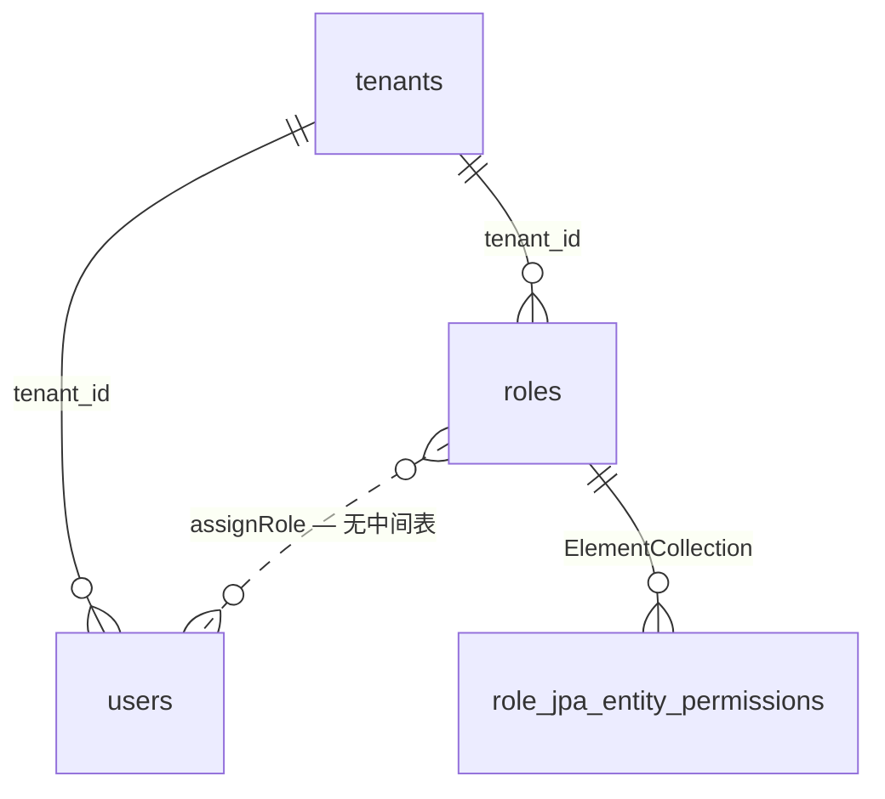
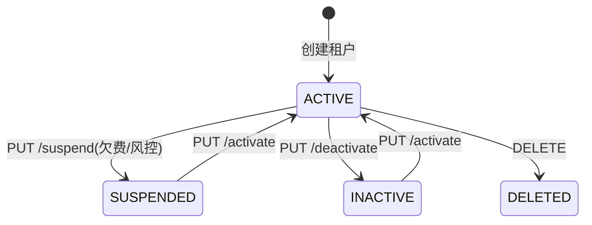
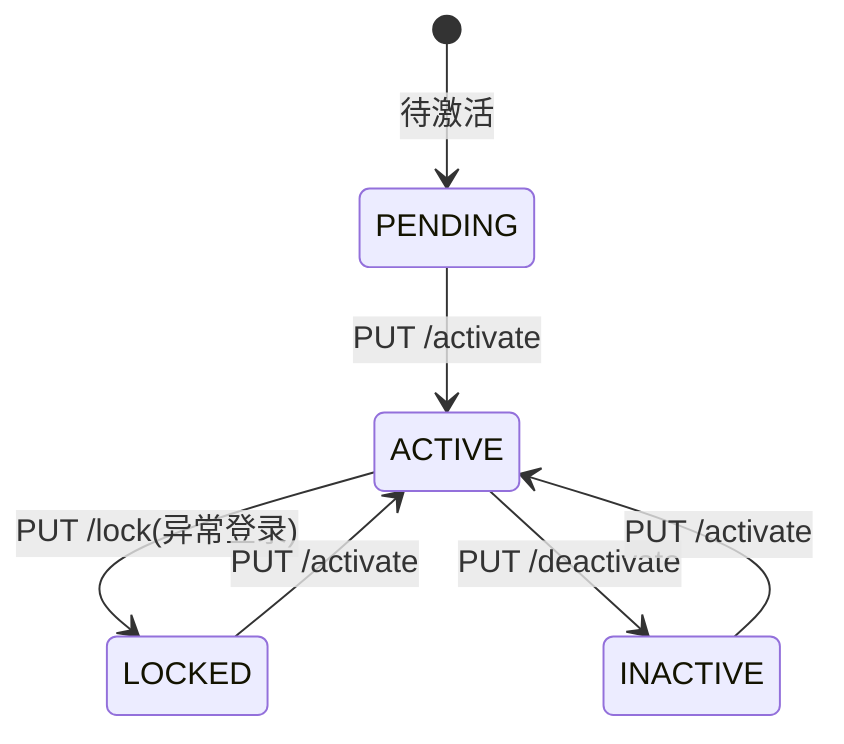
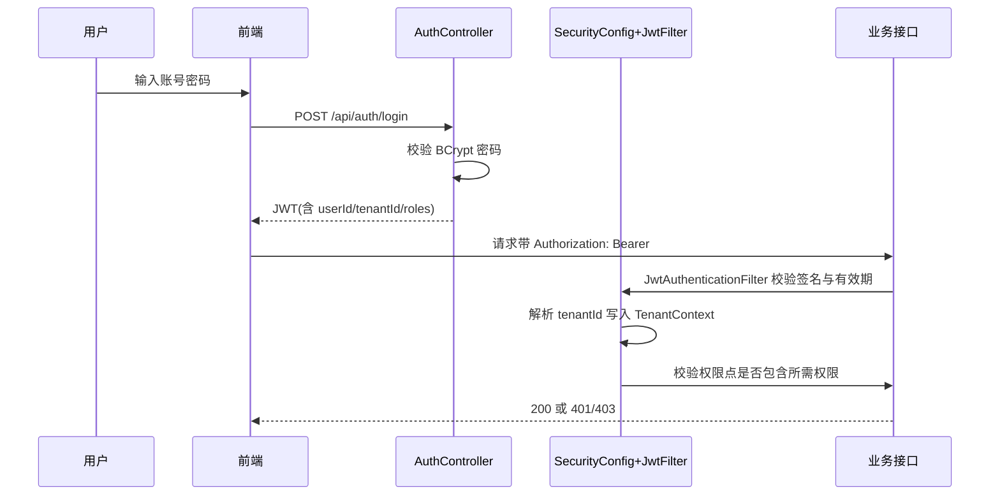

# 功能规格 · 多租户与权限（通用域）

| 项 | 内容 |
|---|---|
| 子域 | 通用域（Tenant Bounded Context） |
| 聚合根 | `Tenant` |
| 实体 | `User`、`Role` |
| 值对象 | `TenantStatus`、`UserStatus` |
| 领域服务 | `TenantService`、`UserService`、`RoleService`（实现放在应用层 `*ServiceImpl`） |
| 数据表 | `tenants`、`users`、`roles`、`role_jpa_entity_permissions` |
| 前端 | `frontend/user-web/src/pages/tenant/*`、`pages/user/*`；`frontend/admin-web/src/pages/{platform,tenant,user}/*` |

---

## 1. 模块定位

多租户决定了这套系统能否作为 **SaaS 售卖**。它解决三件事：

1. **开户**：创建一个租户（客户公司）+ 管理员账号；
2. **授权**：角色与权限点，控制成员能做什么；
3. **隔离**：同一套库里，A 公司永远看不到 B 公司的数据。

> 🔴 **结论先行**：目前 1、2 的 CRUD 与页面已端到端打通（全系统唯一完整链路），但**第 3 点（隔离）与安全校验基本没有生效**——这是上线前的 P0 阻断项。详见 [`../qa/known-issues.md`](../qa/known-issues.md)。

---

## 2. 概念模型

| 概念 | 说明 | 缺口 |
|---|---|---|
| 租户 | 客户组织 | ~~业务表无 `tenant_id`，无法物理隔离~~ → **2026-01-25 复测：列已经在了**，运行时 **23/42 张表有 `tenant_id`**、其中 **17 张建了索引**（`financial_transactions` / `platform_integrations` / `purchase_orders` / `roles` / `users` / `warehouses` 这 6 张有列无索引，见 [`../db/data-dictionary.md`](../db/data-dictionary.md) R-06/R-07）。 ❌ 残留的是**行为**而非列：写路径由 `TenantIsolationAspect.java:55-86` 校验，读路径仓储层不过滤（`:91-97` 仅 trace）⇒ **ISS-050**；租户值仍来自客户端入参（**ISS-051**） |
| 用户 | 登录账号 | `username`/`email` 是**全局唯一**，跨租户同名会被拒（语义冲突，R-07） |
| 角色 | 权限集合 | ~~无 `user_roles` 关联表，用户↔角色关系无三星表持久化~~ → **复测：表已存在**。`user_roles(user_id, role_id)` 复合主键，由 `UserJpaEntity.java:64-66` 的 `@ElementCollection` + 显式 `@CollectionTable(name = "user_roles")` 生成。 ⚠️ 实测 DDL 只有 1 条外键 `user_id → users.id`，**`role_id` 上没有指向 `roles` 的外键** ⇒ 关联可悬空；另一侧 `role_jpa_entity_permissions`（`RoleJpaEntity.java:39` 未标 `@CollectionTable`）仍是隐式命名（ADR-0010 建议第 5 条只修了一半） |
| 权限点 | 最小授权单位 | 自由字符串，**无字典、未与菜单/路由绑定** —— 后端侧仍成立（无字典表、`POST /api/roles/{id}/permissions` 无校验）。 🔎 **2026-01-25 补测**：前端有一份硬编码 `PERMISSION_PRESETS`（`user-web/src/pages/role/RoleList.jsx:12-33`，**21 项**），与库里的 **22** 个权限点不等价：**缺 `finance:import`**，而它正是真被 `@PreAuthorize` 检查的 10 个点之一；`Select mode="multiple"`（`:266`）也导致**无法录入预设外的新点**。菜单/路由绑定依然没有（`AuthContext.hasPermission` 调用点 0）。 ✅ **2026-10-09 订正（见 [known-issues.md §12 ISS-112](../qa/known-issues.md)）**：前端 `PERMISSION_PRESETS` 已补齐到 **26 项**并与后端目录逐项等值；菜单/路由/按钮三层都改为按权限点收敛（`AuthContext.can()`、`PermissionGuard`、`Can.jsx`）。仍成立的部分：后端确实没有字典表，`POST /api/roles/{id}/permissions` 仍不校验点名的合法性（口径 R-22 用守卫测试兜"三处漏改"，而不是加字典表） |

---

## 3. 状态机

### 3.1 租户状态

### 3.2 用户状态

| 对象 | 取值 |
|---|---|
| `TenantStatus` | `ACTIVE` / `INACTIVE` / `SUSPENDED` / `DELETED` |
| `UserStatus` | `ACTIVE` / `INACTIVE` / `LOCKED` / `PENDING` |

> ⚠️ `tenants.status` 与 `users.status` 是普通 `VARCHAR`，没有 `@Enumerated` 映射，写入什么由应用层字符串决定——**枚举约束实际不存在**（数据字典 R-06）。

---

## 4. 业务规则

| 编号 | 规则 | 状态 | 说明 |
|---|---|---|---|
| BR-01 | 租户名称、联系邮箱唯一 | ✅ | 列上有唯一约束 |
| BR-02 | 密码必须使用 BCrypt 存储 | ✅ | `BCryptPasswordEncoder` |
| BR-03 | 系统启动时创建默认租户与管理员账号 | ✅ | `DataInitializationConfig`，默认 `admin` / `123456`（⚠️ 弱口令，仅允许用于本地） |
| BR-04 | 用户可以拥有多个角色 | 🟡 | ~~API 支持，但无 `user_roles` 表~~ → **2026-01-25 实测：`user_roles` 表已存在**（`UserJpaEntity.roleIds` 的 `@CollectionTable`），当前有 2 行（`admin → ROLE_ADMIN`、`admin → PLATFORM_ADMIN`，后者由 ISS-061 的初始化修复写入）。语义仍是「只存 id 字符串、无外键到 `roles`」，故保留 🟡 |
| BR-05 | 角色可包含多个权限点 | 🟡 | `@ElementCollection`，但权限点为自由字符串 |
| BR-06 | **所有业务数据必须按 tenant_id 隔离** | ❌ | ~~仅 2 张表（`users`/`roles`）有 `tenant_id`，其余 19 张无（R-07）~~ → **2026-01-25 实测：42 张表里 23 张有 `tenant_id` / 19 张没有**；且「有列」≠「隔离生效」——写路径已由切面校验，**读路径（仓储层）不带租户条件**（ISS-050） |
| BR-07 | 请求必须携带有效的租户上下文，缺失即拒绝 | 🟡 | ~~`TenantIsolationAspect` 校验被注释~~ → **已生效**（`TenantIsolationAspect.java:55-86`，不一致抛 `TENANT_ACCESS_DENIED`）；但「缺失即拒绝」不成立：入参没有 `tenantId` 时切面直接放行（`:57-60`），`admin` 亦放行（`:63-65`），故仍不满足本条原文 |
| BR-08 | JWT 必须被正确签名校验并过期失效 | 🟡 | ~~`validateToken()` 恒 `true`~~ → **已改为 `parseClaims(token) != null`**（签名/过期由 jjwt 解析时校验）。残余：无显式 `clockSkew` 配置，且 `Result` 层不区分「过期」与「坏签名」 |
| BR-09 | 用户名应在**租户内**唯一而非全局唯一 | ❌ | 当前全局唯一（R-07）。 🔎 **2026-01-25 直接查库确认**：`SHOW INDEX FROM users` 只有两条唯一索引（`username`、`email`），**均为单列、不含 `tenant_id`** → 「唯一键已改租户内」的说法不成立，[tech/security-design.md §4](../tech/security-design.md) 步骤 1 里那句「唯一键从全局改租户内」是**待办步骤**而非现状 |
| BR-10 | 停用租户后其成员立即无法登录 | ⚪ | 未实现联动 |
| BR-11 | 菜单与路由应按角色动态渲染 | 🟡 | ~~前端菜单是静态数组，角色校验被注释~~ → **2026-01-25 实测已实现（ISS-035）**：`AuthGuard.jsx:34` 做 `requiredRoles` 判角色、`:35-43` 命中失败渲染 403 `Result`；`PlatformAdminGuard:51-53` 要求 `PLATFORM_ADMIN`、`TenantAdminGuard:58-60` 要求 `TENANT_ADMIN`/`PLATFORM_ADMIN`，三种守卫**不再等同**；侧边栏已按角色过滤（`Layout.jsx:30` 取 `hasRole`、`:181` 用 `hasRole('PLATFORM_ADMIN')` 条件拼接菜单项、`:212` 展示角色名）。 ❌ 残余三处，所以本条只能算 🟡：① `routes.jsx` 里**只有 `/platform/dashboard`、`/platform/config` 两条路由真在 `PlatformAdminGuard` 之下**（`:127-132`），而 `/tenants`、`/users`、`/roles` 三组管理页仍挂在**裸 `AuthGuard`**（`:75`）下，前端不挡、只靠后端 `@PreAuthorize`/`/api/tenants/**` 兜（直接访问 URL 会进页面、接口才 403）；② `TenantAdminGuard` 虽在 `:135` 挂了路由组，组内**一条路由都没有**（`:137` 只有注释），是个空壳；③ 守卫判的是**角色名**，权限点级（按钮级）控制仍不存在——`Role.hasPermission()` 调用点 0，见 [tech/security-design.md §5](../tech/security-design.md)。 ✅ **2026-10-09 三处残余全部收口，本条转 🟢（ISS-112/035）**：① `/users`、`/roles`、`/tenants` 已分别挂到 `PermissionGuard(user:manage / role:manage)` 与 `PlatformAdminGuard`；② `TenantAdminGuard` 那个组内零路由的空壳组已删除（R-26），组件仍导出备用；③ 权限点级控制落地——`AuthContext.can()` 有真实消费方（菜单/路由/按钮三层），浏览器三身份实测 64/64 断言 |
| BR-12 | 敏感操作需留审计日志 | ⚪ | 无审计能力 |

---

## 5. 认证与鉴权流程（目标态）

**当前实际行为**

| 环节 | 现状 |
|---|---|
| 登录签发 Token | ✅ 正常 |
| Token 签名校验 | ~~❌ `validateToken()` 恒返回 `true`，任意非空 Bearer 串均可通过~~ → ✅ **已修（ISS-007）**：`validateToken` = `parseClaims(token) != null`（`JwtTokenProvider.java:189-191`），`:201-205` 真验签 + 过期，空串先拒（`:197`）。⚠️ 非法令牌的响应是 **403 + 0 字节 body**，401 不可达（`SecurityConfig` 无 `exceptionHandling()`，**ISS-032/058**） |
| 用户名/租户解析 | ~~❌ `getUsernameFromToken()` 返回 `""`，`getTenantIdFromToken()` 返回 `"default-tenant"`~~ → ✅ **已修（ISS-008）**：两者从 claim 读取（`:141-144`），解析失败返回 `null`；`Bearer ` 前缀由过滤器剥离（`JwtAuthenticationFilter.java:88-89`）。⚠️ `"default-tenant"` 作为**兜底**仍散落在服务层与消费者里（全仓 **17** 处字面量：interfaces 2 / application 10 / domain 1 / infrastructure 4） |
| 生成权限（authorities） | ~~❌ 空列表 → `ROLE_PLATFORM_ADMIN` 规则永远不满足~~ → ✅ **已修（ISS-009/041）**：登录写入 `roles`/`permissions` 两个 claim（`JwtAuthenticationFilter.java:46-47`），过滤器把角色加 `ROLE_` 前缀还原为 authorities（`:54-60`）。⚠️ 残留：catalog 现为 **26** 个权限点（2026-10-07 实测 `admin` JWT 带 26 条；ADR-0013 的 `shop:*` 四点已计入），其中被 `hasAuthority()` 字面量引用的 **15** 个（`grep -o "hasAuthority('…')" src/main/java \| sort -u` 实测，本轮新增 `shop:read`/`shop:write`/`shop:credential_write`；`shop:sync` 尚无消费方，等 §6 步骤 5 的外呼端点）；~~其余 11 点配了也不起作用。~~注解仍是 `hasRole('PLATFORM_ADMIN') **or** hasAuthority(...)` 的 OR 结构 ⇒ admin 绕过权限点（**2026-10-09 保留该结构并按 R-25 成文**：改成 AND 等于要求给平台管理员逐个配点，配错即自我锁死；因此"去掉某个点"的授权测试**必须用非平台管理员账号**跑）。 ✅ **2026-10-09 更新（ISS-112）**：目录 **26/26** 点有端点消费（`PermissionPointCoverageGuardTest` 守卫）；`shop:sync` 已接到 `POST /api/warehouses/shop/sync/{integrationId}`（`ShopWarehouseController:77`），不再存在"种上了但没人检查"的点。~~按钮级权限两端都没有（`Role.hasPermission` / `AuthContext.hasPermission` 调用点均为 0）~~ → 前端三处（菜单/路由/按钮）都改为消费权限点；后端领域层 `Role.hasPermission` 仍是 0 调用点（服务端只认 authorities），字段级权限未实现。另注意：**加权限点若点名不合 `Role.PERMISSION_PATTERN`（只许一个冒号），种子会整批静默回滚**——ISS-090 |
| 租户隔离切面 | ~~❌ 校验逻辑被注释，只打印日志~~ → ✅ **已生效**：`TenantIsolationAspect.java:55-86` 对服务层方法做前置校验，不一致抛 `TENANT_ACCESS_DENIED`（`:83`），`PLATFORM_ADMIN` 放行。 ❌ 残留：仓储层切面（`:91-97`）**只打 trace**，注释写明"隔离由服务层参数校验保障" ⇒ 读路径不隔离（**ISS-050**），且租户仍由客户端传参（**ISS-051**） |
| CORS 允许来源 | ~~⚠️ 仅 `http://localhost:5173`，未包含 admin-web 的 5174~~ → ✅ 已含两端：~~`SecurityConfig.java:50`~~ → 🔄 2026-10-10 行号与值均更新为 `SecurityConfig.java:63` + `http://localhost:5110`/`http://localhost:5120`（旧 5173/5174 随固定端口作废）：`setAllowedOrigins(List.of("http://localhost:5173","http://localhost:5174"))`（`corsConfigurationSource()` 于 `:46-55`）。⚠️ 新残留：两个 `vite.config.js` 都只有 `plugins:[react()]`、**没有 dev proxy**，前端 baseURL 硬编码 `http://localhost:8082/api`（`user-web/src/services/api.js:6`）⇒ 换端口/换环境即断，见 [`../tech/frontend-architecture.md`](../tech/frontend-architecture.md) §8 |

---

## 6. 功能清单

| 功能 | 前端 | 后端 | 状态 |
|---|---|---|---|
| 登录 | `Login.jsx` 已联网 | `POST /api/auth/login` | 🟡 签发正常，~~校验失效~~ **校验已修**（真验签+过期）；~~残留：拒绝为 403 空 body、无 401 出口（ISS-032/058）~~ → 已修（ISS-098/111）：未认证 **401 `UNAUTHORIZED`**、越权 **403 `ACCESS_DENIED`**、停用/锁定 **401 `ACCOUNT_DISABLED`/`ACCOUNT_LOCKED`**，全部走 `Result` 信封（`SecurityConfig` 的 `exceptionHandling()`） |
| 刷新令牌 | ~~—~~ `authApi.refreshToken`（`services/api.js:86`）**存在但调用点 0** ⇒ 自动续期未接 | ~~`POST /api/auth/refresh`（桩）~~ **`AuthController.java:93` 已实现**（`:95-101` 验签旧 refreshToken、`:108-127` 重新读库取角色权限） | 🟡 后端可用、前端未接；且 `:128` **原样回传同一个 refreshToken**（无轮换/无撤销表） |
| 登出 | Header 按钮，另有 `AuthContext.logout`（`context/AuthContext.jsx:98-107`，`:100` 真发请求、`:104` 清本地会话） | ~~`POST /api/auth/logout`（桩）~~ **已实现** `AuthController.java:136-139` | 🟡 两端接通，但后端只做 `SecurityContextHolder.clearContext()`，**没有服务端撤销/黑名单** ⇒ 已签发的令牌在过期前仍然可用 |
| 当前用户信息（`GET /api/auth/me`） | `AuthContext.refreshProfile`（`:29-41`，`:31` 调用） | `AuthController.java:146`（`SecurityConfig.java:65` 放行） | ✅ 2026-01-25 新增记录：未登录时抛 `BusinessException("未登录或会话已失效")`（`:151`） |
| 租户 CRUD + 状态变更 | `tenant/*` 三页已联网 | `/api/tenants/**`（9 端点） | 🟡 ~~隔离未生效~~ **写路径隔离已生效**（切面），读路径仍未过滤（**ISS-050**）；`/api/tenants/**` 需 `hasRole('PLATFORM_ADMIN')`（`SecurityConfig.java:66`） |
| 租户管理员创建 | — | `POST /api/tenants/{id}/admin` | 🟡 |
| 用户 CRUD + 状态/密码/角色 | `user/*` 三页已联网 | `/api/users/**`（11 端点） | 🟡 `UserController.java:31` 有 `user:manage` 门（但 OR `hasRole('PLATFORM_ADMIN')`） |
| 角色 CRUD + 权限分配 | ~~—~~ `role/RoleList.jsx`（单页内含权限分配弹窗 `:116-128`、预设 `:12-33`） | `/api/roles/**`（10 端点） | 🟡 后端权限点无字典（2026-10-07 实测：前端 `RoleList.jsx` 硬编码 **22** 个字面量，与库里旧 catalog 等价、`finance:import` 已在其中；与 catalog 现 **26** 项的差集**恰好是 ADR-0013 的四个 `shop:*` 点**——即后端已授权、界面配不出来，反方向无孤儿点。根治方式是 `GET /api/permissions` 下发 catalog，见 ADR-0013 §6 步骤 7） |
| 租户数据隔离 | — | ~~❌~~ 🟡 **半生效**：服务层写路径校验（`TenantIsolationAspect.java:55-86`）✅；仓储读路径 ❌（`:91-97`，**ISS-050**）；租户来自客户端传参（**ISS-051**） |
| 审计日志 | — | — | ⚪ |
| 找回密码 / 邮箱验证 | — | — | ⚪ |

---

## 7. 接口对照

| 分组 | 端点数量 | base path | 备注 |
|---|---|---|---|
| 认证 | ~~3~~ **4** | `/api/auth` | ~~refresh / logout 是桩~~ 两者均已实现；2026-01-25 复测端点为 `login`(`:53`) / `refresh`(`:93`) / `logout`(`:136`) / `GET /me`(`:146`)，`me` 此前漏记 |
| 租户 | 9 | `/api/tenants` | ~~需 `ROLE_PLATFORM_ADMIN`（当前无法真正生效）~~ 需 `ROLE_PLATFORM_ADMIN`（`SecurityConfig.java:66`）**现已真正生效**（authorities 由令牌还原，`JwtAuthenticationFilter.java:54-60`） |
| 用户 | 11 | `/api/users` | 含改密、启停、锁定、分配角色 |
| 角色 | 10 | `/api/roles` | 含系统角色、权限点增删与整体覆盖 |

完整清单见 [`../api/README.md`](../api/README.md)。

---

## 8. 角色权限模型（建议的目标态）

| 角色 | 权限点建议（需先建立权限字典） |
|---|---|
| `PLATFORM_ADMIN` | 租户管理、系统配置、平台监控 |
| `TENANT_ADMIN` | 本租户全部业务功能、成员与角色管理 |
| `WAREHOUSE` | 仓储读写、物流读写、订单只读 |
| `OPERATOR` | 订单读写、产品读写、平台集成读写 |
| `BUYER` | 采购读写、仓储只读 |
| `FINANCE` | 财务读写、订单只读、采购只读 |
| `CS` | 客户读写、订单与物流只读 |

**落地步骤**：~~① 定义权限点字典（建议用 `资源:操作` 命名，如 `order:read`）→ ② 前端菜单绑定权限点 → ③ 后端接口加 `@PreAuthorize` → ④ 路由守卫做二次校验。~~

🔄 **2026-10-09 进度**：① 以代码常量 `PermissionPoints` 为单一事实源（25 租户级 + `platform:manage` = **26**，未建字典表，口径见 R-22）；② ✅ 已做（`constants/menus.js` 每个叶子挂点）；③ ✅ 已做（26/26 点有端点消费，`PermissionPointCoverageGuardTest` 守卫）；④ ✅ 已做（`routes.jsx` 按模块套 `PermissionGuard`）。四步全部落地，判据见 [known-issues.md §12](../qa/known-issues.md) 与 `scripts/smoke/smoke.sh` §11。

---

## 9. 现状缺口与待办

| 优先级 | 缺口 | 建议 |
|---|---|---|
| ~~**P0**~~ ✅ 已修 | ~~JWT 校验失效、authorities 为空~~ | ~~修复 `JwtTokenProvider` 三个方法；Filter 改为 Spring 注入；权限写入 authorities~~（2026-01-25：ISS-007 真验签 + ISS-008/041 权限点入 authorities，实测 JWT 带 22 个权限点。**残留**：未认证出口是 403 空 body 而非 401，ISS-032/058） |
| **P0** 半成 | ~~租户隔离未生效~~ → **写路径已生效、读路径未生效** | ~~启用切面校验；~~业务表补 `tenant_id`；**查询统一走租户过滤（或引入 Hibernate Filter）——这一条是唯一剩下的主体工作，即 ISS-050** |
| **P0** 半成 | ~~业务数据无租户列~~ → 运行时 **23/42 张表有 `tenant_id`**，缺的是 `order_items`/`skus`/`inventory_records`/`locations`/`logistics_channels`/`logistics_fees`/`logistics_labels`/`payment_infos`/`shipping_addresses`/`purchase_order_items` + 6 张 `*_import_job_errors` + 2 张集合表 | 是所有隔离工作的前置；需要先做数据迁移（本轮已给 `purchase_orders` 补列，ISS-046） |
| **P1** | 权限点无字典、未绑定菜单 | 建立权限字典并前后端共用。 ⚠️ 2026-01-25 二次实测补三点：① 库里 22 个点里**只有 10 个被 `@PreAuthorize` 检查**（`finance:read`×5、`finance:write`×4、`finance:import`、`order:import`、`product:import`、`customer:import`、`logistics:import`、`user:manage`、`role:manage`、`platform:manage`），另外 12 个 `:read`/`:write` 只是种上了；② 前端 `RoleList.jsx:12-33` 的 `PERMISSION_PRESETS` 只有 **21 项、恰好缺被检查的 `finance:import`**，且 `mode="multiple"` 不能手输新点；③ `WarehouseImportController` 0 个 `@PreAuthorize`。 ✅ **2026-10-09 三点全部订正（ISS-112）**：库里 26 个点**全部**被端点检查（12 个"只种上了"的已接到 `@PreAuthorize`，`WarehouseImportController` 补齐读写分离注解）；`PERMISSION_PRESETS` 补齐到 26 项；`Select mode="multiple"` 不能手输新点的问题保留为已知边界（新增点必须三处同改，由守卫测试兜住，见 R-22） |
| **P1** | 无 `user_roles` 表 | 补关联表，避免失去 users↔roles 关系持久化 |
| **P1** | 用户名全局唯一 | 改为 `UNIQUE(tenant_id, username)` |
| **P2** | 默认弱口令 | 初始化数据改为随机密码 + 强制首次修改 |
| **P2** | JWT 密钥与数据库口令硬编码入配置 | 改为环境变量/密钥管理服务 |
| **P2** | 无审计日志 | 记录关键操作（登录、权限变更、状态变更） |
| **P3** | 无 SSO / 二次验证 | 视客户安全要求评估 |

---

## 10. 验收要点

1. 使用过期或篡改的 Token 访问 `/api/orders/{id}` 必须返回 401。
2. 缺少权限的用户访问受限接口必须返回 403。
3. A 租户用户查询订单、产品、物流单时，永不返回 B 租户数据。
4. 跨租户创建用户名相同的账号应成功（改为租户内唯一后验证）。
5. 停用租户后，该租户成员访问业务接口应被拒绝。
