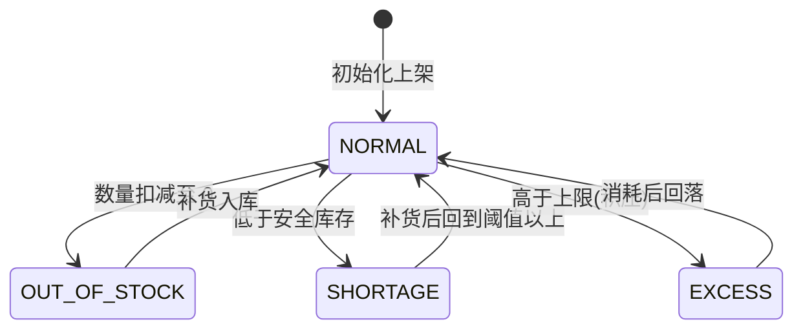

# 功能规格 · 仓储管理（支撑域）

| 项 | 内容 |
|---|---|
| 子域 | 支撑域（Warehouse Bounded Context） |
| 聚合根 | `Warehouse` |
| 实体 | `InventoryRecord`、`Location` |
| 值对象 | `InventoryStatus`、`InventoryMovement`（内含 `MovementType`） |
| 领域服务 | `WarehouseManagementService`、`InventoryManagementService`、`InventoryCountService` |
| 应用服务 | `WarehouseApplicationService` |
| 数据表 | `warehouses`、`locations`、`inventory_records` |
| 前端 | `frontend/user-web/src/pages/warehouse/{WarehouseList,WarehouseDetail,CreateWarehouse}.jsx` |

---

## 1. 模块定位

仓储是履约的**执行层**：它回答两个问题——"货在哪（库位）"和"有多少（库存）"。

跨境场景下的额外要求：多仓（国内自营仓 + 海外仓 + FBA 中转）并存、库存要在多个平台之间同步可售量。**当前模型只有一个 `quantity`，没有区分可用/锁定/在途**，因此无法支撑超卖防护。

---

## 2. 概念模型

```mermaid
erDiagram
    warehouses ||--o{ locations         : "warehouse_id"
    warehouses ||--o{ inventory_records : "warehouse_id"
    locations  ||--o{ inventory_records : "location_id"
    skus       ..> inventory_records    : "sku_code 裸引用"
```

| 概念 | 说明 | 缺口 |
|---|---|---|
| 仓库 | 物理仓，含名称（唯一）、编码（唯一）、地址、容量、启停 | 无仓库类型（自营/海外仓/FBA）——`WarehouseJpaEntity` 无 `type` 列（列清单 `:26-50`）<br>🔄 2026-10-09：唯一性是**三层**——列级 `@Column(unique = true)`（`WarehouseJpaEntity:32` 名称、`:35` 编码）＋ 服务层先查重（编码 `WarehouseManagementService:37,:71`，名称 `:43,:78` 的 `requireUniqueName`）＋ `DataIntegrityViolationException` → 409 兜底（`GlobalExceptionHandler:265-272`，ISS-116）。此前只查编码，名称冲突落 500 `SYSTEM_ERROR` |
| 库位 | 库内位置编码 | ~~无 `(warehouse_id, location_code)` 唯一约束（数据字典 R-05）~~ → 🔄 2026-03-22：**DB 约束确实仍无**（`LocationJpaEntity:19` 的 `@Table` 无 `uniqueConstraints`/`indexes`），但**同仓库内编码唯一已由代码保证**——`WarehouseManagementService:98-103` 在聚合内比对 `getLocations()` 后抛 `BusinessException("库位编码已存在: …")`；跨仓同码仍不受限（与规则本身一致） |
| 库存记录 | 某仓库（可选某库位）下某 SKU 的数量与状态 | 无 `(sku_code, warehouse_id)` 唯一约束（R-05，会导致 `NonUniqueResultException`）——🔄 2026-03-22 复核仍在：`InventoryRecordJpaEntity:21 @Table(name = "inventory_records")` 无 `uniqueConstraints`/`indexes`；缓解手段是定位口径统一走聚合（`InventoryManagementService:112-115` 注释与 `Warehouse.findInventoryRecord`，ISS-060 的修法），不再用不受仓限定的 `findByProductId` 兜底 |
| 库存变动 | 入库/出库/调整/调拨四类 | 未落表，`InventoryMovement` 仅为内存值对象——🔄 2026-03-22 复核仍成立（运行时库只有 `inventory_records`，无 `inventory_movements` 类表）。⚠️ 但该值对象**已可经 HTTP 传入**：`InventoryMovement.java:39` 的私有构造带 `@JsonCreator` + 9 个 `@JsonProperty`（`HEAD` 版本 0 处，工作树 +47 行加上），⇒ `POST /{warehouseId}/inventory/move` 的反序列化阻塞已解除（见 §6） |

---

## 3. 状态机

### 3.1 库存状态（健康度标识）



| 枚举名 | 存储值 | 中文 | 触发条件（目标态） |
|---|---|---|---|
| `NORMAL` | ~~`normal`~~ → 库里是 `NORMAL`（🔄 2026-03-22：`inventory_records.status` 实测 `enum('EXCESS','NORMAL','OUT_OF_STOCK','SHORTAGE')`；小写 `normal` 只是领域枚举的 `code`（`InventoryStatus:14`），落库走 `@Enumerated(EnumType.STRING)` + `InventoryStatusJpaEntity`（`InventoryRecordJpaEntity:46-48`），即 [../db/data-dictionary.md](../db/data-dictionary.md) §4 的**口径 A**） | 正常 | 介于阈值与上限之间 —— 🔄 2026-03-22：实际是 `quantity` 落在 `[10,100]` 闭区间 |
| `SHORTAGE` | ~~`shortage`~~ → `SHORTAGE` | 不足 | < 安全库存阈值（~~⚪ 阈值未配置~~ → 🟡 **阈值有、但硬编码**：`InventoryRecord.calculateInventoryStatus:47-57` 写死 `quantity < 10`，注释「示例阈值」同样出现在 `Warehouse:246`——🔄 2026-10-10 复取行号，原记 `:240` 已漂）。🔄 **同轮订正下游后果**：`SHORTAGE`/`OUT_OF_STOCK` 触发的 `InventoryShortageEvent` 现在会真的产出一张**带明细行的补货建议单**（[../qa/known-issues.md](../qa/known-issues.md) §24 关闭 ISS-143），但建议量恒为 `10 − 现存量` ⇒ **"补到安全库存"这一语义仍未成立**，缺的是阈值建模（`inventory_records` 实测列为 `id/product_id/quantity/sku_code/status/location_id/warehouse_id`，**无 `safety_stock`**），见本文 §8 P1 那条与 [../product/06-glossary.md](../product/06-glossary.md)「安全库存 ⚪ 未建模」 |
| `OUT_OF_STOCK` | ~~`out_of_stock`~~ → `OUT_OF_STOCK` | 缺货 | = 0 → 代码是 `quantity <= 0`（`:48-49`） |
| `EXCESS` | ~~`excess`~~ → `EXCESS` | 过剩 | > 上限（~~⚪ 上限未配置~~ → 🟡 **硬编码 `quantity > 100`**（`:52-53`），非配置项） |

> ~~当前没有任何代码在上架/扣减时自动切换这些状态，也没有阈值模型——状态实际不会被自动更新。~~ → 🔄 **2026-03-22 复测：这句不成立，方向反了**。状态**每次改数量都会自动重算**——`increaseQuantity:64-69`、`decreaseQuantity:76-81`、`adjustQuantity:88-91` 三个方法在改完数量后统一 `this.inventoryStatus = calculateInventoryStatus(this.quantity)`（`:67,:79,:90`），所以入库/出库/调整/盘点四条路径落库的 `status` 都是算出来的，不是入参。
> ⚠️ 真正缺的是**阈值模型**（10/100 写死在实体里，无 `safety_stock` 配置列）与**负库存保护的位置**：实体侧 `decreaseQuantity:78`、`adjustQuantity:89` 用 `Math.max(0, …)` 把数量夹到 0（静默封顶），服务侧 `InventoryManagementService:72-73` 才抛 `InvalidOperationException("库存不足: …, current: …, requested: …")`——两处都在防负数，但只有服务侧会告知调用方。

### 3.2 库存变动类型

> 🔄 2026-03-22：本表的「存储值」是 `InventoryMovement.MovementType:118-121` 的领域 `code`（`inbound/outbound/adjustment/transfer`）。⚠️ **它从来没有落过库**——没有 `inventory_movements` 表，所以这里既不是口径 A 也不是口径 B，而是「只在内存与 HTTP 报文里存在的 code」。⇒ `POST /{warehouseId}/inventory/move` 的 `movementType` 由 Jackson 按**枚举名** `INBOUND/OUTBOUND/ADJUSTMENT/TRANSFER` 反序列化（`@JsonProperty("movementType")`，`InventoryMovement:47`），传小写 code 会 400。

| 枚举名 | 存储值 | 中文 | 触发动作 | 实现 |
|---|---|---|---|---|
| `INBOUND` | `inbound` | 入库 | 采购收货、退货入库、调整入 | ~~⚪ 无端点~~ → ✅ **2026-03-22 复测：有专用端点**`POST /api/warehouses/{warehouseId}/inventory/in`（`WarehouseController:151-158`，body `InventoryMoveRequest{sku,productId,quantity,…}`）→ `WarehouseApplicationService.inventoryIn:110-119` → `InventoryManagementService.inboundInventory:37-52`。**采购到货已接上这条**：`PurchaseApplicationService.receiveIntoWarehouse:281-293` 逐行调用入库。<br>⚠️ 三个残留：① 入库**不带库位**（`:118` 固定传 `locationId = null`）；② 退货入库仍无入口；③ 只回一条 `InventoryRecord`，不产生变动流水 |
| `OUTBOUND` | `outbound` | 出库 | 订单发货、报损 | ~~⚪ 无端点~~ → 🟡 **端点已有、业务联动仍无**：`POST /api/warehouses/{warehouseId}/inventory/out`（`WarehouseController:161-168`）→ `inventoryOut:125-134` → `outboundInventory:62-84`（数量不足在 `:72-73` 抛 `InvalidOperationException` → 400）。<br>❌ 但**订单发货不会扣库存**：全仓 `outboundInventory` 的调用方只有 `WarehouseApplicationService`（`inventoryOut` 与 `moveInventory`/`transferInventory`），`application/service` 下的订单、物流两条链路 0 命中 ⇒ BR-04 的缺口从「没有出库能力」变成「有出库能力但没人调」 |
| `ADJUSTMENT` | `adjustment` | 调整 | 盘点差异修正 | ~~⚪ 无独立端点~~ → 🟡 **仍无独立端点，但可达**：`POST /{warehouseId}/inventory/move` 传 `movementType=ADJUSTMENT` → `moveInventory:221-226` → `adjustInventory:94-110`（语义是「直接置为新数量」，见 `Warehouse.updateInventory:205-206` 的 `adjustQuantity(newQuantity)`）。盘点专用端点 `:171-177` 走的是另一条 `InventoryCountService` |
| `TRANSFER` | `transfer` | 调拨 | 仓间移动 | ~~❌ 端点存在但抛 `UnsupportedOperationException`~~ → ✅ **2026-03-22 复测：已实现，且 HTTP 层可达**。`moveInventory:227-228` 的 `TRANSFER` 分支改调私有 `transferInventory:237-252`（源仓出库 `:249` ＋ 目标仓入库 `:250-251`，`@Transactional` 在 `:200`）；全仓 `UnsupportedOperationException` **0 处**（ISS-012 已修）。<br>⚠️ 两个已知口径（`docs/qa/smoke-test-checklist.md` 4.5 实测）：响应只回**目标仓入库**那条记录，源仓结果要另查 `GET /{warehouseId}/inventory`；body 里 `warehouseId` 是**必填但不起作用**（`InventoryMovement` 构造 `Objects.requireNonNull`，实际生效的是路径参数），路径与 body 不一致时静默按路径执行 |

---

## 4. 业务规则

| 编号 | 规则 | 状态 | 说明 |
|---|---|---|---|
| BR-01 | 仓库名称、编码全局唯一 | ✅ | **三重防护已齐**：列上有唯一约束（`WarehouseJpaEntity:32,:35`）＋ 服务层名称/编码双查（编码 `:37,:71`，名称 `requireUniqueName` `:43,:78,:125-128`）＋ `DataIntegrityViolationException` 兜底映射 409（`GlobalExceptionHandler:265-272`）。🔄 2026-10-09 收口 ISS-116：此前**名称**重复只被 SQL 层的 `warehouse_name` UNIQUE 拦下，抛 `DataIntegrityViolationException` 后无专用分支 ⇒ 落 500 `SYSTEM_ERROR`（与 DB 唯一性竞态无法区分）。现在服务层先查并抛 `BusinessException("仓库名称已存在: …")` → 400，缓存/并发漏网的仍由 409 兜住；409 文案不回显 SQL 与索引名（口径 [R-29](../qa/known-issues.md)）。改自己（名称不变）不被误拦，见 `WarehouseManagementServiceUniquenessTest` 4 例 |
| BR-02 | 同一仓库内库位编码唯一 | ~~⚪~~ → 🟡 | ~~无唯一约束（R-05）~~ → 🔄 2026-03-22：**代码级已保证**（`WarehouseManagementService:98-103` 在聚合 `getLocations()` 内比对 `locationCode`，重复抛 `BusinessException("库位编码已存在: …")` → 400）；⚠️ DB 的 `(warehouse_id, location_code)` 唯一约束仍缺（`LocationJpaEntity:19` 无 `uniqueConstraints`）⇒ 并发双写仍可穿透，属 R-05 残留 |
| BR-03 | 同一仓库同一 SKU 只能有一条库存记录 | ⚪ | 无唯一约束；`findBySkuCodeAndWarehouseId` 返回 `Optional`，重复行会抛 `NonUniqueResultException`。<br>🔄 2026-03-22 复核：`InventoryRecordJpaEntity:21` 仍无约束；定位口径已统一收敛到聚合（`InventoryManagementService:112-115` 注释、`Warehouse.findInventoryRecord`），所以「读到别的仓的行」这一类已修（ISS-060），但「同仓同 SKU 两行」仍无 DB 级防护 |
| BR-04 | 订单发货必须扣减对应仓库库存 | ⚪ | 无联动（BR 缺口，P0）。🔄 2026-03-22 精确化：**不是缺接口，是缺调用**——`inventoryOut` 的调用方只有 `WarehouseController:165` 与服务层自身，订单/物流链路 0 命中（`outboundInventory` 主源码调用点＝`WarehouseApplicationService` + `InventoryManagementService` 两处） |
| BR-05 | 库存不足时禁止出库 | ~~⚪ 无出库动作~~ → ✅ | 🔄 2026-03-22 复测：出库动作与校验都在——`InventoryManagementService:72-73` 数量不足抛 `InvalidOperationException("库存不足: " + productId + ", current: …, requested: …")`，经 `GlobalExceptionHandler:73-81` 映射 **400**；实体侧另有 `Math.max(0, …)` 兜底（`InventoryRecord:78,:89`）。实测口径见 `docs/qa/known-issues.md` ISS-060 尾部（超量出库返 400 INVALID_OPERATION） |
| BR-06 | 调拨必须同时减少源仓、增加目标仓（同一事务） | ~~❌ 方法体抛异常~~ → ✅ | 🔄 2026-03-22 复测：`moveInventory`（`WarehouseApplicationService:201-232`，`@Transactional` 在 `:200`）的 `TRANSFER` 分支调 `transferInventory:237-252`，`:249` 源仓出库 + `:250-251` 目标仓入库，同一事务。<br>⚠️ 三点残留：① **无服务层测试**——全仓只有 `WarehouseControllerTest:190-214` 覆盖了 `/move`，且 `when(warehouseApplicationService.moveInventory(...))` 把服务 mock 掉了，双写逻辑没有一条真实断言；② ~~目标仓若原本没有该 SKU 行，入库会把 `productId` 当 SKU 写进新行（ISS-060 已记）~~ → 🔄 **2026-03-22 复测：方向写反了**，互填发生在 `InventoryManagementService.createInventoryRecord:152-153`（`productId` 空则落 `sku`、`sku` 空则落 `productId`），而调拨路径 `:248` 的 `productKey` 在 `productId` 非空时恒等于 `productId`、`:250-251` 又分别把 productKey 与 sku 各自传到位 ⇒ **调拨新建的行两列各归其位**，只有显式传空串 `"productId": ""` 才回落；真正的"SKU 兼作产品ID"来自另一条路径——`inventoryIn:118` 与 `inventoryOut:133` 把同一个 `skuCode` 同时当 productId 和 sku 传下去（`/in｜/out` 与采购到货自动入库都走这里），实测运行时库 `inventory_records` 现有 **7 行全部 `product_id = sku_code`**；两条路径混用 ⇒ 同一物理 SKU 可落两行不同键的记录（叠加 R-05 无 `uk(sku_code,warehouse_id)`）；③ 无幂等键，重复提交即重复调拨（全仓 0 个 `@Version`） |
| BR-07 | 盘点应冻结账面快照并输出差异表 | ~~⚪ 仅 `count` 更新数量~~ → 🟡 | 「仅更新数量」仍成立（`InventoryCountService:30-50` 直接 `adjustQuantity(actualQuantity)`，无快照表、无差异表）；🔄 但**差异是算出来的、并且进了事件**：`Warehouse.countInventory:253-282` 保留 `originalQuantity:259`，并在 `:268-273` 组 `CountResult{productId, expectedQuantity, actualQuantity, difference}` 注册成 `InventoryCountEvent`（`:281`）——只是这个事件从不发布（见 §7），所以差异既不落库也无人消费 |
| BR-08 | 盘点调整需审批 | ⚪ | 无审批。🔄 2026-03-22 复核：`/inventory/count`（`WarehouseController:171-177`）是 query 参数直改数量的单步接口 |
| BR-09 | 库位容量之和不得超过仓库容量 | ⚪ | 无校验。🔄 2026-03-22 复核 `WarehouseManagementService.addLocation:92-110`：只做「仓库存在 + 编码不重复 + `warehouse.addLocation`」，`capacity`/`occupied` 全程不参与比较（`WarehouseApplicationService:97-98` 只给默认值 `1`） |
| BR-10 | 停用的仓库不可参与发货/入库 | ⚪ | `active` 字段存在但无校验。🔄 2026-03-22 复核仍在：`WarehouseJpaEntity:44` 有 `active NOT NULL`、`PUT /{id}/status`（`WarehouseController:127-132`）能改它，但 `requireWarehouse`（`WarehouseApplicationService:259-264`）与 `inventoryIn/inventoryOut/moveInventory` 都只判「存在」不判「启用」 |
| BR-11 | 库存变动必须留下流水（谁、何时、何种类型、多少） | ⚪ | `InventoryMovement` 未持久化。🔄 2026-03-22 复核：字段是齐的（`movementId`/`warehouseId`/`targetWarehouseId`/`productId`/`sku`/`quantity`/`movementType`/`reason`/`movedAt`，见 `InventoryMovement.java:12-23`），`movementId` 缺省自补 UUID（`:50`），**但没有 `inventory_movements` 表、也没有仓储接口**，所以每次变动只在内存里组对象、塞进那个发不出去的事件 |
| BR-12 | 库存变动后应同步平台可售量 | ⚪ | 无。🔄 2026-03-22 复核：平台侧有 `PlatformIntegrationServiceImpl` 的库存推送能力（失败抛 `PLATFORM_INVENTORY_PUSH_FAILED`），但仓储变动链路 0 处调用它 ⇒ 两侧都有实现、中间没有桥 |

---

## 5. 功能清单

| 功能 | 前端 | 后端 | 状态 |
|---|---|---|---|
| 仓库列表 | `WarehouseList.jsx`~~（mock）~~ | `GET /api/warehouses`（前端 `api.js:284` 的 `warehouseApi.getWarehouses()`） | 🟡 无分页 —— **2026-01-25 逐页复测**（判据：页面内 `*Api.` 调用点数）：前端已联网（2 个调用点），但后端这一条仍成立**：`WarehouseController.java:98-101` 是 `Result<List<Warehouse>>` 全量返回。<br>⚠️ 且响应体是聚合 `Warehouse` 本身（含 `domainEvents` 字段），即 ISS-063 |
| 仓库详情 | `WarehouseDetail.jsx`~~（mock）~~ | `GET /api/warehouses/{id}`（`WarehouseController.java:84`） | 🟡 **2026-01-25 逐页复测**（判据：页面内 `*Api.` 调用点数）：9 个调用点，已联网；库存查询走 `GET /{warehouseId}/inventory`（`:144`）。响应体同样是聚合外露（ISS-063） |
| 创建仓库 | ~~`CreateWarehouse.jsx`（未提交）~~ | `POST /api/warehouses`（`:72-81`，body `CreateWarehouseRequest`） | ~~🟡~~ → 🟡 **2026-03-22 复测：前端其实已经联网**（`CreateWarehouse.jsx:23` 调 `warehouseApi.createWarehouse({...})`，`api.js:287`），旧口径的「未提交/仅提示」作废。<br>🔴 **但这条链路有租户缺口**：表单只送 `warehouseName/warehouseCode/address/capacity` 四个字段（`CreateWarehouse.jsx:23-28`，**没有 `tenantId`**），控制器 `:75` 把 `request.getTenantId()`（＝null）原样传下去，`WarehouseManagementService:32-47` 与 `Warehouse.create:99-115` **都不做任何缺省或 `TenantContext` 解析** ⇒ 从 UI 建出来的仓库 `tenant_id` 会是 NULL（运行时库现有 2 行都带租户 UUID，是因为探针调用显式传了参）。对照：采购域已有 `resolveTenant` 三级回落（`PurchaseController:264-272`），仓储域没有 ⇒ 这是 ISS-051/M-05 在仓储的未收口形态。另外 `capacity` 缺省被 `:79` 静默改成 `1`（而非报错） |
| 查询仓库库存 | `WarehouseDetail.jsx`（库存表格 `:182-200`，含「库位」列 `:196`） | `GET /api/warehouses/{warehouseId}/inventory`（`:144-148`） | 🟡 全量返回、无分页无按 SKU 汇总 |
| 库存盘点 | ~~无入口~~ → `WarehouseDetail.jsx:164-179`（每行「盘点」按钮，用 `window.prompt` 收实盘数，`:165`） | `POST /api/warehouses/{warehouseId}/inventory/count`（`:171-177`，query 参数） | 🟡 只更新数量；⚠️ 前端把 `record.productId \|\| record.sku` 当定位键（`:173`），与后端「聚合内先按 productId、再按 sku」的回落一致（ISS-060 的修法） |
| 库存移动/调拨 | `warehouseApi` **有** `moveInventory` 方法（`api.js:297`），但**没有任何页面调用它**（逐页 grep 0 命中）⇒ 调拨在 UI 上仍然做不到 | `POST /api/warehouses/{warehouseId}/inventory/move`（`:180-185`） | ~~❌ **调用必抛异常**~~ → ✅ **2026-03-22 复测：四类动作都可用**。`moveInventory:201-232` 按 `INBOUND/OUTBOUND/ADJUSTMENT/TRANSFER` 分派，`TRANSFER` 走 `transferInventory:237-252`；HTTP 层也不再被反序列化卡住（`InventoryMovement.java:39` 的 `@JsonCreator`，`WarehouseControllerTest:182-213` 两条用例用真实 JSON body 打到该端点并断 200）。⚠️ 所以现在的断点从后端挪到了前端：接口能调、页面没做 |
| 入库管理 | ~~无页面~~ → `WarehouseDetail.jsx:134-161`（出入库弹窗，payload 仅 `{sku, quantity}`，`:145`） | ~~无端点~~ → `POST /api/warehouses/{warehouseId}/inventory/in`（`WarehouseController:151-158`，body `InventoryMoveRequest`） | 🟡 **2026-03-22 复测：端点与入口都补齐了，缺的是业务层**。① 入库不带库位（`WarehouseApplicationService:118` 固定 `locationId = null`，前端弹窗也没这个字段）；② 没有入库单/收货任务实体，`/in` 是「直接改数量」；③ 采购到货已改为服务端自动调用它（`PurchaseApplicationService:288`），所以到货不再需要人工点；④ 前端 `catch {}` 是空的（`:156-157`），400「入库数量必须大于0」这类错误只在表单校验层挡 |
| 出库管理 | ~~无页面~~ → 同一弹窗（`inventoryFormType === 'IN' ? in : out`，`:146-151`） | ~~无端点~~ → `POST /api/warehouses/{warehouseId}/inventory/out`（`WarehouseController:161-168`） | 🟡 **端点与入口已补、订单联动仍无**：出库会做库存不足校验（`InventoryManagementService:72-73` → 400），但订单发货/取消不调它（BR-04）；同样不带库位 |
| 库位管理 | ~~无页面~~ → `WarehouseDetail.jsx:117-131`（「添加库位」弹窗 + `locationForm`） | ~~无端点~~ → `POST /api/warehouses/{id}/locations`（`WarehouseController:135-141`，body `AddLocationRequest{locationCode,locationType,capacity}`；`api.js:291`） | ~~⚪~~ → 🟡 **只有「新增」这一条闭环**（前后端都通）：无列表/修改/删除端点，库位不参与出入库（`locationId` 恒为 null），`Location` 只在 `warehouses`→`locations` 外键下当静态台账存在（`LocationJpaEntity:19`，运行时库实测该表只有 `PRIMARY(id)` + `warehouse_id` 外键索引，无 `(warehouse_id, location_code)` 唯一约束） |
| 缺货预警 | 无 | ~~无~~ → 领域内已判定 | ~~⚪~~ → 🟡 **判定有、预警发不出去**：`InventoryRecord:50-51` 数量 <10 自动置 `SHORTAGE`、`:48-49` 置 0/负为 `OUT_OF_STOCK`；`Warehouse.updateInventory:234-244` 见到这两个状态就注册 `InventoryShortageEvent`（阈值硬编码 `10`，`:240`）。但入库/出库/调拨路径**都不调用发布器**（`WarehouseApplicationService` 的 `publishDomainEvents` 只在 `:45,:55,:102`）⇒ 没有任何一条通道收得到，见 §7 与 ISS-062。前端只有状态 Tag（`WarehouseDetail.jsx:186-195`），无主动通知 |

---

## 6. 接口对照

| 场景 | 方法 | 路径 | 状态 |
|---|---|---|---|
| 创建仓库 | POST | `/api/warehouses` | 🟡 入参已改 JSON body（`CreateWarehouseRequest{tenantId,warehouseName,warehouseCode,address,capacity}`，`WarehouseController:38-45,:72`）；仍**无鉴权**（本控制器 `@PreAuthorize` 0 处） |
| 仓库详情 | GET | `/api/warehouses/{id}`（`:84`）· 按编码 `GET /api/warehouses/code/{code}`（`:91`） | 🟡 出参是聚合本身（ISS-063） |
| 仓库列表 | GET | `/api/warehouses`（`:98`） | 🟡 全量返回，无分页无租户过滤（`WarehouseApplicationService:170-172` 走 `findAll()`） |
| 更新仓库 | PUT | `/api/warehouses/{id}`（`:104`） | 🟡 body 字段逐条 `null → 取原值` 合并（`:111-114`），空 body 等价于无操作 |
| 删除仓库 | DELETE | `/api/warehouses/{id}`（`:119`） | ✅ **三道引用门，全过才放行**（`WarehouseApplicationService.deleteWarehouse:84-101`，2026-10-10 §23 收口，此前只有第Ⅰ道）：**Ⅰ 库存** 存在 `quantity > 0` 的库存记录 ⇒ 400「仓库中仍存在库存记录，无法删除，请先清空库存」；**Ⅱ 采购引用** `purchaseOrderRepository.countByWarehouseId(id) > 0` ⇒ 400「仓库已被 N 张采购单引用，无法删除，请先处理这些采购单」——补这条是因为 `purchase_orders.warehouse_id` 是 `varchar(255)` 且**库里没有外键**，旧版只看库存 ⇒ 通过 API 删仓就把指向它的采购单掏成断链（[known-issues ISS-142](../qa/known-issues.md)）；**Ⅲ 店铺绑定** `shopWarehouseRepository.findByLocalWarehouseId(id)` 非空 ⇒ 400「仓库已绑定 N 个店铺仓库，无法删除，请先解除绑定」（绑定列名是 `local_warehouse_id`，不补这道会留 `shop_warehouses` 孤儿绑定行）。三门全过后先逐条 `inventoryRecordRepository.delete(...)`、再 `warehouseRepository.delete(...)`。⇒ **接口契约的新增拒绝形状**：`400` ＋ `ValidationException`（`BusinessException` 子类）的可读中文原因，前端不用改——`WarehouseList.jsx:67-74`／`WarehouseDetail.jsx:103-110` 的删除只 `catch` 打印，原因是 `services/api.js:80-130` 的响应拦截器按 `errorData.message` 统一弹出的。**实测**：常驻位 `12.47` 与 `12.47a`~`12.47l` 十三段（一正一负——有引用必 400 且「被挡时仓库一张都没删」，解绑/清场后同一路径 200 且「仓确实已从库里消失」）、`12.123a`~`12.123e` 五段、`12.171` 全库断链采购单基线（本轮 **530 → 530**，即"一张都不许新增"）；`WarehouseDeletionReferenceGuardTest` 4 例行为守卫 + `WarehouseReferenceGuardTest` 5 例静态守卫，**变异实测**＝摘掉两道门 ⇒ `Tests run: 9, Failures: 5, Errors: 1`；R-18 真浏览器（user-web `/warehouses`，18:00:19 拒绝态与 18:01:49 放行态的 toast 逐字回读，截图 `/tmp/round11/iss142-r18-*.png`）。⚠️ **守卫是应用层的，不是 DB 层的**：`warehouses` 与 `purchase_orders` 之间仍没有外键，绕过 API 直接 `DELETE FROM warehouses` 依旧会造断链（探针 teardown 就是这么漏出 530 → 535 的，本轮已按"子表先删"补进 `smoke.sh` §12.J 与 `iss072`／`iss137`／`iss138` 三份探针的清理块，并各加 2 条常驻判定） |
| 启停仓库 | PUT | `/api/warehouses/{id}/status?active=`（`:127-132`） | 🟡 `changeWarehouseStatus:79-83` 用 `toBuilder()` 整体重建后 save，**不注册也不发布任何事件**；停用的仓仍可用于出入库（BR-10） |
| 添加库位 | POST | `/api/warehouses/{id}/locations`（`:135-141`） | 🟡 只有新增（同 §5） |
| 仓库库存 | GET | `/api/warehouses/{warehouseId}/inventory`（`:144-148`） | 🟡 全量返回 |
| 入库 | POST | `/api/warehouses/{warehouseId}/inventory/in`（`:151`） | ✅ 2026-03-22 新增记录（旧表未列）。⚠️ body 虽是 `InventoryMoveRequest`，但 `:155-157` **只读 `sku`（缺省回落 `productId`）与 `quantity`**，`movementType/targetWarehouseId/reason` 传了也被忽略 |
| 出库 | POST | `/api/warehouses/{warehouseId}/inventory/out`（`:161`） | ✅ 同上；不足返 400；同样忽略 `movementType/targetWarehouseId/reason` 三个字段 |
| 库存盘点 | POST | `/api/warehouses/{warehouseId}/inventory/count?productId=&actualQuantity=`（`:171-177`） | 🟡 只更新数量、无差异表；⚠️ 与 `PUT /{id}/status?active=`（`:130`）并列，是本控制器**仅剩的两个仍用 query 参数收业务入参的写端点**（其余写端点已全部 JSON body 化） |
| 库存移动 | POST | `/api/warehouses/{warehouseId}/inventory/move`（`:180-185`） | ~~❌~~ → ✅ **2026-03-22 复测：可达**。body 是 `InventoryMovement` 值对象本身（不是 DTO），`:39` 的 `@JsonCreator` + 9 个 `@JsonProperty` 让它能被反序列化；`quantity` 是原始 `int`、缺省即 0 |

> ~~演示提示：不要点击"库存移动"相关功能，后端会返回 `500 / SYSTEM_ERROR`。~~ → 🔄 **2026-03-22 复测：这条演示提示作废**（ISS-012/059/060 已修，且 `docs/qa/smoke-test-checklist.md` 4.5 已按「入库 50 → 入库 10 → 调拨 20 → 出库 5 → 盘点 45 → 调整 10」实测全 200）。演示可直接用 `/inventory/in|out|count|move`；只有两个坑：① `move` 的 body **必须带 `warehouseId`**（值对象构造 `Objects.requireNonNull`），而实际生效的是路径参数；② `TRANSFER` 响应只回目标仓那条记录。
> ⚠️ 仍然成立的一条：**整个 `WarehouseController` 没有任何 `@PreAuthorize`**（13 个端点 0 处，2026-03-22 逐行重测），并且 `requireWarehouse:259-264` / `getWarehouse:254-257` 只判「存不存在」不判「归属哪个租户」⇒ 知道 ID 就能读写别人的仓库与库存。这是 [../security-findings.md](../security-findings.md) M-04/ISS-050 在仓储域的具体落点。

---

## 7. 领域事件

| 事件 | 期望下游 | 现状 |
|---|---|---|
| `InventoryMovementEvent` | 更新可用库存、驱动平台库存同步 | ~~⚪~~ → 🟡 **2026-03-22 定位到精确断点**：事件**确实被注册了**（`Warehouse.updateInventory:224-231`，载荷含 `originalQuantity`/`newQuantity`/整条 `InventoryMovement`），但四种移动类型的应用层入口（`inventoryIn:110`、`inventoryOut:125`、`countInventory:193`、`moveInventory:201`）**都没有调用 `publishDomainEvents`**（该方法只在 `:45` 创建、`:55` 更新、`:102` 加库位三处被调）⇒ 没有任何一条通道收得到。连采购到货的自动入库（`PurchaseApplicationService:288`）也走 `inventoryIn`，所以**到货入库同样不发事件**。 |
| `InventoryShortageEvent` | 生成缺货预警 → 采购建议 | ~~⚪~~ → 🟡 **消费端已建齐、生产端从不发布**：注册点 `Warehouse:234-244`（条件＝状态已是 `SHORTAGE`/`OUT_OF_STOCK`，阈值硬编码 `10` 于 `:240`）；下游有**两条**——进程内 `EventHandler:92-105` 与 MQ `InventoryShortageEventConsumer`（topic `inventory-events`、group `purchase-group`），两者都会「建采购单」，且都写死 `"default-tenant"` + `"DEFAULT_SUPPLIER"`，`EventHandler:102` 还 `catch (Exception)` 吞掉。⇒ 这是 ISS-062 的教科书样本：修好发布，这两条会**同时**建出两张单（ISS-054 双通道） |
| `InventoryCountEvent` | 生成差异表、发起调整审批 | ~~⚪~~ → 🟡 载荷比 §7 旧表假设的更完整（`Warehouse:268-281` 组了 `CountResult{expected, actual, difference}`），但发布点同样缺位（盘点入口 `countInventory:193`/`InventoryCountService:43` 都不调发布器）⇒ 差异算出来了、只躺在事件对象里，既无表也无审批 |

> 🔄 2026-03-22 汇总口径：仓储三个事件是「**注册了、映射了 topic（`DomainEventPublisher:110-128` 覆盖 8 个包）、消费端也写了两遍，就是没人发布**」。判定某个仓储联动是否存在，要看应用服务有没有调 `publishEventsFrom`，不能只看聚合里有没有 `registerDomainEvent`（同 [../product/06-glossary.md](../product/06-glossary.md) 领域事件条与 [../qa/known-issues.md](../qa/known-issues.md) ISS-062）。

---

## 8. 现状缺口与待办

| 优先级 | 缺口 | 建议 |
|---|---|---|
| **~~P0~~ → ✅ 已交付** | ~~无入库 / 出库能力~~ | ~~新增 `POST /warehouses/{id}/inventory/in\|outbound`，并在订单发货时自动产生出库~~ → 🔄 2026-03-22 复测：**端点已建**（`/inventory/in`:151、`/inventory/out`:161，且路径是 `in\|out` 而非建议里的 `inbound\|outbound`）；**「订单发货自动出库」这半句仍无**（`outboundInventory` 的调用方只有仓储自身链路，见 BR-04）⇒ 剩余动作是把发货/取消接到 `inventoryOut` |
| **~~P0~~ → ✅ 已交付** | ~~调拨接口抛异常~~ | ~~实现 `WarehouseApplicationService:177` 的双写逻辑，务必加 `@Transactional`~~ → 🔄 2026-03-22 复测：**建议已按原样落地**——双写在 `transferInventory:237-252`，`@Transactional` 在 `:200`（`:177` 现在是被挪走的 `findWarehouseByCode`，行号已失效）。⚠️ 补一条新的：双写**没有任何服务层测试**，只有 `WarehouseControllerTest:190-214` 且服务被 mock |
| **P0** | 库存记录缺少唯一约束 | 立即补 `UNIQUE(sku_code, warehouse_id)` 与 `UNIQUE(warehouse_id, location_code)`（R-05）——🔄 2026-03-22 对运行时库复核**仍全部未做**：`inventory_records` 只有 `PRIMARY(id)` + 2 个外键索引、`locations` 只有 `PRIMARY(id)` + 1 个外键索引（`information_schema.statistics` 实测）；库位编码重复目前只被应用层挡（BR-02），并发下无效 |
| **P1** | 缺可用/锁定/在途三类库存 | 表上拆列为 `quantity / locked / inbound`，否则无法防超卖——🔄 2026-03-22 复核仍在：`inventory_records` 实测列＝`id/last_updated/product_id/quantity/sku_code/status/location_id/warehouse_id`，只有单一 `quantity int NOT NULL` |
| **P1** | 缺缺货预警 | 增加 `safety_stock` 配置 + 定时扫描发 `InventoryShortageEvent`——🔄 2026-03-22：**状态判定已自动化**（阈值 10/100 硬编码，`InventoryRecord:47-57`），事件也已注册；真正还缺的是「配置化阈值」「定时扫描」与「发布」（发布缺口见 §7，是三条里最靠前的断点）。🔄 **2026-10-10 §24 轮进度订正**：三条里**「发布」已交付**（`WarehouseApplicationService.inventoryOut:166` 的 `publishDomainEvents`，随提交 `177a8d3` 落地），并且**下游现在真的能用**——缺货事件会产出带明细行、可收货、可入账的补货建议单（[../qa/known-issues.md](../qa/known-issues.md) §24 关闭 ISS-143，采购域侧见 [purchase.md BR-12](purchase.md)）。**仍缺的两条要分清**：①「配置化阈值」= 没有 `safety_stock` 列，建议量因此恒为 `10 − 现存量`；②「定时扫描」的载体 `BusinessProcessOrchestrationService` **已删除**（19:40 核对：`git status` 暂存态 `D`、工作树无文件、全仓无引用），所以缺货链现在**只有事件这一条**，而事件又**只挂在出库**——盘点把数量改到阈值以下不发缺货事件，这是**设计选择而非缺陷**（盘点＝校正账面，可能盘盈/盘亏/损耗/盗窃；若也触发补货会在未查明差异原因时产生重复补货风险。正确做法是盘点差异走独立审批流程，确认后再决定是否补货），所以 `InventoryCountEvent` 作为纯留痕事件、不触发 `InventoryShortageEvent` 是正确的。 |
| **P1** | 盘点无差异表与审批 | 新增 `inventory_counts` 与 `inventory_count_items` 表 + 调整单——🔄 2026-03-22 复核仍在（运行时库无这两张表）；差异值本身已经在算（`Warehouse:268-273` 的 `expected/actual/difference`），缺的是持久化与审批流 |
| **P1** | 缺库存流水表 | 新增 `inventory_movements`，任何变动必留痕——🔄 2026-03-22 复核仍在（`information_schema.tables` 里 `inventory%` 只有 `inventory_records` 一张）。⚠️ 这条现在是**验收要点 3 的硬阻塞**：调拨双写没有留痕处 |
| **~~P2~~ → 🟡 部分已交付** | ~~缺库位管理端点~~ | ~~补充 CRUD + 批量导入~~ → 🔄 2026-03-22：**「C」有了**（`POST /{id}/locations`:135，聚合内查重），R/U/D 与批量导入仍无；且库位从未参与出入库（`locationId` 恒 null） |
| **P2** | 缺仓库类型 | 新增 `type`（自营/海外仓/FBA/中转）以支撑跨境场景——🔄 2026-03-22 复核仍在：`WarehouseJpaEntity:26-50` 无 `type` 列 |

---

## 9. 验收要点

1. 仓库名称/编码重复时创建失败并返回明确错误。→ ✅ **2026-10-09 收口（ISS-116）**：**编码**重复由服务层先查、稳定返回 400 `BusinessException("仓库编码已存在: …")`（`WarehouseManagementService:37,:71`）；**名称**重复此前不查，只靠 `warehouses.warehouse_name` 的 UNIQUE（索引 `UK7ix5…`）在 flush 时抛 `DataIntegrityViolationException`，而 `GlobalExceptionHandler` 当时未登记该异常 ⇒ 落 500 `SYSTEM_ERROR`。现两条路径都补齐：服务层 `requireUniqueName`（`:43,:78,:125-128`）返回 400 且带「仓库名称已存在: …」原因，`GlobalExceptionHandler:265-272` 把漏网的唯一性冲突映射为 409 `DATA_CONFLICT`（文案只说「该记录已存在，或仍被其他数据引用」，**不回显 SQL/索引名**）。验证：`WarehouseManagementServiceUniquenessTest`（4 例，含「改自己不被误拦」「保留编码查重」）+ `GlobalExceptionHandlerErrorSemanticsTest`（409 与不回显 SQL 各 1 例）+ `smoke.sh` 12.3b（400/409）与 12.3c（原因文案）实测绿。
2. 出库数量大于可用库存时必须拒绝，不允许出现负库存。→ ✅ **已满足**：`InventoryManagementService:72-73` 抛 `InvalidOperationException("库存不足: …, current: …, requested: …")` → 400（`GlobalExceptionHandler:73-81`），且 `ISS-060` 的实测记录里已跑过「超量出库返 400」；实体侧另有 `Math.max(0, …)` 双保险（`InventoryRecord:78,:89`）。⚠️ 注意双保险的语义不同：`/inventory/move` 的 `OUTBOUND` 走服务层会报错，而任何**直接**调 `decreaseQuantity` 的将来调用方会被静默夹到 0。
3. 调拨后源仓与目标仓数量变化一致，且生成两条变动流水。→ 🟡 **前半 ✅ 后半 ❌**：数量一致已实测（`docs/qa/smoke-test-checklist.md` 4.5：入库 50→10、调拨 20、出库 5、盘点 45、调整 10，库中 A=45 / B=10 与响应相符；实现 `transferInventory:249-251`）；**「两条变动流水」做不到**——没有 `inventory_movements` 表（§8 P1），且 `moveInventory` 只返回目标仓入库那一条 `InventoryRecord`。另：源仓与目标仓相同时由构造校验拒掉（`InventoryMovement:60` 抛 `IllegalArgumentException` → 400）。
4. 盘点完成后系统库存与实盘数一致，差异项有记录。→ 🟡 **前半 ✅ 后半 ❌**：`/inventory/count` 直接把数量置为实盘值（`InventoryCountService:43` → `adjustQuantity`），所以事后账面必然等于实盘；但「差异项有记录」没有落点——差异只在 `InventoryCountEvent.CountResult`（`Warehouse:268-273`）里瞬时存在，既无表也不发布。
5. 同一 SKU 在同一仓库只能存在一条库存记录。→ ❌ **仍不满足**：`inventory_records` 无 `(sku_code, warehouse_id)` 唯一约束（运行时库实测只有主键 + 外键索引），`findBySkuCodeAndWarehouseId` 返回 `Optional` ⇒ 一旦出现双行会 `NonUniqueResultException`。这是 R-05 未收口的直接后果，也是本模块目前**唯一一条完全没有防护**的验收项。
