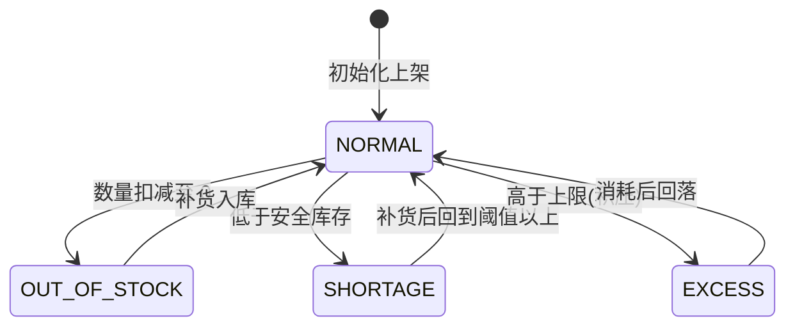

# 功能规格 · 仓储管理（支撑域）

| 项 | 内容 |
|---|---|
| 子域 | 支撑域（Warehouse Bounded Context） |
| 聚合根 | `Warehouse` |
| 实体 | `InventoryRecord`、`Location` |
| 值对象 | `InventoryStatus`、`InventoryMovement`（内含 `MovementType`） |
| 领域服务 | `WarehouseManagementService`、`InventoryManagementService`、`InventoryCountService` |
| 应用服务 | ~~`WarehouseApplicationService`~~ → 🔄 2026-10-21 复测：本上下文 **3 个应用服务**——`WarehouseApplicationService`、`ShopWarehouseApplicationService`、`WarehouseImportApplicationService` |
| 数据表 | `warehouses`、`locations`、`inventory_records`；🔄 2026-10-21 补：店铺仓侧另有 `shop_warehouses`、`shop_warehouse_field_mappings`、`shop_warehouse_import_jobs`、`shop_warehouse_import_job_errors`（本上下文共 **7 表**，`shops` 归 platform/shop 侧）。⚠️ 仍**没有** `inventory_movements`／`inventory_counts`（BR-11、§8） |
| 控制器 | 🔄 2026-10-21 补（原表未列）：`interfaces/controller/warehouse/` 实测 3 个控制器＝`WarehouseController` 13 + `ShopWarehouseController` 5 + `WarehouseImportController` 10，共 **28 端点 / 28 处 `@PreAuthorize`**（`ShopController` 在 `interfaces/controller/shop/`，归 shop/platform 侧） |
| 前端 | ~~`frontend/user-web/src/pages/warehouse/{WarehouseList,WarehouseDetail,CreateWarehouse}.jsx`~~ → 🔄 2026-10-21 复测：实测 4 个页面文件，再加 `ShopWarehouseSync.jsx`。⚠️ 没有独立的 `WarehouseImport.jsx`，但**导入 UI 是有的**——就折叠在 `ShopWarehouseSync.jsx` 里，由 `:65`(getJobs)、`:145`(upload)、`:175`(import)、`:196`(getJob)、`:206`(downloadTemplate) 五处 `warehouseImportApi`（定义在 `api.js:370`）调用承接 |

---

## 1. 模块定位

仓储是履约的**执行层**：它回答两个问题——"货在哪（库位）"和"有多少（库存）"。

跨境场景下的额外要求：多仓（国内自营仓 + 海外仓 + FBA 中转）并存、库存要在多个平台之间同步可售量。**当前模型只有一个 `quantity`，没有区分可用/锁定/在途**，因此无法支撑超卖防护。

---

## 2. 概念模型

```mermaid
erDiagram
    warehouses ||--o{ locations         : "warehouse_id"
    warehouses ||--o{ inventory_records : "warehouse_id"
    locations  ||--o{ inventory_records : "location_id"
    skus       ..> inventory_records    : "sku_code 裸引用"
```

| 概念 | 说明 | 缺口 |
|---|---|---|
| 仓库 | 物理仓，含名称（唯一）、编码（唯一）、地址、容量、启停 | 无仓库类型（自营/海外仓/FBA）——`WarehouseJpaEntity` 无 `type` 列（列清单 `:26-50`）<br>🔄 2026-10-09：唯一性是**三层**——列级 `@Column(unique = true)`（`WarehouseJpaEntity:32` 名称、`:35` 编码）＋ 服务层先查重（编码 `WarehouseManagementService:37,:71`，名称 `:43,:78` 的 `requireUniqueName`）＋ `DataIntegrityViolationException` → 409 兜底（`GlobalExceptionHandler:265-272`，ISS-116）。此前只查编码，名称冲突落 500 `SYSTEM_ERROR` |
| 库位 | 库内位置编码 | ~~无 `(warehouse_id, location_code)` 唯一约束（数据字典 R-05）~~ → 🔄 2026-03-22：**DB 约束确实仍无**（`LocationJpaEntity:19` 的 `@Table` 无 `uniqueConstraints`/`indexes`），但**同仓库内编码唯一已由代码保证**——`WarehouseManagementService:98-103` 在聚合内比对 `getLocations()` 后抛 `BusinessException("库位编码已存在: …")`；跨仓同码仍不受限（与规则本身一致） |
| 库存记录 | 某仓库（可选某库位）下某 SKU 的数量与状态 | 无 `(sku_code, warehouse_id)` 唯一约束（R-05，会导致 `NonUniqueResultException`）——🔄 2026-03-22 复核仍在：`InventoryRecordJpaEntity:21 @Table(name = "inventory_records")` 无 `uniqueConstraints`/`indexes`；缓解手段是定位口径统一走聚合（`InventoryManagementService:112-115` 注释与 `Warehouse.findInventoryRecord`，ISS-060 的修法），不再用不受仓限定的 `findByProductId` 兜底 |
| 库存变动 | 入库/出库/调整/调拨四类 | 未落表，`InventoryMovement` 仅为内存值对象——🔄 2026-03-22 复核仍成立（运行时库只有 `inventory_records`，无 `inventory_movements` 类表）。⚠️ 但该值对象**已可经 HTTP 传入**：`InventoryMovement.java:39` 的私有构造带 `@JsonCreator` + 9 个 `@JsonProperty`（`HEAD` 版本 0 处，工作树 +47 行加上），⇒ `POST /{warehouseId}/inventory/move` 的反序列化阻塞已解除（见 §6） |

---

## 3. 状态机

### 3.1 库存状态（健康度标识）



| 枚举名 | 存储值 | 中文 | 触发条件（目标态） |
|---|---|---|---|
| `NORMAL` | ~~`normal`~~ → 库里是 `NORMAL`（🔄 2026-03-22：`inventory_records.status` 实测 `enum('EXCESS','NORMAL','OUT_OF_STOCK','SHORTAGE')`；小写 `normal` 只是领域枚举的 `code`（`InventoryStatus:14`），落库走 `@Enumerated(EnumType.STRING)` + `InventoryStatusJpaEntity`（`InventoryRecordJpaEntity:46-48`），即 [../db/data-dictionary.md](../db/data-dictionary.md) §4 的**口径 A**） | 正常 | 介于阈值与上限之间 —— 🔄 2026-03-22：实际是 `quantity` 落在 `[10,100]` 闭区间 |
| `SHORTAGE` | ~~`shortage`~~ → `SHORTAGE` | 不足 | < 安全库存阈值（~~⚪ 阈值未配置~~ → 🟡 **阈值有、但硬编码**：`InventoryRecord.calculateInventoryStatus:47-57` 写死 `quantity < 10`，注释「示例阈值」同样出现在 `Warehouse:246`——🔄 2026-10-10 复取行号，原记 `:240` 已漂）。🔄 **同轮订正下游后果**：`SHORTAGE`/`OUT_OF_STOCK` 触发的 `InventoryShortageEvent` 现在会真的产出一张**带明细行的补货建议单**（[../qa/known-issues.md](../qa/known-issues.md) §24 关闭 ISS-143），但建议量恒为 `10 − 现存量` ⇒ **"补到安全库存"这一语义仍未成立**，缺的是阈值建模（`inventory_records` 实测列为 `id/product_id/quantity/sku_code/status/location_id/warehouse_id`，**无 `safety_stock`**），见本文 §8 P1 那条与 [../product/06-glossary.md](../product/06-glossary.md)「安全库存 ⚪ 未建模」 |
| `OUT_OF_STOCK` | ~~`out_of_stock`~~ → `OUT_OF_STOCK` | 缺货 | = 0 → 代码是 `quantity <= 0`（`:48-49`） |
| `EXCESS` | ~~`excess`~~ → `EXCESS` | 过剩 | > 上限（~~⚪ 上限未配置~~ → 🟡 **硬编码 `quantity > 100`**（`:52-53`），非配置项） |

> ~~当前没有任何代码在上架/扣减时自动切换这些状态，也没有阈值模型——状态实际不会被自动更新。~~ → 🔄 **2026-03-22 复测：这句不成立，方向反了**。状态**每次改数量都会自动重算**——`increaseQuantity:64-69`、`decreaseQuantity:76-81`、`adjustQuantity:88-91` 三个方法在改完数量后统一 `this.inventoryStatus = calculateInventoryStatus(this.quantity)`（`:67,:79,:90`），所以入库/出库/调整/盘点四条路径落库的 `status` 都是算出来的，不是入参。
> ⚠️ 真正缺的是**阈值模型**（10/100 写死在实体里，无 `safety_stock` 配置列）与**负库存保护的位置**：实体侧 `decreaseQuantity:78`、`adjustQuantity:89` 用 `Math.max(0, …)` 把数量夹到 0（静默封顶），服务侧 `InventoryManagementService:72-73` 才抛 `InvalidOperationException("库存不足: …, current: …, requested: …")`——两处都在防负数，但只有服务侧会告知调用方。

### 3.2 库存变动类型

> 🔄 2026-03-22：本表的「存储值」是 `InventoryMovement.MovementType:118-121` 的领域 `code`（`inbound/outbound/adjustment/transfer`）。⚠️ **它从来没有落过库**——没有 `inventory_movements` 表，所以这里既不是口径 A 也不是口径 B，而是「只在内存与 HTTP 报文里存在的 code」。⇒ `POST /{warehouseId}/inventory/move` 的 `movementType` 由 Jackson 按**枚举名** `INBOUND/OUTBOUND/ADJUSTMENT/TRANSFER` 反序列化（`@JsonProperty("movementType")`，`InventoryMovement:47`），传小写 code 会 400。

| 枚举名 | 存储值 | 中文 | 触发动作 | 实现 |
|---|---|---|---|---|
| `INBOUND` | `inbound` | 入库 | 采购收货、退货入库、调整入 | ~~⚪ 无端点~~ → ✅ **2026-03-22 复测：有专用端点**`POST /api/warehouses/{warehouseId}/inventory/in`（~~`WarehouseController:151-158`~~ 现行 `:191-199`，body `InventoryMoveRequest{sku,productId,quantity,…}`）→ ~~`WarehouseApplicationService.inventoryIn:110-119`~~（现行 `:140-151`）→ ~~`InventoryManagementService.inboundInventory:37-52`~~（现行 `:43`）。**采购到货已接上这条**：~~`PurchaseApplicationService.receiveIntoWarehouse:281-293`~~（现行 `:276`，逐行调用在 `:283`）调用入库。<br>⚠️ 三个残留：① 入库**不带库位**（~~`:118`~~ 现行 `:149` 固定把第 5 个参数传 `null`，即 `locationId`）；② 退货入库仍无入口；③ 只回一条 `InventoryRecord`，不产生变动流水。<br>🔄 **2026-10-21 补一条**：`:149` 把同一个 `skuCode` 同时当 `productId` 与 `sku` 传给 `inboundInventory`，所以 `/in` 与采购到货自动入库建出的行**两列同值**（运行时库 `inventory_records` 实测全部行 `product_id = sku_code`，见 BR-06） |
| `OUTBOUND` | `outbound` | 出库 | 订单发货、报损 | ~~⚪ 无端点~~ → 🟡 **端点已有、业务联动仍无**：`POST /api/warehouses/{warehouseId}/inventory/out`（~~`WarehouseController:161-168`~~ 现行 `:205-211`）→ `inventoryOut:125-134`（现行 `:157`）→ ~~`outboundInventory:62-84`（数量不足在 `:72-73` 抛 `InvalidOperationException` → 400）~~ **现行 `InventoryManagementService.outboundInventory:68`，"库存不足"在 `:79`**。<br>❌ ~~但**订单发货不会扣库存**：全仓 `outboundInventory` 的调用方只有 `WarehouseApplicationService`（`inventoryOut` 与 `moveInventory`/`transferInventory`），`application/service` 下的订单、物流两条链路 0 命中 ⇒ BR-04 的缺口从「没有出库能力」变成「有出库能力但没人调」~~ → ✅ **2026-10-21 复测：这条已经接通，BR-04 的 P0 已解除**。链路＝`OrderApplicationService.updateOrderStatus:90-105` 在 `newStatus==SHIPPED && oldStatus!=SHIPPED` 时调 `deductInventoryForOrder:112-121`，逐行 `warehouseApplicationService.resolveOutboundWarehouseId(tenantId, sku, qty)`（`WarehouseApplicationService:374-398`，择仓策略＝"能覆盖本次数量的最大库存仓"优先，否则取第一个持有该 SKU 的仓，租户无仓则 `ValidationException("当前租户下没有可用仓库，请先创建仓库")` 阻断发货）＋ `inventoryOut(...)`。物流侧三个发货门（`ship():249`、`batchShip→shipSingle:376`、建单即发货 `:133`）都经 `shipOrder:426-428` 汇入同一条路。<br>⚠️ 两个新边界：① 出库**按 SKU 在租户内自动择仓**，订单行上没有出库仓字段，所以"从哪个仓发的"是算出来的、事后不可追溯（没有流水表，BR-11）；② **`PUT /api/logistics/{id}/status` 推进到已揽收及之后只入运费账、不推进订单也不扣库存**（`persistStatusChange:430-444` 不调 `shipOrder`）⇒ 用它"补发货"会造成物流已揽收而库存照旧。<br>③ 退货入库仍无入口（原判仍在）；只回一条 `InventoryRecord`、不产生变动流水（原判仍在） |
| `ADJUSTMENT` | `adjustment` | 调整 | 盘点差异修正 | ~~⚪ 无独立端点~~ → 🟡 **仍无独立端点，但可达**：`POST /{warehouseId}/inventory/move` 传 `movementType=ADJUSTMENT` → ~~`moveInventory:221-226`~~（现行 `:255`，ADJUSTMENT 分支 `:279-286`）→ ~~`adjustInventory:94-110`~~（现行 `InventoryManagementService.adjustInventory:100`）（语义是「直接置为新数量」，见 ~~`Warehouse.updateInventory:205-206`~~ 现行 `domain/warehouse/aggregate/Warehouse.java:197` 的 `adjustQuantity(quantity)` 分支 `:211`）。盘点专用端点 ~~`:171-177`~~（现行 `:217`）走的是另一条 `InventoryCountService`。<br>🔄 2026-10-21 补：`moveInventory:291` 的兜底分支现在抛 `ValidationException("不支持的库存移动类型: …")` → 400，不再是"静默吞掉" |
| `TRANSFER` | `transfer` | 调拨 | 仓间移动 | ~~❌ 端点存在但抛 `UnsupportedOperationException`~~ → ✅ **2026-03-22 复测：已实现，且 HTTP 层可达**。~~`moveInventory:227-228`~~（现行 `:288-289`）的 `TRANSFER` 分支改调私有 ~~`transferInventory:237-252`~~（现行 `:297-314`；`@Transactional` 在 `:253`），源仓出库 ＋ 目标仓入库，`publishDomainEvents` 对源／目标各调一次（`:312`/`:313`）；全仓 `UnsupportedOperationException` **0 处**（ISS-012 已修）。<br>⚠️ 两个已知口径（`docs/qa/smoke-test-checklist.md` 4.5 实测）：响应只回**目标仓入库**那条记录，源仓结果要另查 `GET /{warehouseId}/inventory`；body 里 `warehouseId` 是**必填但不起作用**（`InventoryMovement` 构造 `Objects.requireNonNull`，实际生效的是路径参数），路径与 body 不一致时静默按路径执行 |

---

## 4. 业务规则

| 编号 | 规则 | 状态 | 说明 |
|---|---|---|---|
| BR-01 | 仓库名称、编码全局唯一 | ✅ | **三重防护已齐**：列上有唯一约束（~~`WarehouseJpaEntity:32,:35`~~ 写法是 `@Column(unique = true)`，就在 `:32`/`:35` 两行；`@Table(name = "warehouses")` 在 `:21` 且**没有** `uniqueConstraints`——🔄 2026-10-21 对运行时库复核，`information_schema` 实测 `warehouse_code`→`UK1bidj95…`、`warehouse_name`→`UK7ix5emrhp…` 两个 UNIQUE 都在）＋ 服务层名称/编码双查（编码 `:37,:71`，名称 `requireUniqueName` `:43,:78,:125-128`）＋ `DataIntegrityViolationException` 兜底映射 409（~~`GlobalExceptionHandler:265-272`~~ 现行 `:265-273`）。🔄 2026-10-09 收口 ISS-116：此前**名称**重复只被 SQL 层的 `warehouse_name` UNIQUE 拦下，抛 `DataIntegrityViolationException` 后无专用分支 ⇒ 落 500 `SYSTEM_ERROR`（与 DB 唯一性竞态无法区分）。现在服务层先查并抛 `BusinessException("仓库名称已存在: …")` → 400，缓存/并发漏网的仍由 409 兜住；409 文案不回显 SQL 与索引名（口径 [R-29](../qa/known-issues.md)）。改自己（名称不变）不被误拦，见 `WarehouseManagementServiceUniquenessTest` 4 例 |
| BR-02 | 同一仓库内库位编码唯一 | ~~⚪~~ → 🟡 | ~~无唯一约束（R-05）~~ → 🔄 2026-03-22：**代码级已保证**（~~`WarehouseManagementService:98-103`~~ 现行 `addLocation:99`，查重在 `:105-110`：在聚合 `getLocations()` 内比对 `locationCode`，重复抛 `BusinessException("库位编码已存在: …")` → 400）；⚠️ DB 的 `(warehouse_id, location_code)` 唯一约束仍缺（`LocationJpaEntity:19` 的 `@Table(name = "locations")` **无 `uniqueConstraints`**，各列也没有 `unique = true`）⇒ 并发双写仍可穿透，属 R-05 残留。🔄 **2026-10-21 对运行时库复核**：`information_schema.STATISTICS` 实测 `locations` 只有 `PRIMARY(id)` + 1 个 `warehouse_id` 外键索引，判据不变 |
| BR-03 | 同一仓库同一 SKU 只能有一条库存记录 | ⚪ | 无唯一约束；`findBySkuCodeAndWarehouseId` 返回 `Optional`，重复行会抛 `NonUniqueResultException`。<br>🔄 2026-03-22 复核：`InventoryRecordJpaEntity:21` 仍无约束；定位口径已统一收敛到聚合（~~`InventoryManagementService:112-115`~~ 现行 `findRecord:126` 与 `findOrCreateRecord:137`，均在 `Warehouse` 聚合内按 productId→sku 回落查找），所以「读到别的仓的行」这一类已修（ISS-060），但「同仓同 SKU 两行」仍无 DB 级防护 |
| BR-04 | 订单发货必须扣减对应仓库库存 | ~~⚪ 无联动（BR 缺口，P0）。🔄 2026-03-22 精确化：**不是缺接口，是缺调用**——~~（该判据当时成立）`inventoryOut` 的调用方只有 `WarehouseController:165`（现行 `:205`）与服务层自身，订单/物流链路 0 命中 ⇒ ~~BR-04 的缺口是"有出库能力但没人调"~~ → ✅ **2026-10-21 复测：已成立，本行改判 P0 关闭**。 | 调用链与择仓策略见 §3.2 OUTBOUND 行的复测块（`OrderApplicationService:98-100` → `deductInventoryForOrder:112-121` → `resolveOutboundWarehouseId:374-398` → `inventoryOut`）；`WarehouseApplicationServiceOutboundTest` 5 例常驻守择仓分支（含"租户无仓 ⇒ `ValidationException`"）。⚠️ 仍然成立的两个反面：① 扣减是**发货时同步执行**、不进 `InventoryMovement` 事件（§7），所以平台可售量不会跟着变（BR-12 仍 ⚪）；② `PUT /api/logistics/{id}/status` 那条推状态的路径**不扣**（§3.2 复测块②） |
| BR-05 | 库存不足时禁止出库 | ~~⚪ 无出库动作~~ → ✅ | 🔄 2026-03-22 复测：出库动作与校验都在——~~`InventoryManagementService:72-73`~~（现行 `:79`）抛 `InvalidOperationException("库存不足: " + productId + ", current: …, requested: …")`，经 `GlobalExceptionHandler:73-81`（现行 `:80-88`）映射 **400**；实体侧另有 `Math.max(0, …)` 兜底（`InventoryRecord:78,:89`）。实测口径见 `docs/qa/known-issues.md` ISS-060 尾部（超量出库返 400 INVALID_OPERATION）。🔄 2026-10-21 补一条**新增后果**：这条 400 现在会**从发货路径冒出来**——`deductInventoryForOrder` 逐行调 `inventoryOut`，任一 SKU 余量不足就把整单发货事务顶掉（`@Transactional` 回滚），而 `resolveOutboundWarehouseId:396-397` 在"没有任何仓能覆盖"时仍会挑一个仓（`holder` 或第一个仓）去撞这个 400，报的是"库存不足"而不是"无仓可选" |
| BR-06 | 调拨必须同时减少源仓、增加目标仓（同一事务） | ~~❌ 方法体抛异常~~ → ✅ | 🔄 2026-03-22 复测：`moveInventory`（~~`WarehouseApplicationService:201-232`，`@Transactional` 在 `:200`~~ 现行 `:255`，`@Transactional` 在 `:253`）的 `TRANSFER` 分支调 ~~`transferInventory:237-252`，`:249` 源仓出库 + `:250-251` 目标仓入库~~（现行 `:297-315`：源仓出库 `:309` + 目标仓入库 `:310-311`），同一事务。<br>⚠️ 三点残留：① **无服务层测试**——~~全仓只有 `WarehouseControllerTest:190-214` 覆盖了 `/move`~~ 现行覆盖 `/move` 的是 `interfaces/controller/WarehouseControllerTest.java` 的 `testMoveInventory:158` 与 `testTransferInventory:193`（该类共 8 例），两条都用 `when(warehouseApplicationService.moveInventory(...))`（`:181`/`:206`）把服务 mock 掉了，**双写逻辑没有一条真实断言**；② ~~目标仓若原本没有该 SKU 行，入库会把 `productId` 当 SKU 写进新行（ISS-060 已记）~~ → 🔄 **2026-03-22 复测：方向写反了**，互填发生在 ~~`InventoryManagementService.createInventoryRecord:152-153`~~（现行 `:154`，回落在 `:158-159`）（`productId` 空则落 `sku`、`sku` 空则落 `productId`），而调拨路径 ~~`:248`~~ 的 `productKey`（现行 `:308`）在 `productId` 非空时恒等于 `productId`、`:309-311` 又分别把 productKey 与 sku 各自传到位 ⇒ **调拨新建的行两列各归其位**，只有显式传空串 `"productId": ""` 才回落；真正的"SKU 兼作产品ID"来自另一条路径——~~`inventoryIn:118` 与 `inventoryOut:133`~~（现行 `:149`/`:165`）把同一个 `skuCode` 同时当 productId 和 sku 传下去（`/in｜/out` 与采购到货自动入库都走这里），实测运行时库 `inventory_records` ~~现有 **7 行全部 `product_id = sku_code`**~~ → 🔄 **2026-10-21 复核：该表现在是 0 行**（历轮冒烟按"子表先删"清场，`SELECT COUNT(*)` 实测 `0`），所以这条判据**只剩代码侧证据**（`:149` 的实参形状）没有数据侧证据了；两条路径混用 ⇒ 同一物理 SKU 可落两行不同键的记录（叠加 R-05 无 `uk(sku_code,warehouse_id)`）；③ 无幂等键，重复提交即重复调拨（全仓 0 个 `@Version`） |
| BR-07 | 盘点应冻结账面快照并输出差异表 | ~~⚪ 仅 `count` 更新数量~~ → 🟡 | 「仅更新数量」仍成立（`InventoryCountService:30`直接 `adjustQuantity(actualQuantity)`，无快照表、无差异表）；🔄 但**差异是算出来的、并且进了事件**：~~`Warehouse.countInventory:253-282` 保留 `originalQuantity:259`，并在 `:268-273` 组 `CountResult{productId, expectedQuantity, actualQuantity, difference}` 注册成 `InventoryCountEvent`（`:281`）~~ → 🔄 **2026-10-21 现行**：`domain/warehouse/aggregate/Warehouse.java:259-288`，`originalQuantity:265`、`CountResult:274-279`、`registerDomainEvent:287`——**事件确实进了聚合的事件列表**，但**没有任何消费者**（`InventoryCountEvent` 既不在 `EventHandler` 的 4 个 `@EventListener` 里、也没有 MQ 消费者类），所以差异既不落库也无人消费；见 §7 复测块 |
| BR-08 | 盘点调整需审批 | ⚪ | 无审批。🔄 2026-03-22 复核：~~`/inventory/count`（`WarehouseController:171-177`）~~（现行 `:217`）是 query 参数直改数量的单步接口 |
| BR-09 | 库位容量之和不得超过仓库容量 | ⚪ | 无校验。🔄 2026-03-22 复核 ~~`WarehouseManagementService.addLocation:92-110`~~（现行 `:99`）：只做「仓库存在 + 编码不重复 + `warehouse.addLocation`」，`capacity`/`occupied` 全程不参与比较（~~`WarehouseApplicationService:97-98`~~ 现行 `:128` 只给默认值 `1`，`locationType` 缺省 `SHELF` 在 `:127`） |
| BR-10 | 停用的仓库不可参与发货/入库 | ⚪ | `active` 字段存在但无校验。🔄 2026-03-22 复核仍在：`WarehouseJpaEntity:44` 有 `active NOT NULL`、~~`PUT /{id}/status`（`WarehouseController:127-132`）~~（现行 `:164`）能改它，但 `requireWarehouse`（`WarehouseApplicationService:259-264`）与 `inventoryIn/inventoryOut/moveInventory` 都只判「存在」不判「启用」 → 🔄 **2026-10-21 复测：结论不变、行号已换**——按 ID 加载仓库的收口点现在是 `getWarehouse:317-322`（另有 `findWarehouseById:200-204`、`findWarehouseByCode:224-228`），三处都只做 `EntityNotFoundException` + `TenantAccessGuard.requireOwned`（分别为 `:203`/`:227`/`:321`），**没有一处看 `active`**；全文件 `grep active` 只命中 `changeWarehouseStatus:107-110` 与 `:128` 的库位默认值 ⇒ 停用仓仍可被择仓、出入库、调拨。⚠️ 而且**发货自动扣库存会把停用仓选进来**（`resolveOutboundWarehouseId:374-398` 遍历 `listByTenantId`（`:376`）不看 `active`）——BR-04 接通后这条缺口的后果变重了：从"能操作"升级成"系统会自动把停用仓当作出库仓" |
| BR-11 | 库存变动必须留下流水（谁、何时、何种类型、多少） | ⚪ | `InventoryMovement` 未持久化。🔄 2026-03-22 复核：字段是齐的（`movementId`/`warehouseId`/`targetWarehouseId`/`productId`/`sku`/`quantity`/`movementType`/`reason`/`movedAt`，见 `domain/warehouse/valueobject/InventoryMovement.java:13-24`），`movementId` 缺省自补 UUID（`:50`），**但没有 `inventory_movements` 表、也没有仓储接口**，所以每次变动只在内存里组对象、塞进那个发不出去的事件——🔄 2026-10-21 订正后半句：事件**现在发得出去了**（§7 复测：`publishDomainEvents` 已挂在 12 个写点上），"没流水"这一半仍成立，缺的还是表 |
| BR-12 | 库存变动后应同步平台可售量 | ⚪ | 无。🔄 2026-03-22 复核：平台侧有 `PlatformIntegrationServiceImpl` 的库存推送能力（失败抛 `PLATFORM_INVENTORY_PUSH_FAILED`），但仓储变动链路 0 处调用它 ⇒ 两侧都有实现、中间没有桥。🔄 **2026-10-21 复测：三处口径要订正**——① 触发方式仍是**手工** `POST /api/platform-integrations/{id}/sync-inventory`（`PlatformIntegrationController:319-323`），`InventoryMovementEvent` 虽已发布但**没有任何消费者会去调它**；② 能推的只有 `CUSTOM_SHOP` 一种协议：`PlatformIntegrationServiceImpl.syncInventoryToPlatform:181` 对 ~~`authType != CUSTOM_SHOP` 一律抛 `PLATFORM_INVENTORY_PUSH_UNSUPPORTED`~~ 现行 `:190-193` 的判定是 `authType != null && authType != CUSTOM_SHOP` ⇒ **`authType` 为空的集成放行**（`:250` 注释说明空值即默认 `CUSTOM_SHOP`，口径一致）；注释里点名的 `PlatformInventoryPusher` **端口类型全仓不存在**，只有 `:178` 那句 javadoc 提到它，即"其他平台需要先补端口"这件事从未落地；③ 🔴 **新发现的越权面**：汇总可售量走 `inventoryRecordRepository.findAll()`（~~`:200`~~ 现行 `:202`），**不带租户条件** ⇒ 一家店铺做同步时，会把别的租户的 SKU 数量一并 POST 到该店铺的 `{storeUrl}/inventory`（负数还被 ~~`Math.max(qty,0)` `:203`~~ 现行 `:206` 夹成 0）。这一条要进 [../security-findings.md](../security-findings.md) 与 ISS 台账，优先级 P0/P1 |

---

## 5. 功能清单

| 功能 | 前端 | 后端 | 状态 |
|---|---|---|---|
| 仓库列表 | `WarehouseList.jsx`~~（mock）~~ | `GET /api/warehouses`（前端 `api.js:284`~~`warehouseApi.getWarehouses()`~~，现行 `warehouseApi` 整体在 `api.js:341`） | ~~🟡 无分页 —— **2026-01-25 逐页复测**（判据：页面内 `*Api.` 调用点数）：前端已联网（2 个调用点），但后端这一条仍成立**：`WarehouseController.java:98-101` 是 `Result<List<Warehouse>>` 全量返回。~~ → 🟡 **2026-10-21 复测：分页与租户过滤都加上了，ISS-063 仍在**。`GET /api/warehouses`（`WarehouseController:115-121`）现在收 `tenantId/page/size` 三个参数（`size` 缺省 **10**、不是别的模块的 20），控制器 `resolveTenant:123-132` 走"请求参数 → JWT 上下文 → `DEFAULT_TENANT_ID`"三级回落，服务侧 `searchWarehouses:216-218` 把 `TenantAccessGuard.scopedTenantId(tenantId)` 写进 `warehouseRepository.search(...)`；另有一条**遗留全量入口** `findAllWarehouses:209-211`（`withinCurrentTenant` 查后过滤）。⚠️ 出参仍是 `Result<PageResult<Warehouse>>`——**领域聚合本身**（含 `domainEvents` 之类内部字段），这就是 ISS-063 在本域唯一的常驻形态 |
| 仓库详情 | `WarehouseDetail.jsx`~~（mock）~~ | `GET /api/warehouses/{id}`（~~`WarehouseController.java:84`~~ 现行 `:99`） | 🟡 **2026-01-25 逐页复测**（判据：页面内 `*Api.` 调用点数）：9 个调用点，已联网；库存查询走 `GET /{warehouseId}/inventory`（~~`:144`~~ 现行 `:184`）。响应体同样是聚合外露（ISS-063） |
| 创建仓库 | ~~`CreateWarehouse.jsx`（未提交）~~ | `POST /api/warehouses`（~~`:72-81`~~，body `CreateWarehouseRequest`；现行 `:84-95`） | ~~🟡~~ → 🟡 **2026-03-22 复测：前端其实已经联网**（`CreateWarehouse.jsx:23` 调 `warehouseApi.createWarehouse({...})`，`api.js:287`），旧口径的「未提交/仅提示」作废。<br>🔴 ~~**但这条链路有租户缺口**：表单只送 `warehouseName/warehouseCode/address/capacity` 四个字段（`CreateWarehouse.jsx:23-28`，**没有 `tenantId`**），控制器 `:75` 把 `request.getTenantId()`（＝null）原样传下去，`WarehouseManagementService:32-47` 与 `Warehouse.create:99-115` **都不做任何缺省或 `TenantContext` 解析** ⇒ 从 UI 建出来的仓库 `tenant_id` 会是 NULL（运行时库现有 2 行都带租户 UUID，是因为探针调用显式传了参）。对照：采购域已有 `resolveTenant` 三级回落（`PurchaseController:264-272`），仓储域没有 ⇒ 这是 ISS-051/M-05 在仓储的未收口形态。~~ → ✅ **2026-10-21 复测：ISS-051/M-05 在仓储已收口**——控制器 `:89` 现在传 `resolveTenant(request.getTenantId())`（同列表口径三级回落 `resolveTenant:123-132`，注释里点名的就是 ISS-118），服务侧 `createWarehouse:55-56` 另有一层 `resolveTenantId → TenantAccessGuard.resolveWriteTenant(tenantId, DEFAULT_TENANT_ID)`（`:417-418`）兜底 ⇒ **前端不送 `tenantId` 也不会再落 NULL**。⚠️ 另一半仍在：`capacity` 缺省被 `:93` 静默改成 `1`（不报错），表单填 0 或留空都会建出一个"容量 1"的仓。（`api.js` 侧：`warehouseApi` 现在整体在 **`:341-358`**，13 个方法与 13 个端点一一对应） |
| 查询仓库库存 | `WarehouseDetail.jsx`（库存表格列 `inventoryColumns:201`，含「库位」列 ~~`:196`~~ 现行 `:215`） | `GET /api/warehouses/{warehouseId}/inventory`（~~`:144-148`~~ 现行 `:184`） | 🟡 全量返回、无分页无按 SKU 汇总 |
| 库存盘点 | ~~无入口~~ → `WarehouseDetail.jsx:183`（`handleCount`，每行「盘点」按钮，用 `window.prompt` 收实盘数，`:184`；非负整数校验在 `:186-189`） | `POST /api/warehouses/{warehouseId}/inventory/count`（~~`:171-177`~~ 现行 `:217`，query 参数） | 🟡 只更新数量；⚠️ 前端把 `record.productId \|\| record.sku` 当定位键（`:192`），与后端「聚合内先按 productId、再按 sku」的回落一致（ISS-060 的修法）；⚠️ 失败只 `console.error`（`:196-198`），没有 toast |
| 库存移动/调拨 | ~~`warehouseApi` **有** `moveInventory` 方法（`api.js:297`），但**没有任何页面调用它**（逐页 grep 0 命中）⇒ 调拨在 UI 上仍然做不到~~ → 🔄 **2026-10-21 复测：调拨 UI 已经做了**——`WarehouseDetail.jsx:142` 的 `openInventoryForm(type)` 有 IN/OUT/**TRANSFER** 三态，`handleInventorySubmit:149` 的 `else` 分支（`:160-169`）调 `warehouseApi.moveInventory(id, {...})`（现行 `api.js:356`），body 里**主动补齐** `movementType`/`warehouseId`/`productId`/`sku`/`quantity`/`targetWarehouseId`，正是 §6 那个"body 必须带 warehouseId"坑的正解（`:161` 的注释写明了原因）；⚠️ 但 `productId: values.sku` 与 `sku: values.sku` 同值 ⇒ UI 调拨新建的行会落进 BR-06 记的"两列同值"形状 | `POST /api/warehouses/{warehouseId}/inventory/move`（~~`:180-185`~~ 现行 `:228`，`@PreAuthorize` 在 `:226`） | ✅ **2026-03-22 复测：四类动作都可用**（`moveInventory` 现行 `:255`，`@Transactional` 在 `:253`，按 `INBOUND/OUTBOUND/ADJUSTMENT/TRANSFER` 分派，`TRANSFER` 走私有 `transferInventory:297`；~~`InventoryMovement.java:39`~~ 现行 `:40-49` 的 `@JsonCreator` + 9 个 `@JsonProperty` 让 body 能反序列化，`WarehouseControllerTest`（现行路径 `interfaces/controller/WarehouseControllerTest.java`）的 `testMoveInventory:158`／`testTransferInventory:193` 两条用例用真实 JSON 打该端点并断 200）。🔄 2026-10-21：**前端断点也已消除**（见左列）。⚠️ 剩下的＝错误不可见：`WarehouseDetail.jsx:175` 起 `catch {}` 是空的，400"库存不足"／"当前租户下没有可用仓库"到不了用户眼前 |
| 入库管理 | ~~无页面~~ → `WarehouseDetail.jsx:134-161`（出入库弹窗，payload 仅 `{sku, quantity}`，~~`:145`~~ 现行 `:153`） | ~~无端点~~ → `POST /api/warehouses/{warehouseId}/inventory/in`（~~`WarehouseController:151-158`~~ 现行 `:191-199`，body `InventoryMoveRequest`） | 🟡 **2026-03-22 复测：端点与入口都补齐了，缺的是业务层**。① 入库不带库位（~~`WarehouseApplicationService:118`~~ 现行 `:149` 末位固定传 `null`，前端弹窗也没这个字段）；② 没有入库单/收货任务实体，`/in` 是「直接改数量」；③ 采购到货已改为服务端自动调用它（~~`PurchaseApplicationService:288`~~ 现行 `:283`，方法 `receiveIntoWarehouse:276`），所以到货不再需要人工点；④ 前端 `catch {}` 是空的（~~`:156-157`~~ 现行 `:175-176`），400「入库数量必须大于0」这类错误只在表单校验层挡 |
| 出库管理 | ~~无页面~~ → 同一弹窗（`inventoryFormType === 'IN' ? in : out`，~~`:146-151`~~ 现行 `:154-159`） | ~~无端点~~ → `POST /api/warehouses/{warehouseId}/inventory/out`（~~`WarehouseController:161-168`~~ 现行 `:205-211`） | ~~🟡 端点与入口已补、订单联动仍无~~ → 🟢 **2026-10-21：订单联动已接**（`OrderApplicationService.deductInventoryForOrder:112-121`，见 BR-04）；出库会做库存不足校验（~~`InventoryManagementService:72-73`~~ 现行 `:79` → 400），同样不带库位 |
| 库位管理 | ~~无页面~~ → `WarehouseDetail.jsx:125`（`handleAddLocation`，提交处理器的空 `catch {}` 在 `:134-136`，与出入库弹窗同一个毛病）+「库位管理」按钮 `:278`/弹窗内「添加库位」`:396`，「添加库位」弹窗 `:448-461`（`locationCode` 必填、`locationType` 默认 `SHELF`） | ~~无端点~~ → `POST /api/warehouses/{id}/locations`（~~`WarehouseController:135-141`~~ 现行 `:174`，body `AddLocationRequest{locationCode,locationType,capacity}`；~~`api.js:291`~~ 现行 `api.js:350`） | ~~⚪~~ → 🟡 **只有「新增」这一条闭环**（前后端都通）：无列表/修改/删除端点，库位不参与出入库（`locationId` 恒为 null——`inventoryIn:149`、`moveInventory:266` 的 INBOUND 分支、`transferInventory:311` 三处末位都是 `null`），`Location` 只在 `warehouses`→`locations` 外键下当静态台账存在（`LocationJpaEntity:19`，🔄 2026-10-21 `information_schema` 实测该表只有 `PRIMARY(id)` + `warehouse_id` 外键索引，无 `(warehouse_id, location_code)` 唯一约束） |
| 缺货预警 | 无 | ~~无~~ → 领域内已判定 | ~~⚪~~ → 🟡 ~~**判定有、预警发不出去**~~ → 🟢 **2026-10-21 复测：判定有、也发得出去、下游真的建单**。判定：`InventoryRecord:48-51`（`quantity <= 0` ⇒ `OUT_OF_STOCK`、`< 10` ⇒ `SHORTAGE`）；注册：~~`Warehouse.updateInventory:234-244`~~ 现行 `Warehouse.java:239-249`（阈值硬编码 `10` 于 ~~`:240`~~ `:246`）；发布：~~但入库/出库/调拨路径都不调用发布器（`publishDomainEvents` 只在 `:45,:55,:102`）~~ → 🔄 **现在 `publishDomainEvents` 已挂在 12 个写点上**（`:58` 创建、`:70` 更新、`:132` 加库位、`:149` 入库、`:166` 出库、`:182` 批量盘点、`:247` 单条盘点、`:269`/`:277`/`:285` 三个 move 分支、`:312`/`:313` 调拨源/目标；方法定义在 `:421`），缺货事件正是挂在 `:166` 的出库点上；消费：进程内 `EventHandler:92-105` 与 MQ `InventoryShortageEventConsumer` 两条通道现在**都转调同一个 `ReplenishmentApplicationService.replenishForShortage`**（`:100` 与 `InventoryShortageEventConsumer:40` 这两行转调，`:97-98` 的注释点名的就是 ISS-143「两条通道各写一套会建出只有单头的空单」），此前"写死 `default-tenant`/`DEFAULT_SUPPLIER`、`catch` 吞异常"的形态里，**租户这一半已消**（载荷带 `tenantId`，`Warehouse.java:242`；补货侧用 `TenantAccessGuard.resolveWriteTenant(event.getTenantId(), DEFAULT_TENANT_ID)`，`ReplenishmentApplicationService:71`），**供应商这一半仍在**（`SUPPLIER_ID="DEFAULT_SUPPLIER"`／`SUPPLIER_NAME="Default Supplier"` 是常量 `:34-35`，建单时用 `:97`）；`catch (Exception)` 仍在 `:103-105`，只是现在只吞不建重复单。⚠️ 仍缺的是**主动通知**：前端只有状态 Tag（`inventoryStatusMap:36-38` + 渲染 `:206-213`），无消息/待办 |
| 店铺仓库绑定/同步 | 🔄 **2026-10-21 补（本表此前完全没有这两行）**：`ShopWarehouseSync.jsx`，6 个 `*Api.` 调用点（`fetchBase:46-48` 拉集成/仓库/店铺仓三份列表、`syncFromPlatform:85`、`bindShopWarehouse:119`、`unbindShopWarehouse:133`） | `ShopWarehouseController`（前缀 `/api/warehouses/shop`）5 个端点：列表 `GET :47`、详情 `GET /{id} :57`、绑定 `POST /bind :66`、解绑 `POST /{id}/unbind :74`、平台全量同步 `POST /sync/{integrationId} :83`（守卫用 `shop:sync`，见 §6） | 🟡 闭环已通（前后端都有、5/5 有守卫、`ShopWarehouseApplicationService` 三个写点都 `@Transactional` `:64/:98/:110`）。⚠️ 三条口径：① **按编码自动绑定的租户收敛只在同步这条路做了**——`syncShopWarehousesFromPlatform:136-146` 先取 `TenantAccessGuard.currentTenantId()`（`:137`）再逐条比 `warehouse.getTenantId()` 跳过他家仓（`:140-142`，注释点名 ISS-050），但 `currentTenantId()` 返回 null 时（无 JWT 上下文）该过滤整体失效、索引退化成全库；手工绑定另有 `requireOwned`（`bindShopWarehouse:78`）；② 页面加载的三份列表调用都写成 `.catch(() => [])`（`:46-48`），接口 4xx 时页面显示"没有数据"而不是报错；③ 绑定弹窗的 `catch {` 是空的（`handleBind:115`，空 catch 在 `:123`），与 §8 记的 `WarehouseDetail.jsx` 同一个毛病 |
| 店铺仓库批量导入 | 同一页面 `ShopWarehouseSync.jsx`（没有独立导入页）：任务列表 `warehouseImportApi.getJobs:65`、文件上传 `upload:145`、按预览行导入 `import:175`、任务详情 `getJob:196`、模板下载 `downloadTemplate:206` | `WarehouseImportController`（前缀 `/api/warehouses/import`）10 个端点、10/10 方法级守卫（§6 表） | 🟡 主链路可用（预演 → 上传 → 建任务 → 逐行落库 → 任务详情读失败行）。判定要点：① 导入**只写 `shop_warehouses` 侧**，不会代建本地仓库——行的 `warehouseCode` 命不中就整行失败：`findByWarehouseCode(...).orElseThrow(ValidationException("本地仓库编码不存在: …，请先创建对应仓库"))`（`WarehouseImportApplicationService:286-288`）；② 逐行 `try/catch(Exception)` + `job.recordFailure(...)`（`:179-185`），坏行不阻断整批，失败原因落 `shop_warehouse_import_job_errors`；③ `updateExisting` 缺省即 `true`（`:151`：`request.getUpdateExisting() == null \|\| ...`），不显式传 false 就会覆盖已有绑定；未开启覆盖时走 `job.recordSkipped`（`:293-298`）；④ ⚠️ **这一条编码查找没有租户条件**（见 §8 新增 P1 行）；⑤ ⚠️ 默认仓库行没给 `warehouseCode` 时报「默认仓库未绑定本地仓库编码，请在数据中提供 warehouseCode」（`:315-317`），是硬失败不是跳过 |

---

## 6. 接口对照

| 场景 | 方法 | 路径 | 状态 |
|---|---|---|---|
| 创建仓库 | POST | `/api/warehouses` | 🟡 入参已改 JSON body（`CreateWarehouseRequest{tenantId,warehouseName,warehouseCode,address,capacity}`，`WarehouseController:48-…`，映射 `:84`）；~~仍**无鉴权**（本控制器 `@PreAuthorize` 0 处）~~ → ✅ **2026-10-21 复测：本控制器 13 个端点全部有 `@PreAuthorize`（13/13）**，写用 `HAS_WAREHOUSE_WRITE`、读用 `HAS_WAREHOUSE_READ`（常量定义在 `:40-43`，SpEL＝`hasRole('PLATFORM_ADMIN') or hasAuthority('warehouse:read\|write')`）。⚠️ 口径补充：这两个常量是**每个控制器各自私有**的字符串，不在 `PermissionPoints` 里（`domain/tenant/PermissionPoints.java:45` 只登记权限点 `warehouse:read`/`warehouse:write`；全表 25 租户级 + 1 平台级 = 26 项）⇒ 改表达式要逐控制器搜 |
| 仓库详情 | GET | `/api/warehouses/{id}`（~~`:84`~~ `:99`）· 按编码 `GET /api/warehouses/code/{code}`（~~`:91`~~ `:107`） | 🟡 出参是聚合本身（ISS-063）；🔄 两条读路径都过 `TenantAccessGuard.requireOwned`（`findWarehouseById:203`、`findWarehouseByCode:227`） |
| 仓库列表 | GET | `/api/warehouses`（~~`:98`~~ `:115`） | ~~🟡 全量返回，无分页无租户过滤（`WarehouseApplicationService:170-172` 走 `findAll()`）~~ → ✅ **2026-10-21 复测：判据已不成立**——`:115-121` 是 `Result<PageResult<Warehouse>>`，收 `tenantId/page/size`；`searchWarehouses:217` 走 `warehouseRepository.search(TenantAccessGuard.scopedTenantId(tenantId), page, size)`（`:218`）。走 `findAll()` 的是**另一条**入口 `findAllWarehouses:210`（`withinCurrentTenant:328` 查后过滤），🔄 **2026-10-21 补测：它连调用方都没有**——`grep -rn findAllWarehouses backend/src/main` 除定义处**零命中**（没有 HTTP 映射、没有服务内引用），即一段死代码；`withinCurrentTenant` 这个"查后过滤"模式在本类里也只剩它一个用户（其余读路径都改成了 `search(scopedTenantId(...))` 的查前收敛） |
| 更新仓库 | PUT | `/api/warehouses/{id}`（~~`:104`~~ `:137`） | 🟡 body 字段逐条 `null → 取原值` 合并（现行控制器 `:141-147`，先用 `findWarehouseById` 读回原值再合并），空 body 等价于无操作；⚠️ 合并后仍走 `WarehouseManagementService.updateWarehouse:62`，名称/编码查重齐全 |
| 删除仓库 | DELETE | `/api/warehouses/{id}`（~~`:119`~~ `:154`） | ✅ **三道引用门，全过才放行**（`WarehouseApplicationService.deleteWarehouse:84-101`，2026-10-10 §23 收口，此前只有第Ⅰ道）：**Ⅰ 库存** 存在 `quantity > 0` 的库存记录 ⇒ 400「仓库中仍存在库存记录，无法删除，请先清空库存」；**Ⅱ 采购引用** `purchaseOrderRepository.countByWarehouseId(id) > 0` ⇒ 400「仓库已被 N 张采购单引用，无法删除，请先处理这些采购单」——补这条是因为 `purchase_orders.warehouse_id` 是 `varchar(255)` 且**库里没有外键**，旧版只看库存 ⇒ 通过 API 删仓就把指向它的采购单掏成断链（[known-issues ISS-142](../qa/known-issues.md)）；**Ⅲ 店铺绑定** `shopWarehouseRepository.findByLocalWarehouseId(id)` 非空 ⇒ 400「仓库已绑定 N 个店铺仓库，无法删除，请先解除绑定」（绑定列名是 `local_warehouse_id`，不补这道会留 `shop_warehouses` 孤儿绑定行）。三门全过后先逐条 `inventoryRecordRepository.delete(...)`、再 `warehouseRepository.delete(...)`（`:100`）。⇒ **接口契约的新增拒绝形状**：`400` ＋ `ValidationException`（`BusinessException` 子类）的可读中文原因，前端不用改——`WarehouseList.jsx:67-74`／`WarehouseDetail.jsx:103-110` 的删除只 `catch` 打印，原因是 `services/api.js:80-130` 的响应拦截器按 `errorData.message` 统一弹出的。**实测**：常驻位 `12.47` 与 `12.47a`~`12.47l` 十三段（一正一负——有引用必 400 且「被挡时仓库一张都没删」，解绑/清场后同一路径 200 且「仓确实已从库里消失」）、`12.123a`~`12.123e` 五段、`12.171` 全库断链采购单基线（本轮 **530 → 530**，即"一张都不许新增"）；`WarehouseDeletionReferenceGuardTest` 4 例行为守卫 + `WarehouseReferenceGuardTest` 5 例静态守卫，**变异实测**＝摘掉两道门 ⇒ `Tests run: 9, Failures: 5, Errors: 1`；R-18 真浏览器（user-web `/warehouses`，18:00:19 拒绝态与 18:01:49 放行态的 toast 逐字回读，截图 `/tmp/round11/iss142-r18-*.png`）。⚠️ **守卫是应用层的，不是 DB 层的**：`warehouses` 与 `purchase_orders` 之间仍没有外键，绕过 API 直接 `DELETE FROM warehouses` 依旧会造断链（探针 teardown 就是这么漏出 530 → 535 的，本轮已按"子表先删"补进 `smoke.sh` §12.J 与 `iss072`／`iss137`／`iss138` 三份探针的清理块，并各加 2 条常驻判定） |
| 启停仓库 | PUT | `/api/warehouses/{id}/status?active=`（~~`:127-132`~~ `:164`） | 🟡 `changeWarehouseStatus:107-111` 用 `toBuilder()` 整体重建后 save，**不注册也不发布任何事件**；停用的仓仍可用于出入库、还会被发货自动择中（BR-10） |
| 添加库位 | POST | `/api/warehouses/{id}/locations`（~~`:135-141`~~ `:174`） | 🟡 只有新增（同 §5） |
| 仓库库存 | GET | `/api/warehouses/{warehouseId}/inventory`（~~`:144-148`~~ `:184`） | 🟡 全量返回；服务侧 `findInventoryByWarehouse:234` 先 `requireWarehouse`（`:236`）⇒ 归属校验覆盖到这条读路径 |
| 入库 | POST | `/api/warehouses/{warehouseId}/inventory/in`（~~`:151`~~ `:193`） | ✅ 2026-03-22 新增记录（旧表未列）。⚠️ body 虽是 `InventoryMoveRequest`，但控制器 `:196-198` **只读 `sku`（缺省回落 `productId`）与 `quantity`**，`movementType/targetWarehouseId/reason` 传了也被忽略 |
| 出库 | POST | `/api/warehouses/{warehouseId}/inventory/out`（~~`:161`~~ `:205`） | ✅ 同上（控制器 `:208-210`）；不足返 400；同样忽略三个字段 |
| 库存盘点 | POST | `/api/warehouses/{warehouseId}/inventory/count?productId=&actualQuantity=`（~~`:171-177`~~ `:217`） | 🟡 只更新数量、无差异表；⚠️ 与 `PUT /{id}/status?active=`（`:164`，参数在 `:167`）并列，是本控制器**仅剩的两个仍用 query 参数收业务入参的写端点**（其余写端点已全部 JSON body 化） |
| 库存移动 | POST | `/api/warehouses/{warehouseId}/inventory/move`（~~`:180-185`~~ `:228`） | ~~❌~~ → ✅ **2026-03-22 复测：可达**。body 是 `InventoryMovement` 值对象本身（不是 DTO），`:40-49` 的 `@JsonCreator` + 9 个 `@JsonProperty` 让它能被反序列化；`quantity` 是原始 `int`、缺省即 0 |

> ~~演示提示：不要点击"库存移动"相关功能，后端会返回 `500 / SYSTEM_ERROR`。~~ → 🔄 **2026-03-22 复测：这条演示提示作废**（ISS-012/059/060 已修，且 `docs/qa/smoke-test-checklist.md` 4.5 已按「入库 50 → 入库 10 → 调拨 20 → 出库 5 → 盘点 45 → 调整 10」实测全 200）。演示可直接用 `/inventory/in|out|count|move`；只有两个坑：① `move` 的 body **必须带 `warehouseId`**（值对象构造 `Objects.requireNonNull`），而实际生效的是路径参数；② `TRANSFER` 响应只回目标仓那条记录。
> ~~⚠️ 仍然成立的一条：**整个 `WarehouseController` 没有任何 `@PreAuthorize`**（13 个端点 0 处，2026-03-22 逐行重测），并且 `requireWarehouse:259-264` / `getWarehouse:254-257` 只判「存不存在」不判「归属哪个租户」⇒ 知道 ID 就能读写别人的仓库与库存。这是 M-04/ISS-050 在仓储域的具体落点。~~ → ✅ **2026-10-21 复测：这两句都已不成立，ISS-050/M-04 在仓储域已收口**——① 鉴权：`WarehouseController` 13 个端点 13 处 `@PreAuthorize`（`:82,106,114,135,152,162,172,183,191,203,215,226` 等，逐行 grep 计得），另有 **9 处 `@Auditable`** 恰好覆盖全部 9 个写端点（`:83,136,153,163,173,192,204,216,227`）；同族的 `ShopWarehouseController` 5/5、`WarehouseImportController` 10/10 也都有。② 归属：`getWarehouse:317-322` 现在第二行就是 `TenantAccessGuard.requireOwned("Warehouse", …)`（`:321`），而 `requireWarehouse:338-343` 是**直接委托给它**的（`:342`），所以 9 个写点 + 4 个按 ID 的读点全部落在同一道门里。⚠️ 唯一还没有归属校验的是"仓库下挂的库存行"本身——`InventoryRecord` 上没有租户列，跨仓读写只能靠上面的仓级门挡；以及 BR-12 记的 `PlatformIntegrationServiceImpl:202` 聚合全库库存那条独立越权面（与本条不同源）。
>
> 🔄 **2026-10-21 补：本域对外其实是 28 个端点，上表只列了 `WarehouseController` 的 13 个**。另两个控制器同前缀、此前从未登记：
>
> | 控制器 | 前缀 | 端点（映射行） | 守卫 |
> |---|---|---|---|
> | `ShopWarehouseController` | `/api/warehouses/shop` | 绑定列表 `GET :47`、详情 `GET /{id} :57`、绑定 `POST /bind :66`、解绑 `POST /{id}/unbind :74`、按店铺全量同步 `POST /sync/{integrationId} :83` | 5/5；读用 `warehouse:read`、写用 `warehouse:write`，**同步那一条用 `shop:sync`**（`:81`）——即"把本地仓推成店铺仓"这件事交给店铺权限而不是仓储权限 |
> | `WarehouseImportController` | `/api/warehouses/import` | 目标字段 `GET /target-fields :73`、转换算子 `GET /transforms :80`、字段映射 `GET /field-mappings :87` 与 `PUT :97`、预演 `POST /preview :105`、上传 `POST /upload :118`（`multipart/form-data`）、建任务 `POST :157`、任务列表 `GET /jobs :169`、任务详情 `GET /jobs/{jobId} :179`、模板 `GET /template :187`（`text/csv`） | 10/10，**方法级**（不是类级）⇒ 与商品/物流/采购的导入控制器写法不同（那几个用类级 `@PreAuthorize`），改权限时要多扫一处 |
>
> 三个控制器的 SpEL 常量都是**各自私有**的同名串（`WarehouseController:40-43`、`ShopWarehouseController:37`、`WarehouseImportController:62-64`），`PermissionPoints` 只登记权限点名字、不持有表达式；前端侧对应 `api.js` 的 `warehouseApi:341-358`（13 个方法）、`shopWarehouseApi:360-368`、`warehouseImportApi:370` 起。

---

## 7. 领域事件

| 事件 | 期望下游 | 现状 |
|---|---|---|
| `InventoryMovementEvent` | 更新可用库存、驱动平台库存同步 | ~~⚪~~ → 🟡 ~~**2026-03-22 定位到精确断点**：事件**确实被注册了**（`Warehouse.updateInventory:224-231`，载荷含 `originalQuantity`/`newQuantity`/整条 `InventoryMovement`），但四种移动类型的应用层入口（`inventoryIn:110`、`inventoryOut:125`、`countInventory:193`、`moveInventory:201`）**都没有调用 `publishDomainEvents`** ⇒ 没有任何一条通道收得到~~ → 🟡 **2026-10-21 复测：发布这一半已修，"没人接"这一半仍在**。① 注册点现行 `domain/warehouse/aggregate/Warehouse.java:229-236`（在 `updateInventory:197` 内，载荷 `originalQuantity:203` + `newQuantity:233` + 整条 `InventoryMovement:230`）；② 发布点现行 **12 处**（`WarehouseApplicationService:58,70,132,149,166,182,247,269,277,285,312,313`，方法定义 `:421`）⇒ 入库/出库/盘点/调整/调拨**都会发**；③ ISS-062 的"映射副本事件为空"在本域也已补桥（`infrastructure/persistence/repository/warehouse/WarehouseRepositoryImpl:36` 调 `BaseAggregateRoot.carryOverEvents`）。⚠️ 但**两个总线上都没有 `InventoryMovementEvent` 的订阅者**：`EventHandler` 的 4 个 `@EventListener` 只覆盖订单创建／订单状态／物流完成／库存缺货（注解在 `:45/:61/:76/:92`，处理方法 `:46/:62/:77/:93`），MQ 侧也只有 4 个消费者类，没有第五个 ⇒ 发出去的唯一效果是 `DomainEventPublisher:42` 那行日志。所以"驱动平台库存同步"仍 ⚪（BR-12 的同步只能手工触发）。<br>⚠️ 装配侧两点：`Warehouse` **不继承 `BaseAggregateRoot`**（类声明 `Warehouse.java:24`，`:25` 自带 `protected List<Object> domainEvents`），事件取得靠 `resolveDomainEvents` 的**沿继承链反射兜底**（`DomainEventPublisher:61-75`，`publishEventsFrom:35` 在 `:38` 调它），整个 `publishEventsFrom` 还包在 `try/catch(Exception) → log.error`（`:51-53`）里 ⇒ 装配出错不影响业务请求、只让事件静默消失；另外 `InventoryMovementEvent` 是 24 个事件类里**没有 `@JsonCreator` 的 20 个之一**（只有 4 个消费者事件类带），所以即便将来补一个 MQ 消费者，反序列化还得再补构造器。 |
| `InventoryShortageEvent` | 生成缺货预警 → 采购建议 | ~~⚪~~ → 🟡 ~~**消费端已建齐、生产端从不发布**~~ → ✅ **2026-10-21 复测：这一条整环都通了**。注册 `Warehouse.java:239-249`（条件＝状态已是 `SHORTAGE`/`OUT_OF_STOCK`，阈值硬编码 `10` 于 `:246`；载荷 `:242` 带 `tenantId`）；发布挂在出库点 `WarehouseApplicationService:166`（入库 `:149` 同理会带出，但入库通常把量加上去、状态不落在阈值下）；消费两条通道现在**都转调同一个 `ReplenishmentApplicationService.replenishForShortage`**（进程内 `EventHandler:100`、MQ `InventoryShortageEventConsumer:40`），`ReplenishmentApplicationService:62-100` 有四道跳过判定（SKU 空 `:64`、商品不存在 `:74-77`、商品租户与事件租户不符 `:80-84`、无有效成本价 `:89-93` ⇒ "只发预警不建单"）。⚠️ 三条仍在的口径：① ~~两者都会「建采购单」且都写死 `"default-tenant"`~~ → 租户已改从载荷取（`:71`），**供应商仍写死** `DEFAULT_SUPPLIER`（`:34-35`）；② **双通道仍无幂等键**（`replenishForShortage` 里没有"该 SKU 是否已有在途补货单"的查重），现在只靠 `rocketmq.internal-consumers.enabled=false`（`application.yml:45-46`）压住 MQ 那条，一旦打开就会与进程内通道各建一张（ISS-054 的形态没变，只是默认关）；③ 建议量恒为 `max(1, 10 − 现存)`（`:95`），阈值没有配置列（§8 P1） |
| `InventoryCountEvent` | 生成差异表、发起调整审批 | ~~⚪~~ → 🟡 ~~载荷比 §7 旧表假设的更完整（`Warehouse:268-281` 组了 `CountResult{expected, actual, difference}`），但发布点同样缺位（盘点入口 `countInventory:193`/`InventoryCountService:43` 都不调发布器）⇒ 差异算出来了、只躺在事件对象里~~ → 🟡 **2026-10-21 复测：事件现在发得出去，但"表"和"审批"仍是零**。载荷现行 `Warehouse.java:274-279`（`CountResult{productId, expectedQuantity, actualQuantity, difference}`）＋ `:282-287` 注册；发布点单条盘点 `:247`、批量盘点 `:182`（`executeInventoryCount:174`）；消费侧**没有任何一个**（4 个 `@EventListener` 与 4 个 MQ 消费者里没有它）⇒ 差异进了总线就没人接，既无表也无审批。⚠️ 本条是"设计选择不是缺陷"的口径见 §8 P1 缺货预警行：盘点差异刻意不触发补货 |

> ~~🔄 2026-03-22 汇总口径：仓储三个事件是「**注册了、映射了 topic（`DomainEventPublisher:110-128` 覆盖 8 个包）、消费端也写了两遍，就是没人发布**」。~~ → 🔄 **2026-10-21 汇总口径改为：「都发布了，只有缺货那一条有人接」**。三点判据更新：① 发布缺口已修（12 个写点，见上）；② topic 路由现行是 **9 个包**（`DomainEventPublisher.getTopicForEvent:110-129`：`order/customer/logistics/warehouse→inventory-events/finance/purchase/product/platform/shop`，未命中返回 `null` 即不发 MQ）；③ 真正还缺的是**消费端**——24 个事件类里只有 4 个有订阅（且那 4 个恰好就是带 `@JsonCreator` 的 4 个），其余 20 个属于"发了只进日志"。所以判定某个仓储联动是否存在，~~要看应用服务有没有调 `publishEventsFrom`~~ → 现在要**两步都查**：先查有没有发布点，再查 `EventHandler` 的 4 个 `@EventListener`／4 个 `*EventConsumer` 里有没有它（同 [../product/06-glossary.md](../product/06-glossary.md) 领域事件条与 [../qa/known-issues.md](../qa/known-issues.md) ISS-062）。

---

## 8. 现状缺口与待办

| 优先级 | 缺口 | 建议 |
|---|---|---|
| **~~P0~~ → ✅ 已交付** | ~~无入库 / 出库能力~~ | ~~新增 `POST /warehouses/{id}/inventory/in\|outbound`，并在订单发货时自动产生出库~~ → 🔄 2026-03-22 复测：**端点已建**（~~`/inventory/in`:151、`/inventory/out`:161~~ 现行 `:193`/`:205`，且路径是 `in\|out` 而非建议里的 `inbound\|outbound`）；~~**「订单发货自动出库」这半句仍无**（`outboundInventory` 的调用方只有仓储自身链路，见 BR-04）⇒ 剩余动作是把发货/取消接到 `inventoryOut`~~ → ✅ **2026-10-21：这半句也已交付**（`OrderApplicationService.updateOrderStatus:98-99` → `deductInventoryForOrder:112-121` → `inventoryOut`，见 BR-04）；**仍缺的是"订单取消回补库存"**——`cancelOrder`/退单路径没有任何 `inventoryIn` 调用，退货入库依旧无入口（§3.2 INBOUND 残留②） |
| **~~P0~~ → ✅ 已交付** | ~~调拨接口抛异常~~ | ~~实现 `WarehouseApplicationService:177` 的双写逻辑，务必加 `@Transactional`~~ → 🔄 2026-03-22 复测：**建议已按原样落地**——双写在 ~~`transferInventory:237-252`，`@Transactional` 在 `:200`~~ 现行 `transferInventory:297-315`、`@Transactional` 在 `:253`（`:177` 现在是被挪走的 `changeWarehouseStatus` 附近，行号已失效）。⚠️ 补一条新的：双写**没有任何服务层测试**，~~只有 `WarehouseControllerTest:190-214` 且服务被 mock~~ 现行 `interfaces/controller/WarehouseControllerTest.java` 的 `testTransferInventory:193` 也把服务 mock 掉了（`when(...moveInventory...)` `:206`），双写依旧 0 条真实断言 |
| **P0** | 库存记录缺少唯一约束 | 立即补 `UNIQUE(sku_code, warehouse_id)` 与 `UNIQUE(warehouse_id, location_code)`（R-05）——🔄 2026-03-22 对运行时库复核**仍全部未做**：~~`inventory_records` 只有 `PRIMARY(id)` + 2 个外键索引、`locations` 只有 `PRIMARY(id)` + 1 个外键索引~~ → 🔄 **2026-10-21 逐条重跑 `information_schema.STATISTICS`：结论不变**——`inventory_records` = `PRIMARY(id)` + `FKcf4gkw…(location_id)` + `FKmj86vn…(warehouse_id)`，`locations` = `PRIMARY(id)` + `FKbwtc4f…(warehouse_id)`，`warehouses` 才有 2 个 UNIQUE（`warehouse_code`/`warehouse_name`）；库位编码重复目前只被应用层挡（BR-02），并发下无效 |
| **P1** | 缺可用/锁定/在途三类库存 | 表上拆列为 `quantity / locked / inbound`，否则无法防超卖——🔄 2026-03-22 复核仍在：~~`inventory_records` 实测列＝`id/last_updated/product_id/quantity/sku_code/status/location_id/warehouse_id`，只有单一 `quantity int NOT NULL`~~ → 🔄 **2026-10-21 按 `InventoryRecordJpaEntity` 复核：仍是单一数量列**（`sku_code:29 NOT NULL`、`product_id:32`、`quantity:43 NOT NULL`、`status:47 NOT NULL`、`last_updated:50`，没有 `locked`/`in_transit`/`reserved` 任何一列）⇒ 发货扣减与订单取消不回补这两件事都没有状态位可表达 |
| **P1** | 缺缺货预警 | 增加 `safety_stock` 配置 + 定时扫描发 `InventoryShortageEvent`——🔄 2026-03-22：**状态判定已自动化**（阈值 10/100 硬编码，~~`InventoryRecord:47-57`~~ 现行 `calculateInventoryStatus:46-57`），事件也已注册；真正还缺的是「配置化阈值」「定时扫描」与「发布」（发布缺口见 §7，是三条里最靠前的断点）。🔄 **2026-10-10 §24 轮进度订正**：三条里**「发布」已交付**（~~`WarehouseApplicationService.inventoryOut:166` 的 `publishDomainEvents`~~ 现行是 **12 个写点都发**，见 §7 复测块），并且**下游现在真的能用**——缺货事件会产出带明细行、可收货、可入账的补货建议单（[../qa/known-issues.md](../qa/known-issues.md) §24 关闭 ISS-143，采购域侧见 [purchase.md BR-12](purchase.md)）。**仍缺的两条要分清**：①「配置化阈值」= 没有 `safety_stock` 列，建议量因此恒为 `max(1, 10 − 现存量)`（`ReplenishmentApplicationService:95`）；②「定时扫描」的载体 `BusinessProcessOrchestrationService` ~~已删除~~ → 🔄 **2026-10-21 复核：`find backend/src -name "BusinessProcess*"` 0 命中，确实不存在**，所以缺货链现在**只有事件这一条**。⚠️ 本轮订正一句旧的：事件**不再只挂在出库**——缺货判定位于 `Warehouse.updateInventory:239`，而入库（`InventoryManagementService:52`）、出库、调整（`:110`）三条都走这个改数入口，所以**入库把数量加到 0/负值以外的路径也会带出缺货事件**；唯一的例外是盘点（`InventoryCountService:43` → `Warehouse.countInventory:259`，只注册 `InventoryCountEvent`）。"盘点差异不触发补货"仍是**设计选择而非缺陷**（盘点＝校正账面，可能盘盈/盘亏/损耗/盗窃；若也触发补货会在未查明差异原因时产生重复补货风险。正确做法是盘点差异走独立审批流程，确认后再决定是否补货），所以 `InventoryCountEvent` 作为纯留痕事件、不触发 `InventoryShortageEvent` 是正确的。 |
| **P1** | 盘点无差异表与审批 | 新增 `inventory_counts` 与 `inventory_count_items` 表 + 调整单——🔄 2026-03-22 复核仍在（运行时库无这两张表）；差异值本身已经在算（~~`Warehouse:268-273` 的 `expected/actual/difference`~~ 现行 `Warehouse.java:274-279`），缺的是持久化与审批流；⚠️ 2026-10-21 补：现在连"发出去"都没有下游（§7 `InventoryCountEvent` 行）⇒ 事件清单一扩，缺表这一半更容易被忘掉 |
| **P1** | 缺库存流水表 | 新增 `inventory_movements`，任何变动必留痕——🔄 2026-03-22 复核仍在（`information_schema.tables` 里 `inventory%` 只有 `inventory_records` 一张）。⚠️ 这条现在是**验收要点 3 的硬阻塞**：调拨双写没有留痕处 |
| **~~P2~~ → 🟡 部分已交付** | ~~缺库位管理端点~~ | ~~补充 CRUD + 批量导入~~ → 🔄 2026-03-22：**「C」有了**（~~`POST /{id}/locations`:135~~ 现行 `:174`，聚合内查重），R/U/D 与批量导入仍无；且库位从未参与出入库（`locationId` 恒 null，三处写死：`inventoryIn:149`、`moveInventory:267`、`transferInventory:311`） |
| **P2** | 缺仓库类型 | 新增 `type`（自营/海外仓/FBA/中转）以支撑跨境场景——🔄 2026-03-22 复核仍在：`WarehouseJpaEntity:26-50` 无 `type` 列（🔄 2026-10-21 逐行复核：`@Column` 计 **9 个**（`id/tenant_id/warehouse_name/warehouse_code/address/capacity/active/created_at/updated_at`），运行时库 `information_schema.COLUMNS` 同样 9 列，确实没有 `type`；`docs/db/schema.sql:285-296` 的建表语句里也只有 `warehouse_name`（`:287`）与 `capacity`（`:290`）这一组，另带 `UNIQUE KEY uk_warehouse_name`（`:295`）——⚠️ 而**活库里这两个 UNIQUE 的索引名是 Hibernate 生成的 `UK1bidj95…`/`UK7ix5emrhp…`**，说明现网 schema 是 `ddl-auto: update` 造出来的、不是这份 SQL 建的（口径见 [../db/data-dictionary.md](../db/data-dictionary.md)） |
| 🔴 **P1（本轮新增）** | **平台库存同步是全库聚合，不带租户条件** | `PlatformIntegrationServiceImpl.syncInventoryToPlatform:181` 汇总可售量时走 `inventoryRecordRepository.findAll()`（`:202`），随后 `skuQuantities.merge(...)`（`:206`）把所有租户的 SKU 数量一并 POST 到该集成的 `{storeUrl}/inventory` ⇒ 任一租户给自己的店铺点一次"同步库存"，就会把别人的库存数字外发到别人的服务器。建议：按 `platform.getTenantId()` 收敛聚合范围（新增 `findByTenantId`/`listByWarehouseIds` 一类仓储方法），并在 `WarehouseInventoryRecordRepository` 上补一条 `TenantIsolationAspect` 能命中的切点约束。**须同步登记到 [../security-findings.md](../security-findings.md) 与 [../qa/known-issues.md](../qa/known-issues.md) 台账**（见 BR-12） |
| 🔴 **P1（本轮新增）** | **导入路径按编码绑本地仓时没有租户条件，能把别家仓库绑进自家店铺仓** | `WarehouseImportApplicationService.processRow:286` 用 `warehouseRepository.findByWarehouseCode(row.getWarehouseCode().trim())` 解析"本地仓库"，该仓储方法**只有编码等值查询、没有租户谓词**（`WarehouseRepositoryImpl:47-50` 直接透传 `warehouseJpaRepository.findByWarehouseCode:26`），命中后 `:313-314` 原样 `target.bindToLocalWarehouse(localWarehouse.getWarehouseId(), …)` 写入 `shop_warehouses.local_warehouse_id` ⇒ 租户 A 在自己的导入任务里把 `warehouseCode` 填成租户 B 的仓编码，就能把 B 的仓库绑成自家店铺仓（`warehouses.warehouse_code` 是全局 UNIQUE，所以这个目标是确定的、不是碰运气）。**同一个动作的另两条路径都有防**：手工绑定 `ShopWarehouseApplicationService.bindShopWarehouse:78` 有 `requireOwned`（注释点名 ISS-050），平台同步 `:136-146` 有 `currentTenantId()` 收敛——只有批量导入这一条漏了。建议：把 `:286` 换成"取回后走 `requireOwned`"，或给仓储补 `findByTenantIdAndWarehouseCode`。⚠️ 顺带记一条弱化项：同步侧的收敛在 `currentTenantId()` 返回 null 时整段跳过（`:140` 的 `scopeTenantId != null &&` 短路），即平台管理员/无 JWT 上下文调用时它索引的仍是全库仓。与本节上一条 `PlatformIntegrationServiceImpl:202` 同一类"读侧没收敛"缺陷，**须一并登记 [../security-findings.md](../security-findings.md) 与 [../qa/known-issues.md](../qa/known-issues.md)** |
| **P2（本轮新增）** | 停用仓会被发货链路自动择中 | `resolveOutboundWarehouseId:374-398` 遍历 `listByTenantId`（`:376`）不看 `active`，`getWarehouse:317-322`/`requireWarehouse:338-343` 也不看 ⇒ 停用仓既是可手工出入库的仓，也是"最大库存仓"策略下**最可能被选中**的出库仓（BR-10 在 BR-04 接通后后果升级）。建议：择仓循环加 `warehouse.isActive()` 过滤，并在 `requireWarehouse` 里对写路径拒绝停用仓 |
| **P2（本轮新增）** | 前端把仓储写操作的失败全吞了 | `WarehouseDetail.jsx` 的三个提交处理器都是空 `catch {}`（出入库/调拨 `:175-176`、库位 `:134-136`），盘点只 `console.error`（`:196-198`）⇒ 400「库存不足」「当前租户下没有可用仓库」「调拨数量必须大于0」这些**后端已经给了中文原因**的错误在 UI 上没有任何反馈（`api.js:80-130` 的拦截器有 toast，但被本地空 catch 挡在 promise 链外）。建议：至少 `message.error(error?.message)`，或直接删掉本地 catch 让拦截器兜住。🔄 **2026-10-21 扩面**：`ShopWarehouseSync.jsx` 的绑定弹窗同一个毛病（`handleBind:115` 的空 `catch {` 在 `:123`，注释只写"表单校验失败或接口错误"），而同页的同步/解绑/导入四个处理器是 `console.error`（`:92/:136/:159/:186`）——即**同一页面内两种"报错不进用户视野"的写法并存**；再加页面加载的三份列表调用 `.catch(() => [])`（`:46-48`）会把 4xx 伪装成空数据 |

---

## 9. 验收要点

1. 仓库名称/编码重复时创建失败并返回明确错误。→ ✅ **2026-10-09 收口（ISS-116）**：**编码**重复由服务层先查、稳定返回 400 `BusinessException("仓库编码已存在: …")`（~~`WarehouseManagementService:37,:71`~~ 现行 `createWarehouse` 的查重块 `:37-39`、`updateWarehouse` 的"排除自身"块 `:71-75`）；**名称**重复此前不查，只靠 `warehouses.warehouse_name` 的 UNIQUE（索引 `UK7ix5…`）在 flush 时抛 `DataIntegrityViolationException`，而 `GlobalExceptionHandler` 当时未登记该异常 ⇒ 落 500 `SYSTEM_ERROR`。现两条路径都补齐：服务层 `requireUniqueName`（`:43,:78,:125-128`）返回 400 且带「仓库名称已存在: …」原因，~~`GlobalExceptionHandler:265-272`~~（现行 `:265-273`）把漏网的唯一性冲突映射为 409 `DATA_CONFLICT`（文案只说「该记录已存在，或仍被其他数据引用」，**不回显 SQL/索引名**）。验证：`WarehouseManagementServiceUniquenessTest`（4 例，含「改自己不被误拦」「保留编码查重」）+ `GlobalExceptionHandlerErrorSemanticsTest`（409 与不回显 SQL 各 1 例）+ `smoke.sh` 12.3b（400/409）与 12.3c（原因文案）实测绿。
2. 出库数量大于可用库存时必须拒绝，不允许出现负库存。→ ✅ **已满足**：~~`InventoryManagementService:72-73`~~（现行 `:78-80`，抛点在 `:79`）抛 `InvalidOperationException("库存不足: …, current: …, requested: …")` → ~~400（`GlobalExceptionHandler:73-81`）~~ 现行 `:80-88`，且 `ISS-060` 的实测记录里已跑过「超量出库返 400」；实体侧另有 `Math.max(0, …)` 双保险（`InventoryRecord:78,:89`）。⚠️ 注意双保险的语义不同：`/inventory/move` 的 `OUTBOUND` 走服务层会报错，而任何**直接**调 `decreaseQuantity` 的将来调用方会被静默夹到 0。<br>🔄 **2026-10-21 补两条**：① 这条 400 现在会**从订单发货路径冒出来**（`deductInventoryForOrder:112-121` 逐行调 `inventoryOut`，任一 SKU 余量不足就回滚整单发货事务，见 BR-05）；② **超量出库的报错文案在发货场景里会误导**——`resolveOutboundWarehouseId:396-397` 在"没有任何仓能覆盖"时仍返回一个仓（`holder` 或第一个仓）去撞 `:79`，报的是"库存不足"而不是"该租户下没有足量库存"。
3. 调拨后源仓与目标仓数量变化一致，且生成两条变动流水。→ 🟡 **前半 ✅ 后半 ❌**：数量一致已实测（`docs/qa/smoke-test-checklist.md` 4.5：入库 50→10、调拨 20、出库 5、盘点 45、调整 10，库中 A=45 / B=10 与响应相符；实现 ~~`transferInventory:249-251`~~ 现行 `:309-311`）；**「两条变动流水」做不到**——没有 `inventory_movements` 表（§8 P1），且 `moveInventory` 只返回目标仓入库那一条 `InventoryRecord`。另：源仓与目标仓相同时由构造校验拒掉（`InventoryMovement:59-61` 抛 `IllegalArgumentException` → 400）。🔄 2026-10-21 订正**这条 400 的落点**：因为该校验发生在 Jackson `@JsonCreator`（`:40-49`）里，异常会被包成 `HttpMessageNotReadableException` ⇒ 命中的是**请求绑定分支** `GlobalExceptionHandler:287-305`（`VALIDATION_ERROR` ＋「请求体格式不正确，请检查必填字段与取值」），不是 `:203-210` 的领域守卫分支（`INVALID_OPERATION`），**前端拿不到"源仓与目标仓不能相同"这句原因**。
4. 盘点完成后系统库存与实盘数一致，差异项有记录。→ 🟡 **前半 ✅ 后半 ❌**：`/inventory/count` 直接把数量置为实盘值（`InventoryCountService:30` → `Warehouse.countInventory:259` 的 `adjustQuantity(actualQuantity)`（`:268`）），所以事后账面必然等于实盘；但「差异项有记录」没有落点——差异只在 `InventoryCountEvent.CountResult`（~~`Warehouse:268-273`~~ 现行 `:274-279`）里瞬时存在，~~既无表也不发布~~ → 🔄 **2026-10-21：现在会发布了**（盘点写点 `WarehouseApplicationService:247`），**但仍然既无表也无消费者**（§7 第 3 行）⇒ "有记录"这一半依旧 ❌，缺的是 `inventory_count_items`。⚠️ 补一条口径：盘点改数量走的是 `countInventory` 而不是 `updateInventory`，所以**盘点把数量压到阈值以下不会发缺货事件**（这是设计选择，见 §8 P1）。
5. 同一 SKU 在同一仓库只能存在一条库存记录。→ ❌ **仍不满足**：`inventory_records` 无 `(sku_code, warehouse_id)` 唯一约束（🔄 2026-10-21 重跑 `information_schema.STATISTICS`：只有 `PRIMARY(id)` + `location_id`/`warehouse_id` 两个外键索引），`findBySkuCodeAndWarehouseId` 返回 `Optional`（`InventoryRecordJpaRepository:19`，Impl `:55`）⇒ 一旦出现双行会 `NonUniqueResultException`。这是 R-05 未收口的直接后果，也是本模块目前**唯一一条完全没有防护**的验收项。🔄 2026-10-21 补一句可执行判据：**当前表是 0 行**（历轮冒烟清过场），所以这条约束可以**现在就补**而不需要先去重——补索引的成本窗口是空的。
