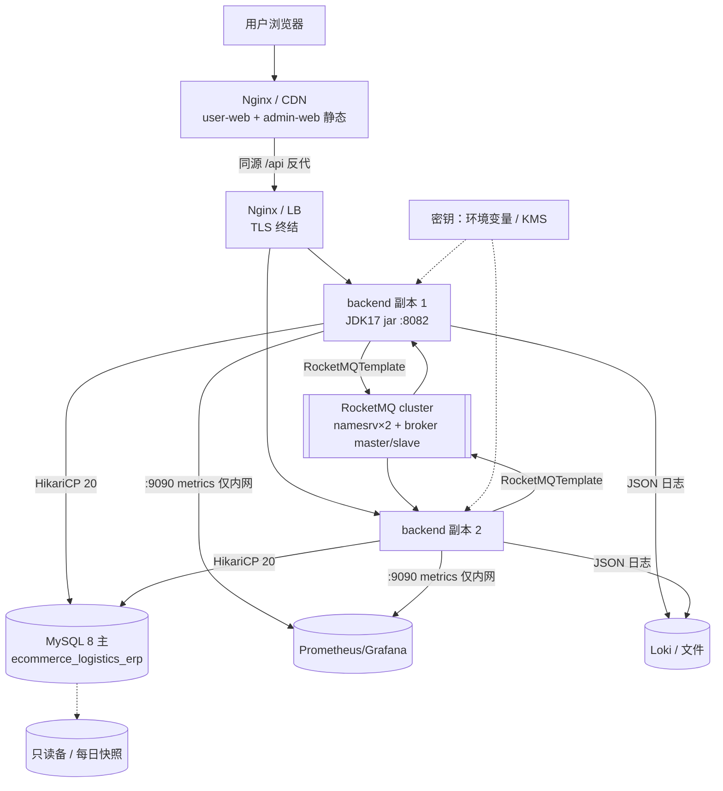

# 目标部署架构（To-Be）

> 定位：[deployment.md](../deployment.md) 描述的是**本地开发环境的启动方式**，且明确写了「当前没有预发/生产部署定义」。本文补齐**目标态拓扑**：镜像、编排、入口、密钥、备份、发布回滚、故障处置。
> 尚未存在的依赖（Dockerfile、CI、profile、Actuator、迁移工具）在本文按「需先落地」标注，配套门禁见 [ci-cd.md](ci-cd.md)。
> 事实基线：2026-01-25 工作树。

## 1. 当前部署能力边界（先划清「现在能做到什么」）

| 能力 | 现状 |
|---|---|
| 后端容器化 | ❌ 无 Dockerfile；只有 `mvn spring-boot:run` |
| 编排 | ⚠️ `scripts/docker/docker-compose.yml` **只定义 RocketMQ 三件套**（namesrv:9876、broker:10909/10911/10912、proxy:8088/8089），无 MySQL、无应用 |
| 前端托管 | ❌ 只有 `vite dev`/`vite build`（`vite.config.js` 仅 `plugins:[react()]`），无 Nginx/CDN 定义 |
| 环境区分 | ❌ 无 profile（`application.yml` 是全仓唯一配置文件），无 `${VAR}` 占位 |
| 就绪探针 | ❌ 无 Actuator → 编排器无法探活、无法安全滚动发布 |
| TLS / 域名 / 反代 | ❌ 无 |
| 备份恢复 | ❌ 无定义（数据在单实例 MySQL） |
| 跨域策略 | ~~`SecurityConfig.java:31` 硬编码只放行 `http://localhost:5173`（admin-web 的 5174 不在内，M-09/ISS-018）~~ → 🔄 **2026-10-10 现状**：`SecurityConfig.java:63` 硬编码放行 `http://localhost:5110`（admin-web）与 `http://localhost:5120`（user-web），来源仍**写死在代码里**（未外置为配置项），端口一改就要三处联动（两个 `vite.config.js:9` + 这一行 + 两份 `services/api.js` 的 `baseURL`），ISS-018 已修但"硬编码"这半句仍然成立 |

**结论**：目标架构的第一块基石不是 K8s，而是「**能一条命令起一个含数据库的完整环境**」。

## 2. 三档拓扑（按团队阶段择一，逐级演进）

| 档 | 适用 | 组成 | 何时用 |
|---|---|---|---|
| **A 单机 all-in-one** | 内测/演示/POC | 1 个 compose：`mysql` + `backend`×1 + `web`（Nginx 托管两个前端 + 反代 `/api`）+（可选）RocketMQ | **建议先做这一档**（1 天内可交付，解决 CORS/环境/可复现三件事） |
| **B 小规模生产** | 首个真实租户上线 | Nginx/云 LB → `backend`×2（无状态）→ 托管 MySQL 主备 + RocketMQ 集群 | 有付费客户时 |
| **C 多副本 + 编排** | 多租户规模化 | K8s：Deployment(≥3) + HPA + Service + Ingress(TLS) + Secret + Job(迁移) + MQ StatefulSet | 单 region 内需要弹性 |

### 2.1 B 档拓扑（推荐的近期目标）



关键约束：

- **应用必须无状态**才能多副本。当前有两条状态依赖：① `TenantContext` 的 ThreadLocal（`clearTenantId()` 全仓无调用点，M-03）；② 进程内 `@EventListener` + MQ 双通道发布导致**同一事件被两个副本各处理一次**（[architecture.md §3](../architecture.md)）。**多副本前必须先收敛为单通道**，否则订单→物流单会翻倍。
- **静态前端与 API 同源**（Nginx 反代 `/api` → backend），从而彻底删掉 CORS 白名单依赖；`SecurityConfig` 保留外部化 origin 列表仅为兼容直连调试。
- ~~5173/5174 不是「配置出来的端口」，是 Vite 默认端口被占后递增的结果~~ → 🔄 **2026-10-10 订正**：两端端口现由 `vite.config.js:9` 显式写死（user-web **5120** / admin-web **5110**），后端 CORS 白名单同步为这两个来源（`SecurityConfig:63`）；但三者是**三处独立的硬编码**（两个 `server.port` + 一份 origin 列表 + 两份 `baseURL`），改端口仍要手工联动，所以目标态仍是由 Nginx 按路径/子域分发（`app.example.com` / `admin.example.com`）、彻底删掉本机端口与 CORS 依赖。

## 3. 制品构建

```dockerfile
# backend/Dockerfile（多阶段）
FROM maven:3.9-eclipse-temurin-17 AS build
COPY pom.xml .
RUN mvn -q dependency:go-offline
COPY src ./src
RUN mvn -q -DskipTests package

FROM eclipse-temurin:17-jre
RUN useradd -r -u 10001 app
USER app
WORKDIR /app
COPY --from=build target/ecommerce-logistics-erp-*.jar app.jar
EXPOSE 8082 9090
ENTRYPOINT ["java","-XX:MaxRAMPercentage=75","-jar","/app/app.jar"]
```

- ⚠️ `spring-boot-devtools` 是 optional + runtime 依赖，打进镜像前确认未被引入（`deployment.md §8` 第 1 条要求生产移除）。
- `mvnw` 需先落地（[ci-cd.md §2 C-1](ci-cd.md)），否则镜像构建依赖 builder 镜像里的 Maven 版本。
- 前端：`npm ci && npm run build` → `dist/`，产物进 Nginx 镜像（或静态托管）：

```nginx
server {
  listen 443 ssl http2;
  server_name app.example.com;
  root /usr/share/nginx/html;
  location / { try_files $uri $uri/ /index.html; }        # SPA history 路由回退（必须，否则刷新 404）
  location /api/ { proxy_pass http://backend:8082/api/; } # 同源，免 CORS
}
```

## 4. 环境矩阵

| 项 | dev | test/CI | staging | prod |
|---|---|---|---|---|
| profile | `dev` | `test`（需新增 `src/test/resources/application-test.yml`，当前不存在） | `staging` | `prod` |
| `ddl-auto` | `update`（保留现状便利） | `validate` | `validate` | **`validate`**（[migration-plan.md](../db/migration-plan.md)） |
| Flyway | 可选 | **开启**（空库全量迁移校验） | 开启 | 开启 |
| `show-sql` | `true` | `false` | **`false`** | **`false`** |
| `spring-boot-devtools` | 保留 | 排除 | 排除 | **排除** |
| 日志 | 控制台 + 文件 | 控制台 | JSON | JSON + 采集（[observability.md §3.4](observability.md)） |
| Actuator | `health,info` | `health,info` | +`metrics` | `health`（探针）+ `metrics`/`prometheus`（仅内网 9090） |
| 数据 | 本地库 + 造数脚本 | Testcontainers MySQL 8 | 与 prod 同构（版本一致，避免 `MySQL8Dialect` 行为差） | 托管 MySQL 主备 |
| 密钥 | `.env`（不入库） | CI secrets | 密钥管理服务 | KMS / Secrets Manager |
| 初始数据 | `DataInitializationConfig` 开启 | 关闭（测试自造数据） | 关闭 | **关闭**（~~`:48-50`~~ → 2026-01-25 复测订正锚点：幂等判断在 `:118-120`（`tenantRepository.findAll()` 为空才建），口令编码 `:134`、日志明文打印 `:145`；`ensurePlatformAdminRole:159` / `ensureAdminHasPlatformAdminRole:182` 由 `:107-108` 调用）无租户即建默认租户与 `admin/123456`，生产是后门 |

## 5. 配置与密钥注入

现状 `application.yml` 硬编码：`server.port=8082`、`spring.datasource.url` 指 `localhost:3306`、用户名 `root`、口令 `123456`、`jwt.secret` 明文、`jwt.expiration=86400000`、`spring.rocketmq.*`（死配置，`RocketMQConfig.java:20-23` 裸 `new RocketMQTemplate()`）。

目标（全部走 `SPRING_*` 环境变量或 ConfigMap，零文件改动切环境）：

| 变量 | 覆盖键 |
|---|---|
| `SPRING_DATASOURCE_URL/USERNAME/PASSWORD` | 数据源 |
| `JWT_SECRET` | `jwt.secret`（≥ 512 bit，与 [security-design.md §3.1](security-design.md) 对齐） |
| `JWT_EXPIRATION` / `JWT_REFRESH_EXPIRATION` | access 15–30min、refresh 7–14d（现状两者同为 24h） |
| `ROCKETMQ_NAME_SERVER` / `ROCKETMQ_PRODUCER_GROUP` | **注意前缀**：starter 期望顶层 `rocketmq.`，现在是 `spring.rocketmq.` → 不匹配即死配置 |
| `CORS_ALLOWED_ORIGINS` | 替代 `SecurityConfig:31` 的硬编码单值 |
| `APP_INIT_DEMO_DATA` | 控制数据初始化开关 |

轮换要求：已入 Git 的 `jwt.secret` 与 DB 口令一律按**已泄漏**处理（S-04）；JWT 密钥轮换需考虑已发令牌的失效窗口（配合 `jti` 黑名单，见 [security-design.md §3.1](security-design.md)）。

## 6. 发布流程

```
1) CI 产出镜像（tag = git sha + 版本）         →  [ci-cd.md §5](ci-cd.md)
2) DB 迁移先行：Job/flyway migrate 对目标库执行（向后兼容窗口内先加列后改代码）
3) 滚动发布：副本逐个替换，readiness 探针保障流量只打到就绪实例
4) 冒烟：qa/smoke-test-checklist §1/§4 的 curl 子集（登录 + 建单 + 列表）
5) 观察 15min：P99、错误率、事件发布失败计数（[observability.md §5](observability.md)）
6) 回滚：镜像回到上一 tag；库结构按「向前修复」而非反向回滚
```

- **迁移与发布的顺序原则**：只加不改（加列/加索引）→ 先发库再发码；改类型/删列（`V7/V8/V10` 类）→ 影子列双写切换（[migration-plan.md §6](../db/migration-plan.md)），严禁一步 `ALTER ... MODIFY`。
- 当前**不具备**这条流程的前置：无 Actuator（探针）、无 profile、无迁移工具。按 [deployment.md §8](../deployment.md) 的最小整改清单顺序补。

## 7. 运维 Runbook（起步 6 条）

| 症状 | 首查 | 处置 |
|---|---|---|
| 应用起不来：`Schema-validation: missing column` | 实体与迁移脚本漂移 | 补 `V*` 或回退实体；**不要**改回 `ddl-auto: update` |
| 启动即建表/改表（prod 意外） | `ddl-auto` 值与 profile | 强制 `validate` + `APP_INIT_DEMO_DATA=false` |
| 前端全部请求 401/403 | `SecurityConfig:39-42` 规则；`/api/platform/**` 与真实前缀不符（S-03）；admin 源不在 CORS（M-09） | 修规则 + 同源反代；~~注意当前 `validateToken` 恒 true（S-01）会让「401 风暴」看起来不可能出现，修复鉴权后才会有真实 401~~ → **2026-01-25 更正**：`validateToken` 已真验签（ISS-007），但**401 永远不会出现**——`SecurityConfig` 没配 `exceptionHandling()`/`httpBasic`/`formLogin`，未认证直接走 403 + 0 字节 body（ISS-032/058），所以症状会是「403 风暴 + 前端不跳登录」：`api.js:63-66` 只在 401 时跳 `/login`，该分支不可达 |
| 登录成功但页面空白/数据不刷新 | `user-web/src/context/AuthContext.jsx:32` 双重解包（token 恒 `undefined`） | [frontend-architecture.md §9](frontend-architecture.md) P0 修复 |
| 事件「发了但没反应」 | 🟡 装配层三条旧因已消除（2026-01-25：消费者拆为顶层类、配置归位顶层 `rocketmq.`、模板由 starter 装配，ISS-034 已修）。**真因换了**：① 事件无 `@JsonCreator` → 消费端反序列化失败（ISS-052）；② `rocketmq.enabled=true` 且无 broker 时应用起不来；③ 进程内 `EventHandler` 与 MQ 消费者动作重复，症状反而是"生效了两遍"（ISS-054） | 排障顺序：~~broker/nameServer 可达 → 消费者是否注册 → 反序列化异常~~ **2026-01-25 二次实测把第 0 步补在最前面：先确认事件到底发出去了没有（ISS-062）**——`grep 发布领域事件` 应用日志，为空就说明断在生产侧而不是 MQ；实测全会话只有 `PurchaseOrderCreatedEvent`/`FinancialTransactionCreatedEvent`/`ProductCreatedEvent`/`SKUCreatedEvent` 四类出现过，broker 与 4 个消费者容器都是好的。排障顺序改为：**① 生产侧有没有发布日志（ISS-062）→ ② broker/nameServer 可达 → ③ 消费者是否注册（已实测全部 running）→ ④ 反序列化异常（ISS-052）**。「订单→物流单」现在连异步链路都算不上，它是**两头都断**：生产不发、消费会炸 |
| 内存增长 / OOM | 无分页的列表端点把全表载入堆（M-07）；`open-in-view` 默认 true 的懒加载放大 | [performance-capacity.md §2/§6](performance-capacity.md)（P-2/P-3） |
| 接口异常但日志无迹可寻 | 无 traceId、无文件 appender | [observability.md §3](observability.md) O1/O2 |

## 8. 备份、恢复与数据规格

| 项 | 目标 | 说明 |
|---|---|---|
| 全量备份 | 每日 1 次（`mysqldump --single-transaction` 或云快照），保留 30 天 | 现状无任何备份定义 |
| 增量 | binlog 开启，支持时间点恢复 | 跨境订单不可丢，RPO 目标 ≤ 5min（若做不到，至少接受 24h 并在合同/SLA 中写明） |
| 恢复演练 | 每季度 1 次：空实例恢复 + `flyway migrate` + 应用启动 + 冒烟 | 未演练的备份等于没有备份 |
| RTO | ≤ 30min（重建实例 + 切流量） | 无状态应用可快速重建，瓶颈在 DB |
| 保留期 | 审计日志/`sync_job_items` 30–90 天；订单数据按合规要求 | 与 [integration-design.md §6](integration-design.md) 的任务明细表配套 |
| 字符集 | `utf8mb4` / `utf8mb4_general_ci` | [migration-plan.md §4](../db/migration-plan.md) |

## 9. RocketMQ 部署要点

- 现状 compose 是**单机 broker 且无持久卷**（`apache/rocketmq:5.3.2`，无 `volumes:` 定义），重启即丢未消费消息——生产必须：broker 主从 + 存储卷 + `broker.conf`（`brokerClusterName`、`brokerId`、`flushDiskType`）。
- Topic 需预建或放开自动创建：当前代码推断出的 topic 只有 5 个（`order-events`、`logistics-events`、`inventory-events`、`finance-events`、`purchase-events`，`DomainEventPublisher:85-99`），**product/purchase/customer/platform 的事件类不命中任何 topic**（`:72` 返回 null 仅 warn）——上线前必须补齐路由，否则这些域的事件静默丢弃。
- Consumer group 与订阅关系：4 个 group（`logistics-group`、`warehouse-group`、`finance-group`、`purchase-group`）；同一 group 多副本要求订阅完全一致，滚动发布时注意短暂重复消费 → **消费者必须幂等**（现状 `OrderCreatedEventConsumer` 直接建物流单，无幂等键）。
- 死信：配置 `%DLQ%<group>` 监控与告警。

## 10. 上生产前的最小整改（顺序即优先级）

1. 密钥与地址外部化 + profile（[ADR-0009](../adr/0009-config-externalization.md)）——否则每次换环境都要改文件并把密钥入库。
2. `ddl-auto: validate` + Flyway 基线（[migration-plan.md M0/M1](../db/migration-plan.md)）；`show-sql: false`；移除 devtools 与生产数据初始化。
3. 鉴权链路修复（[security-design.md §3](security-design.md)）+ Actuator 健康检查 + `.anyRequest()` 兜底（L-01）。
4. 事务边界（`@Transactional` 现状 0 处）+ 事件单通道收敛（消除重复副作用），然后才谈多副本。
5. 列表分页与索引（[performance-capacity.md §4/§5](performance-capacity.md)）——无界返回 + 无索引在真实数据量下必炸。
6. CI/CD + Dockerfile + Nginx 反代（[ci-cd.md](ci-cd.md)、本文 §3）——把「能跑」变成「能反复安全地跑」。
7. 备份策略与恢复演练（本文 §8）。

每一项在文档体系里都有对应权威文档，完成后请回改其状态标记（🟡/⚪ → ✅），并遵守 [docs/README §4.5](../README.md)「未跑通链路不得标 ✅」。
