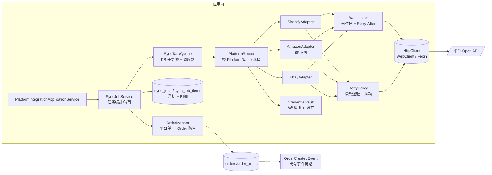

# 外部平台集成技术方案

> 定位：Amazon / eBay / Shopify 对接的**技术实现设计**。业务规则以 [spec/platform-integration.md](../spec/platform-integration.md) 的 `BR-01~BR-11` 为权威（本文逐条给技术落点，不重述规则语义）；端点契约以 [api.md §4.12](../api/api.md) 为权威。
> 事实基线：~~2026-01-25 工作树~~ → **2026-03-08 工作树**（§3/§4/§5/§10 的"设计"已有一批落地为代码，本文相应改标 **as-built**；未落地部分保留原设计）。

## 1. 现状

> ⚠️ 口径 **2026-03-08 工作树**。本节 2026-01-25/10-02 版把"第一个真实集成口子"记成"只有商品拉取"，现已推进为**按认证协议分派的 6 条数据线 + Shopify 端到端 + 凭据加密**。逐行按下述格式修订：✅ 已实现 ｜ 🟡 部分 ｜ ⚪ 未做 ｜ ~~划掉者~~ 结论已过期。

| 事实 | 证据 |
|---|---|
| ✅ **真实外呼覆盖 6 条数据线**（订单/商品/客户/物流/店铺仓/财务） | `infrastructure/platform/` 下 7 个 `HttpPlatform*Fetcher`/`Tester` + 6 个 `SamplePlatform*Fetcher` + `shopify/` 5 个类（`ShopifyAdminApi`/`ShopifyOrderFetcher`/`ShopifyProductFetcher`/`ShopifyFulfillmentPusher`/`ShopifyConnectionTester`）+ `ShopifyJson` 工具 |
| ✅ ~~分派是布尔三元~~ → **按认证协议的注册表** | ~~`ProductImportApplicationService:72-73,81-82,407` 的 `useSample ? sample : http`~~ → 现在是 `PlatformFetcherRegistry`（构造期把 8 类端口的所有实现按 `type()` 建索引，**键冲突直接抛 `IllegalStateException`**），分派键是 `PlatformAuthType`（协议）不是 `PlatformName`（业务标签）。<br>⚠️ 语义细节：`useSampleData=true` **优先于协议**（走 `SAMPLE`），与旧行为兼容；`authType` 为空按 `CUSTOM_SHOP`（历史数据都是它）；反向端口 `fulfillmentPusher`/`connectionTester` **没有 SAMPLE 分支**。<br>⚪ 找不到适配器时抛 `PLATFORM_ADAPTER_NOT_FOUND`，消息里列出已注册键 |
| ✅ **超时 + 重试 + 退避 + 快速失败**（原为"仅超时"） | `infrastructure/config/HttpClientConfig`（`platform.http.connect-timeout:5s`/`read-timeout:15s`）。<br>Shopify 侧另有 `ShopifyAdminApi.execute()`：429 与 5xx/`ResourceAccessException` → 按 `Retry-After` 退避重试（`platform.shopify.retry.max-attempts=3`、`max-wait=30s`），401/403 **立即失败**不消耗配额，耗尽抛 `SHOPIFY_REQUEST_FAILED`。<br>⚪ `CUSTOM_SHOP` 的 `HttpPlatform*Fetcher` 仍无重试（只有超时），且 `catch (Exception)` 统一包成 `Platform{X}FetchException` 上抛 |
| ✅ 有界外呼参数 | `CUSTOM_SHOP` 侧 `pageSize` 默认 50、上限 200；Shopify 侧 `clampPageSize` 到官方上限 **250**，翻页由 `cursor.max-pages=20` 兜底 |
| ✅ ~~`sync-*` 是桩~~ → **5 个同步端点全部走真实导入作业** | `PlatformIntegrationController` 现有 **14 个端点**：`sync-orders`/`sync-customers`/`sync-products`/`sync-logistics`/`sync-inventory` + 新增 `test-connection`/`push-fulfillment`。前四条返回 `{X}ImportJobDto`（逐行 成功/跳过/失败）。<br>⚠️ 两个遗留：① `useSampleData` 仍由**客户端参数**决定，生产传 `true` 就导入假数据；② 每个端点仍有 `catch (Exception)` 把 `e.getMessage()` 拼进 500 响应（M-08）<br>❌ 唯一仍是桩的：`domain/logistics/service/LogisticsTrackingService.java:25-32`（注释原话「简化处理，直接返回当前状态」） |
| ✅ 导入侧解析与任务模型（6 条线齐备） | `ImportSourceParser`（JSON/CSV）；**6 张 `*_import_jobs` + 6 张 `*_import_job_errors` + 6 张 `*_field_mappings`**（order/customer/product/logistics/finance/shop_warehouse），`ImportJobStatus` 五态，`FieldTransform` 含 `WEIGHT_KG_TO_G` 等 |
| ✅ ~~凭据明文入库、原样收发~~ → **密文列 + 掩码出参** | ~~`api_key/api_secret` 无加密；控制器直接序列化领域聚合~~ → `CredentialCipher`（AES-256/GCM/NoPadding，IV 12B、tag 128b、`enc:v1:` 前缀）在**仓储边界**加解密（`PlatformIntegrationRepositoryImpl.encryptSecrets/decryptSecrets`，4 个凭据字段）；出参走 `PlatformIntegrationDto`，只有 `apiKeyMasked`（前 3+`****`+后 4）与 `hasApiSecret`/`hasAccessToken` 布尔位，`apiSecret`/`accessToken`/`refreshToken` **不在 DTO 上**。<br>⚠️ **门槛**：主密钥只从 `PLATFORM_CREDENTIAL_MASTER_KEY` 注入；**未注入时打 WARN 并按明文读写**（不 fail fast），所以 ISS-011 只在运维配好密钥后才真正关闭。历史明文行无前缀 → 读取原样返回、下次写入收敛为密文 |
| 🟡 ~~`platform_integrations` 无 `tenant_id`~~ → **列已存在，约束与读路径没有** | `PlatformIntegrationJpaEntity` 现有 `tenant_id`/`auth_type`/`access_token(1024)`/`refresh_token(1024)`/`token_expires_at`/`api_version(32)`。<br>⚪ 无唯一约束（BR-03）、读路径不按租户过滤（BR-11，对齐 ISS-050） |
| ⚪ 无调度器；导入是**单请求内同步执行** | 全仓 `@Scheduled` **0 处**、`@EnableScheduling` **0 处**（2026-03-08 复测）。真实平台调用下前端 `timeout: 10000` 会先到（见 §8 的 202 改造） |
| 🟡 **Shopify 是第一家按官方协议对接的平台；其余平台仍无 SDK/适配器** | pom 无平台 SDK（刻意：只用 `RestClient`/`HttpClient` + JSON，避免引第三方依赖）。`PlatformName` 仍只作业务标签 |

`spec/platform-integration.md` 的 11 条规则现状随之从「BR-01/02/11 ❌、BR-07/08/09 ⚪」推进为：**BR-01/02/05/08 ✅（BR-01 有运维门槛）、BR-03/06/10 ⚪、BR-04/07/09/11 🟡**。本文定位也由「沿已开出的第一个口子收敛」改为 **「Shopify 样板已成形，下一步是调度/异步化与凭据演练，不是再抽象一层」**。


## 2. 目标架构



分层落位（遵守 [backend-standards.md §1](backend-standards.md)）：`PlatformAdapter` **接口**定义在 `domain/platform/service`（或新增 `domain/platform/acl`），三个实现落 `infrastructure/integration/{shopify,amazon,ebay}`；`application` 只依赖接口。**不要把 HTTP/SDK 类型漏进 domain**（现状 domain 已泄漏 `@Service`，不要再叠加技术依赖）。

> 🔎 **as-built 对照（2026-03-08）**——上图是目标，实际落点有 5 处不同，读图时容易误判"这些还没做"：
>
> | 图上 | 实际 |
> |---|---|
> | `PlatformRouter` 按 **`PlatformName`** 选择 | `PlatformFetcherRegistry` 按 **`PlatformAuthType`（协议）** 选择；平台名不参与分派。这是本轮最重要的一个设计修正——同一业务平台可能走不同协议（自建网关代理 vs 官方 API），而同一协议在不同平台间可复用 |
> | `SyncJobService` + `sync_jobs` 队列表 | 无独立编排服务；**复用各数据线的导入作业**（`{X}ImportApplicationService.syncFromPlatform` → `*_import_jobs`）。⚪ 队列/重试队列仍不存在 |
> | `CredentialVault` 解密缓存 | 加解密在**仓储边界**，无缓存层（§4 第 3 条） |
> | 接口在 `domain/platform/service`、实现在 `infrastructure/integration/*` | 接口在 **`domain/platform/client`**，Shopify 实现在 **`infrastructure/platform/shopify`**（不是 `integration/`）。位置不同、分层意图相同，不值得为对齐图纸去搬家 |
> | `RateLimiter`/`RetryPolicy` 独立组件 | 退避重试**内联在 `ShopifyAdminApi.execute()`**，不是可复用组件（第 2 家平台时需要抽出来，见 §5） |

## 3. 适配器契约（SPI）

### 3.1 实际落地形态（as-built，2026-03-08）

设计稿里的"单个 `PlatformAdapter` + `Capability` 位图"**没有实现**，走的是**按数据线拆端口**：`domain/platform/client/` 下 **8 个端口**，每个都有 `type()` 作注册键。

```java
// 6 条入站线：抽象方法只收请求，凭据走 default 重载（旧实现不改也能编译）
public interface PlatformOrderFetcher {
    String type();                                                             // 注册键
    List<Map<String,Object>> fetch(PlatformOrderFetchRequest request);         // 不带凭据（CUSTOM_SHOP 用不上）
    default List<Map<String,Object>> fetch(PlatformOrderFetchRequest request,
                                          PlatformCredential credential) { return fetch(request); }
}
// … PlatformProductFetcher / PlatformCustomerFetcher / PlatformLogisticsFetcher
//   / PlatformWarehouseFetcher / PlatformFinanceFetcher 同形
// 2 条反向与探测线：必须拿凭据，没有 default 重载也没有 SAMPLE 分支
public interface PlatformFulfillmentPusher { String type(); PlatformFulfillmentResult push(PlatformFulfillmentRequest req, PlatformCredential cred); }
public interface PlatformConnectionTester  { String type(); PlatformConnectionTestResult test(PlatformCredential cred); }
```


| 设计要点 | 落地情况 | 说明 |
|---|---|---|
| 返回平台中立 DTO，不返回聚合 | ✅ **但形态更弱**：返回 `List<Map<String,Object>>` 而不是类型化 `PlatformOrder` | 选择理由：直接复用**已有的 Excel/CSV 导入管道**（别名表 + `FieldTransform` + 逐行错误），不必为平台再建一套 mapper。<br>⚠️ **代价是这条约定必须靠测试守**：`detectByAlias` 是**子串匹配**，把 Shopify 原始键（`id`/`name`/`weight_unit`）直接抛出来会被误配成 `CUSTOMER_ID`/`ITEM_NAME`、并顶掉 `WEIGHT_IN_GRAMS`。所以适配器只能输出**别名表认识的中立键**，由 `ShopifyAdapterMappingTest.shouldEmitOnlyKeysTheAliasTableRecognises` 锁住 |
| 时间窗一律 UTC + `updated_since` 语义 | ✅ Shopify `updated_at_min`；`*ImportTargetField` 侧只认 `yyyy-MM-dd HH:mm:ss`（无时区），适配器负责换算（`-04:00 08:30` → `12:30`，测试已断言） | `serverTimezone=UTC` 统一口径 |
| 游标持久化在 `sync_jobs` | ⚪ 游标只在**单次请求内**跟着 `Link` 头走，跨请求增量靠调用方传 `updatedFrom` | 依赖 §6 的调度表才能自动续传 |
| 分页由 adapter 内部消化 | ✅ `ShopifyOrderFetcher` 的 `while (next != null && pages < maxPages && rows.size() < totalLimit)`；上层只见 `limit` | ⚠️ Shopify **只支持 `Link` 头 `page_info` 游标**，官方明确"发 `page` 参数会返回错误"——这是 `ShopifyAdminApiContractTest.shouldFollowLinkHeaderCursorAndNeverSendPageParameter` 存在的原因 |
| 三类目标异常（RateLimited/AuthExpired/Unavailable） | ⚪ **至今未建** | 实际只有 7 个异常类：`Platform{Order,Product,Customer,Logistics,Warehouse}FetchException` + `PlatformFulfillmentException` + **`FinanceFetchException`（唯一无 `Platform` 前缀的）**。都**没有专属 `@ExceptionHandler`** → 落到 `GlobalExceptionHandler` 兜底成 500，原因被兜底文案吃掉。<br>Shopify 侧靠 `ShopifyAdminApi` 自己分派（429/5xx 重试、401/403 快速失败），**不依赖异常类型做决策** |
| 幂等键 `uk(tenant, platform, external_order_id)` | 🟡 **靠查询不靠约束**：`findByPlatformOrderId(tenantId, platform, externalOrderId)` 命中即更新 | 并发同步仍可能双插；建唯一索引要等 DDL 基线（§9 I0） |
| `Capability` 位图 | ⚪ 未实现 | 能力差异现在**体现在注册表里有没有对应适配器**（见 spec §7.1 矩阵），调用缺数据线的平台会得 `PLATFORM_ADAPTER_NOT_FOUND` |

```java
public interface PlatformAdapter {
    PlatformName supported();
    Capability supports();                       // orders/products/inventory/fulfillment/tracking 位图
    AuthResult verifyCredential(PlatformCredential cred);          // BR-04 连通性测试
    Page<PlatformOrder> fetchOrders(Cursor cursor, TimeWindow w);  // BR-05 增量
    List<PlatformProduct> fetchProducts(Cursor cursor);
    List<PlatformStock> fetchInventory(Cursor cursor);
    void pushInventory(SkuStockUpdate update);                     // BR-10  outbound
    TrackingResult queryTracking(String trackingNo);
}
```

设计要点：

| 项 | 约定 | 理由 |
|---|---|---|
| 返回类型 | 平台中立 DTO（`PlatformOrder`），**不直接返回聚合** | 映射与去重是 `OrderMapper` 的职责，adapter 只做协议转换 |
| 时间窗 | 一律 UTC + `updated_since` 语义（而非 `created_since`） | 平台侧改地址/改状态必须被捕获；`serverTimezone=UTC`（`application.yml:17`）已统一时区口径 |
| 游标 | `Cursor { since, pageToken, lastSyncedId }` 持久化在 `sync_jobs` | 断点续传，避免全量重拉 |
| 分页 | 由平台决定（Shopify `page_info`、Amazon `NextToken`），adapter 内部消化 | 上层只见 `Page` |
| 错误 | 抛 `PlatformRateLimitedException` / `PlatformAuthExpiredException` / `PlatformUnavailableException`，**不抛 `RuntimeException`** | 决定重试策略的是异常类型，不是消息文本（~~现状 `System.out` 吞掉一切~~ → **2026-01-25：`System.out` 已 0 处，改为 `log.warn/error` + 抛 `Platform{X}FetchException`**，例如 `HttpPlatformProductFetcher:86-94`、`PlatformIntegrationServiceImpl:196`。<br>❌ 但这三个**目标异常类至今不存在**——全仓实际只有 **6 个**外呼异常类且命名不统一——`Platform{Product,Order,Logistics,Customer,Warehouse}FetchException` + **`FinanceFetchException`（无 `Platform` 前缀）**，它们**没有专属 `@ExceptionHandler`**，落到 `GlobalExceptionHandler.java:197` 兜底 → 外呼故障对外是 500、原因被兜底文案吃掉（见 [backend-standards.md §7](backend-standards.md) 的 throws 分布表）） |
| 幂等键 | 平台订单号 + 租户 → `uk(tenant_id, source_platform, external_order_id)` | BR-05 |

能力矩阵（避免「三个平台一套代码」的伪抽象）：

| 能力 | Shopify | Amazon SP-API | eBay |
|---|---|---|---|
| 增量拉单 | ✅ `updated_at` | ✅ `LastUpdatedAfter`（需 Reporting API） | ✅ `GetOrders` |
| 商品 | ✅ | ✅ Catalog | ✅ |
| 库存 | ✅（多地点需 `inventoryLevels`） | ✅ FBA/FBM 差异大 | 🟡 |
| 物流轨迹 | 🟡 需第三方 | ✅ Tracking API | ✅ |
| 授权 | 永久 access token（自定义 App） | **OAuth2 + LWA，1 小时过期，需 refresh** | OAuth2 user access token，需 refresh |
| 限流模型 | 令牌桶（按 API capacity） | 按操作 `rate/burst`，429 + `Retry-After` | 调用配额（call limit）周期重置 |

> ⚠️ **Amazon 的 token 轮换与 eBay 的 OAuth refresh：表结构已能承载，逻辑还没有。**
> ~~`platform_integrations` 只有 `api_key`/`api_secret` 两列，没有 `access_token`/`refresh_token`/`expires_at`~~ → **2026-03-08：前三列已加**（`access_token`/`refresh_token`/`token_expires_at`，均按密文处理），所以 SP-API/OAuth 类平台的**存储**已就绪；
> 仍缺的是 ① `scope`/`region`/`store_id`（Amazon 必须按 marketplace/region 分端点，`storeUrl` 一列不够表达）、② **刷新令牌的调用与到期前预刷**（0 处实现）、③ Amazon 独有的 **Restricted Data Token** 与 LWA `client_credentials` 两段式授权。
> 结论：I3 的**第一块砖不是写适配器，而是决定这三列怎么放**（扩列 vs 引入 `credential_ref`）。

## 4. 凭据与授权（BR-01、BR-02、BR-04）

> 口径 **2026-03-08**：第 2/3/4/5/6 条已落地（第 1 条按更轻的方案偏离），逐条标注。

1. **列改造**：~~`api_key`/`api_secret` → `credential_ref`（指向密钥库记录）~~ → ⚪ **未做 `credential_ref`**，改为**原列存密文 + 新增 4 列**：`access_token(1024)`、`refresh_token(1024)`、`token_expires_at`、`api_version(32)`（另加 `auth_type(32)` 作分派键）。<br>偏离理由：`credential_ref` 需要引入外部密钥库与迁移窗口，而本轮的威胁模型是"**接口出参泄露 + 库泄露**"，本地信封加密已能同时堵住这两条；表结构也没有"清掉明文列"的迁移能力（`ddl-auto=update` 只加不减，[ADR-0002](../adr/0002-hibernate-ddl-auto.md)）。<br>⚠️ 密文列**宽度按 `VARBINARY` 设计但落的是 `VARCHAR`**：Base64 后的 GCM 密文比原文长（12B IV + 16B tag + 密文），`api_key`/`api_secret` 若原有 `length` 限制需确认够放——`access_token` 给了 1024 就是这个原因。
2. **加密**：✅ AES-256-GCM（`AES/GCM/NoPadding`，IV 12 字节随机、tag 128 位），密文带 `enc:v1:` 前缀以标识版本、便于将来换密钥做灰度；主密钥来自环境变量 `PLATFORM_CREDENTIAL_MASTER_KEY`（[ADR-0009](../adr/0009-config-externalization.md)），**不入库、不入 Git**。<br>⚠️ 两处刻意宽松：① 传入不是 32 字节 Base64 时**用 SHA-256 派生并打 WARN**（而不是拒绝启动），② **主密钥缺失时按明文读写 + WARN**。代价是"配了没配"在功能上看不出差别，只有一条 WARN 可查；改进建议（生产 profile 下 fail fast）见 spec §9.2 的 P0 行。
3. **解密时机**：🟡 加解密收敛在**仓储边界**（`PlatformIntegrationRepositoryImpl.encryptSecrets/decryptSecrets`），领域聚合与上层只见明文——比设计稿的"不外泄"更简单，但**没有 §3 设想的那层 `CredentialVault`**，也就没有 TTL 缓存：每次读取都解密、每次保存都重加密。`PlatformIntegration` 聚合**没有 `toString()` 覆写**，Lombok `@Getter` 生成的 getter 会让 `accessToken` 出现在任何整体序列化里——出参安全是靠 DTO 挡住的，不是靠聚合。
4. **出参**：✅ `PlatformIntegrationDto` 只有 `apiKeyMasked`（前 3 + `****` + 后 4；≤7 位整体 `****`）+ `hasApiSecret`/`hasAccessToken` + `tokenExpiresAt`；`apiSecret`/`accessToken`/`refreshToken` **字段不在 DTO 上**（漏加字段比漏掩字段安全）。配套：`PUT` 凭据留空 = 沿用库中原值（`PlatformIntegrationSaveRequest.toAggregate(existing)`），所以"不回显"不会造成"改个名字丢密钥"。
5. **连通性测试**：✅ `POST /api/platform-integrations/{id}/test-connection`（第 13 个端点）。Shopify 打 `GET /admin/api/{version}/shop.json`（**权限要求最低，却能同时验证令牌、店铺域名、接口版本三件事**，回显店铺名与币种但不回显令牌）；`CUSTOM_SHOP` 打 `GET {storeUrl}/orders?page=1&pageSize=1`。<br>⚪ 偏离：**没有做到"激活前必过"**——`activate` 不调用它，失败也不写 `markError()`（聚合里方法已实现，0 调用点）。理由见 spec §3 的状态机注记。
6. **历史明文**：✅ 口径保留——已入库的明文密钥按**已泄漏**处理：**先在各平台侧轮换、再重新录入**，加密本身不解除泄漏。


## 5. 限流、重试与退避（BR-08、BR-09）

> 口径 **2026-03-08**：**"被动退避"这一档已经实现（仅 Shopify）**，主动限流/熔断/死信仍是设计。

| 机制 | 状态 | 落地/方案 |
|---|---|---|
| 主动限流（令牌桶） | ⚪ | 仍是设计：按 `(platform, tenant)` 令牌桶（Resilience4j `RateLimiter`）。Shopify 官方口径是 **leaky bucket：每店铺 40 次请求容量、每秒回补 2 次**；现在靠"单线程串行翻页 + 被动退避"间接满足 |
| 并发闸门 | ⚪ | 未做。目前无并发来源（没有调度器），所以风险暂不可达 |
| 被动限流（429 + `Retry-After`） | ✅ **Shopify** | `ShopifyAdminApi.execute()` 捕获 `HttpClientErrorException.TooManyRequests`，读 `Retry-After` 头（缺省用退避序列）后重试；`retry.max-wait=30s` 封顶，超过即放弃 |
| 重试（指数退避） | ✅ **Shopify** | `retry.max-attempts=3`，等待 `1s → 2s → 4s`（`backoffMs *= 2`，封顶 `retry.max-wait=30s`）；对 429/5xx（`HttpServerErrorException`）与 `ResourceAccessException`（连接/读超时）重试。<br>⚠️ **没有加抖动（jitter）**：单实例下无 thundering herd 风险，多个集成同时被 429 时会同步重试；<br>⚠️ 耗尽后（`canRetry = attempt < maxAttempts` 为假时 `break`）抛 `SHOPIFY_REQUEST_FAILED`，消息带尝试次数。<br>⚪ `CUSTOM_SHOP` 的 6 个 fetcher **无重试** |
| 快速失败 | ✅ | 401/403 **不重试**（不浪费配额），错误消息里只写 `accessToken` 这个词、**不写值** |
| 熔断 | ⚪ | Resilience4j `CircuitBreaker`（失败率 > 50%/滑动 20 开闸 60s，半开走 `test-connection`） |
| 写操作幂等键 | 🟡 | 发货回写的幂等**不靠 `idempotency-key`**，靠本地 `logistics_orders.external_logistics_id`：回写成功即记账，重复调用直接拒（比"平台侧幂等"更可控，因为 Shopify fulfillment 没有幂等头） |
| 死信 | ⚪ | 设计里的 `sync_job_items.status=DEAD` 未建；现状最接近的是 `*_import_job_errors`（逐行失败原因），但它是**导入行**不是**外呼重试** |

**依赖现状**：pom 仍**无 resilience4j / spring-retry**（2026-03-08 复测）。Shopify 的重试是手写循环——只有 1 家平台时这样更省依赖；**到第 3 家再抽公共策略**，否则会是三次重复的退避代码。


## 6. 调度与任务模型（BR-06、BR-07）

> 口径 **2026-03-08**：设计稿的两张 `sync_jobs*` 表**没有建**，因为发现**已经存在一套等价物**——6 条数据线各自的 `*_import_jobs` + `*_import_job_errors`（含 `total/success/failed`、`tenant_id` 索引、逐行错误原因）。**再建一套同义表是第二个事实来源**，所以本节改为「复用导入作业 + 只补调度」，缺的是**调度器**（`@Scheduled` 全仓 0 处）与**按平台聚合的作业视图**，不是表。
>
> 仍要新增的只有两列级别的东西：`cursor_since`/`cursor_token`（跨请求增量续传）与 `trace_id`。当前跨请求增量靠调用方手工传 `updatedFrom`，**没有"上次同步到哪"的持久状态**——这是接调度器前必须先补的一块，否则每个定时任务都会退化成全量重拉。

新增两张表（迁移脚本见 [migration-plan.md](../db/migration-plan.md) 的 `V12__platform_sync_tables.sql`）：

```
sync_jobs        (id, tenant_id, platform_integration_id, job_type, status,
                  cursor_since, cursor_token, started_at, finished_at,
                  items_fetched, items_upserted, items_failed, error_code, error_message,
                  attempt, next_retry_at, trace_id)
sync_job_items   (id, job_id, external_id, action, status, error_message, created_at)  -- 明细，保留 30 天
```

调度：

- 起步用 `@EnableScheduling` + `@Scheduled(fixedDelay)` 扫 `next_retry_at`（单实例够用；现状无调度注解）。
- 多副本后改**任务表 + 分布式锁**（`SELECT ... FOR UPDATE SKIP LOCKED` 或 ShedLock），**不要**用内存队列——进程重启即丢任务。
- 频率：拉单 15min、商品 6h、库存 1h（平台侧变更）+ 本地库存变更**事件触发**（BR-10：`InventoryMovement` 事件 → outbound 队列，现状 `InventoryShortageEventConsumer` 只建采购单，无 outbound）。
- `trace_id` 列让一次同步能在日志中被完整检索（[observability.md §3.1](observability.md)）。

幂等与冲突：`upsert` 以 `uk(tenant_id, source_platform, external_order_id)` 为准；已存在的平台订单**只允许白名单字段更新**（地址、物流单号、状态），不允许覆盖本地已发生的履约动作——这是「平台 → ERP 单向拉取」与「ERP 本地状态机」的边界，需在 `spec/order.md` 的 `BR-xx` 中补一条（当前 18 条里没有明确来源优先级规则）。

## 7. 数据映射（平台单 → `Order` 聚合）

> 口径 **2026-03-08**：映射**不在 adapter 里做完整 DTO 转换**，而是分两段——adapter 只做**协议级桥接**（嵌套展开、单位换算、状态合成），字段归属仍交给已有的别名表 + `*_field_mappings`。下表逐行标注落点。

| 映射项 | 处理 |
|---|---|
| SKU | 🟡 需 `sku_mappings` 表（平台 SKU ↔ 本地 `skus.sku_code`）；现状 `skus`/`products` 有 `source_platform`/`external_id` 类列与 `uk_products_external_ref`，但**没有独立映射表**，跨平台同 SKU 仍会撞 |
| 金额与币种 | ✅ 适配器输出**字符串**金额（`"129.90"`）与 `currency`，由导入侧统一解析——避开了 `orders.total_amount` 是 `DOUBLE` 的历史坑（[data-dictionary R-09](../db/data-dictionary.md)）；`DECIMAL(19,2)` 的舍入口径仍待 `V7` 类迁移 |
| 地址 | ✅ 在 adapter 内展开：Shopify 的 `shipping_address` 嵌套对象被拍平成 `recipientName/phoneNumber/country/province/city/addressLine1/zipCode`。**必须拍平**，因为原始键 `shipping_address` 不会被别名表认出（测试 `shouldEmitOnlyKeysTheAliasTableRecognises` 断言行内**不含**该键） |
| 状态 | ✅ **显式桥接，不靠名字猜**：`ShopifyOrderFetcher.bridgeStatus` 用三个互相独立的标志合成一个状态——`cancelled_at` 非空 → `cancelled`；`fulfillment_status` 非空 → `shipped`；否则看 `financial_status`（`paid`→`processing`、`authorized`→`pending`、`refunded`→`cancelled`）。5 个分支各有断言（`shouldBridgeStatusFromThreeIndependentFlags`）<br>⚠️ 前提：`financial_status` **不能直接抛给导入侧**（它会被误配），必须先变成 `orderStatus` |
| 租户 | ⚪ 设计是"从 `platform_integration` 归属取"；现状是**从请求参数 `tenantId` 取**（可选，为空走 `DEFAULT_TENANT_ID` 兜底）——这正是 ISS-002/ISS-051 的形态，接调度器时必须改成从集成记录读 |
| 事件 | 🔴 **不变，且风险更大**：拉单成功后走 `Order.create()` → `registerDomainEvent`，而 `*RepositoryImpl.save()` 返回映射副本导致事件丢失（[ISS-062](../qa/known-issues.md)）。**结论：目前"同步来的订单"不会触发任何下游动作**——不会自动生成物流单。批量导入 1 万单不会放大成 2 万物流单，因为**一个都不会生成** |


## 8. 端点与契约变更

> 口径 **2026-03-08**：控制器现有 **14 个端点**（清单以 [api.md §4.12](../api/api.md) 为权威）。本节 5 条变更里 **3 条已落地、2 条未做**。

| 变更 | 状态 | 说明 |
|---|---|---|
| 请求/响应改 DTO（不再收发 `PlatformIntegration` 聚合） | ✅ | 出参 `PlatformIntegrationDto`（掩码）、入参 `PlatformIntegrationSaveRequest`；同步端点返回 `{X}ImportJobDto`。<br>⚠️ 例外：`push-fulfillment` 返回 `PlatformFulfillmentResult`、`test-connection` 返回 `PlatformConnectionTestResult`——这两个是 `domain/platform/client` 里的 **record**，严格说仍是"领域类型出现在 API 上"（与 **ISS-063** 同形态，但两者都不含凭据，`ShopifyConnectionTester` 的 message 只写店铺名） |
| 新增 `POST /{id}/test-connection` | ✅ | 第 13 个端点。⚠️ **偏离设计**：失败**不**改 `status`、激活**不**强制先测（见 §4 第 5 条） |
| 新增 `POST /{id}/push-fulfillment` | ✅ | 设计稿里原本没有这条反向链路（原以为要等 `PlatformAdapter.pushInventory`）；实际先做了**发货回写**，库存回写仍缺（§3 能力矩阵） |
| 新增 `GET /{id}/sync-jobs`、`GET /sync-jobs/{id}` | 🟡 | 以另一种形态存在：`GET /api/{线}-import/jobs`（6 条线各自有）。**缺的是"按平台集成查作业"**，现在只能按数据线查 |
| `sync-*` 改**异步**（HTTP 202 + `jobId` 立即返回） | ⚪ **未做，且现在是真风险** | 同步端点仍在单请求内完成"外呼 + 映射 + 落库"。前端 `timeout: 10000`，而一次带重试的 Shopify 全量翻页（20 页 × 最多 250 条，最坏还要叠加 1/2/4s 退避）**必然超过 10s**。<br>⚠️ 更糟的是超时后**客户端断开不会回滚**：服务端事务继续提交，用户看到失败、数据其实进来了。**上真凭据前应先改这条**，否则演练结果会被误读成"同步不稳定" |
| 三个 `sync-*` 合并为带 `jobType` 的任务接口 | ⚪ | 契约分叉仍在（5 个端点、参数各异）。暂时不合并也说得通：各线返回的 Job DTO 结构不同 |


## 9. 落地分期

> 口径 **2026-03-08**：进度列是本轮实测；**退出标准列保持原样不动**——它还没被满足，改掉它就是把目标挪门柱。

| 期 | 内容 | 退出标准 | 进度 |
|---|---|---|---|
| I0 前置 | 凭据加密 + DTO 化（BR-01/02）、`tenant_id`（BR-11）、事件双通道收敛 | 无明文 secret 出入库；一次拉单只产生一条物流单 | 🟡 **3 项里成了 2 项**：加密 ✅（有运维门槛）、DTO ✅、`tenant_id` 列 ✅ 但读路径不过滤。<br>🔴 **事件收敛未做** → 退出标准的"产生一条物流单"实际是**产生 0 条**（[ISS-062](../qa/known-issues.md)），所以 I0 **不能判退出** |
| I1 样板 | **Shopify 单平台全链路**（roadmap `R-203`）：adapter + 限流重试 + 任务表 + 增量幂等 + 明细日志 | 沙箱店 1000 单导入，重复执行为 0 新增（幂等验证） | 🟡 **代码侧 4/5**：adapter ✅、限流重试 ✅、增量幂等 ✅、明细日志 ✅（`order_import_jobs`/`_errors`）、独立任务表 🟡（复用导入作业，缺游标持久化——`last_orders_synced_at` 只是展示用的时间戳，增量窗口 `updatedFrom` 每次由**调用方传入**，见 `PlatformIntegrationApplicationService:119-123`；无调度器）。<br>🔴 **退出标准未满足**：无沙箱凭据，1000 单演练一次也没跑过。现状是"27 例 Shopify fixture 契约测试绿"（平台域共 **52 例 / 6 类**，见 §10）→ 已登记为 **ISS-064（P0）** |
| I2 映射治理 | `sku_mappings`、状态桥接、金额舍入、时区口径 | 映射错单率 = 0（抽样核对） | 🟡 状态桥接 ✅、时区口径 ✅（都有断言）；`sku_mappings` ⚪、金额舍入口径 ⚪。抽样核对需要真数据 |
| I3 扩平台 | Amazon SP-API（OAuth/LWA 令牌轮换 + Restricted Data Token 合规）、eBay | 三平台各自限流策略生效、熔断可演练 | ⚪ **未开始，且卡点在准入不在代码**（见 §11）。列 `refresh_token` 已预留并能加密存取，但**没有令牌刷新逻辑**：该字段只在聚合复制与加解密路径出现，0 处调用平台令牌端点 |
| I4 双向 | 库存 outbound（BR-10）、轨迹 inbound 接 `LogisticsTrackingService`（现为桩） | 本地库存变更 5min 内同步到平台。 | 🟡 outbound **仅 `CUSTOM_SHOP`**（`{storeUrl}/inventory`）；本轮明确让其他协议**返回 `PLATFORM_INVENTORY_PUSH_UNSUPPORTED`** 而不是误推到不存在的路径。Shopify outbound 需要先补 `inventory_item_id`/`location_id` 映射（跨模块 schema 变更）。inbound 轨迹**仍是桩**。"5min"SLO 仍**无人度量** |
| I5 对账 | 每日对账任务：平台单数 vs 本地单数，差异进 `sync_job_items` + 告警 | 差异可视、可重放 | ⚪ 无调度、无对账 |


## 10. 测试与灰度

> 口径 **2026-03-08**：本节第 1/3 条**已经成立**（原文写的是"当前无外部调用测试范式"，已过期），第 2/4/5 条仍待做。

- **契约测试**：✅ **范式已建立**——`com.sun.net.httpserver.HttpServer` 绑 `127.0.0.1:0` 当平台替身，把请求记下来再断言（头、参数、翻页次数），**不依赖网络也不依赖真凭据**。
  - `ShopifyAdminApiContractTest`（**10 例**）——传输层：`X-Shopify-Access-Token`、250 clamp、UTC 增量窗、`Link` 游标且从不发 `page`、`max-pages` 停止、429 退避后成功、401/403 不重试、连续 5xx 放弃、缺 `api_version` 报错、`admin.shopify.com` 被拒。
  - `ShopifyAdapterMappingTest`（**17 例**）——映射层：订单嵌套拍平、三标志合成状态、变体出行、重量→克、options→属性对、空 SKU 交给导入侧报必填、HTML→纯文本、回写只发可履约行、非数字订单号在拼 URL 前拒绝、测试回显店铺名而不泄露令牌。
  - `PlatformFetcherRegistryTest`（**7 例**，分派与缺适配器）、`HttpPlatformLogisticsFetcherTest`（**4 例**）、`PlatformIntegrationServiceImplTest`（**4 例**，协议级必填凭据 + 库存推送边界）、`PlatformIntegrationControllerTest`（**10 例**，standalone MockMvc）⇒ **平台域小计 6 类 / 52 例**；另有 `CredentialCipherTest`（**9 例**，凭据加密契约）与 `HttpClientConfigTest`（**2 例**，平台请求工厂的超时可注入）不属平台域但同轮交付。全仓 2026-03-08 复测 = **31 类 / 211 例全绿**（见 [testing.md](../testing.md)）。
  - ⚠️ **这套测试能证明"形状对"，不能证明"平台认"**：fixture 是按官方文档手写的，不是录制的真实响应。真实字段缺省/多余/类型漂移（比如 `line_items` 为空数组 vs 缺键）只有真凭据能暴露。
- **幂等回归**：⚪ 未做（同一页数据重放 3 次断言行数不变）。这条能同时锁住 §6 的 upsert 与 §7 的事件缺失问题。
- **限流/退避**：🟡 注入 429 与超时 → ✅ 已有（`shouldRetryOnRateLimitAndThenSucceed`/`shouldFailFastOnUnauthorizedWithoutWastingQuota`/`shouldGiveUpAfterRepeatedServerErrors`）；❌ 断言**退避序列数值**与 `DEAD` 落库未做（因为没有死信表）。
- **灰度**：⚪ 无调度，所以灰度只能"人工按集成点一下"。建议的真实演练次序写在 [spec/platform-integration.md §10.2](../spec/platform-integration.md)（6 条清单）。
- **安全**：🟡 出参掩码 + 密文落库已闭环（`CredentialCipherTest` 里有一例专门验证"无主密钥时明文回退并 WARN"，即**门槛本身也被测了**）；⚪ 凭据轮换演练未做（没真凭据）；🔴 事件载荷里的 `PaymentInfo` 与买家 PII 收敛仍未处理（ISS-063 同族问题）。

---

## 11. 各平台官方文档 · 认证 · 数据格式 · 准入前置

> ⚠️ **本节的存在理由**：其余 6 家平台"未对接"的**卡点在平台侧准入，不在本项目代码量**。在拿到凭据之前写适配器 = 凭想象编程，因此本轮明确只对 Shopify 动手。
> 🔒 **链接纪律**：下面**只列本轮检索命中的官方域名链接**。没有可靠官方链接的平台（速卖通）**明说不写**，不猜 URL。

### 11.1 Shopify —— 已完成代码对接（唯一）

| 项 | 内容 |
|---|---|
| 官方文档 | [Make paginated requests to the REST Admin API](https://shopify.dev/docs/api/admin-rest/usage/pagination)（本轮逐句核对） |
| 认证 | `X-Shopify-Access-Token: shpat_…`（Custom App 颁发的**永久** Admin API 访问令牌）。scope 至少 `read_orders`、`read_products`、`write_fulfillments` |
| 端点形状 | `https://{shop}.myshopify.com/admin/api/{api_version}/{resource}`；增量拉单 `orders.json?updated_at_min=…&limit=…`；发货回写 `orders/{id}/fulfillments.json`；探测用 `shop.json` |
| 分页 | **官方原文**："Any request that sends the `page` parameter will return an error." → 只能跟 `Link` 头的 `page_info`，且"cannot be modified and must be used exactly as it appears in the link header URL" |
| 上限 | **官方原文**："The maximum `limit` value is `250`." |
| 限流 | 漏桶模型：429 + `Retry-After`。（⚠️ 具体容量数字本轮**未取到可引用的官方页面**，实现上不依赖该数字，只被动尊重响应头） |
| 数据格式 | 嵌套 JSON（`shipping_address` 对象、`line_items` 数组、`financial_status`/`fulfillment_status`/`cancelled_at` 三个独立标志）+ 时间带时区偏移（`-04:00`）→ 适配器负责拍平与 UTC 换算 |
| 🔴 **战略告警** | **官方原文**："The REST Admin API is a legacy API as of October 1, 2024." → 本实现是**在遗留 API 上做的第一家样板**。GraphQL Admin API 是前进方向。<br>**决策建议**：不要现在重写（REST 仍可用、fixture 已就位），但**在下一家平台落地前先定口径**——如果决定走 GraphQL，`Platform*Fetcher` 返回 `List<Map>` 的中立行设计**不必改**（只是取数方式变），这是当初不做类型化 DTO 的一个意外收益 |

### 11.2 Amazon SP-API —— 未开始，准入最重

| 项 | 内容 |
|---|---|
| 官方文档 | [developer-docs.amazon.com/sp-api](https://developer-docs.amazon.com/sp-api/lang-de_DE/docs/connect-to-the-selling-partner-api-using-a-generated-c-sharp-sdk)（本轮检索命中的官方页面；站点有中英德多语言镜像） |
| 认证 | **两段式**：① LWA（Login With Amazon）`client_id`/`client_secret` 换 `access_token`（**约 1 小时过期**，要 `refresh_token` 预刷）；② 卖方授权走 SP-API 的 authorization URI 流程，开发者拿的是 **`LWA refresh token`**（Public App）或自建私有 App 的固定刷新令牌 |
| 额外合规 | **Restricted Data Token（RDT）**：访问 PII（买家姓名/地址）要单独换短期令牌，且每次调用要声明 `dataElements`；还有 `operation` 级 `rate/burst` 与 **`data distribution` 申报**、GDPR/DPA 承诺 |
| 数据格式 | JSON；`Report` 类接口是**异步**的（创建 report → 轮询 → 下载压缩文档），不能当同步 API 用 |
| 表结构缺口 | 需要 `region`/`marketplaceIds`（NA/EU/FE 三套端点，`store_url` 一列表达不了）、`scope`、以及**刷新令牌的写入路径**（现在 `refresh_token` 只存不用） |
| 准入卡点 | 🔴 开发者注册需审核（营业执照 + 用途说明）；未过审连 sandbox 都拿不到。**这是"代码能写但不能测"的典型**，因此不排在本轮 |

### 11.3 eBay —— 未开始

| 项 | 内容 |
|---|---|
| 官方文档 | [eBay OAuth 2.0 consent request guide](https://developer.ebay.com/api-docs/static/oauth-consent-request.html)（developer.ebay.com 官方站） |
| 认证 | OAuth 2.0 **Authorization Code Grant**：Application ID + Cert ID + Cert Token 三件套，环境分 `sandbox`/`production`；用户令牌约 2 小时过期、**refresh 令牌一次性**（用过即换，必须持久化新值） |
| 数据格式 | Buy/Sell 线为 JSON REST（`/sell/fulfillment/v1/...`、`/sell/inventory/v1/...`）；老的 Trading API 是 **XML**，同一平台两代协议并存——**必须明确只接 JSON 线**，否则工作量翻倍 |
| 准入卡点 | 🟡 sandbox 相对易得（注册开发者账号 + 建 app 即可），但**每个 API 组要单独申请权限**；用户授权需要真实卖家账号点同意，所以**必须有人配合做一次性 OAuth 流程** |
| 落地成本 | 结构上最需要的改动是**"回调端点 + 令牌存储 + 到期前预刷"三件套**（本项目目前 0 OAuth 基础设施）。一旦做了，Amazon/Magento 复用同一套 |

### 11.4 Adobe Commerce / Magento —— **建议作为第二家**

| 项 | 内容 |
|---|---|
| 官方文档 | [REST API Overview](https://developer.adobe.com/commerce/webapi/rest/)（developer.adobe.com 官方站） |
| 认证 | OAuth 1.a（admin 令牌交换）或 **integration token** 换 **admin token**（`POST /rest/V1/integration/admin/token`），后者是自建实例最常用的路径 |
| 数据格式 | JSON，`/rest/V1/{resource}`；分页用 `searchCriteria` + `filter_parameters`，**语义与 Shopify 的 `page_info` 完全不同**（是查询条件分页，不是游标） |
| 准入卡点 | 🟢 **唯一不需要平台审核的一家**：本地起一个 Magento 实例（或 docker）就能拿真凭据、真端点做端到端演练 |
| 为什么值得做 | 它能**验证抽象是否成立**：现在 `Platform*Fetcher` 只有 2 个实现（`CUSTOM_SHOP` 是自定约定、`SHOPIFY` 是唯一真平台），**"注册表可扩展"目前仍是单点声明**。接第二家真实平台才能证伪 |

### 11.5 AliExpress（速卖通）—— 本轮**不写具体端点**

| 项 | 内容 |
|---|---|
| 官方文档 | 🔴 **本轮检索未命中可公开引用的速卖通开放平台官方文档页**（结果全是三方博客与聚合 API 站）。开放平台文档需要**登录 ISV 账号**才可访问，`{apiHost}/router/rest` 这类端点形状、`sign`（MD5/HMAC）算法细节都**无法在不登录的情况下核实** |
| 处理方式 | **明确不猜**。按"不许生成未核实 URL"的纪律，这里只登记：需要接入时由**拿到开放平台账号的人**提供文档入口与 `app_key`/`app_secret`，再按本节格式补一张表 |
| 认证（已知公开信息） | `app_key` + `app_secret` + 卖家授权的 `access_token`；请求带 `sign` 签名与 `timestamp`。**具体签名拼接顺序必须以官方页为准**，不在此复述 |

### 11.6 Wish —— 建议**排在最后或不排**

| 项 | 内容 |
|---|---|
| 官方文档 | [merchant.wish.com/documentation/api](https://merchant.wish.com/documentation/api)（官方域名，但**检索到的索引内容日期停留在 2021 年**） |
| 佐证风险 | 同期检索结果多为 2021 年的"V2 版端口将停用"类公告与三方转载，**文档可达性差、平台活跃度下降**；百度问答里甚至出现"停业了没"的提问（2023）。<br>⚠️ 这不构成"平台已停"的结论，但构成"**投入产出不明**"的结论 |
| 建议 | 除非有客户明确要求，**不投入**；`PlatformName.WISH` 枚举留着不碍事 |

### 11.7 一张"下一家做什么"的决策表

| 目标 | 先决条件 | 需要的结构改动 | 判断 |
|---|---|---|---|
| **验证 Shopify** | 一个开发店铺 + Custom App 凭据 | **无** | ✅ **最高优先**：门 1 已在 [spec §10.2](../spec/platform-integration.md) 列好，做完才有资格谈第二家 |
| **Magento（第二家）** | 自建实例（本地即可） | 加 OAuth/令牌交换的最小实现；`store_url` 已够用 | ✅ **性价比最高**：不需要平台审核，且能真正检验注册表抽象 |
| **eBay** | 开发者账号 + 卖家配合授权 | OAuth 回调端点 + 一次性 refresh 令牌**写回**路径 | 🟡 在"有 OAuth 基础设施"之后做 |
| **Amazon SP-API** | 过审 + 合规申报 | `region`/`marketplaceIds` 列 + RDT + 异步 Report 模型 | 🔴 单独立项，不是"再加一个 fetcher" |
| **AliExpress** | ISV 账号 + 文档入口 | 未知（签名算法待核） | ⚪ 信息不足，暂不评估 |
| **Wish** | — | — | ⚪ 不排 |


